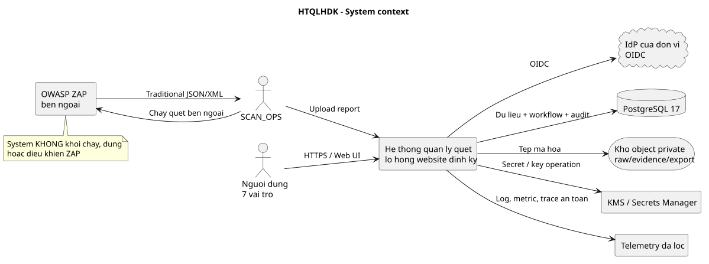
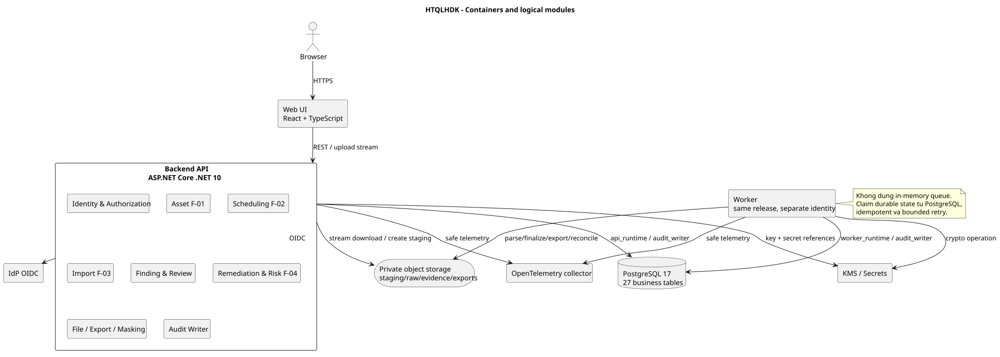
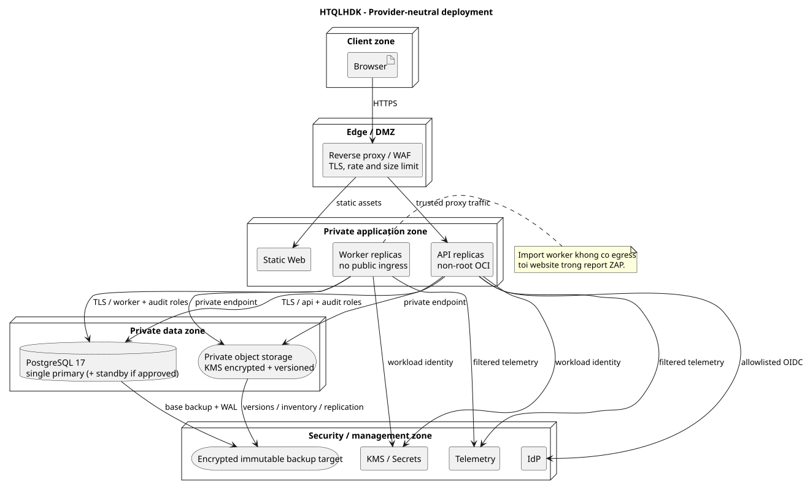

# Kiến trúc logic và triển khai

## 1. Phạm vi và động lực

Kiến trúc phục vụ đúng bốn nghiệp vụ F-01 Khai báo tài sản, F-02 Lịch quét, F-03 Nhập kết quả OWASP ZAP và F-04 Theo dõi khắc phục. OWASP ZAP do `SCAN_OPS` chạy bên ngoài. Hệ thống chỉ quản lý cấu hình đã duyệt, lịch/lần quét, tệp báo cáo được tải lên và workflow sau đó.

Mục tiêu kiến trúc là mặc định từ chối, phân quyền theo vai trò + tài sản + nhiệm vụ, bảo vệ dữ liệu lỗ hổng, giữ lịch sử, chống nhập trùng và vận hành được khi khối lượng upload/parse tăng. Kiến trúc không giả định có giao dịch phân tán giữa PostgreSQL và kho object.

## 2. Ngữ cảnh hệ thống

| Tác nhân/hệ thống | Quan hệ được phép | Không được phép suy diễn |
|---|---|---|
| Bảy vai trò người dùng | Truy cập qua trình duyệt và API sau xác thực/phân quyền | Không kết nối database/object storage trực tiếp |
| IdP của đơn vị | Xác thực OIDC, phát danh tính ổn định và claim tối thiểu | Claim IdP không tự cấp quyền asset; quyền nghiệp vụ đọc từ `user_role` |
| OWASP ZAP bên ngoài | Sinh Traditional JSON/XML để SCAN_OPS tải lên | Backend không gọi ZAP API, không khởi chạy/dừng scan |
| Kho object | Giữ raw report, evidence và report export | Không có object/public URL lâu dài |
| PostgreSQL | Nguồn sự thật nghiệp vụ, quyền, audit và trạng thái công việc | Không cho người dùng nghiệp vụ sửa trực tiếp |
| KMS/Secrets Manager | Giữ/mở khóa và cung cấp secret qua workload identity | Database chỉ giữ key reference, không giữ plaintext key |
| Nền tảng quan sát | Nhận log/metric/trace đã lọc | Không nhận payload lỗ hổng hoặc nội dung tệp |

Nguồn chỉnh sửa: [`diagrams/01_system_context.puml`](diagrams/01_system_context.puml).

## 3. Container và thành phần logic

### 3.1. Web UI

- Hiển thị dữ liệu theo response của API; không tự quyết định quyền.
- Không giữ access token trong `localStorage`; dùng phiên BFF/cookie `HttpOnly`, `Secure`, `SameSite` phù hợp luồng OIDC.
- Encode output mặc định; không render HTML lấy từ ZAP; CSP hạn chế script/connect/frame.
- Upload trực tiếp tới API bằng streaming; UI không nhận credential của object storage.
- Mọi route guard phía UI chỉ phục vụ trải nghiệm, không thay kiểm quyền phía server.

### 3.2. Backend API

Pipeline cố định cho mỗi request: ID tương ứng → xác thực → CSRF khi dùng cookie → rate/size limit → authorization theo action/asset → validation → service/giao dịch → masking → audit → response an toàn.

Các module bên trong cùng một deployable:

| Module | Trách nhiệm chính | Bảng sở hữu logic |
|---|---|---|
| Identity & Authorization | Đồng bộ danh tính tối thiểu, role/asset grant, tách quyền nhạy cảm, SoD | `app_user`, `team`, `team_member`, `user_role` |
| Asset (F-01) | Tài sản, scope revision/rule/window, phê duyệt và vòng đời | `asset`, `asset_scope_revision`, `asset_scope_rule`, `asset_scan_window` |
| Scheduling (F-02) | Lịch, sinh kỳ, trạng thái lần quét do Ops cập nhật | `scan_schedule`, `scan_occurrence` |
| Import (F-03) | Nhận tệp, kiểm loại/cấu trúc/scope, chống trùng, parse | `import_batch`, `import_error` |
| Finding | Fingerprint, occurrence/observation, severity/disposition | `finding`, `finding_occurrence`, `finding_observation`, `finding_review` |
| Remediation (F-04) | Phiếu, sự kiện, xác minh, đóng/mở lại | `remediation_ticket`, `ticket_event`, `verification_request`, `verification_result` |
| Risk (F-04) | Đề nghị/quyết định/gia hạn/hết hiệu lực | `risk_acceptance` |
| File & Export | Raw/evidence/export, masking, tải/thu hồi | `evidence`, `report_export`, `report_export_asset` + kho object |
| Audit | Audit thành công trong TX; denial/failure ở TX độc lập | `audit_log` |
| Notification/Policy | SLA được duyệt và thông báo tối thiểu | `sla_rule`, `notification` |

“Sở hữu logic” không cho phép module bỏ qua FK/guard hoặc đọc chéo tùy ý. Truy cập chéo module qua application service/query được review; không tạo schema hoặc database riêng cho từng module ở release đầu.

### 3.3. Worker

Worker dùng cùng domain/application code nhưng chạy identity và connection role riêng. Các nhóm việc:

- Claim `import_batch` ở trạng thái cần xử lý bằng PostgreSQL advisory lock theo `batch_id`, parse JSON/XML không cho network egress, ghi từng record bằng giao dịch ngắn. Không giữ row transaction trong lúc đọc/parse object; mất session giữ lock phải hủy worker attempt, lần sau tiếp tục idempotent.
- Sinh `scan_occurrence` đến hạn bằng khóa kỳ `(schedule_id, planned_at)` và `FOR UPDATE SKIP LOCKED`/advisory lock.
- Kiểm phiếu/rủi ro sắp đến hạn hoặc hết hạn theo chính sách đã duyệt; tạo `notification` với `dedupe_key`.
- Tạo report export đã che và finalize object sau khi metadata commit.
- Đối soát object tạm/object chưa liên kết và retry idempotent.

Không dùng bộ nhớ tiến trình làm hàng đợi bền vững. Mỗi job có khóa idempotency từ dữ liệu nghiệp vụ, claim/lock ngắn hoặc advisory lock theo work item, giới hạn retry và mã lỗi an toàn. Crash trước commit được chạy lại; crash sau commit không được nhân đôi do unique key/check lại trạng thái. Nếu sau benchmark cần lease bền vững có heartbeat, phải bổ sung cột/bảng qua ADR + migration thay vì giả định schema hiện tại đã có.

### 3.4. PostgreSQL

- PostgreSQL 17, minor hiện hành đã qua regression; timezone máy chủ UTC.
- 27 bảng nghiệp vụ và guard/view hiện có là baseline. Bảng lịch sử migration kỹ thuật, nếu công cụ tạo, không phải thực thể nghiệp vụ thứ 28.
- Database bảo vệ cấu trúc/FK/unique/check/immutable; ứng dụng vẫn phải kiểm authorization, scope URL, SoD và workflow.
- Runtime không là owner, superuser hoặc `BYPASSRLS`. Không cấp DDL cho API/worker.
- Backup, migration và audit sử dụng role riêng, xem mục 6.

### 3.5. Kho object và KMS

Ba prefix/bucket tách policy: `raw/`, `evidence/`, `exports/`; thêm vùng `staging/` không thể tải bởi người dùng. Object key do server sinh, không dùng tên tệp người dùng. Mọi bucket private, chặn anonymous/public ACL, mã hóa bằng khóa được KMS quản lý, versioning bật nếu nền tảng hỗ trợ. Object gốc đã finalize bị từ chối overwrite/delete đối với runtime.

## 4. Luồng chính qua kiến trúc

### 4.1. Lệnh nghiệp vụ thông thường

1. API xác thực phiên và ánh xạ cặp `(issuer, subject)` IdP sang `app_user` đang hoạt động.
2. Policy evaluator kiểm permission code, grant còn hiệu lực, `asset_id`, trạng thái đối tượng và SoD.
3. API mở transaction, khóa theo thứ tự asset → Finding → ticket/risk/request, kiểm lại row version/trạng thái.
4. Domain service thực thi cạnh workflow; repository ghi nghiệp vụ + audit Success trong cùng transaction.
5. Sau commit, tạo notification idempotent khi cần. Response được masking theo người nhận.
6. Nếu transaction rollback, audit Failure/Denied được ghi bằng connection/transaction độc lập; nếu audit không bền vững được thì thao tác nhạy cảm fail closed và phát cảnh báo kỹ thuật không chứa payload.

### 4.2. Upload và nhập báo cáo

Luồng chi tiết nằm ở [thiết kế tệp](04_cau_hinh_secrets_va_quan_ly_tep.md#4-luồng-upload-và-finalize-báo-cáo-gốc). API không giữ cả tệp trong RAM và không parse trong request. Worker đọc object qua service identity chỉ-read với đúng object, không qua public URL và không có egress tới website trong báo cáo.

### 4.3. Tải dữ liệu nhạy cảm

API kiểm quyền hiện hành ở mỗi lượt; với export phải kiểm mọi asset trong `report_export_asset`, người nhận, hạn và thu hồi. Ưu tiên stream qua API. Nếu hạ tầng buộc dùng presigned URL thì URL có TTL ngắn do cấu hình được phê duyệt, chỉ sinh sau audit, ràng buộc đúng object và không thay thế kiểm quyền.

## 5. Kiến trúc triển khai

### 5.1. Vùng mạng

| Vùng | Thành phần | Luồng vào được phép |
|---|---|---|
| Client | Trình duyệt người dùng | HTTPS tới ingress công bố |
| Edge/DMZ | Reverse proxy/WAF, TLS termination, rate/size limit | Internet/mạng nội bộ theo chính sách truy cập |
| Application private | Web static, API replicas, worker | Chỉ edge tới Web/API; cổng quản trị không public |
| Data private | PostgreSQL, private object endpoint | Chỉ workload/service account được cấp |
| Security/management | IdP, KMS/secrets, telemetry, backup target | Chỉ luồng quản trị/workload identity được định nghĩa |

Mặc định chặn egress của worker import. API chỉ egress tới IdP discovery/token endpoint, database, object storage, KMS/secrets và telemetry đã allowlist. Không allowlist mục tiêu website lấy từ tệp ZAP.

### 5.2. Scale và tính sẵn sàng

- Web/API stateless; session/nonce OIDC dùng cơ chế Data Protection key ring chung được mã hóa, không sticky session bắt buộc.
- API scale ngang theo request/latency; worker scale theo queue depth nhưng claim bằng row lock/idempotency.
- PostgreSQL single-primary; standby/failover chỉ bật sau khi đơn vị chốt mức sẵn sàng/RPO/RTO.
- Object storage dùng durability/versioning/replication do nền tảng cung cấp sau khi policy được duyệt.
- Health: liveness không phụ thuộc dịch vụ ngoài; readiness kiểm dependency thiết yếu với timeout ngắn, không log secret.
- Deploy rolling chỉ khi migration tương thích tiến/lùi; thay đổi phá vỡ dùng expand → migrate/backfill → contract.

### 5.3. Không phải HA đã được chứng minh

Sơ đồ nêu topology mục tiêu chứ không chứng minh HA, DR hay dung lượng. Các nội dung này phải qua load test, failover/restore drill và phê duyệt ở [tài liệu môi trường](05_moi_truong_dung_luong_sao_luu.md).

## 6. Tài khoản và đặc quyền tối thiểu

| Identity | Quyền cần | Quyền bị cấm |
|---|---|---|
| `db_migrator` | DDL trong schema ứng dụng, áp migration có checksum | Login runtime, superuser, truy cập từ public network |
| `api_runtime` | SELECT/INSERT/UPDATE đúng bảng và sequence cần cho request; không DELETE/TRUNCATE | DDL, owner, superuser, `BYPASSRLS`, sửa/xóa `audit_log` |
| `worker_runtime` | Bảng job/import/notification/export cần xử lý; object staging/raw/export theo action | Quản trị user/role, DDL, đọc tùy ý báo cáo ngoài job |
| `audit_writer` | INSERT/SELECT tối thiểu cần xác minh FK vào `audit_log` | UPDATE/DELETE/TRUNCATE audit, DDL |
| `backup_operator` | Quyền backup/replication tối thiểu theo công cụ | Quyền ứng dụng, DDL ngoài yêu cầu backup |
| `restore_operator` | Chỉ dùng trong môi trường restore cô lập | Login production thường trực |

API và worker có thể mở connection pool audit riêng nhưng secret/role audit chỉ cho phép INSERT; trigger bất biến vẫn là lớp bảo vệ thứ hai. Quyền cụ thể phải được viết thành migration và có negative test trước production; `REVOKE PUBLIC` hiện tại chỉ là nền, chưa đủ nghiệm thu.

## 7. Công nghệ và vòng đời hỗ trợ

| Lớp | Baseline | Quy tắc nâng cấp |
|---|---|---|
| UI | React 19.2, TypeScript, build SPA tĩnh | Pin exact dependency trong lockfile; security update qua CI/test |
| API/Worker | .NET 10 LTS + ASP.NET Core 10 | Luôn dùng patch 10.0.x còn hỗ trợ; không tự nhảy major |
| Data access | EF Core/Npgsql major 10 | Cùng compatibility matrix; raw SQL cho lock/query quan trọng được test |
| Database | PostgreSQL 17 | Dùng minor mới nhất sau staging regression; kế hoạch nâng major riêng |
| Hợp đồng | OpenAPI 3.1 | API `/api/v1`; thay đổi breaking cần version mới |
| Telemetry | OpenTelemetry | Collector/exporter do môi trường cung cấp |
| Đóng gói | OCI image không đặc quyền | Pin image digest, SBOM và vulnerability scan ở giai đoạn 10/14 |

Tại ngày lập hồ sơ, .NET 10 là LTS còn hỗ trợ đến 2028-11-14; React docs ghi 19.2 là bản chính hiện hành; PostgreSQL 17 được hỗ trợ đến 2029-11-08. Nguồn chính thức: [.NET support policy](https://dotnet.microsoft.com/en-us/platform/support/policy), [React versions](https://react.dev/versions), [PostgreSQL versioning policy](https://www.postgresql.org/support/versioning/).

**Khoảng trống cần phản hồi về giai đoạn 7:** `app_user` hiện chỉ có `username` (được mô tả là chuẩn hóa chữ thường) và `password_hash`, chưa có định danh OIDC `(issuer, subject)`. OIDC `sub` là opaque và không được tự lower-case. Trước khi lập trình, cần một migration/database review bổ sung hai thuộc tính bất biến có unique phù hợp hoặc một bảng ánh xạ danh tính được phê duyệt, đồng thời cập nhật từ điển/ERD/số thuộc tính. Cho tới khi gap này được xử lý, không được coi ánh xạ OIDC production là đã triển khai; `password_hash` phải NULL/không được dùng nếu production chọn OIDC.

## 8. Liên kết thiết kế chi tiết

- Quyền/giao dịch: [`database/04_rang_buoc_va_giao_dich.md`](../database/04_rang_buoc_va_giao_dich.md).
- Sequence: [`sequence_diagrams/README.md`](../sequence_diagrams/README.md).
- Quyết định: [02](02_quyet_dinh_kien_truc.md).
- Threat model: [03](03_mo_hinh_de_doa.md).
- Tệp/secrets/config: [04](04_cau_hinh_secrets_va_quan_ly_tep.md).
- Môi trường/backup: [05](05_moi_truong_dung_luong_sao_luu.md).
