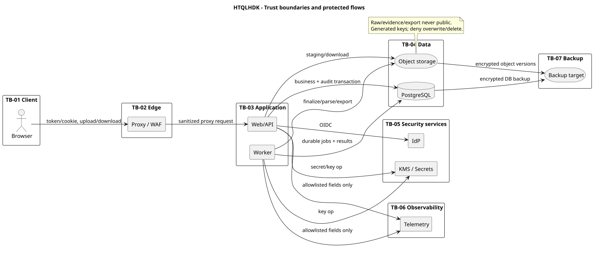

# Mô hình đe dọa sơ bộ

## 1. Phạm vi, phương pháp và giả định

Mô hình dùng STRIDE theo luồng dữ liệu và trust boundary. Đây là threat model kiến trúc sơ bộ; phải cập nhật ở giai đoạn API, UI, code và trước go-live. Mức ưu tiên là định tính:

- **P0**: có thể dẫn đến truy cập/sửa dữ liệu lỗ hổng diện rộng, chiếm quyền phê duyệt hoặc mất audit; phải có kiểm soát trước coding/go-live.
- **P1**: ảnh hưởng một/một nhóm tài sản, tính toàn vẹn workflow hoặc khả dụng đáng kể.
- **P2**: ảnh hưởng hạn chế hoặc đã cần nhiều điều kiện; vẫn phải có test/monitor phù hợp.

Không giả định reverse proxy, KMS, encryption, IdP/MFA, backup hoặc WAF đã tồn tại chỉ vì có trên sơ đồ. Chúng phải có cấu hình và bằng chứng kiểm tra.

## 2. Tài sản bảo vệ

| Mã | Tài sản | Mục tiêu |
|---|---|---|
| A-01 | Raw ZAP, Attack, Evidence, URL/parameter | Bí mật, toàn vẹn, truy vết nguồn |
| A-02 | Finding/Final Severity/workflow/ticket/risk | Toàn vẹn, lịch sử, tách nhiệm vụ |
| A-03 | Role/asset grant và hai quyền nhạy cảm | Bí mật phù hợp, toàn vẹn, thu hồi kịp thời |
| A-04 | Audit log và correlation | Bất biến, đầy đủ, sẵn dùng cho điều tra |
| A-05 | Evidence khắc phục/xác minh | Bí mật, toàn vẹn, gắn đúng Finding |
| A-06 | Export/token tải | Bí mật theo người nhận, có hạn, thu hồi được |
| A-07 | Khóa mã hóa, secret, credential và signing key | Bí mật, luân chuyển, hạn chế blast radius |
| A-08 | Backup database/object/config | Bảo vệ tương đương production, restore được |

## 3. Trust boundary và luồng dữ liệu

| Boundary | Dữ liệu đi qua | Kiểm soát bắt buộc |
|---|---|---|
| TB-01 Browser ↔ Edge | Cookie/token, request/response, upload/download | TLS, CSP/headers, CSRF, rate/size limit, no-cache cho dữ liệu nhạy cảm |
| TB-02 Edge ↔ API | Identity forwarding, request metadata | MTLS hoặc private trusted network, strip header giả, trusted proxy list |
| TB-03 API/Worker ↔ PostgreSQL | Dữ liệu nghiệp vụ/audit | TLS, role riêng, private network, parameterized query, transaction/lock |
| TB-04 API/Worker ↔ Object storage | Tệp thô/evidence/export | Workload identity, private endpoint, KMS, generated key, deny public/overwrite |
| TB-05 Workload ↔ IdP/KMS/Secrets | OIDC metadata/token, key operation, secret | Issuer/audience pinning, workload identity, allowlist egress, audit quản trị |
| TB-06 Workload ↔ Telemetry | Log/metric/trace | Allowlist field, redaction, secure transport, retention/access policy |
| TB-07 Backup plane | Snapshot/base backup/WAL/object versions | Identity riêng, encryption, immutability, isolated restore test |

Nguồn chỉnh sửa: [`diagrams/04_trust_boundaries.puml`](diagrams/04_trust_boundaries.puml).

## 4. Danh mục đe dọa và kiểm soát

| ID | STRIDE | Đe dọa/kịch bản | Ưu tiên | Kiểm soát thiết kế | Bằng chứng cần có |
|---|---|---|---|---|---|
| T-01 | S | Giả mạo token/session hoặc chấp nhận issuer/audience sai | P0 | OIDC code+PKCE; validate issuer/aud/signature/exp/nonce; cookie HttpOnly/Secure; session timeout theo policy | Negative auth tests, IdP config review |
| T-02 | E/I | IDOR: đổi asset/finding/export ID để đọc hoặc sửa ngoài quyền | P0 | Policy theo action + asset + task ở server; query luôn scope; default deny; audit Denied | Test chéo 7 vai trò × 2 asset |
| T-03 | E | Claim ADMIN/SECURITY từ IdP bị coi là quyền nghiệp vụ toàn cục | P0 | IdP chỉ xác thực; `user_role` DB cấp asset/action; `asset_id=NULL` không là wildcard | Unit/integration policy tests |
| T-04 | E | Người nhập tự xác nhận severity, remediator tự đóng, requester tự duyệt risk | P0 | SoD theo actor thực tế + review/verification/risk FK; recheck trong transaction | Concurrent/negative workflow tests |
| T-05 | T | Bỏ qua API để sửa DB/audit trực tiếp bằng runtime role | P0 | Private DB; role least privilege; runtime không owner/DDL/delete audit; immutable triggers | Privilege matrix + SQL negative tests |
| T-06 | T | Sửa/thay raw report sau nhập | P0 | Generated immutable object key, deny overwrite/delete, KMS/versioning, DB metadata immutable, verify checksum khi đọc | Object-policy test, tamper test |
| T-07 | T/R | Business transaction commit nhưng thiếu audit, hoặc failure audit rollback cùng TX | P0 | Success audit cùng TX; denial/failure connection+TX riêng; sensitive action fail closed khi audit unavailable | Fault injection/rollback tests |
| T-08 | I | Token/Attack/Evidence/secret rò qua log, trace, notification hoặc error | P0 | Field allowlist/redaction; generic error; no request/response body logging; notification tối thiểu | Automated log-leak test |
| T-09 | I | Link export còn hạn được chia sẻ cho người không có quyền | P0 | Chỉ hash token; bind recipient; kiểm quyền mọi asset/hạn/thu hồi ở mỗi lượt; stream API | Link-sharing/revocation tests |
| T-10 | I | Object/bucket public hoặc presigned URL quá rộng/quá lâu | P0 | Block public access; private endpoint; stream mặc định; presign TTL/verb/object chặt nếu được duyệt | Cloud policy scan |
| T-11 | T/D | XML có DTD/XXE/entity expansion hoặc parser fetch URL | P0 | DTD/external entity/schema resolution tắt; parser no-egress; depth/node/text limits; safe library | Malicious XML corpus |
| T-12 | T/I | JSON/XML chứa HTML/script tạo stored XSS | P0 | Không render HTML; output encoding; sanitization only if needed; CSP; safe filename/header | Stored-XSS tests |
| T-13 | D | Upload lớn/chậm, nhiều upload hoặc decompression bomb | P1 | Streaming, max bytes/count/time, body rate limit, concurrency quota; chỉ raw JSON/XML, reject archives | Slow-upload/load tests |
| T-14 | T | Dựa extension/MIME do client khai để chấp nhận file giả | P1 | Sniff content + parse root/template; extension chỉ gợi ý; Rejected có audit, không normalize | Polyglot/wrong-type tests |
| T-15 | I | Dùng checksum/dedup như oracle để biết tệp của asset khác | P1 | Dedup lookup sau auth/asset validation; chỉ trả batch hiện có trong cùng asset/scan và đúng quyền | Cross-asset checksum test |
| T-16 | T | Path traversal hoặc overwrite do dùng filename làm object key | P0 | UUID/ULID server-generated key; sanitize display name; không nối path từ input | Filename fuzz tests |
| T-17 | T | Fingerprint collision/normalization làm gộp sai Finding | P1 | HMAC-SHA-256 versioned + canonical tuple; lưu/so sánh identity tuple an toàn; test corpus | Golden normalization tests |
| T-18 | T | Race condition tạo trùng kỳ/lô/finding/occurrence hoặc áp review cũ | P1 | Unique key, stable lock order, row_version/If-Match, idempotency, recheck before commit | Multi-session integration tests |
| T-19 | T | Crash giữa object storage và DB để lại file mồ côi/mất nguồn | P1 | Staging/finalize state machine; immutable metadata; reconciliation; không public staging | Kill-point recovery tests |
| T-20 | D | Import tốn CPU/RAM làm nghẽn API | P1 | Parse ở worker riêng, streaming/event parser, memory/CPU limit, bounded concurrency | Stress/resource isolation test |
| T-21 | D/T | Job chạy hai lần, mất lease hoặc retry gây chuyển trạng thái lặp | P1 | Durable state, row claim, dedupe key, monotonic transition, capped retry/dead state | Duplicate-worker/kill tests |
| T-22 | I | Backup/snapshot chứa raw report hoặc key bị truy cập rộng | P0 | Backup identity riêng, encryption, immutable target, access logging; không backup plaintext key cùng data | Restore/access review |
| T-23 | S/E | Compromise worker/API credential cho phép blast radius rộng | P0 | Workload identity riêng; DB/object policy theo role/prefix; rotation; no static key in image | Credential policy/rotation drill |
| T-24 | I | Cache/browser/proxy lưu response nhạy cảm | P1 | `Cache-Control: no-store`, `Pragma: no-cache` khi cần, no indexing, clear data on logout | Header/browser tests |
| T-25 | R | Actor/time do client gửi làm sai audit | P0 | Actor từ validated principal; time/correlation từ server; trusted time sync | Tampered-field tests |
| T-26 | T | Scope parser sai encoding, host suffix, port, path khiến nhận URL ngoài scope | P0 | Canonical URL parser; exact host boundary; Exclude ưu tiên; IDN/IPv6/encoded path tests | Scope fuzz/golden tests |
| T-27 | I | Error/404 khác nhau làm lộ object có tồn tại | P1 | Authorization trước detail lookup khi có thể; response thống nhất; audit internal ID an toàn | Enumeration tests |
| T-28 | E | Mass assignment sửa `status`, `owner`, `decided_by`, `raw_key_ref` | P0 | Command DTO allowlist; server-set actor/time/status; no entity binding trực tiếp | API overposting tests |
| T-29 | D | Connection pool exhaustion/expensive unbounded query/export | P1 | Pagination/max page; query timeout; export worker; indexes; concurrency limits | Performance tests |
| T-30 | T/I | Dependency/container image bị chèn mã độc | P1 | Lockfile/digest, trusted registry, SBOM, signature/provenance nếu nền tảng có, scan và patch SLA kỹ thuật | CI evidence/image scan |
| T-31 | I | Telemetry backend trở thành kênh đọc dữ liệu lỗ hổng | P1 | Tách quyền telemetry; field allowlist; no payload; retention theo policy | Sample-log review và access test |
| T-32 | D/T | Restore thiếu object/WAL hoặc lệch thời điểm làm dữ liệu không nhất quán | P0 | Restore DB + object theo runbook, manifest/checksum, reconciliation, drill theo RPO/RTO | Biên bản restore test |

## 5. Abuse cases bắt buộc đưa vào test

1. ADMIN không có grant nhạy cảm thử tải raw report.
2. REMEDIATOR thay `asset_id`/`finding_id` sang phiếu không được giao.
3. Người nhập cùng batch tự áp Final Severity; requester tự duyệt risk; remediator tự kết luận Closed.
4. Upload XML có DTD/entity; JSON sâu/quá dài; file HTML đổi đuôi JSON; slow upload; tên file traversal.
5. Hai worker claim cùng schedule/import/risk expiry; hai người áp cùng row version.
6. Kill API/worker tại từng điểm staging → DB insert → finalize → parse → commit.
7. Dùng token export sau thu hồi/hết hạn/mất quyền hoặc bằng tài khoản người khác.
8. Cố đưa secret/Attack/Evidence vào validation error, audit, log, trace và notification.
9. Sửa/xóa raw object/audit bằng từng service identity.
10. Restore sang môi trường cô lập rồi đối soát checksum và quan hệ DB ↔ object.

## 6. Rủi ro còn lại và chủ sở hữu

| Rủi ro còn lại | Xử lý cần phê duyệt | Chủ sở hữu đề xuất |
|---|---|---|
| Compromise toàn bộ API process có thể dùng cả business và audit INSERT credential | Cân nhắc tách audit service/DB role procedure khi threat/risk yêu cầu; hiện tại immutable + least privilege + alert | Tech Lead + ATTT |
| Không có RLS ở baseline | Chấp nhận có điều kiện sau negative test hoặc thêm RLS qua ADR/migration | Tech Lead + ATTT |
| Provider object/KMS/IdP chưa chốt | Chọn dịch vụ và kiểm policy thực tế | Hạ tầng + ATTT |
| RPO/RTO/retention/upload quota chưa có | Cấp policy và chạy capacity/restore test tương ứng | Chủ nhiệm + vận hành |
| Mẫu ZAP thực tế chưa đại diện | Cung cấp corpus đã khử bí mật, fuzz/regression parser | SCAN_OPS + ATTT + QA |

Không đánh dấu rủi ro “đã xử lý” chỉ vì control có trong tài liệu. Chỉ đóng khi có code/config và bằng chứng test liên kết.

