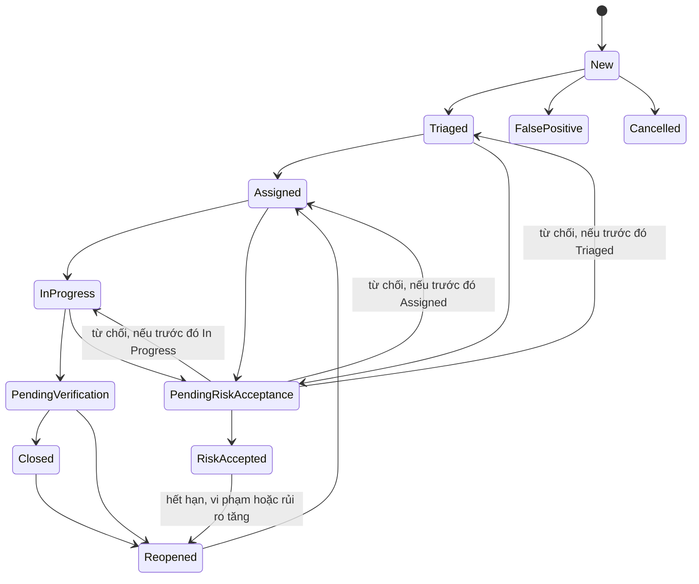

# Thiết kế cơ sở dữ liệu — Hệ thống quản lý quét lỗ hổng website định kỳ

Phiên bản thiết kế 2.0. Nguồn yêu cầu: [doi_tuong_sd_quy_trinh_hd.md](../doi_tuong_sd_quy_trinh_hd.md) phiên bản 2.2. Hệ quản trị dùng trong bộ SQL: PostgreSQL; đã thực chạy bằng PostgreSQL 17.5 nhúng.

## 1. Quy mô được chọn

Chọn **27 bảng** thay cho 43 bảng: **27 bảng, 344 thuộc tính và 91 khóa ngoại**. Giảm bảng bằng cách gộp dữ liệu cùng vòng đời hoặc có thể dùng chung lịch sử. Không bỏ dữ liệu nguồn, điều kiện độc lập khi phê duyệt, lịch sử hoặc quyền trên từng tài sản để đạt một con số định sẵn.

Tài liệu nghiệp vụ liệt kê các khái niệm như RawReport, SeverityAssessment, Assignment. Các khái niệm này vẫn tồn tại trong mô hình; không bắt buộc mỗi khái niệm phải tương ứng một bảng vật lý riêng.

## 2. Danh sách đầy đủ 27 bảng

| Nhóm | Số bảng | Các bảng |
|---|---:|---|
| Người dùng và quyền | 4 | `app_user`, `team`, `team_member`, `user_role` |
| Tài sản và phạm vi | 4 | `asset`, `asset_scope_revision`, `asset_scope_rule`, `asset_scan_window` |
| Lịch và lần quét | 2 | `scan_schedule`, `scan_occurrence` |
| Nhập kết quả ZAP | 2 | `import_batch`, `import_error` |
| Phát hiện và đánh giá | 5 | `finding`, `finding_occurrence`, `finding_observation`, `evidence`, `finding_review` |
| Khắc phục và xác minh | 5 | `sla_rule`, `remediation_ticket`, `ticket_event`, `verification_request`, `verification_result` |
| Chấp nhận rủi ro | 1 | `risk_acceptance` |
| Nhật ký, báo cáo và thông báo | 4 | `audit_log`, `report_export`, `report_export_asset`, `notification` |

### Người dùng, tài sản và lịch quét

`app_user` lưu định danh người dùng. `team` và `team_member` biểu diễn các nhóm vận hành/kỹ thuật và lịch sử thành viên. `user_role` lưu người dùng, một trong bảy vai trò, tài sản được cấp quyền, người/thời điểm cấp và thu hồi. Hai quyền nhạy cảm được cấp riêng bằng cờ mặc định false. Vai trò chưa gắn tài sản chỉ ghi nhận vai trò, không cấp quyền trên mọi tài sản.

`asset` lưu mã, tên, domain/URL, môi trường, chủ sở hữu, nhóm kỹ thuật, người ATTT phụ trách, đơn vị, mức quan trọng và trạng thái. Mã tài sản duy nhất; domain/URL trùng chỉ cảnh báo. `asset_scope_revision` lưu từng phiên bản đề nghị/xác nhận/phê duyệt. Mỗi phiên bản có các quy tắc Include/Exclude trong `asset_scope_rule` và khung giờ được phép trong `asset_scan_window`.

`scan_schedule` lưu chu kỳ, múi giờ, thời hạn hiệu lực, lần đến hạn tiếp theo và nhóm vận hành. `scan_occurrence` lưu từng kỳ cụ thể hoặc lần quét xác minh, mục tiêu chụp tại thời điểm lập, thời gian thực hiện, người thực hiện, trạng thái và lý do thất bại/bỏ lỡ. Hệ thống lưu kế hoạch và kết quả do người vận hành cung cấp; không điều khiển ZAP.

### Nhập ZAP và theo dõi phát hiện

`import_batch` lưu lô nhập và metadata tệp gốc: khóa tệp trong kho riêng, tên, SHA-256, kích thước, loại tệp và tham chiếu khóa mã hóa. Chỉ JSON/XML hợp lệ được chuẩn hóa; giá trị Other hoặc kích thước 0 chỉ giúp ghi nhận tệp sai/rỗng trong lô bị từ chối hoặc lỗi. Các trường nguồn này bất biến, còn trạng thái và bộ đếm xử lý được cập nhật. Byte tệp gốc được lưu ngoài database trong kho riêng có mã hóa. `import_error` giữ vị trí dòng lỗi, mã lỗi và thông báo đã che.

Ba cấp dữ liệu cần giữ riêng:

| Cấp | Một bản ghi đại diện cho | Khóa chống trùng |
|---|---|---|
| `finding` | Một lỗ hổng trên một tài sản trong suốt quá trình theo dõi | `(asset_id, fingerprint)` |
| `finding_occurrence` | Lỗ hổng đó xuất hiện trong một lần quét | `(finding_id, scan_id)` |
| `finding_observation` | Một dòng/instance nguồn trong một tệp nhập | `(batch_id, record_locator)` |

Ví dụ: hai tệp ZAP khác nhau của cùng lần quét cùng ghi nhận một lỗ hổng. Database có một Finding, một Occurrence và hai Observation. Nhập lại nguyên tệp trả lô cũ. Cách này giữ đủ nguồn Risk/Confidence mà không nhân đôi phiếu xử lý.

`finding_review` hợp nhất đánh giá Severity và kết luận False Positive/Cancelled/Recheck bằng `review_kind`. Mỗi loại có CHECK riêng. Con trỏ `finding.current_review_id` chỉ nhận bản Severity đã Applied; không lấy kết luận kết quả sai làm mức độ. `evidence` giữ bằng chứng và tham chiếu tệp nhạy cảm cho phân tích, khắc phục, xác minh hoặc rủi ro.

### Khắc phục, xác minh và rủi ro

`sla_rule` lưu từng dòng thời hạn đã được đơn vị phê duyệt, gồm mã phiên bản chính sách, đơn vị, mức độ, khoảng thời gian và hiệu lực. Không nạp một bộ thời hạn mặc định và không xây dựng lịch làm việc/lịch nghỉ.

`remediation_ticket` là định danh phiếu. `ticket_event` giữ các bản chụp bất biến cho phân công, cập nhật tiến độ hoặc đổi hạn. Mỗi bản chụp có người phụ trách, nhóm, thời hạn, quy tắc SLA, tiến độ, nguyên nhân, biện pháp, bằng chứng và người/thời điểm sửa. `previous_event_id` nối lịch sử; `current_event_id` trên phiếu trỏ bản hiện hành. Ngày/người thực sự khắc phục được giữ nguyên khi chỉ đổi hạn hoặc phân công, để kiểm độc lập khi đóng.

`verification_request` lưu yêu cầu và bản khắc phục cần xác minh. `verification_result` lưu từng kết quả đánh giá báo cáo mới: hợp lệ, bao phủ mục tiêu, còn fingerprint và kết luận Closed/Reopened. Giữ hai bảng vì một yêu cầu có thể chưa có kết quả hoặc cần nhiều lần đánh giá/quét. Không ghi đè kết quả cũ. `finding.verification_result_id` trỏ kết quả được chọn làm căn cứ chuyển trạng thái.

`risk_acceptance` lưu cả đề nghị và quyết định có thời hạn, gồm trạng thái trước khi đề nghị, lý do, ảnh hưởng, giảm thiểu, người chịu trách nhiệm, người đề nghị, người quyết định, căn cứ thẩm quyền, điều kiện và hiệu lực. Các lần bổ sung/rà soát ghi vào audit. Quyết định đã kết luận không được sửa; gia hạn tạo hồ sơ mới qua `renewal_of_id`.

### Nhật ký, báo cáo và thông báo

`audit_log` dùng chung cho lịch sử chuyển trạng thái và các hoạt động bắt buộc ghi nhật ký. Có FK thật tới Finding, bằng chứng, review, kết quả xác minh, hồ sơ rủi ro và lần xuất hiện khi phù hợp. `before_masked`/`after_masked` chỉ chứa ảnh trước/sau đã che của sự kiện; không thay thế các bảng nghiệp vụ cần quan hệ và ràng buộc.

`report_export` lưu một lần phát hành tệp xuất và liên kết tải cho người nhận, gồm nhãn, người/thời điểm xuất, mã truy vết, chính sách che, metadata tệp, hash token, hạn và thông tin thu hồi. Cần phát hành cho người khác thì tạo lần xuất mới có mã truy vết và che theo người đó. `report_export_asset` liệt kê tài sản nằm trong tệp bằng FK để kiểm quyền trên toàn bộ nội dung. `notification` chỉ phục vụ thông báo tối thiểu, không có nội dung Attack/Evidence.

## 3. Quan hệ và lực lượng

| Quan hệ | Lực lượng | Khóa liên kết chính |
|---|---|---|
| Người dùng ↔ Nhóm | N–N qua lịch sử thành viên | `team_member(user_id,team_id)` |
| Người dùng ↔ Tài sản được cấp quyền | N–N theo vai trò | `user_role(user_id,asset_id,role_code)` |
| Tài sản → Phiên bản phạm vi | 1–N | `asset_scope_revision.asset_id` |
| Phiên bản phạm vi → Mục phạm vi/khung giờ | 1–N | `scope_id` |
| Tài sản → Lịch và lần quét | 1–N | `asset_id`; FK ghép kiểm scope/lịch cùng tài sản |
| Lịch → Lần quét | 1–N; lần xác minh có thể không thuộc lịch | `scan_occurrence.schedule_id` có thể NULL |
| Lần quét → Lô nhập | 1–N | `import_batch(scan_id,asset_id)` |
| Lô nhập → Lỗi nhập và dòng nguồn | 1–N | `batch_id` |
| Phát hiện ↔ Lần quét | N–N qua lần xuất hiện | `finding_occurrence(finding_id,scan_id)` |
| Lần xuất hiện → Dòng nguồn | 1–N | `finding_observation.occurrence_id` |
| Phát hiện → Review/bằng chứng/phiếu | 1–N | `finding_id` |
| Phiếu → Sự kiện cập nhật | 1–N, một con trỏ hiện hành | `ticket_event.ticket_id`, `current_event_id` |
| Phiếu/bản khắc phục → Yêu cầu xác minh | 1–N | `ticket_id`, `remediation_event_id` |
| Yêu cầu → Kết quả xác minh | 1–N | `verification_result.request_id` |
| Phát hiện → Hồ sơ rủi ro | 1–N, có chuỗi gia hạn | `finding_id`, `renewal_of_id` |
| Phát hiện → Nhật ký | 1–N | `audit_log.finding_id` |
| Lần xuất báo cáo ↔ Tài sản trong tệp | N–N | `report_export_asset(export_id,asset_id)` |

Các quan hệ chủ sở hữu, người cấp quyền, người đánh giá, người duyệt và người cập nhật đều dùng FK tới `app_user`. Một số FK ghép lặp `asset_id`/`finding_id` có chủ đích để database chặn liên kết chéo tài sản/phát hiện. Xem đầy đủ khóa và cột ở [từ điển](02_tu_dien_du_lieu.md).

## 4. Khóa và nguyên tắc lưu trữ

- PK mặc định là `bigint identity`, không dùng URL hay tên người làm PK. Bảng nối báo cáo dùng PK ghép `(export_id,asset_id)`.
- Mã tài sản/lịch/lần quét/lô/phiếu/phát hiện duy nhất. Lịch có khóa kỳ `(schedule_id,planned_at)` để không sinh trùng cùng kỳ.
- Một lô duy nhất theo `(asset_id,scan_id,file_sha256)`. Một bản ghi nguồn duy nhất theo `(batch_id,record_locator)`.
- Fingerprint tính từ tài sản + alert reference/rule ID + URL chuẩn hóa + parameter/input vector + HTTP method nếu có; không dùng Attack/Evidence. Danh tính đầy đủ chứa bí mật được mã hóa, bản hiển thị được che; việc tạo fingerprint nhất quán do bộ nhập thực hiện.
- Final Severity không sao chép lên phiếu. View lấy từ review hiện hành của Finding. Trạng thái xử lý chính lưu một nơi ở Finding.
- FK dùng RESTRICT, không xóa dây chuyền lịch sử. Các bản nguồn, kết luận và sự kiện lịch sử có trigger bảo vệ.
- Thời gian thực tế dùng `timestamptz`; múi giờ lịch và khung giờ địa phương lưu riêng. Giới hạn hiệu lực kiểm khi xử lý, không dùng CHECK phụ thuộc thời gian hiện tại.

## 5. Workflow được giữ

Tên trong sơ đồ viết liền để dễ hiển thị; các giá trị trong SQL có khoảng trắng đúng theo tài liệu nguồn. Không tự tạo cạnh False Positive → Reopened, Risk Accepted → Pending Risk Acceptance hoặc Reopened → Risk Accepted. Kết quả sai tái xuất hiện được ghi Recheck và chờ ATTT rà soát theo nguồn.

