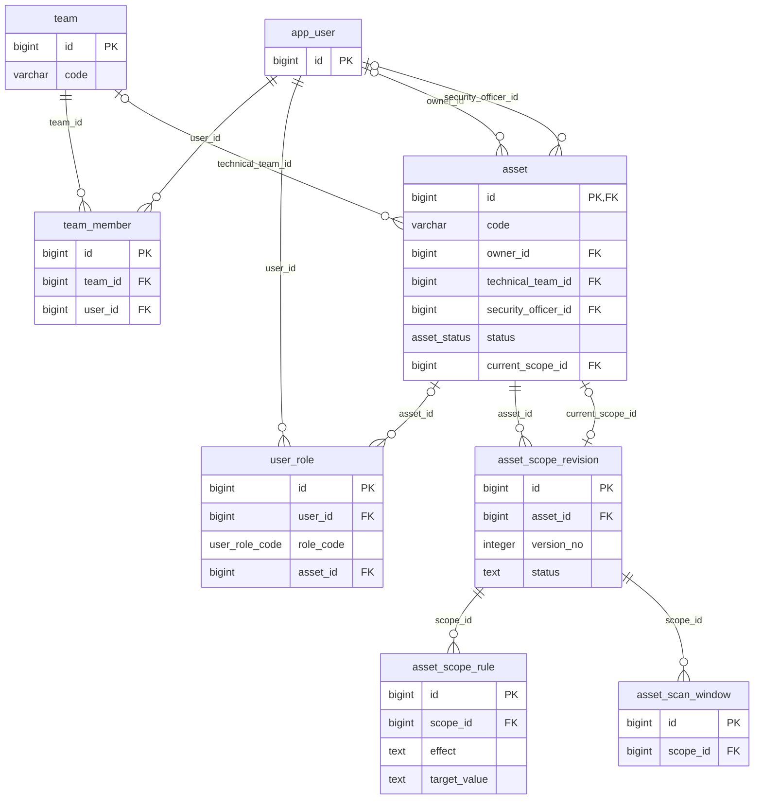
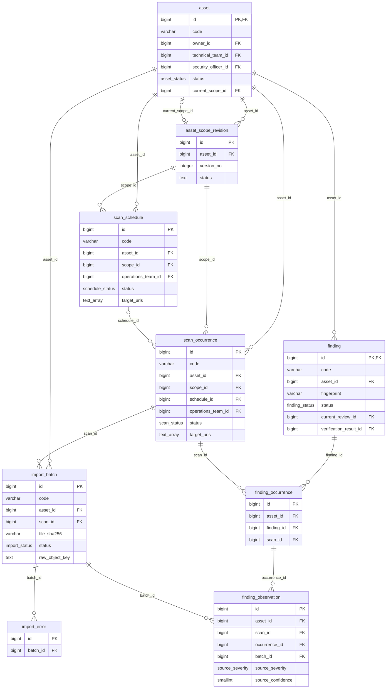
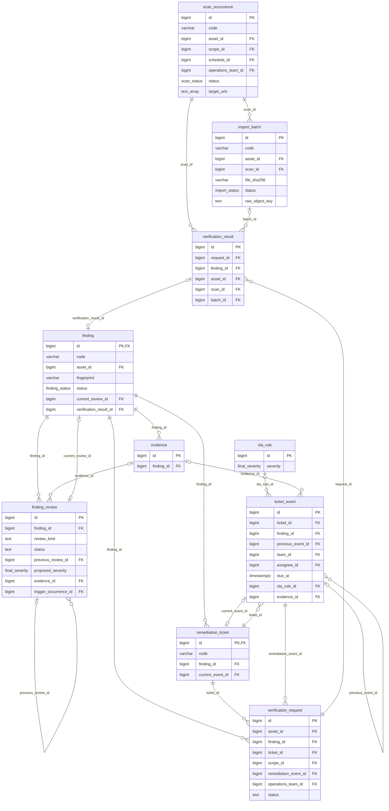
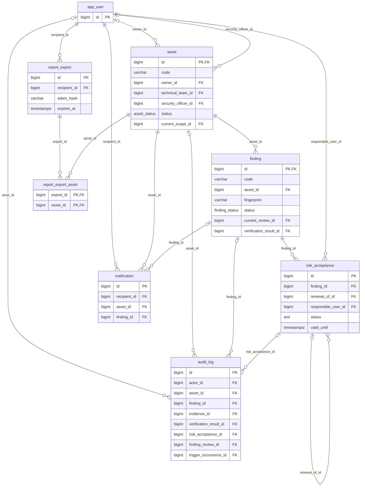

# ERD — mô hình 27 bảng

Các hình chỉ hiển thị thuộc tính chính. PK/FK ghép và ràng buộc đầy đủ xem từ điển/SQL. Bảy vai trò là miền giá trị cố định; ma trận quyền là view, không phải bảng nghiệp vụ bổ sung.

## 01 tai san phan quyen

[SVG](diagrams/01_tai_san_phan_quyen.svg) · [PNG](diagrams/01_tai_san_phan_quyen.png) · [PlantUML](diagrams/01_tai_san_phan_quyen.puml)

## 02 lich quet nhap ket qua

[SVG](diagrams/02_lich_quet_nhap_ket_qua.svg) · [PNG](diagrams/02_lich_quet_nhap_ket_qua.png) · [PlantUML](diagrams/02_lich_quet_nhap_ket_qua.puml)

## 03 phan tich khac phuc

[SVG](diagrams/03_phan_tich_khac_phuc.svg) · [PNG](diagrams/03_phan_tich_khac_phuc.png) · [PlantUML](diagrams/03_phan_tich_khac_phuc.puml)

## 04 rui ro bao mat

[SVG](diagrams/04_rui_ro_bao_mat.svg) · [PNG](diagrams/04_rui_ro_bao_mat.png) · [PlantUML](diagrams/04_rui_ro_bao_mat.puml)
