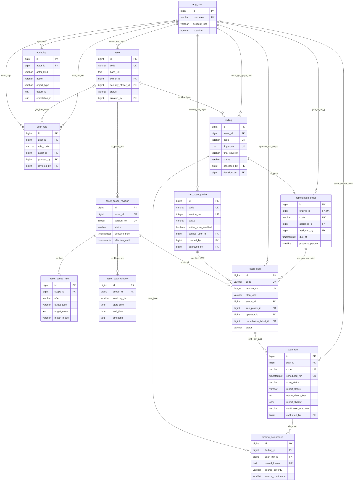
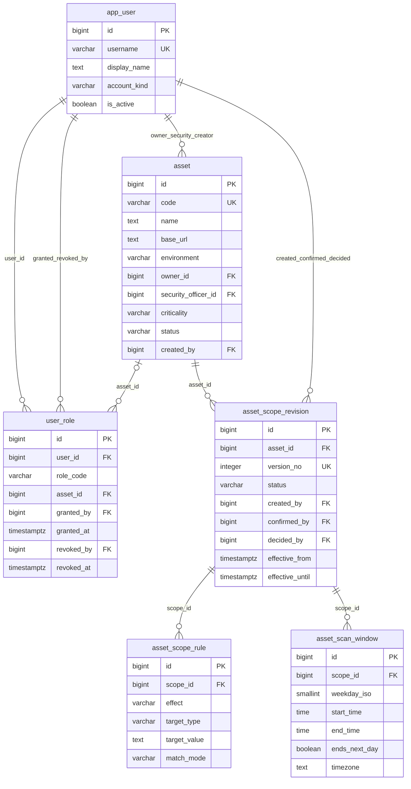
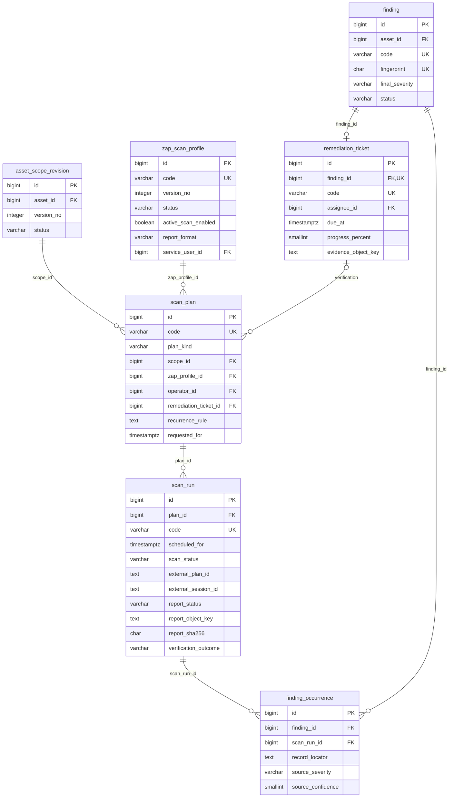

# ERD — MÔ HÌNH BCNF TỐI GIẢN 13 BẢNG

ERD này thay thế sơ đồ 27 bảng trước đây và bám theo [thiết kế BCNF tối giản](08_thiet_ke_3nf_tinh_gon.md). Sơ đồ tổng thể ưu tiên khóa và quan hệ; danh sách đầy đủ mọi thuộc tính nằm trong [tài liệu giải thích chi tiết](09_giai_thich_chi_tiet_13_bang.md).

## 1. ERD tổng thể

## 2. ERD tài sản, phạm vi và quyền

## 3. ERD quét ZAP, kết quả và khắc phục

## 4. Diễn giải bội số

| Quan hệ | Diễn giải |
|---|---|
| Asset 1–N ScopeRevision | Một asset có nhiều phiên bản phạm vi; mỗi revision thuộc đúng một asset |
| ScopeRevision 1–N Rule/Window | Một phiên bản có nhiều luật và nhiều khung giờ |
| ScopeRevision 1–N ScanPlan | Nhiều kế hoạch có thể dùng cùng một phiên bản đã duyệt |
| ZapProfile 1–N ScanPlan | Một profile version có thể được nhiều kế hoạch dùng |
| ScanPlan 1–N ScanRun | Lịch định kỳ sinh nhiều run; Verification bị giới hạn tối đa một run |
| Asset 1–N Finding | Một asset có nhiều phát hiện |
| Finding N–N ScanRun | Thể hiện bằng `finding_occurrence` |
| Finding 1–0..1 Ticket | Mô hình tối giản có tối đa một phiếu hiện hành cho finding |
| Ticket 1–N Verification Plan | Mỗi lần yêu cầu/quét lại tạo plan Verification mới |
| User 1–N Role | Một người có thể có nhiều role/phạm vi asset |

## 5. Tệp nguồn sơ đồ

- [Mermaid](diagrams/05_erd_13_bang.mmd)
- [PlantUML](diagrams/05_erd_13_bang.puml)

Hai tệp nguồn biểu diễn cùng ERD tổng thể. Mermaid trong tài liệu này có thể được render trực tiếp bởi công cụ hỗ trợ Mermaid.
