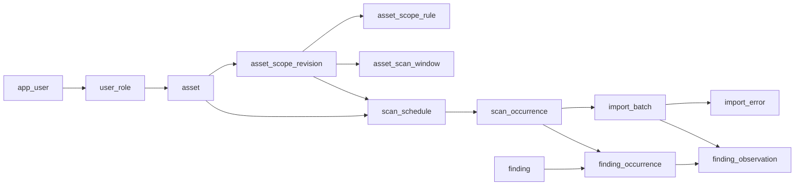
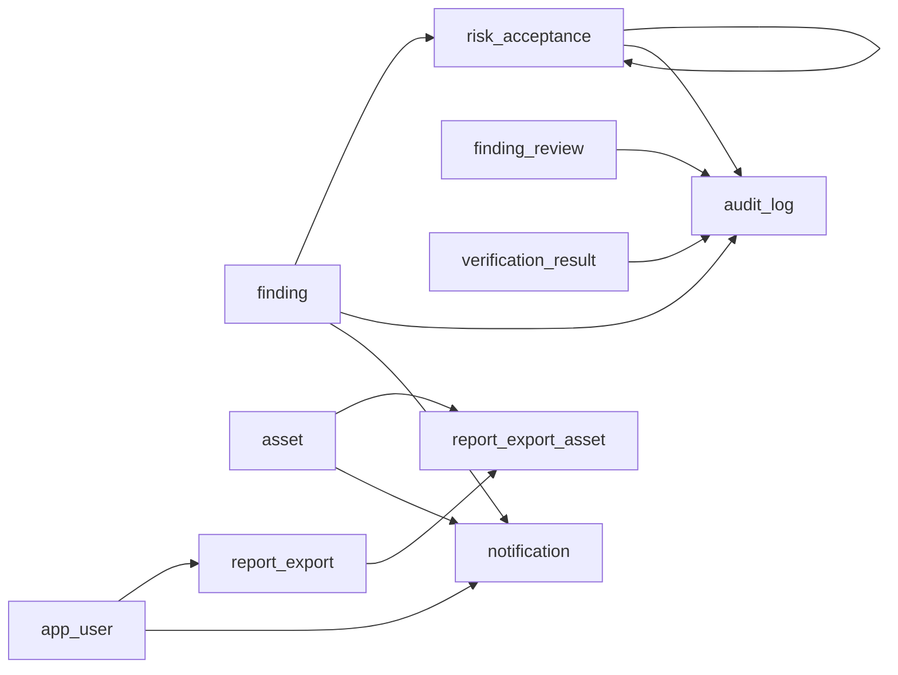

# Giải thích chi tiết vai trò, chức năng, dữ liệu và quan hệ của 27 bảng

## Mục lục nhanh

- **Người dùng, nhóm và phân quyền**
  - [`app_user`](#table-app-user) — Người dùng.
  - [`team`](#table-team) — Nhóm công tác.
  - [`team_member`](#table-team-member) — Thành viên nhóm.
  - [`user_role`](#table-user-role) — Vai trò, phạm vi tài sản và quyền nhạy cảm.
- **Tài sản và phạm vi được phép quét**
  - [`asset`](#table-asset) — Tài sản website.
  - [`asset_scope_revision`](#table-asset-scope-revision) — Phiên bản phạm vi quét.
  - [`asset_scope_rule`](#table-asset-scope-rule) — Mục cho phép hoặc loại trừ.
  - [`asset_scan_window`](#table-asset-scan-window) — Khung giờ quét được phép.
- **Lịch và lần quét bên ngoài**
  - [`scan_schedule`](#table-scan-schedule) — Lịch quét định kỳ.
  - [`scan_occurrence`](#table-scan-occurrence) — Lần quét cụ thể.
- **Nhập báo cáo OWASP ZAP**
  - [`import_batch`](#table-import-batch) — Lô nhập và metadata báo cáo ZAP gốc.
  - [`import_error`](#table-import-error) — Lỗi lô hoặc bản ghi.
- **Phát hiện, nguồn và đánh giá**
  - [`finding`](#table-finding) — Phát hiện chuẩn hóa.
  - [`finding_occurrence`](#table-finding-occurrence) — Lần xuất hiện trong một lần quét.
  - [`finding_observation`](#table-finding-observation) — Chi tiết cảnh báo nguồn theo lô.
  - [`evidence`](#table-evidence) — Bằng chứng của phát hiện.
  - [`finding_review`](#table-finding-review) — Đánh giá mức độ và kết luận phát hiện.
- **Khắc phục và xác minh**
  - [`sla_rule`](#table-sla-rule) — Thời hạn được phê duyệt theo mức độ.
  - [`remediation_ticket`](#table-remediation-ticket) — Phiếu khắc phục.
  - [`ticket_event`](#table-ticket-event) — Lịch sử phân công, tiến độ và thời hạn phiếu.
  - [`verification_request`](#table-verification-request) — Yêu cầu xác minh khắc phục.
  - [`verification_result`](#table-verification-result) — Kết quả đánh giá xác minh.
- **Chấp nhận rủi ro**
  - [`risk_acceptance`](#table-risk-acceptance) — Hồ sơ đề nghị và quyết định chấp nhận rủi ro.
- **Nhật ký, báo cáo xuất và thông báo**
  - [`audit_log`](#table-audit-log) — Nhật ký chung, lịch sử workflow và thay đổi hồ sơ.
  - [`report_export`](#table-report-export) — Tệp xuất và liên kết tải có hạn.
  - [`report_export_asset`](#table-report-export-asset) — Tài sản được đưa vào báo cáo xuất.
  - [`notification`](#table-notification) — Thông báo tối thiểu trong hệ thống.

## 1. Mục đích tài liệu

Tài liệu này giải thích mô hình database của **Hệ thống quản lý quét lỗ hổng website định kỳ** theo góc nhìn nghiệp vụ. Nguồn yêu cầu duy nhất là [`doi_tuong_sd_quy_trinh_hd.md`](../doi_tuong_sd_quy_trinh_hd.md) phiên bản 2.2. Mô hình có 27 bảng, phục vụ bốn chức năng:

- **F-01 — Khai báo tài sản:** website, chủ sở hữu, mức quan trọng và phạm vi được phép quét.
- **F-02 — Lịch quét:** kế hoạch định kỳ và từng lần quét do nhóm vận hành chạy OWASP ZAP bên ngoài hệ thống.
- **F-03 — Nhập kết quả:** nhận JSON/XML ZAP, kiểm tra, chống trùng, chuẩn hóa và lưu nguồn.
- **F-04 — Theo dõi khắc phục:** đánh giá mức độ, phân công, thời hạn, bằng chứng, xác minh, đóng/mở lại và chấp nhận rủi ro.

Phân quyền, audit, thông báo và báo cáo xuất chỉ hỗ trợ trực tiếp bốn chức năng trên. Tài liệu này không bổ sung điều khiển ZAP, đa công cụ quét, CI/CD, ticket ngoài, SSO, email hoặc BI.

### Cách đọc

- **Vai trò của bảng** trả lời vì sao bảng tồn tại.
- **Chức năng hỗ trợ** cho biết bảng tham gia F-01 đến F-04 như thế nào.
- **Chủ thể liên quan** cho biết ai tạo, xác nhận, sử dụng hoặc được ghi nhận; quyền thực tế vẫn phải kiểm ở máy chủ.
- **Nội dung lưu trữ** liệt kê đầy đủ mọi cột trong schema hiện tại. “Đã che” nghĩa là ứng dụng phải masking trước khi ghi/hiển thị; tên cột không tự thực hiện masking.
- **Quan hệ trực tiếp** liệt kê FK đi và FK đến. FK ghép có lặp `asset_id` hoặc `finding_id` nhằm chặn liên kết chéo tài sản/phát hiện.
- **Vòng đời và ràng buộc chính** tóm tắt cách dữ liệu được tạo, cập nhật và giữ lịch sử. Ràng buộc SQL đầy đủ nằm trong [từ điển dữ liệu](02_tu_dien_du_lieu.md) và [bộ SQL](sql/01_schema.sql).

## 2. Bức tranh quan hệ tổng thể

### 2.1. Từ tài sản tới kết quả ZAP

Tài sản là ranh giới gốc. Lịch chỉ dùng phạm vi đã duyệt. Mỗi lần quét tạo nguồn cho một hoặc nhiều lô nhập. Finding là lỗ hổng hợp nhất; Occurrence là lần xuất hiện theo scan; Observation là dòng nguồn theo file/lô.

### 2.2. Từ Finding tới khắc phục và xác minh

```mermaid
flowchart LR
    F[finding] --> E[evidence]
    F --> RV[finding_review]
    F --> T[remediation_ticket]
    T --> TE[ticket_event]
    SLA[sla_rule] --> TE
    E --> RV
    E --> TE
    TE --> VRQ[verification_request]
    VRQ --> VRS[verification_result]
    SO[scan_occurrence] --> VRS
    IB[import_batch] --> VRS
    VRS --> F
```

Review hiện hành xác định Final Severity. Phiếu giữ định danh ổn định, còn mọi phân công/tiến độ/hạn nằm ở chuỗi TicketEvent. Yêu cầu xác minh trỏ đúng bản khắc phục; kết quả xác minh trỏ báo cáo ZAP mới và làm căn cứ đóng/mở lại.

### 2.3. Rủi ro, audit, báo cáo và thông báo

Gia hạn rủi ro tạo hồ sơ mới tự tham chiếu hồ sơ trước. Audit có FK tới căn cứ của chuyển trạng thái. Báo cáo xuất dùng bảng nối tài sản để kiểm quyền trên toàn bộ nội dung; thông báo chỉ chứa thông tin tối thiểu.

### 2.4. Các loại quan hệ cần ghi nhớ

| Quan hệ | Lực lượng | Ý nghĩa |
|---|---|---|
| `app_user` ↔ `team` qua `team_member` | N–N có thời gian | Một người có thể tham gia nhiều nhóm; lịch sử rời nhóm được giữ. |
| `app_user` ↔ `asset` qua `user_role` | N–N theo vai trò | Quyền gắn tài sản cụ thể; dòng không có asset không phải wildcard. |
| `asset` → `asset_scope_revision` | 1–N | Tài sản có nhiều phiên bản phạm vi, một phiên bản Approved được chọn làm hiện hành. |
| `asset_scope_revision` → rule/window | 1–N | Một phiên bản gồm nhiều mục Include/Exclude và khung giờ. |
| `asset` → `scan_schedule` → `scan_occurrence` | 1–N–N | Cấu hình lặp lại tách khỏi từng lần thực hiện thực tế. |
| `scan_occurrence` → `import_batch` | 1–N | Một lần quét có thể có nhiều tệp/lần nhập khác nhau. |
| `finding` ↔ `scan_occurrence` qua `finding_occurrence` | N–N | Một lỗ hổng xuất hiện ở nhiều scan; một scan thấy nhiều lỗ hổng. |
| `finding_occurrence` → `finding_observation` | 1–N | Một occurrence có thể có nhiều dòng nguồn từ nhiều lô của cùng scan. |
| `finding` → review/evidence/ticket/risk/audit | 1–N | Mọi lịch sử nghiệp vụ tập trung quanh Finding nhưng giữ bảng chuyên trách. |
| `remediation_ticket` → `ticket_event` | 1–N + một con trỏ hiện hành | Không ghi đè lịch sử phân công, tiến độ và hạn. |
| `verification_request` → `verification_result` | 1–N | Giữ được nhiều lần đánh giá/quét lại mà không ghi đè kết quả trước. |
| `risk_acceptance` → `risk_acceptance` | 1–N tự tham chiếu | Gia hạn là hồ sơ mới, giữ nguyên quyết định cũ. |
| `report_export` ↔ `asset` qua `report_export_asset` | N–N | Một file có thể chứa nhiều tài sản và phải kiểm quyền trên tất cả. |

## 3. Giải thích chi tiết từng bảng

## 3.1. Người dùng, nhóm và phân quyền

### 1. `app_user` — Người dùng
**Vai trò của bảng:** Làm danh mục định danh người dùng được tham chiếu xuyên suốt hệ thống. Bảng cho biết một hành động, quyền, lần quét, đánh giá hoặc quyết định gắn với ai.
**Chức năng hỗ trợ:** Hỗ trợ cả F-01 đến F-04 và các kiểm soát truy cập, audit, xuất báo cáo.
**Chủ thể liên quan:** Tất cả bảy vai trò nghiệp vụ; quản trị viên quản lý trạng thái tài khoản theo cơ chế của ứng dụng.
#### Nội dung lưu trữ
| Cột | Vai trò kỹ thuật | Nội dung được lưu |
|---|---|---|
| `id` | PK, bắt buộc | Định danh nội bộ, không đổi. |
| `username` | UNIQUE, bắt buộc | Tên đăng nhập chuẩn hóa chữ thường tại ứng dụng. |
| `display_name` | bắt buộc | Họ tên hiển thị. |
| `password_hash` | tùy chọn | Chuỗi băm mật khẩu có salt khi dùng đăng nhập nội bộ; không lưu mật khẩu thô. |
| `is_active` | bắt buộc | Tài khoản được phép đăng nhập. |
| `created_at` | bắt buộc | Thời điểm tạo. |
| `unit_name` | tùy chọn | Tên đơn vị công tác; dữ liệu mô tả, không cấp quyền theo đơn vị. |

#### Khóa và quan hệ trực tiếp
- **Khóa chính:** `id`.
- **Khóa duy nhất được khai báo trong bảng:** `(username)`. Các unique index có điều kiện xem trong SQL.
- **Bảng này tham chiếu:** không có FK đi; đây là danh mục gốc được các bảng khác dùng.
- **Bảng tham chiếu đến bảng này:**
  - `team_member(user_id)` → `(id)`.
  - `user_role(user_id)` → `(id)`.
  - `user_role(granted_by)` → `(id)`.
  - `user_role(revoked_by)` → `(id)`.
  - `asset(owner_id)` → `(id)`.
  - `asset(security_officer_id)` → `(id)`.
  - `asset(created_by)` → `(id)`.
  - `asset_scope_revision(created_by)` → `(id)`.
  - `asset_scope_revision(confirmed_by)` → `(id)`.
  - `asset_scope_revision(decided_by)` → `(id)`.
  - `scan_schedule(created_by)` → `(id)`.
  - `scan_schedule(time_confirmed_by)` → `(id)`.
  - `scan_schedule(approved_by)` → `(id)`.
  - `scan_occurrence(performed_by)` → `(id)`.
  - `import_batch(imported_by)` → `(id)`.
  - `evidence(created_by)` → `(id)`.
  - `finding_review(assessed_by)` → `(id)`.
  - `finding_review(reviewed_by)` → `(id)`.
  - `finding_review(impact_confirmed_by)` → `(id)`.
  - `sla_rule(approved_by)` → `(id)`.
  - `remediation_ticket(created_by)` → `(id)`.
  - `ticket_event(assignee_id)` → `(id)`.
  - `ticket_event(remediated_by)` → `(id)`.
  - `ticket_event(changed_by)` → `(id)`.
  - `verification_request(requested_by)` → `(id)`.
  - `verification_result(evaluated_by)` → `(id)`.
  - `risk_acceptance(requested_by)` → `(id)`.
  - `risk_acceptance(responsible_user_id)` → `(id)`.
  - `risk_acceptance(decided_by)` → `(id)`.
  - `audit_log(actor_id)` → `(id)`.
  - `report_export(exported_by)` → `(id)`.
  - `report_export(recipient_id)` → `(id)`.
  - `report_export(revoked_by)` → `(id)`.
  - `notification(recipient_id)` → `(id)`.

**Ý nghĩa các quan hệ:** Một người có thể thuộc nhiều nhóm qua `team_member`, có nhiều dòng cấp quyền qua `user_role`, đồng thời xuất hiện ở các cột người tạo, người xác nhận, người phê duyệt, người thực hiện và người nhận báo cáo. Các quan hệ này giữ trách nhiệm cá nhân ngay cả khi người dùng về sau bị khóa.

**Vòng đời và ràng buộc chính:** Không xóa người dùng đã được dữ liệu lịch sử tham chiếu. `is_active=false` ngăn sử dụng tài khoản ở tầng ứng dụng nhưng không làm mất lịch sử.

**Giới hạn phạm vi:** Không phải phân hệ nhân sự, cơ cấu tổ chức hay SSO. `unit_name` chỉ là mô tả; `password_hash` chỉ dùng khi triển khai đăng nhập nội bộ.

### 2. `team` — Nhóm công tác
**Vai trò của bảng:** Đại diện một nhóm công tác tham gia vận hành quét hoặc khắc phục kỹ thuật.
**Chức năng hỗ trợ:** F-01 gắn nhóm kỹ thuật với tài sản; F-02 gắn nhóm vận hành với lịch/lần quét; F-04 gắn nhóm với phiếu và yêu cầu xác minh.
**Chủ thể liên quan:** Nhóm vận hành quét, nhóm khắc phục kỹ thuật và các nhóm công tác được đơn vị sử dụng.
#### Nội dung lưu trữ
| Cột | Vai trò kỹ thuật | Nội dung được lưu |
|---|---|---|
| `id` | PK, bắt buộc | Định danh nội bộ, không đổi. |
| `code` | UNIQUE, bắt buộc | Mã nhóm. |
| `name` | bắt buộc | Tên nhóm vận hành, kỹ thuật hoặc ATTT. |
| `is_active` | bắt buộc | Trạng thái sử dụng. |
| `unit_name` | tùy chọn | Đơn vị quản lý nhóm; không xây dựng phân hệ tổ chức. |

#### Khóa và quan hệ trực tiếp
- **Khóa chính:** `id`.
- **Khóa duy nhất được khai báo trong bảng:** `(code)`. Các unique index có điều kiện xem trong SQL.
- **Bảng này tham chiếu:** không có FK đi; đây là danh mục gốc được các bảng khác dùng.
- **Bảng tham chiếu đến bảng này:**
  - `team_member(team_id)` → `(id)`.
  - `asset(technical_team_id)` → `(id)`.
  - `scan_schedule(operations_team_id)` → `(id)`.
  - `scan_occurrence(operations_team_id)` → `(id)`.
  - `ticket_event(team_id)` → `(id)`.
  - `verification_request(operations_team_id)` → `(id)`.

**Ý nghĩa các quan hệ:** Thành viên của nhóm nằm ở `team_member`. `asset` tham chiếu nhóm kỹ thuật; `scan_schedule`, `scan_occurrence` và `verification_request` tham chiếu nhóm vận hành; `ticket_event` chụp nhóm chịu trách nhiệm ở từng thời điểm.

**Vòng đời và ràng buộc chính:** Dùng `is_active=false` khi ngừng sử dụng nhóm; các bản ghi lịch sử vẫn giữ FK tới nhóm cũ.

**Giới hạn phạm vi:** Không quản lý phòng ban hoặc sơ đồ tổ chức. `unit_name` là dữ liệu mô tả.

### 3. `team_member` — Thành viên nhóm
**Vai trò của bảng:** Bảng nối có thời gian giữa người dùng và nhóm, cho biết ai thuộc nhóm nào trong giai đoạn nào.
**Chức năng hỗ trợ:** Hỗ trợ phân công, xác định nhóm vận hành và nhóm khắc phục trong F-02/F-04.
**Chủ thể liên quan:** Người vận hành, người khắc phục và các thành viên nhóm liên quan.
#### Nội dung lưu trữ
| Cột | Vai trò kỹ thuật | Nội dung được lưu |
|---|---|---|
| `id` | PK, bắt buộc | Định danh nội bộ, không đổi. |
| `team_id` | FK, bắt buộc | Nhóm. |
| `user_id` | FK, bắt buộc | Thành viên. |
| `joined_at` | bắt buộc | Bắt đầu tham gia. |
| `left_at` | tùy chọn | Kết thúc; NULL là còn tham gia. |

#### Khóa và quan hệ trực tiếp
- **Khóa chính:** `id`.
- **Khóa duy nhất bổ sung:** không có trong khai báo bảng; tính duy nhất nghiệp vụ nếu có được nêu ở phần vòng đời hoặc unique index SQL.
- **Bảng này tham chiếu:**
  - `(team_id)` → `team(id)` — quan hệ bắt buộc ở cấp dòng.
  - `(user_id)` → `app_user(id)` — quan hệ bắt buộc ở cấp dòng.
- **Bảng tham chiếu đến bảng này:** không có FK đến trong mô hình hiện tại.

**Ý nghĩa các quan hệ:** Mỗi dòng nối đúng một `app_user` với một `team`. Một người có thể thuộc nhiều nhóm và một nhóm có nhiều người, nên đây là quan hệ N–N được tách thành bảng riêng.

**Vòng đời và ràng buộc chính:** `left_at=NULL` nghĩa là còn hiệu lực. Khi rời nhóm, điền `left_at` thay vì xóa; chỉ có một quan hệ thành viên đang hiệu lực cho cùng người/nhóm.

**Giới hạn phạm vi:** Không tự cấp quyền trên tài sản. Thành viên nhóm và quyền truy cập là hai khái niệm khác nhau.

### 4. `user_role` — Vai trò, phạm vi tài sản và quyền nhạy cảm
**Vai trò của bảng:** Lưu vai trò của người dùng, phạm vi tài sản được cấp và hai quyền nhạy cảm phải cấp riêng.
**Chức năng hỗ trợ:** Hỗ trợ phân quyền cho cả bốn chức năng và bảo mật báo cáo theo mục 8.2.
**Chủ thể liên quan:** ADMIN cấp/thu hồi; người nhận có thể mang vai trò SECURITY, OWNER, SCAN_OPS, REMEDIATOR, RISK_APPROVER hoặc AUDITOR.
#### Nội dung lưu trữ
| Cột | Vai trò kỹ thuật | Nội dung được lưu |
|---|---|---|
| `id` | PK, bắt buộc | Định danh nội bộ, không đổi. |
| `user_id` | FK, bắt buộc | Người được cấp. |
| `role_code` | bắt buộc | Vai trò được cấp. |
| `asset_id` | FK, tùy chọn | Tài sản được cấp quyền; NULL chỉ ghi nhận vai trò, không cấp quyền đọc/ghi trên mọi tài sản. ADMIN dùng vai trò để quản lý quyền. |
| `granted_by` | FK, bắt buộc | Người cấp. |
| `granted_at` | bắt buộc | Thời điểm cấp. |
| `revoked_by` | FK, tùy chọn | Người thu hồi. |
| `revoked_at` | tùy chọn | Thời điểm thu hồi; không xóa hàng cấp quyền. |
| `can_read_raw_report` | bắt buộc | Quyền riêng đọc bản gốc, chỉ hiệu lực trên asset_id được cấp; mặc định false. |
| `can_read_sensitive_evidence` | bắt buộc | Quyền riêng đọc bằng chứng nhạy cảm; mặc định false. |
| `sensitive_reason` | tùy chọn | Lý do cấp hai quyền nhạy cảm; thay đổi/thu hồi phải có audit. |

#### Khóa và quan hệ trực tiếp
- **Khóa chính:** `id`.
- **Khóa duy nhất bổ sung:** không có trong khai báo bảng; tính duy nhất nghiệp vụ nếu có được nêu ở phần vòng đời hoặc unique index SQL.
- **Bảng này tham chiếu:**
  - `(user_id)` → `app_user(id)` — quan hệ bắt buộc ở cấp dòng.
  - `(asset_id)` → `asset(id)` — quan hệ tùy chọn ở cấp dòng.
  - `(granted_by)` → `app_user(id)` — quan hệ bắt buộc ở cấp dòng.
  - `(revoked_by)` → `app_user(id)` — quan hệ tùy chọn ở cấp dòng.
- **Bảng tham chiếu đến bảng này:** không có FK đến trong mô hình hiện tại.

**Ý nghĩa các quan hệ:** `user_id` là người nhận quyền; `asset_id` là tài sản được phép truy cập; `granted_by` và `revoked_by` giữ người quản trị thao tác. Dòng không có `asset_id` chỉ ghi nhận vai trò và không trở thành quyền wildcard trên mọi tài sản.

**Vòng đời và ràng buộc chính:** Cấp mới tạo dòng có `granted_at`. Thu hồi điền đồng thời người/thời điểm thu hồi, không xóa. Quyền đọc bản gốc/bằng chứng mặc định false và chỉ hợp lệ khi có tài sản cụ thể cùng lý do.

**Giới hạn phạm vi:** Không thay kiểm tra quyền phía máy chủ. ADMIN không mặc nhiên được đọc nội dung lỗ hổng.

## 3.2. Tài sản và phạm vi được phép quét

### 5. `asset` — Tài sản website
**Vai trò của bảng:** Là thực thể gốc của một website/ứng dụng web được quản lý và là ranh giới phân quyền, phạm vi quét, kết quả và báo cáo.
**Chức năng hỗ trợ:** Trung tâm của F-01 và được mọi luồng F-02, F-03, F-04 tham chiếu.
**Chủ thể liên quan:** Chủ sở hữu, chuyên viên ATTT, nhóm kỹ thuật, nhóm vận hành và người khai báo.
#### Nội dung lưu trữ
| Cột | Vai trò kỹ thuật | Nội dung được lưu |
|---|---|---|
| `id` | PK, FK, bắt buộc | Định danh nội bộ, không đổi. |
| `code` | UNIQUE, bắt buộc | Mã tài sản duy nhất. |
| `name` | bắt buộc | Tên website/ứng dụng. |
| `domain` | bắt buộc | Tên miền chuẩn hóa; chỉ cảnh báo trùng, không UNIQUE. |
| `base_url` | bắt buộc | URL gốc; không lưu token hoặc mật khẩu. |
| `environment` | bắt buộc | Môi trường theo danh mục đơn vị, ví dụ production/test. |
| `owner_id` | FK, tùy chọn | Chủ sở hữu chính, bắt buộc trước kích hoạt. |
| `technical_team_id` | FK, tùy chọn | Nhóm kỹ thuật chịu trách nhiệm. |
| `security_officer_id` | FK, tùy chọn | Chuyên viên ATTT phụ trách. |
| `criticality` | tùy chọn | Mức quan trọng nghiệp vụ theo danh mục đơn vị; khác Final Severity. |
| `data_classification` | tùy chọn | Loại và độ nhạy cảm dữ liệu xử lý. |
| `internet_exposed` | tùy chọn | Có công khai Internet; NULL khi chưa xác định. |
| `status` | bắt buộc | Vòng đời tài sản. |
| `current_scope_id` | FK, tùy chọn | Phiên bản phạm vi đã duyệt đang áp dụng. |
| `created_by` | FK, bắt buộc | Người khai báo. |
| `created_at` | bắt buộc | Thời điểm tạo. |
| `updated_at` | bắt buộc | Lần cập nhật gần nhất, trigger tự cập nhật. |
| `unit_name` | tùy chọn | Đơn vị sở hữu website theo mục 5.1.1; lưu tên, không dùng làm phạm vi quyền. |

#### Khóa và quan hệ trực tiếp
- **Khóa chính:** `id`.
- **Khóa duy nhất được khai báo trong bảng:** `(code)`. Các unique index có điều kiện xem trong SQL.
- **Bảng này tham chiếu:**
  - `(owner_id)` → `app_user(id)` — quan hệ tùy chọn ở cấp dòng.
  - `(technical_team_id)` → `team(id)` — quan hệ tùy chọn ở cấp dòng.
  - `(security_officer_id)` → `app_user(id)` — quan hệ tùy chọn ở cấp dòng.
  - `(created_by)` → `app_user(id)` — quan hệ bắt buộc ở cấp dòng.
  - `(current_scope_id, id)` → `asset_scope_revision(id, asset_id)` — quan hệ tùy chọn ở cấp dòng.
- **Bảng tham chiếu đến bảng này:**
  - `user_role(asset_id)` → `(id)`.
  - `asset_scope_revision(asset_id)` → `(id)`.
  - `scan_schedule(asset_id)` → `(id)`.
  - `scan_occurrence(asset_id)` → `(id)`.
  - `import_batch(asset_id)` → `(id)`.
  - `finding(asset_id)` → `(id)`.
  - `audit_log(asset_id)` → `(id)`.
  - `report_export_asset(asset_id)` → `(id)`.
  - `notification(asset_id)` → `(id)`.

**Ý nghĩa các quan hệ:** `owner_id`, `security_officer_id`, `created_by` nối tới người dùng; `technical_team_id` nối tới nhóm. Tài sản có nhiều phiên bản phạm vi, lịch, lần quét, Finding và quyền. `current_scope_id` trỏ ngược đúng phiên bản phạm vi đã duyệt đang áp dụng cho chính tài sản.

**Vòng đời và ràng buộc chính:** Bắt đầu Draft. Chỉ Active khi có chủ sở hữu, mức quan trọng và phạm vi đã duyệt. Suspended/Retired giữ nguyên dữ liệu lịch sử. Mã tài sản duy nhất; domain/URL trùng chỉ được cảnh báo.

**Giới hạn phạm vi:** Không thay hệ thống quản lý tài sản doanh nghiệp. Không lưu token, mật khẩu hoặc bí mật trong `base_url`.

### 6. `asset_scope_revision` — Phiên bản phạm vi quét
**Vai trò của bảng:** Lưu từng phiên bản phạm vi quét để mọi thay đổi đều qua xác nhận/phê duyệt và không làm mất phạm vi cũ.
**Chức năng hỗ trợ:** F-01 khai báo/phê duyệt phạm vi; F-02 giới hạn lịch; F-03 kiểm URL kết quả; F-04 chọn phạm vi xác minh.
**Chủ thể liên quan:** Người đề nghị, chủ sở hữu xác nhận và chuyên viên ATTT quyết định.
#### Nội dung lưu trữ
| Cột | Vai trò kỹ thuật | Nội dung được lưu |
|---|---|---|
| `id` | PK, bắt buộc | Định danh nội bộ, không đổi. |
| `asset_id` | FK, bắt buộc | Tài sản của phạm vi. |
| `version_no` | bắt buộc | Số phiên bản trong tài sản. |
| `status` | bắt buộc | Draft/Pending Approval/Approved/Rejected; trạng thái hồ sơ phạm vi, không phải Asset. |
| `change_reason` | bắt buộc | Lý do khai báo hoặc thay đổi. |
| `created_by` | FK, bắt buộc | Người đề nghị. |
| `created_at` | bắt buộc | Thời điểm tạo. |
| `confirmed_by` | FK, tùy chọn | Chủ sở hữu xác nhận phạm vi và dữ liệu tài sản. |
| `confirmed_at` | tùy chọn | Thời điểm xác nhận. |
| `decided_by` | FK, tùy chọn | ATTT phê duyệt/từ chối. |
| `decided_at` | tùy chọn | Thời điểm quyết định. |
| `decision_reason` | tùy chọn | Lý do phê duyệt/từ chối. |

#### Khóa và quan hệ trực tiếp
- **Khóa chính:** `id`.
- **Khóa duy nhất được khai báo trong bảng:** `(asset_id, version_no)`, `(id, asset_id)`. Các unique index có điều kiện xem trong SQL.
- **Bảng này tham chiếu:**
  - `(asset_id)` → `asset(id)` — quan hệ bắt buộc ở cấp dòng.
  - `(created_by)` → `app_user(id)` — quan hệ bắt buộc ở cấp dòng.
  - `(confirmed_by)` → `app_user(id)` — quan hệ tùy chọn ở cấp dòng.
  - `(decided_by)` → `app_user(id)` — quan hệ tùy chọn ở cấp dòng.
- **Bảng tham chiếu đến bảng này:**
  - `asset(current_scope_id, id)` → `(id, asset_id)`.
  - `asset_scope_rule(scope_id)` → `(id)`.
  - `asset_scan_window(scope_id)` → `(id)`.
  - `scan_schedule(scope_id, asset_id)` → `(id, asset_id)`.
  - `scan_occurrence(scope_id, asset_id)` → `(id, asset_id)`.
  - `verification_request(scope_id, asset_id)` → `(id, asset_id)`.

**Ý nghĩa các quan hệ:** Mỗi phiên bản thuộc một `asset`, có nhiều `asset_scope_rule` và `asset_scan_window`. `asset.current_scope_id` chọn phiên bản hiện hành; lịch, lần quét và yêu cầu xác minh giữ FK tới phiên bản đã dùng.

**Vòng đời và ràng buộc chính:** Luồng Draft → Pending Approval → Approved/Rejected. Phiên bản đã có quyết định bất biến; thay đổi tạo `version_no` mới. Một phiên bản gửi duyệt phải có ít nhất một Include và một khung giờ.

**Giới hạn phạm vi:** Không tự thực hiện quét; chỉ mô tả ranh giới được phép.

### 7. `asset_scope_rule` — Mục cho phép hoặc loại trừ
**Vai trò của bảng:** Lưu từng mục Include hoặc Exclude tạo nên phạm vi kỹ thuật của một phiên bản.
**Chức năng hỗ trợ:** F-01 xác định domain/subdomain/URL được phép; F-03 dùng để từ chối dòng ngoài phạm vi.
**Chủ thể liên quan:** Chủ sở hữu cung cấp/xác nhận; chuyên viên ATTT rà soát và phê duyệt.
#### Nội dung lưu trữ
| Cột | Vai trò kỹ thuật | Nội dung được lưu |
|---|---|---|
| `id` | PK, bắt buộc | Định danh nội bộ, không đổi. |
| `scope_id` | FK, bắt buộc | Phiên bản phạm vi. |
| `effect` | bắt buộc | Include hoặc Exclude; Exclude ưu tiên. |
| `target_type` | bắt buộc | Domain, Subdomain hoặc URL. |
| `target_value` | bắt buộc | Giá trị chuẩn hóa không chứa bí mật; ứng dụng kiểm tra cú pháp và ranh giới host/path. |
| `match_mode` | bắt buộc | Exact hoặc Prefix; Prefix chỉ dùng cho đường dẫn URL. |

#### Khóa và quan hệ trực tiếp
- **Khóa chính:** `id`.
- **Khóa duy nhất được khai báo trong bảng:** `(id, scope_id)`, `(scope_id, effect, target_type, target_value, match_mode)`. Các unique index có điều kiện xem trong SQL.
- **Bảng này tham chiếu:**
  - `(scope_id)` → `asset_scope_revision(id)` — quan hệ bắt buộc ở cấp dòng.
- **Bảng tham chiếu đến bảng này:** không có FK đến trong mô hình hiện tại.

**Ý nghĩa các quan hệ:** Nhiều rule thuộc một `asset_scope_revision`. Quan hệ riêng giúp một phiên bản có nhiều miền/URL, giữ Exclude độc lập và kiểm trùng trong cùng phiên bản.

**Vòng đời và ràng buộc chính:** Chỉ sửa khi phiên bản phạm vi còn ở giai đoạn cho phép. Khi phiên bản đã Approved/Rejected, rule được giữ bất biến.

**Giới hạn phạm vi:** Không chứa credential, token hoặc payload ZAP. `Prefix` chỉ dùng cho URL; ứng dụng vẫn phải kiểm ranh giới host/path chính xác.

### 8. `asset_scan_window` — Khung giờ quét được phép
**Vai trò của bảng:** Lưu các khung ngày/giờ địa phương mà tài sản cho phép tiến hành quét.
**Chức năng hỗ trợ:** F-01 ghi điều kiện cho phép; F-02 kiểm lịch và lần quét có nằm trong khung giờ.
**Chủ thể liên quan:** Chủ sở hữu xác nhận thời gian; ATTT và vận hành sử dụng khi lập lịch.
#### Nội dung lưu trữ
| Cột | Vai trò kỹ thuật | Nội dung được lưu |
|---|---|---|
| `id` | PK, bắt buộc | Định danh nội bộ, không đổi. |
| `scope_id` | FK, bắt buộc | Khung giờ thuộc phiên bản đã được phê duyệt. |
| `weekday_iso` | bắt buộc | Thứ ISO: 1 thứ Hai, 7 Chủ nhật. |
| `start_time` | bắt buộc | Giờ bắt đầu địa phương. |
| `end_time` | bắt buộc | Giờ kết thúc địa phương. |
| `ends_next_day` | bắt buộc | Khung qua nửa đêm; true và giờ bằng nhau biểu diễn 24 giờ. |
| `timezone` | bắt buộc | Tên múi giờ IANA, ví dụ Asia/Bangkok. |

#### Khóa và quan hệ trực tiếp
- **Khóa chính:** `id`.
- **Khóa duy nhất được khai báo trong bảng:** `(scope_id, weekday_iso, start_time, end_time, ends_next_day, timezone)`. Các unique index có điều kiện xem trong SQL.
- **Bảng này tham chiếu:**
  - `(scope_id)` → `asset_scope_revision(id)` — quan hệ bắt buộc ở cấp dòng.
- **Bảng tham chiếu đến bảng này:** không có FK đến trong mô hình hiện tại.

**Ý nghĩa các quan hệ:** Nhiều khung giờ thuộc một `asset_scope_revision`, nhờ đó thay đổi khung giờ cũng được phiên bản hóa cùng phạm vi.

**Vòng đời và ràng buộc chính:** Giữ thứ ISO, giờ bắt đầu/kết thúc, cờ qua nửa đêm và múi giờ. Bất biến khi phiên bản phạm vi đã quyết định.

**Giới hạn phạm vi:** Không phải lịch làm việc, ngày lễ hay bộ tính SLA.

## 3.3. Lịch và lần quét bên ngoài

### 9. `scan_schedule` — Lịch quét định kỳ
**Vai trò của bảng:** Lưu cấu hình lặp lại của kế hoạch quét định kỳ cho một tài sản.
**Chức năng hỗ trợ:** Thực hiện F-02: tần suất, hiệu lực, múi giờ, lần đến hạn, nhóm vận hành, mục tiêu và trạng thái lịch.
**Chủ thể liên quan:** ATTT tạo/phê duyệt, chủ sở hữu xác nhận thời gian, nhóm vận hành tiếp nhận kế hoạch.
#### Nội dung lưu trữ
| Cột | Vai trò kỹ thuật | Nội dung được lưu |
|---|---|---|
| `id` | PK, bắt buộc | Định danh nội bộ, không đổi. |
| `code` | UNIQUE, bắt buộc | Mã lịch. |
| `name` | bắt buộc | Tên lịch. |
| `asset_id` | FK, bắt buộc | Tài sản. |
| `scope_id` | FK, bắt buộc | Phiên bản phạm vi dùng cho lịch. |
| `frequency` | bắt buộc | Daily/Weekly/Monthly/Custom. |
| `recurrence_rule` | bắt buộc | Quy tắc chu kỳ do ứng dụng kiểm tra, định dạng RRULE được đề xuất. |
| `timezone` | bắt buộc | Múi giờ IANA để tính kỳ quét. |
| `effective_from` | bắt buộc | Bắt đầu hiệu lực. |
| `effective_until` | tùy chọn | Kết thúc hiệu lực. |
| `next_due_at` | bắt buộc | Kỳ dự kiến kế tiếp; không phải lúc chạy ZAP tự động. |
| `planned_duration_minutes` | bắt buộc | Khoảng thời gian dự kiến để kiểm tra khung giờ và xung đột. |
| `operations_team_id` | FK, bắt buộc | Nhóm vận hành phụ trách. |
| `zap_config_note` | tùy chọn | Ghi chú cấu hình tham chiếu, tuyệt đối không chứa mật khẩu/token. |
| `status` | bắt buộc | Vòng đời lịch theo nguồn. |
| `created_by` | FK, bắt buộc | Người lập. |
| `created_at` | bắt buộc | Thời điểm tạo. |
| `updated_at` | bắt buộc | Thời điểm cập nhật, trigger tự cập nhật. |
| `time_confirmed_by` | FK, tùy chọn | Chủ tài sản xác nhận thời gian. |
| `time_confirmed_at` | tùy chọn | Thời điểm xác nhận thời gian. |
| `approved_by` | FK, tùy chọn | ATTT kích hoạt hoặc phê duyệt. |
| `approved_at` | tùy chọn | Thời điểm phê duyệt. |
| `target_urls` | bắt buộc | Danh sách URL mục tiêu của cấu hình lịch; kiểm mọi phần tử theo scope đã duyệt. Không chứa bí mật. |

#### Khóa và quan hệ trực tiếp
- **Khóa chính:** `id`.
- **Khóa duy nhất được khai báo trong bảng:** `(code)`, `(id, asset_id)`. Các unique index có điều kiện xem trong SQL.
- **Bảng này tham chiếu:**
  - `(asset_id)` → `asset(id)` — quan hệ bắt buộc ở cấp dòng.
  - `(scope_id, asset_id)` → `asset_scope_revision(id, asset_id)` — quan hệ bắt buộc ở cấp dòng.
  - `(operations_team_id)` → `team(id)` — quan hệ bắt buộc ở cấp dòng.
  - `(created_by)` → `app_user(id)` — quan hệ bắt buộc ở cấp dòng.
  - `(time_confirmed_by)` → `app_user(id)` — quan hệ tùy chọn ở cấp dòng.
  - `(approved_by)` → `app_user(id)` — quan hệ tùy chọn ở cấp dòng.
- **Bảng tham chiếu đến bảng này:**
  - `scan_occurrence(schedule_id, asset_id)` → `(id, asset_id)`.

**Ý nghĩa các quan hệ:** Mỗi lịch thuộc một `asset`, dùng một `asset_scope_revision` của đúng tài sản và một `team` vận hành. Một lịch sinh nhiều `scan_occurrence`; các lần quét giữ snapshot mục tiêu riêng.

**Vòng đời và ràng buộc chính:** Draft/Active/Paused/Expired/Cancelled. Active chỉ khi tài sản Active, phạm vi hiện hành Approved và có mục tiêu. Thay cấu hình lịch không sửa các lần quét đã sinh.

**Giới hạn phạm vi:** Không gọi API, khởi chạy, dừng hoặc điều khiển OWASP ZAP. `zap_config_note` không chứa bí mật.

### 10. `scan_occurrence` — Lần quét cụ thể
**Vai trò của bảng:** Đại diện một lần quét cụ thể, gồm kỳ định kỳ hoặc lần quét xác minh.
**Chức năng hỗ trợ:** F-02 theo dõi việc thực hiện; F-03 làm nguồn của lô nhập; F-04 cung cấp lần quét mới để xác minh.
**Chủ thể liên quan:** Nhóm/người vận hành cập nhật thời gian và kết quả thực hiện; ATTT dùng khi xác minh.
#### Nội dung lưu trữ
| Cột | Vai trò kỹ thuật | Nội dung được lưu |
|---|---|---|
| `id` | PK, bắt buộc | Định danh nội bộ, không đổi. |
| `code` | UNIQUE, bắt buộc | Mã lần quét. |
| `asset_id` | FK, bắt buộc | Tài sản. |
| `scope_id` | FK, bắt buộc | Phiên bản phạm vi chụp tại lúc lập lần quét. |
| `schedule_id` | FK, tùy chọn | Lịch nguồn; NULL cho lần quét xác minh riêng. |
| `purpose` | bắt buộc | Periodic hoặc Verification. |
| `planned_at` | bắt buộc | Thời điểm dự kiến bắt đầu, cũng là khóa kỳ của lịch. |
| `planned_end_at` | bắt buộc | Thời điểm dự kiến kết thúc. |
| `started_at` | tùy chọn | Thời điểm bắt đầu ZAP do vận hành khai báo. |
| `ended_at` | tùy chọn | Thời điểm kết thúc ZAP. |
| `operations_team_id` | FK, bắt buộc | Nhóm thực hiện được chụp từ lịch/yêu cầu. |
| `performed_by` | FK, tùy chọn | Người thực hiện bên ngoài hệ thống. |
| `status` | bắt buộc | Trạng thái lần quét. |
| `outcome_reason` | tùy chọn | Lý do thất bại/bỏ lỡ/hủy. |
| `config_snapshot` | tùy chọn | Cấu hình tham chiếu đã loại bí mật tại lần quét. |
| `created_at` | bắt buộc | Thời điểm tạo. |
| `target_urls` | bắt buộc | Bản chụp URL mục tiêu cho lần quét; không đổi theo lịch sau khi đã thực hiện. |

#### Khóa và quan hệ trực tiếp
- **Khóa chính:** `id`.
- **Khóa duy nhất được khai báo trong bảng:** `(code)`, `(id, asset_id)`. Các unique index có điều kiện xem trong SQL.
- **Bảng này tham chiếu:**
  - `(asset_id)` → `asset(id)` — quan hệ bắt buộc ở cấp dòng.
  - `(scope_id, asset_id)` → `asset_scope_revision(id, asset_id)` — quan hệ bắt buộc ở cấp dòng.
  - `(schedule_id, asset_id)` → `scan_schedule(id, asset_id)` — quan hệ tùy chọn ở cấp dòng.
  - `(operations_team_id)` → `team(id)` — quan hệ bắt buộc ở cấp dòng.
  - `(performed_by)` → `app_user(id)` — quan hệ tùy chọn ở cấp dòng.
- **Bảng tham chiếu đến bảng này:**
  - `import_batch(scan_id, asset_id)` → `(id, asset_id)`.
  - `finding_occurrence(scan_id, asset_id)` → `(id, asset_id)`.
  - `verification_result(scan_id, asset_id)` → `(id, asset_id)`.

**Ý nghĩa các quan hệ:** Thuộc một `asset` và phạm vi của tài sản; lần Periodic tham chiếu `scan_schedule`, còn Verification có thể không thuộc lịch. Một lần quét có nhiều `import_batch` và liên kết nhiều Finding qua `finding_occurrence`.

**Vòng đời và ràng buộc chính:** Planned rồi Completed/Failed/Missed/Cancelled/Result Imported. Failed, Missed, Cancelled phải có lý do. Mỗi kỳ của cùng lịch chỉ có một occurrence; mục tiêu là snapshot tại lần quét.

**Giới hạn phạm vi:** Chỉ ghi nhận công việc ZAP diễn ra bên ngoài; không lưu tiến trình kỹ thuật hay payload quét.

## 3.4. Nhập báo cáo OWASP ZAP

### 11. `import_batch` — Lô nhập và metadata báo cáo ZAP gốc
**Vai trò của bảng:** Đại diện một lần tiếp nhận và xử lý tệp báo cáo ZAP, đồng thời giữ metadata bất biến của tệp gốc.
**Chức năng hỗ trợ:** Thực hiện F-03: kiểm tệp, chống trùng, chuẩn hóa, thống kê thành công/lỗi và bảo toàn nguồn.
**Chủ thể liên quan:** Nhóm vận hành/người có quyền nhập; ATTT theo dõi kết quả và lỗi.
#### Nội dung lưu trữ
| Cột | Vai trò kỹ thuật | Nội dung được lưu |
|---|---|---|
| `id` | PK, bắt buộc | Định danh nội bộ, không đổi. |
| `code` | UNIQUE, bắt buộc | Mã lô nhập. |
| `asset_id` | FK, bắt buộc | Tài sản đã chọn. |
| `scan_id` | FK, bắt buộc | Lần quét đã chọn. |
| `file_sha256` | bắt buộc | SHA-256 byte nguyên bản; cùng asset_id và scan_id tạo khóa chống trùng; bất biến. |
| `zap_version` | tùy chọn | Phiên bản ZAP, có thể chưa đọc được ở lô Rejected. |
| `template_name` | tùy chọn | Traditional JSON Report hoặc Traditional XML Report khi hợp lệ. |
| `session_name` | tùy chọn | Mã/tên phiên quét nếu báo cáo có. |
| `report_started_at` | tùy chọn | Thời gian bắt đầu trong báo cáo nếu có. |
| `report_ended_at` | tùy chọn | Thời gian kết thúc trong báo cáo nếu có. |
| `imported_by` | FK, bắt buộc | Người nhập. |
| `created_at` | bắt buộc | Thời điểm tạo. |
| `finished_at` | tùy chọn | Kết thúc xử lý. |
| `status` | bắt buộc | Trạng thái xử lý lô. |
| `total_records` | bắt buộc | Số bản ghi sau làm phẳng Alert/instance, không phải số Finding. |
| `success_records` | bắt buộc | Số bản ghi hợp lệ đã ghi Observation, kể cả trùng fingerprint. |
| `error_records` | bắt buộc | Số bản ghi bị loại, không phải số thông báo lỗi. |
| `failure_code` | tùy chọn | Mã lỗi tổng thể, không chứa payload. |
| `raw_object_key` | UNIQUE, bắt buộc | Khóa tệp gốc trong kho riêng; bất biến, không phải URL công khai. |
| `raw_original_name` | bắt buộc | Tên tệp gốc đã làm sạch; không dùng trực tiếp làm đường dẫn. |
| `raw_size_bytes` | bắt buộc | Kích thước byte gốc; 0 chỉ để ghi nhận tệp rỗng bị từ chối/lỗi, không được chuẩn hóa. |
| `raw_format` | bắt buộc | Loại tệp đã nhận; Other lưu dấu vết tệp sai loại, không được Processing/Completed/Partial. Chỉ JSON/XML được chuẩn hóa. |
| `raw_key_ref` | bắt buộc | Tham chiếu khóa mã hóa trong cơ chế được đơn vị phê duyệt; không chứa khóa. |

#### Khóa và quan hệ trực tiếp
- **Khóa chính:** `id`.
- **Khóa duy nhất được khai báo trong bảng:** `(code)`, `(raw_object_key)`, `(asset_id, scan_id, file_sha256)`, `(id, scan_id, asset_id)`. Các unique index có điều kiện xem trong SQL.
- **Bảng này tham chiếu:**
  - `(asset_id)` → `asset(id)` — quan hệ bắt buộc ở cấp dòng.
  - `(scan_id, asset_id)` → `scan_occurrence(id, asset_id)` — quan hệ bắt buộc ở cấp dòng.
  - `(imported_by)` → `app_user(id)` — quan hệ bắt buộc ở cấp dòng.
- **Bảng tham chiếu đến bảng này:**
  - `import_error(batch_id)` → `(id)`.
  - `finding_observation(batch_id, scan_id, asset_id)` → `(id, scan_id, asset_id)`.
  - `verification_result(batch_id, scan_id, asset_id)` → `(id, scan_id, asset_id)`.

**Ý nghĩa các quan hệ:** Mỗi lô thuộc một `asset` và đúng `scan_occurrence`; người nhập nối tới `app_user`. Lô có nhiều `import_error` và nhiều `finding_observation`. FK ghép ngăn gắn lô sang lần quét của tài sản khác.

**Vòng đời và ràng buộc chính:** Received → Validating → Processing → Completed/Partially Completed/Rejected/Failed. Khóa `(asset, scan, checksum)` chống nhập lặp. Metadata `raw_*`, checksum, người nhập và nguồn không được thay; byte tệp nằm trong kho riêng.

**Giới hạn phạm vi:** Không lưu byte tệp trực tiếp trong database và không dùng HTML/Markdown/PDF để tạo Finding. `Other` hoặc tệp rỗng chỉ được ghi nhận để từ chối/lỗi.

### 12. `import_error` — Lỗi lô hoặc bản ghi
**Vai trò của bảng:** Giữ lỗi ở cấp toàn lô hoặc từng bản ghi trong quá trình kiểm tra/chuẩn hóa báo cáo.
**Chức năng hỗ trợ:** F-03 giải thích Rejected, Failed hoặc Partially Completed và đánh dấu lỗi cần ATTT rà soát phạm vi.
**Chủ thể liên quan:** Bộ nhập tạo; vận hành và ATTT xem thông tin đã che.
#### Nội dung lưu trữ
| Cột | Vai trò kỹ thuật | Nội dung được lưu |
|---|---|---|
| `id` | PK, bắt buộc | Định danh nội bộ, không đổi. |
| `batch_id` | FK, bắt buộc | Lô nhập bị lỗi. |
| `record_locator` | tùy chọn | JSON pointer/XML path và chỉ số instance; NULL nếu lỗi cả tệp. |
| `error_code` | bắt buộc | Mã lỗi cấu trúc/phạm vi/kỹ thuật. |
| `message_masked` | bắt buộc | Thông điệp an toàn, không lưu nguyên payload hoặc bí mật. |
| `needs_scope_review` | bắt buộc | Bản ghi ngoài phạm vi cần ATTT rà soát. |
| `created_at` | bắt buộc | Thời điểm tạo. |

#### Khóa và quan hệ trực tiếp
- **Khóa chính:** `id`.
- **Khóa duy nhất bổ sung:** không có trong khai báo bảng; tính duy nhất nghiệp vụ nếu có được nêu ở phần vòng đời hoặc unique index SQL.
- **Bảng này tham chiếu:**
  - `(batch_id)` → `import_batch(id)` — quan hệ bắt buộc ở cấp dòng.
- **Bảng tham chiếu đến bảng này:** không có FK đến trong mô hình hiện tại.

**Ý nghĩa các quan hệ:** Nhiều lỗi thuộc một `import_batch`. `record_locator` cho biết vị trí nguồn mà không cần sao chép toàn bộ dòng nhạy cảm.

**Vòng đời và ràng buộc chính:** Là lịch sử bất biến của lần nhập; lỗi của bản ghi không làm mất các Observation hợp lệ khác trong lô Partial.

**Giới hạn phạm vi:** Không chứa Attack/Evidence hoặc bí mật chưa che; không thay nhật ký hệ thống.

## 3.5. Phát hiện, nguồn và đánh giá

### 13. `finding` — Phát hiện chuẩn hóa
**Vai trò của bảng:** Là bản ghi chuẩn hóa duy nhất của một lỗ hổng trên một tài sản trong suốt vòng đời theo dõi.
**Chức năng hỗ trợ:** F-03 chống trùng/tổng hợp các lần xuất hiện; F-04 quản lý trạng thái, mức độ hiện hành, khắc phục, xác minh và rủi ro.
**Chủ thể liên quan:** ATTT phân tích; Owner theo dõi; Remediator xử lý; vận hành cung cấp lần xuất hiện; người duyệt rủi ro quyết định khi có đề nghị.
#### Nội dung lưu trữ
| Cột | Vai trò kỹ thuật | Nội dung được lưu |
|---|---|---|
| `id` | PK, FK, bắt buộc | Định danh nội bộ, không đổi. |
| `code` | UNIQUE, bắt buộc | Mã phát hiện hiển thị. |
| `asset_id` | FK, bắt buộc | Tài sản duy nhất của phát hiện. |
| `fingerprint` | bắt buộc | HMAC-SHA256 của bộ định danh chuẩn hóa, được tính tại ứng dụng. |
| `identity_version` | bắt buộc | Phiên bản chuẩn hóa và quy tắc chọn tham số. |
| `identity_key_ref` | bắt buộc | Tham chiếu khóa HMAC/mã hóa; việc đổi khóa cần di trú fingerprint có kiểm soát. |
| `identity_ciphertext` | bắt buộc | Bộ định danh gốc đã chuẩn hóa và mã hóa, dùng đối chiếu khi cần. |
| `source_alert_ref` | bắt buộc | Alert Reference; dùng Rule ID nếu thiếu, giữ dạng chuỗi. |
| `affected_url_masked` | bắt buộc | URL hiển thị đã che bí mật; không dùng chuỗi che để tính fingerprint. |
| `parameter_masked` | tùy chọn | Tham số đã làm sạch nếu có. |
| `input_vector_masked` | tùy chọn | Vị trí đầu vào đã làm sạch nếu có. |
| `http_method` | bắt buộc | HTTP method viết hoa; chuỗi rỗng là không biết, không tự gán GET. |
| `title_masked` | bắt buộc | Tên phát hiện an toàn để hiển thị. |
| `status` | bắt buộc | Nguồn trạng thái duy nhất; phiếu lấy trạng thái qua view. |
| `current_review_id` | FK, tùy chọn | Đánh giá Severity đã Applied hiện hành của chính Finding; không trỏ review loại khác. |
| `first_seen_at` | bắt buộc | MIN thời gian quét của các occurrence. |
| `last_seen_at` | bắt buộc | MAX thời gian quét; nhập báo cáo cũ không kéo lùi giá trị. |
| `row_version` | bắt buộc | Phiên bản phục vụ kiểm soát cập nhật đồng thời. |
| `created_at` | bắt buộc | Thời điểm tạo. |
| `verification_result_id` | FK, tùy chọn | Kết quả xác minh được chọn làm căn cứ đóng/mở; không tự cập nhật từ kết quả không hợp lệ. |

#### Khóa và quan hệ trực tiếp
- **Khóa chính:** `id`.
- **Khóa duy nhất được khai báo trong bảng:** `(code)`, `(asset_id, fingerprint)`, `(id, asset_id)`. Các unique index có điều kiện xem trong SQL.
- **Bảng này tham chiếu:**
  - `(asset_id)` → `asset(id)` — quan hệ bắt buộc ở cấp dòng.
  - `(current_review_id, id)` → `finding_review(id, finding_id)` — quan hệ tùy chọn ở cấp dòng.
  - `(verification_result_id, id)` → `verification_result(id, finding_id)` — quan hệ tùy chọn ở cấp dòng.
- **Bảng tham chiếu đến bảng này:**
  - `finding_occurrence(finding_id, asset_id)` → `(id, asset_id)`.
  - `evidence(finding_id)` → `(id)`.
  - `finding_review(finding_id)` → `(id)`.
  - `remediation_ticket(finding_id)` → `(id)`.
  - `verification_request(finding_id, asset_id)` → `(id, asset_id)`.
  - `risk_acceptance(finding_id)` → `(id)`.
  - `audit_log(finding_id, asset_id)` → `(id, asset_id)`.
  - `notification(finding_id, asset_id)` → `(id, asset_id)`.

**Ý nghĩa các quan hệ:** Thuộc một `asset`; có nhiều occurrence, observation gián tiếp, evidence, review, phiếu, hồ sơ rủi ro và audit. `current_review_id` trỏ đúng Severity review Applied; `verification_result_id` trỏ kết quả được chọn để đóng/mở sau xác minh.

**Vòng đời và ràng buộc chính:** Khởi tạo New và đi theo ma trận workflow. `(asset_id,fingerprint)` duy nhất; first/last seen giữ khoảng xuất hiện. Danh tính nhạy cảm được mã hóa; trường hiển thị được che; `row_version` hỗ trợ chống cập nhật dựa trên bản cũ.

**Giới hạn phạm vi:** Không phải một dòng cảnh báo ZAP nguyên bản và không sao chép trạng thái/mức độ lên phiếu.

### 14. `finding_occurrence` — Lần xuất hiện trong một lần quét
**Vai trò của bảng:** Bảng nối cho biết một Finding đã xuất hiện trong một lần quét cụ thể.
**Chức năng hỗ trợ:** F-03 hợp nhất nhiều dòng/tệp cùng Finding; F-04 phát hiện tái xuất hiện và làm căn cứ xác minh/recheck.
**Chủ thể liên quan:** Bộ nhập tạo; ATTT dùng khi phân tích và mở lại.
#### Nội dung lưu trữ
| Cột | Vai trò kỹ thuật | Nội dung được lưu |
|---|---|---|
| `id` | PK, bắt buộc | Định danh nội bộ, không đổi. |
| `asset_id` | FK, bắt buộc | Khóa tài sản giúp chống liên kết chéo tài sản. |
| `finding_id` | FK, bắt buộc | Phát hiện ổn định. |
| `scan_id` | FK, bắt buộc | Lần quét ghi nhận. |
| `observed_at` | bắt buộc | Thời gian của lần quét, không phải thời điểm tải tệp. |
| `created_at` | bắt buộc | Thời điểm tạo. |

#### Khóa và quan hệ trực tiếp
- **Khóa chính:** `id`.
- **Khóa duy nhất được khai báo trong bảng:** `(finding_id, scan_id)`, `(id, scan_id, asset_id)`. Các unique index có điều kiện xem trong SQL.
- **Bảng này tham chiếu:**
  - `(finding_id, asset_id)` → `finding(id, asset_id)` — quan hệ bắt buộc ở cấp dòng.
  - `(scan_id, asset_id)` → `scan_occurrence(id, asset_id)` — quan hệ bắt buộc ở cấp dòng.
- **Bảng tham chiếu đến bảng này:**
  - `finding_observation(occurrence_id, scan_id, asset_id)` → `(id, scan_id, asset_id)`.
  - `finding_review(trigger_occurrence_id)` → `(id)`.
  - `audit_log(trigger_occurrence_id)` → `(id)`.

**Ý nghĩa các quan hệ:** Nối N–N giữa `finding` và `scan_occurrence`, nhưng mỗi cặp Finding/lần quét chỉ có một occurrence. Nhiều `finding_observation` có thể cùng trỏ occurrence này khi nhiều tệp/dòng nguồn ghi nhận cùng lỗ hổng.

**Vòng đời và ràng buộc chính:** Là dấu vết bất biến. `asset_id` lặp có chủ đích trong FK ghép để cả Finding và Scan luôn thuộc cùng tài sản.

**Giới hạn phạm vi:** Không chứa chi tiết Risk, Confidence, Attack hay Evidence nguồn; các dữ liệu đó ở Observation.

### 15. `finding_observation` — Chi tiết cảnh báo nguồn theo lô
**Vai trò của bảng:** Lưu một dòng hoặc instance cảnh báo ZAP cụ thể đã được chuẩn hóa từ một lô nhập.
**Chức năng hỗ trợ:** F-03 giữ nguyên nguồn Risk/Confidence và chi tiết kỹ thuật đã che; cung cấp bằng chứng nguồn cho F-04.
**Chủ thể liên quan:** Bộ nhập tạo; ATTT xem/phân tích; các vai trò khác chỉ xem theo quyền và dữ liệu đã che.
#### Nội dung lưu trữ
| Cột | Vai trò kỹ thuật | Nội dung được lưu |
|---|---|---|
| `id` | PK, bắt buộc | Định danh nội bộ, không đổi. |
| `asset_id` | FK, bắt buộc | Tài sản, khớp cả occurrence và lô. |
| `scan_id` | FK, bắt buộc | Lần quét, khớp cả occurrence và lô. |
| `occurrence_id` | FK, bắt buộc | Occurrence chứa bản ghi nguồn này. |
| `batch_id` | FK, bắt buộc | Lô nhập có bản ghi này. |
| `record_locator` | bắt buộc | Định vị duy nhất một Alert instance trong báo cáo. |
| `source_severity` | bắt buộc | Risk nguồn: Informational/Low/Medium/High. |
| `source_confidence` | bắt buộc | Confidence ZAP gốc dạng số, độc lập severity; bộ nhập kiểm tra giá trị. |
| `title_masked` | bắt buộc | Tên cảnh báo nguồn đã lọc bí mật. |
| `source_attack_masked` | tùy chọn | Attack đã che dữ liệu nhạy cảm. |
| `source_evidence_masked` | tùy chọn | Evidence đã che dữ liệu nhạy cảm. |
| `description_masked` | tùy chọn | Mô tả nguồn an toàn. |
| `technical_details_masked` | tùy chọn | Other Info đã che. |
| `remediation_guidance_masked` | tùy chọn | Solution đã che. |
| `references_masked` | bắt buộc | Danh sách liên kết tham khảo đã làm sạch; JSON phụ trợ của ZAP. |
| `cwe_id` | tùy chọn | CWE ID theo nguồn nếu có; 0 có thể là không xác định. |
| `wasc_id` | tùy chọn | WASC ID theo nguồn nếu có. |
| `source_tags_masked` | bắt buộc | Thẻ nguồn đã lọc; không dùng làm khóa quan hệ. |
| `created_at` | bắt buộc | Thời điểm tạo. |

#### Khóa và quan hệ trực tiếp
- **Khóa chính:** `id`.
- **Khóa duy nhất được khai báo trong bảng:** `(batch_id, record_locator)`. Các unique index có điều kiện xem trong SQL.
- **Bảng này tham chiếu:**
  - `(occurrence_id, scan_id, asset_id)` → `finding_occurrence(id, scan_id, asset_id)` — quan hệ bắt buộc ở cấp dòng.
  - `(batch_id, scan_id, asset_id)` → `import_batch(id, scan_id, asset_id)` — quan hệ bắt buộc ở cấp dòng.
- **Bảng tham chiếu đến bảng này:** không có FK đến trong mô hình hiện tại.

**Ý nghĩa các quan hệ:** Mỗi Observation thuộc một `import_batch` và một `finding_occurrence` của cùng scan/tài sản. Nhờ hai FK ghép, dòng nguồn không thể bị gắn sang Finding hay lô của tài sản khác.

**Vòng đời và ràng buộc chính:** Bất biến sau khi ghi. `(batch_id,record_locator)` duy nhất giữ đúng vị trí nguồn. Source Severity và Confidence lưu riêng, Critical chỉ có ở Final Severity do ATTT xác nhận.

**Giới hạn phạm vi:** Không phải trạng thái cuối của Finding. Attack/Evidence nguồn không tham gia fingerprint và phải được che.

### 16. `evidence` — Bằng chứng của phát hiện
**Vai trò của bảng:** Lưu metadata và mô tả đã che của bằng chứng dùng trong phân tích, khắc phục, xác minh, rủi ro hoặc kết luận kết quả sai.
**Chức năng hỗ trợ:** F-04 cung cấp căn cứ bắt buộc cho đánh giá, cập nhật khắc phục và quyết định workflow.
**Chủ thể liên quan:** ATTT, Remediator, Owner hoặc chủ thể được phép tạo bằng chứng phù hợp với hành động.
#### Nội dung lưu trữ
| Cột | Vai trò kỹ thuật | Nội dung được lưu |
|---|---|---|
| `id` | PK, bắt buộc | Định danh nội bộ, không đổi. |
| `finding_id` | FK, bắt buộc | Phát hiện được chứng minh. |
| `kind` | bắt buộc | Analysis/Remediation/Verification/Risk/False Positive. |
| `summary_masked` | bắt buộc | Mô tả bằng chứng đã che, dùng trên giao diện. |
| `object_key` | tùy chọn | Tệp nhạy cảm trong kho riêng; tùy chọn nếu bằng chứng chỉ là văn bản an toàn. |
| `sha256` | tùy chọn | Checksum tệp khi có. |
| `encryption_key_ref` | tùy chọn | Tham chiếu khóa mã hóa tệp khi có. |
| `created_by` | FK, bắt buộc | Người cung cấp bằng chứng. |
| `created_at` | bắt buộc | Thời điểm tạo. |

#### Khóa và quan hệ trực tiếp
- **Khóa chính:** `id`.
- **Khóa duy nhất được khai báo trong bảng:** `(id, finding_id)`. Các unique index có điều kiện xem trong SQL.
- **Bảng này tham chiếu:**
  - `(finding_id)` → `finding(id)` — quan hệ bắt buộc ở cấp dòng.
  - `(created_by)` → `app_user(id)` — quan hệ bắt buộc ở cấp dòng.
- **Bảng tham chiếu đến bảng này:**
  - `finding_review(evidence_id, finding_id)` → `(id, finding_id)`.
  - `ticket_event(evidence_id, finding_id)` → `(id, finding_id)`.
  - `audit_log(evidence_id, finding_id)` → `(id, finding_id)`.

**Ý nghĩa các quan hệ:** Mỗi evidence thuộc một `finding` và người tạo. `finding_review`, `ticket_event` và `audit_log` tham chiếu bằng FK ghép cùng Finding để không dùng nhầm bằng chứng.

**Vòng đời và ràng buộc chính:** Bản ghi và metadata tệp được giữ bất biến. Khi có tệp, object key, SHA-256 và tham chiếu khóa mã hóa phải cùng có; nội dung nằm trong kho riêng.

**Giới hạn phạm vi:** Không lưu tệp nhị phân trực tiếp và không mặc nhiên cho mọi vai trò đọc bằng chứng nhạy cảm.

### 17. `finding_review` — Đánh giá mức độ và kết luận phát hiện
**Vai trò của bảng:** Lưu lịch sử đánh giá Final Severity và các kết luận False Positive, Cancelled hoặc Recheck trong một cấu trúc chung có phân loại.
**Chức năng hỗ trợ:** F-03/F-04: xác nhận mức độ, hạ mức có rà soát độc lập, xác nhận kết quả sai/ngoài phạm vi và rà soát khi tái xuất hiện.
**Chủ thể liên quan:** ATTT đánh giá; Owner có thể xác nhận tác động; người rà soát thứ hai thực hiện theo chính sách.
#### Nội dung lưu trữ
| Cột | Vai trò kỹ thuật | Nội dung được lưu |
|---|---|---|
| `id` | PK, bắt buộc | Định danh nội bộ không đổi. |
| `finding_id` | FK, bắt buộc | Phát hiện được đánh giá. |
| `review_kind` | bắt buộc | Severity/False Positive/Cancelled/Recheck; phân loại bản ghi đánh giá, không thêm trạng thái Finding. |
| `status` | bắt buộc | Proposed/Applied/Rejected; Applied là kết luận được chấp thuận. |
| `previous_review_id` | FK, tùy chọn | Đánh giá Severity hiện hành khi đề xuất mức mới. |
| `old_severity` | tùy chọn | Mức trước; NULL ở đánh giá đầu hoặc review không thay mức. |
| `proposed_severity` | tùy chọn | Mức đề xuất, bắt buộc khi review_kind = Severity. |
| `reason` | bắt buộc | Lý do đánh giá/kết luận. |
| `context_masked` | tùy chọn | Bối cảnh, tác động nghiệp vụ hoặc kết luận rà soát đã che. |
| `impact_confirmed_by` | FK, tùy chọn | Chủ tài sản xác nhận tác động khi cần. |
| `impact_confirmed_at` | tùy chọn | Thời điểm xác nhận tác động. |
| `evidence_id` | FK, tùy chọn | Bằng chứng cùng Finding, bắt buộc trước khi áp dụng Severity/False Positive/Recheck. |
| `trigger_occurrence_id` | FK, tùy chọn | Lần xuất hiện kích hoạt Recheck; phải thuộc cùng Finding. |
| `assessed_by` | FK, tùy chọn | ATTT đề xuất; NULL chỉ khi hệ thống tạo yêu cầu Recheck. |
| `assessed_at` | bắt buộc | Thời điểm đề xuất/yêu cầu. |
| `second_review_required` | bắt buộc | Kết quả áp dụng chính sách rà soát; máy chủ tính, không tin giá trị từ client. |
| `review_policy_ref` | tùy chọn | Căn cứ chính sách/thẩm quyền khi rà soát thứ hai. |
| `reviewed_by` | FK, tùy chọn | Người rà soát độc lập hoặc ATTT xử lý Recheck. |
| `reviewed_at` | tùy chọn | Thời điểm rà soát. |
| `review_outcome` | tùy chọn | Approved/Rejected khi đã rà soát. |
| `review_comment` | tùy chọn | Nhận xét đã che thông tin nhạy cảm. |
| `applied_at` | tùy chọn | Thời điểm kết luận chính thức. |

#### Khóa và quan hệ trực tiếp
- **Khóa chính:** `id`.
- **Khóa duy nhất được khai báo trong bảng:** `(id, finding_id)`. Các unique index có điều kiện xem trong SQL.
- **Bảng này tham chiếu:**
  - `(finding_id)` → `finding(id)` — quan hệ bắt buộc ở cấp dòng.
  - `(previous_review_id, finding_id)` → `finding_review(id, finding_id)` — quan hệ tùy chọn ở cấp dòng.
  - `(evidence_id, finding_id)` → `evidence(id, finding_id)` — quan hệ tùy chọn ở cấp dòng.
  - `(trigger_occurrence_id)` → `finding_occurrence(id)` — quan hệ tùy chọn ở cấp dòng.
  - `(assessed_by)` → `app_user(id)` — quan hệ tùy chọn ở cấp dòng.
  - `(reviewed_by)` → `app_user(id)` — quan hệ tùy chọn ở cấp dòng.
  - `(impact_confirmed_by)` → `app_user(id)` — quan hệ tùy chọn ở cấp dòng.
- **Bảng tham chiếu đến bảng này:**
  - `finding(current_review_id, id)` → `(id, finding_id)`.
  - `finding_review(previous_review_id, finding_id)` → `(id, finding_id)`.
  - `audit_log(finding_review_id, finding_id)` → `(id, finding_id)`.

**Ý nghĩa các quan hệ:** Thuộc một `finding`; `previous_review_id` tạo chuỗi đánh giá cùng Finding; `evidence_id` và `trigger_occurrence_id` giữ căn cứ. `finding.current_review_id` chỉ chọn review loại Severity đã Applied.

**Vòng đời và ràng buộc chính:** Proposed → Applied/Rejected. Kết luận đã Applied/Rejected bất biến. Review Severity giữ mức cũ/mới; các loại disposition không được giả làm mức độ. Hạ High/Critical hoặc False Positive mức cao cần reviewer độc lập.

**Giới hạn phạm vi:** Không tự chuyển trạng thái Finding và không tự chứng minh người đánh giá có thẩm quyền; ứng dụng phải áp dụng review cùng giao dịch/audit.

## 3.6. Khắc phục và xác minh

### 18. `sla_rule` — Thời hạn được phê duyệt theo mức độ
**Vai trò của bảng:** Lưu từng dòng thời hạn xử lý đã được đơn vị phê duyệt theo Final Severity và phiên bản chính sách.
**Chức năng hỗ trợ:** F-04 tính hạn khi phân công hoặc phân công lại và giữ căn cứ của hạn cũ.
**Chủ thể liên quan:** Đơn vị/ATTT phê duyệt chính sách; người phân công chọn dòng phù hợp.
#### Nội dung lưu trữ
| Cột | Vai trò kỹ thuật | Nội dung được lưu |
|---|---|---|
| `id` | PK, bắt buộc | Định danh nội bộ không đổi. |
| `policy_ref` | bắt buộc | Mã tài liệu/phiên bản chính sách của đơn vị; không tự tạo chính sách. |
| `unit_name` | bắt buộc | Đơn vị ban hành, dùng để chọn đúng chính sách, không cấp quyền. |
| `severity` | bắt buộc | Mức độ cuối cùng áp dụng. |
| `duration_minutes` | bắt buộc | Thời lượng đã được phê duyệt; không seed thời hạn tự đặt. |
| `effective_from` | bắt buộc | Bắt đầu áp dụng quy tắc. |
| `effective_until` | tùy chọn | Kết thúc hiệu lực nếu có. |
| `approved_by` | FK, bắt buộc | Người phê duyệt theo thẩm quyền của đơn vị. |
| `approved_at` | bắt buộc | Thời điểm phê duyệt. |

#### Khóa và quan hệ trực tiếp
- **Khóa chính:** `id`.
- **Khóa duy nhất được khai báo trong bảng:** `(policy_ref, unit_name, severity)`. Các unique index có điều kiện xem trong SQL.
- **Bảng này tham chiếu:**
  - `(approved_by)` → `app_user(id)` — quan hệ bắt buộc ở cấp dòng.
- **Bảng tham chiếu đến bảng này:**
  - `ticket_event(sla_rule_id)` → `(id)`.

**Ý nghĩa các quan hệ:** Được `ticket_event` tham chiếu qua `sla_rule_id`; nhờ vậy mỗi hạn của phiếu giữ đúng quy tắc đã dùng dù chính sách mới xuất hiện.

**Vòng đời và ràng buộc chính:** Dòng đã phê duyệt được giữ bất biến. Chính sách mới tạo dòng/version mới, không sửa thời lượng của sự kiện lịch sử. Không có dữ liệu SLA mẫu trong bộ nạp thật.

**Giới hạn phạm vi:** Không tự đặt thời hạn cho đề tài và không chứa lịch làm việc/ngày nghỉ.

### 19. `remediation_ticket` — Phiếu khắc phục
**Vai trò của bảng:** Là định danh ổn định của phiếu theo dõi khắc phục một Finding.
**Chức năng hỗ trợ:** Trung tâm F-04: phân công, tiến độ, hạn, yêu cầu xác minh và lịch sử xử lý.
**Chủ thể liên quan:** ATTT tạo/phân công; Remediator xử lý; Owner theo dõi.
#### Nội dung lưu trữ
| Cột | Vai trò kỹ thuật | Nội dung được lưu |
|---|---|---|
| `id` | PK, FK, bắt buộc | Định danh nội bộ, không đổi. |
| `code` | UNIQUE, bắt buộc | Mã phiếu. |
| `finding_id` | FK, bắt buộc | Phát hiện được xử lý. Không áp đặt một phiếu suốt vòng đời; khi nhập phát hiện trùng phải liên kết phiếu hiện có theo mục 7.6. |
| `created_by` | FK, bắt buộc | ATTT tạo phiếu. |
| `created_at` | bắt buộc | Thời điểm tạo. |
| `current_event_id` | FK, tùy chọn | Bản cập nhật hiện hành; toàn bộ lịch sử phân công/tiến độ/hạn giữ ở ticket_event. |

#### Khóa và quan hệ trực tiếp
- **Khóa chính:** `id`.
- **Khóa duy nhất được khai báo trong bảng:** `(code)`, `(id, finding_id)`. Các unique index có điều kiện xem trong SQL.
- **Bảng này tham chiếu:**
  - `(finding_id)` → `finding(id)` — quan hệ bắt buộc ở cấp dòng.
  - `(created_by)` → `app_user(id)` — quan hệ bắt buộc ở cấp dòng.
  - `(current_event_id, id, finding_id)` → `ticket_event(id, ticket_id, finding_id)` — quan hệ tùy chọn ở cấp dòng.
- **Bảng tham chiếu đến bảng này:**
  - `ticket_event(ticket_id, finding_id)` → `(id, finding_id)`.
  - `verification_request(ticket_id, finding_id)` → `(id, finding_id)`.

**Ý nghĩa các quan hệ:** Thuộc một `finding` và người tạo. Có nhiều `ticket_event`; `current_event_id` trỏ snapshot hiện hành của chính phiếu/Finding. `verification_request` tham chiếu phiếu cần xác minh.

**Vòng đời và ràng buộc chính:** Thông tin thay đổi không ghi đè trên bảng phiếu mà tạo TicketEvent mới. Không đặt UNIQUE một phiếu cho toàn bộ vòng đời Finding; ứng dụng vẫn phải tránh tạo phiếu trùng do cùng lần nhập.

**Giới hạn phạm vi:** Không phải hệ thống ticket tổng quát và không tích hợp ticket bên ngoài.

### 20. `ticket_event` — Lịch sử phân công, tiến độ và thời hạn phiếu
**Vai trò của bảng:** Lưu snapshot bất biến mỗi lần phân công, cập nhật tiến độ/khắc phục hoặc đổi thời hạn của phiếu.
**Chức năng hỗ trợ:** F-04 giữ đầy đủ lịch sử người phụ trách, nhóm, hạn, SLA, tiến độ, nguyên nhân, biện pháp và bằng chứng.
**Chủ thể liên quan:** ATTT phân công/đổi hạn; Remediator cập nhật tiến độ và bản sửa.
#### Nội dung lưu trữ
| Cột | Vai trò kỹ thuật | Nội dung được lưu |
|---|---|---|
| `id` | PK, bắt buộc | Định danh nội bộ không đổi. |
| `ticket_id` | FK, bắt buộc | Phiếu được cập nhật. |
| `finding_id` | FK, bắt buộc | Phát hiện để ràng buộc evidence/xác minh cùng đối tượng. |
| `previous_event_id` | FK, tùy chọn | Bản cập nhật trước; dùng đọc giá trị cũ, không ghi đè lịch sử. |
| `event_type` | bắt buộc | Assignment/Progress/Deadline; loại cập nhật trong workflow nguồn. |
| `team_id` | FK, tùy chọn | Nhóm phụ trách tại thời điểm cập nhật. |
| `assignee_id` | FK, tùy chọn | Người phụ trách tại thời điểm cập nhật. |
| `due_at` | tùy chọn | Thời hạn đang áp dụng trong bản cập nhật. |
| `sla_rule_id` | FK, tùy chọn | Quy tắc đã phê duyệt làm căn cứ cho due_at. |
| `progress_percent` | bắt buộc | Tiến độ hiện hành của bản cập nhật. |
| `root_cause_masked` | tùy chọn | Nguyên nhân đã che thông tin nhạy cảm. |
| `remediation_action_masked` | tùy chọn | Biện pháp khắc phục đang được ghi nhận. |
| `evidence_id` | FK, tùy chọn | Bằng chứng khắc phục cùng Finding. |
| `remediated_by` | FK, tùy chọn | Người thực sự cung cấp bản khắc phục, giữ nguyên khi chỉ đổi phân công/hạn. |
| `remediated_at` | tùy chọn | Thời điểm của bản khắc phục; không thay bằng ngày đổi hạn. |
| `reason_masked` | bắt buộc | Lý do/nhận xét cập nhật đã che. |
| `changed_by` | FK, bắt buộc | Người ghi lần cập nhật này. |
| `changed_at` | bắt buộc | Thời điểm tạo bản cập nhật bất biến. |

#### Khóa và quan hệ trực tiếp
- **Khóa chính:** `id`.
- **Khóa duy nhất được khai báo trong bảng:** `(id, ticket_id, finding_id)`. Các unique index có điều kiện xem trong SQL.
- **Bảng này tham chiếu:**
  - `(ticket_id, finding_id)` → `remediation_ticket(id, finding_id)` — quan hệ bắt buộc ở cấp dòng.
  - `(previous_event_id, ticket_id, finding_id)` → `ticket_event(id, ticket_id, finding_id)` — quan hệ tùy chọn ở cấp dòng.
  - `(team_id)` → `team(id)` — quan hệ tùy chọn ở cấp dòng.
  - `(assignee_id)` → `app_user(id)` — quan hệ tùy chọn ở cấp dòng.
  - `(sla_rule_id)` → `sla_rule(id)` — quan hệ tùy chọn ở cấp dòng.
  - `(evidence_id, finding_id)` → `evidence(id, finding_id)` — quan hệ tùy chọn ở cấp dòng.
  - `(remediated_by)` → `app_user(id)` — quan hệ tùy chọn ở cấp dòng.
  - `(changed_by)` → `app_user(id)` — quan hệ bắt buộc ở cấp dòng.
- **Bảng tham chiếu đến bảng này:**
  - `remediation_ticket(current_event_id, id, finding_id)` → `(id, ticket_id, finding_id)`.
  - `ticket_event(previous_event_id, ticket_id, finding_id)` → `(id, ticket_id, finding_id)`.
  - `verification_request(remediation_event_id, ticket_id, finding_id)` → `(id, ticket_id, finding_id)`.

**Ý nghĩa các quan hệ:** Thuộc một `remediation_ticket` và cùng `finding`; `previous_event_id` nối bản trước. Tham chiếu team, assignee, SLA, evidence, người sửa và người thay đổi. `verification_request.remediation_event_id` chọn đúng snapshot chứa bản khắc phục.

**Vòng đời và ràng buộc chính:** Mỗi sự kiện mới phải nối `current_event_id` hiện hành rồi con trỏ phiếu được cập nhật cùng giao dịch. Assignment cần người/nhóm/hạn/SLA. Đổi hạn/phân công phải giữ nguyên dữ liệu bản sửa; lịch sử không được update.

**Giới hạn phạm vi:** Không lưu bản vá mã nguồn. `progress_percent=100` không đủ để đóng Finding nếu thiếu bằng chứng và quét xác minh.

### 21. `verification_request` — Yêu cầu xác minh khắc phục
**Vai trò của bảng:** Lưu yêu cầu thực hiện quét ZAP mới để xác minh một bản khắc phục cụ thể.
**Chức năng hỗ trợ:** F-04 điều phối xác minh; liên kết F-02 lần quét ngoài hệ thống và F-03 báo cáo mới.
**Chủ thể liên quan:** ATTT yêu cầu; nhóm vận hành thực hiện quét; Remediator cung cấp bản sửa làm căn cứ.
#### Nội dung lưu trữ
| Cột | Vai trò kỹ thuật | Nội dung được lưu |
|---|---|---|
| `id` | PK, bắt buộc | Định danh nội bộ, không đổi. |
| `asset_id` | FK, bắt buộc | Tài sản. |
| `finding_id` | FK, bắt buộc | Phát hiện cần xác minh. |
| `ticket_id` | FK, bắt buộc | Phiếu khắc phục. |
| `scope_id` | FK, bắt buộc | Phiên bản phạm vi yêu cầu. |
| `remediation_event_id` | FK, bắt buộc | Bản cập nhật bất biến có biện pháp, bằng chứng và người/thời điểm khắc phục để xác minh. |
| `operations_team_id` | FK, bắt buộc | Nhóm vận hành thực hiện. |
| `requested_by` | FK, bắt buộc | ATTT yêu cầu. |
| `requested_at` | bắt buộc | Thời điểm yêu cầu; kết quả phải mới hơn mốc khắc phục. |
| `status` | bắt buộc | Requested/Evaluated; mô hình hồ sơ hỗ trợ, không phải trạng thái Finding. |
| `note_masked` | tùy chọn | Nội dung xác minh và độ bao phủ cần thiết, đã che. |

#### Khóa và quan hệ trực tiếp
- **Khóa chính:** `id`.
- **Khóa duy nhất được khai báo trong bảng:** `(id, finding_id, asset_id)`. Các unique index có điều kiện xem trong SQL.
- **Bảng này tham chiếu:**
  - `(finding_id, asset_id)` → `finding(id, asset_id)` — quan hệ bắt buộc ở cấp dòng.
  - `(ticket_id, finding_id)` → `remediation_ticket(id, finding_id)` — quan hệ bắt buộc ở cấp dòng.
  - `(scope_id, asset_id)` → `asset_scope_revision(id, asset_id)` — quan hệ bắt buộc ở cấp dòng.
  - `(remediation_event_id, ticket_id, finding_id)` → `ticket_event(id, ticket_id, finding_id)` — quan hệ bắt buộc ở cấp dòng.
  - `(operations_team_id)` → `team(id)` — quan hệ bắt buộc ở cấp dòng.
  - `(requested_by)` → `app_user(id)` — quan hệ bắt buộc ở cấp dòng.
- **Bảng tham chiếu đến bảng này:**
  - `verification_result(request_id, finding_id, asset_id)` → `(id, finding_id, asset_id)`.

**Ý nghĩa các quan hệ:** Nối đúng `asset`, `finding`, `remediation_ticket`, phiên bản scope, `ticket_event` khắc phục và team vận hành. Một yêu cầu có thể có nhiều `verification_result` nếu cần đánh giá/quét lại.

**Vòng đời và ràng buộc chính:** Requested → Evaluated. Yêu cầu giữ snapshot logic qua các FK, không thay bằng xác nhận miệng của nhóm khắc phục.

**Giới hạn phạm vi:** Không tự chạy ZAP, không phải kết quả xác minh và không tự đóng Finding.

### 22. `verification_result` — Kết quả đánh giá xác minh
**Vai trò của bảng:** Lưu kết luận ATTT về một báo cáo của lần quét xác minh: hợp lệ, bao phủ, còn fingerprint và kết quả Closed/Reopened.
**Chức năng hỗ trợ:** F-04 cung cấp căn cứ duy nhất để đóng hoặc mở lại sau Pending Verification.
**Chủ thể liên quan:** ATTT đánh giá; vận hành cung cấp Scan/ImportBatch; Remediator không tự kết luận đóng bản sửa của mình.
#### Nội dung lưu trữ
| Cột | Vai trò kỹ thuật | Nội dung được lưu |
|---|---|---|
| `id` | PK, bắt buộc | Định danh nội bộ, không đổi. |
| `request_id` | FK, bắt buộc | Yêu cầu được xác minh; không áp đặt số kết quả của một yêu cầu ngoài tài liệu nguồn. |
| `finding_id` | FK, bắt buộc | Phát hiện đối chiếu. |
| `asset_id` | FK, bắt buộc | Tài sản cùng yêu cầu/lần quét/lô. |
| `scan_id` | FK, bắt buộc | Lần quét xác minh kể cả Failed/Missed. |
| `batch_id` | FK, tùy chọn | Lô báo cáo xác minh; NULL nếu không thu được báo cáo. |
| `is_valid` | bắt buộc | ATTT xác nhận kết quả đủ giá trị kiểm chứng mục tiêu. |
| `coverage_confirmed` | bắt buộc | Đã kiểm tra mục tiêu, đường dẫn, quy tắc, quyền truy cập và độ bao phủ. |
| `fingerprint_present` | tùy chọn | true còn, false không còn, NULL không kết luận được. |
| `outcome` | bắt buộc | Closed hoặc Reopened, kết luận của ATTT. |
| `reason` | bắt buộc | Căn cứ hợp lệ/không hợp lệ và kết luận, đã che bí mật. |
| `evaluated_by` | FK, bắt buộc | ATTT xác nhận; kiểm tra tách nhiệm vụ tại ứng dụng. |
| `evaluated_at` | bắt buộc | Thời điểm kết luận. |

#### Khóa và quan hệ trực tiếp
- **Khóa chính:** `id`.
- **Khóa duy nhất được khai báo trong bảng:** `(id, finding_id)`. Các unique index có điều kiện xem trong SQL.
- **Bảng này tham chiếu:**
  - `(request_id, finding_id, asset_id)` → `verification_request(id, finding_id, asset_id)` — quan hệ bắt buộc ở cấp dòng.
  - `(scan_id, asset_id)` → `scan_occurrence(id, asset_id)` — quan hệ bắt buộc ở cấp dòng.
  - `(batch_id, scan_id, asset_id)` → `import_batch(id, scan_id, asset_id)` — quan hệ tùy chọn ở cấp dòng.
  - `(evaluated_by)` → `app_user(id)` — quan hệ bắt buộc ở cấp dòng.
- **Bảng tham chiếu đến bảng này:**
  - `finding(verification_result_id, id)` → `(id, finding_id)`.
  - `audit_log(verification_result_id, finding_id)` → `(id, finding_id)`.

**Ý nghĩa các quan hệ:** Thuộc một `verification_request`, một `scan_occurrence` và lô `import_batch` cùng tài sản/scan. `finding.verification_result_id` chọn kết quả được áp dụng; `audit_log` có thể liên kết chính kết quả đó.

**Vòng đời và ràng buộc chính:** Bất biến sau khi ghi; cho phép nhiều kết quả theo một yêu cầu. Closed đòi kết quả hợp lệ, bao phủ và không còn fingerprint. Scan phải mới sau bản khắc phục; lô Failed/Rejected không đủ căn cứ.

**Giới hạn phạm vi:** Các cờ hợp lệ/bao phủ không tự chứng minh nội dung báo cáo; ứng dụng/parser phải xác định và kiểm quyền người đánh giá.

## 3.7. Chấp nhận rủi ro

### 23. `risk_acceptance` — Hồ sơ đề nghị và quyết định chấp nhận rủi ro
**Vai trò của bảng:** Gộp hồ sơ đề nghị và quyết định chấp nhận rủi ro có thời hạn cho một Finding.
**Chức năng hỗ trợ:** F-04 hỗ trợ nhánh Pending Risk Acceptance/Risk Accepted, từ chối, hết hạn và gia hạn.
**Chủ thể liên quan:** Owner hoặc ATTT đề nghị; người chịu trách nhiệm rủi ro được chỉ định; RISK_APPROVER độc lập quyết định.
#### Nội dung lưu trữ
| Cột | Vai trò kỹ thuật | Nội dung được lưu |
|---|---|---|
| `id` | PK, bắt buộc | Định danh nội bộ không đổi. |
| `finding_id` | FK, bắt buộc | Phát hiện được đề nghị chấp nhận. |
| `renewal_of_id` | FK, tùy chọn | Hồ sơ đã duyệt được gia hạn; hồ sơ mới giữ quyết định cũ nguyên vẹn. |
| `previous_finding_status` | bắt buộc | Trạng thái phải khôi phục nếu đề nghị ban đầu bị từ chối. |
| `requested_by` | FK, bắt buộc | Chủ tài sản/ATTT tạo đề nghị chính thức. |
| `requested_at` | bắt buộc | Thời điểm gửi đề nghị. |
| `responsible_user_id` | FK, bắt buộc | Người chịu trách nhiệm rủi ro. |
| `reason` | bắt buộc | Lý do đề nghị. |
| `business_impact_masked` | bắt buộc | Tác động nghiệp vụ. |
| `mitigation_masked` | bắt buộc | Biện pháp giảm thiểu/bù trừ. |
| `requested_until` | bắt buộc | Ngày hết hạn đề nghị; chưa phải hạn được duyệt. |
| `security_recommendation_masked` | tùy chọn | Khuyến nghị ATTT. |
| `status` | bắt buộc | Pending/Needs Information/Approved/Rejected; lịch sử bổ sung lưu AuditLog. |
| `decided_by` | FK, tùy chọn | Người duyệt độc lập, khác requested_by. |
| `decided_at` | tùy chọn | Thời điểm quyết định. |
| `authority_ref` | tùy chọn | Căn cứ thẩm quyền tại lúc duyệt. |
| `decision_reason` | tùy chọn | Lý do quyết định. |
| `conditions_masked` | tùy chọn | Điều kiện chấp nhận đã che. |
| `valid_from` | tùy chọn | Bắt đầu hiệu lực khi Approved. |
| `valid_until` | tùy chọn | Ngày hết hạn được duyệt, không bị ghi đè khi gia hạn. |
| `applied_at` | tùy chọn | Chỉ có khi quyết định đã áp dụng cùng giao dịch; NULL không có nghĩa được chấp nhận có hiệu lực. |

#### Khóa và quan hệ trực tiếp
- **Khóa chính:** `id`.
- **Khóa duy nhất được khai báo trong bảng:** `(id, finding_id)`. Các unique index có điều kiện xem trong SQL.
- **Bảng này tham chiếu:**
  - `(finding_id)` → `finding(id)` — quan hệ bắt buộc ở cấp dòng.
  - `(renewal_of_id, finding_id)` → `risk_acceptance(id, finding_id)` — quan hệ tùy chọn ở cấp dòng.
  - `(requested_by)` → `app_user(id)` — quan hệ bắt buộc ở cấp dòng.
  - `(responsible_user_id)` → `app_user(id)` — quan hệ bắt buộc ở cấp dòng.
  - `(decided_by)` → `app_user(id)` — quan hệ tùy chọn ở cấp dòng.
- **Bảng tham chiếu đến bảng này:**
  - `risk_acceptance(renewal_of_id, finding_id)` → `(id, finding_id)`.
  - `audit_log(risk_acceptance_id, finding_id)` → `(id, finding_id)`.

**Ý nghĩa các quan hệ:** Thuộc một `finding`; các cột người đề nghị, chịu trách nhiệm và quyết định nối `app_user`. `renewal_of_id` tự tham chiếu hồ sơ Approved đã áp dụng của cùng Finding. Audit liên kết từng hồ sơ.

**Vòng đời và ràng buộc chính:** Pending/Needs Information → Approved/Rejected. Approved/Rejected bất biến; `applied_at` đánh dấu quyết định thực sự được áp dụng. Gia hạn tạo dòng mới, không sửa `valid_until` cũ. Từ chối cần khôi phục `previous_finding_status`.

**Giới hạn phạm vi:** Không biến chấp nhận rủi ro thành miễn trừ vô thời hạn và không tự thêm cạnh workflow ngoài tài liệu.

## 3.8. Nhật ký, báo cáo xuất và thông báo

### 24. `audit_log` — Nhật ký chung, lịch sử workflow và thay đổi hồ sơ
**Vai trò của bảng:** Lưu nhật ký chung cho hành động nhạy cảm, thay đổi nghiệp vụ và lịch sử chuyển trạng thái Finding.
**Chức năng hỗ trợ:** Hỗ trợ kiểm soát/audit trực tiếp cho F-01 đến F-04, truy cập dữ liệu nhạy cảm và xuất/tải báo cáo.
**Chủ thể liên quan:** Mọi người dùng thực hiện hành động; hệ thống hoặc người chưa xác thực ở trường hợp phù hợp; Auditor đọc theo quyền.
#### Nội dung lưu trữ
| Cột | Vai trò kỹ thuật | Nội dung được lưu |
|---|---|---|
| `id` | PK, bắt buộc | Định danh nội bộ, không đổi. |
| `actor_id` | FK, tùy chọn | Người thực hiện nếu xác định; NULL cho hệ thống hoặc truy cập chưa xác thực. |
| `actor_kind` | bắt buộc | User/System/Unauthenticated. |
| `occurred_at` | bắt buộc | Thời gian sự kiện tại máy chủ. |
| `category` | bắt buộc | Permission/Business/Access/Import/Export/System. |
| `action` | bắt buộc | Mã hành động. |
| `asset_id` | FK, tùy chọn | Tài sản liên quan; NULL cho quyền toàn hệ thống hoặc thao tác chưa xác định tài sản. |
| `object_type` | bắt buộc | Tên loại đối tượng; tham chiếu đa hình phục vụ audit, không phải FK nghiệp vụ. |
| `object_id` | tùy chọn | ID mục tiêu dưới dạng chuỗi; vẫn lưu được truy cập bị từ chối tới ID không tồn tại. |
| `outcome` | bắt buộc | Success/Denied/Failure. |
| `before_masked` | tùy chọn | Ảnh trước đã lọc bí mật và trường nhạy cảm không cần thiết. |
| `after_masked` | tùy chọn | Ảnh sau đã lọc bí mật; danh sách thay đổi chi tiết khi phù hợp. |
| `reason_masked` | tùy chọn | Lý do/kết quả an toàn. |
| `correlation_id` | bắt buộc | Mã truy vết một yêu cầu/giao dịch do ứng dụng tạo. |
| `finding_id` | FK, tùy chọn | Finding liên quan nếu xác định được; truy cập tới ID không tồn tại dùng object_id. |
| `from_status` | tùy chọn | Trạng thái trước khi chuyển, NULL khi tạo mới. |
| `to_status` | tùy chọn | Trạng thái sau; NULL nếu sự kiện không phải chuyển Finding. |
| `evidence_id` | FK, tùy chọn | Bằng chứng cùng Finding khi có. |
| `verification_result_id` | FK, tùy chọn | Kết quả xác minh cùng Finding làm căn cứ. |
| `risk_acceptance_id` | FK, tùy chọn | Hồ sơ rủi ro cùng Finding làm căn cứ. |
| `finding_review_id` | FK, tùy chọn | Kết luận phân tích làm căn cứ chuyển trạng thái; FK cùng Finding. |
| `trigger_occurrence_id` | FK, tùy chọn | Lần xuất hiện làm căn cứ mở lại; trigger kiểm tra cùng Finding. |

#### Khóa và quan hệ trực tiếp
- **Khóa chính:** `id`.
- **Khóa duy nhất bổ sung:** không có trong khai báo bảng; tính duy nhất nghiệp vụ nếu có được nêu ở phần vòng đời hoặc unique index SQL.
- **Bảng này tham chiếu:**
  - `(actor_id)` → `app_user(id)` — quan hệ tùy chọn ở cấp dòng.
  - `(asset_id)` → `asset(id)` — quan hệ tùy chọn ở cấp dòng.
  - `(finding_id, asset_id)` → `finding(id, asset_id)` — quan hệ tùy chọn ở cấp dòng.
  - `(evidence_id, finding_id)` → `evidence(id, finding_id)` — quan hệ tùy chọn ở cấp dòng.
  - `(verification_result_id, finding_id)` → `verification_result(id, finding_id)` — quan hệ tùy chọn ở cấp dòng.
  - `(risk_acceptance_id, finding_id)` → `risk_acceptance(id, finding_id)` — quan hệ tùy chọn ở cấp dòng.
  - `(finding_review_id, finding_id)` → `finding_review(id, finding_id)` — quan hệ tùy chọn ở cấp dòng.
  - `(trigger_occurrence_id)` → `finding_occurrence(id)` — quan hệ tùy chọn ở cấp dòng.
- **Bảng tham chiếu đến bảng này:** không có FK đến trong mô hình hiện tại.

**Ý nghĩa các quan hệ:** Có thể nối asset/Finding và các căn cứ cụ thể: evidence, verification result, risk acceptance, finding review, occurrence. `actor_id` nối người thực hiện; `correlation_id` gom sự kiện trong cùng yêu cầu. `object_type/object_id` vẫn ghi được đối tượng không có FK hoặc truy cập bị từ chối.

**Vòng đời và ràng buộc chính:** Append-only, chặn update/delete/truncate. Chuyển trạng thái giữ from/to, lý do và căn cứ. Ảnh trước/sau phải đã che. Audit thành công ghi cùng giao dịch; audit lỗi/từ chối cần giao dịch riêng để không mất khi rollback.

**Giới hạn phạm vi:** Không tự ghi mọi SELECT/UPDATE chỉ vì bảng tồn tại; ứng dụng phải gọi cơ chế audit. Không lưu token, Attack, Evidence thô hoặc bí mật.

### 25. `report_export` — Tệp xuất và liên kết tải có hạn
**Vai trò của bảng:** Đại diện một lần phát hành tệp báo cáo đã che cho một người nhận và liên kết tải có thời hạn.
**Chức năng hỗ trợ:** Hỗ trợ báo cáo tối thiểu và yêu cầu bảo mật/xuất/tải/thu hồi ở mục 8.4.
**Chủ thể liên quan:** Người có quyền xuất, người nhận được chỉ định và người có quyền thu hồi.
#### Nội dung lưu trữ
| Cột | Vai trò kỹ thuật | Nội dung được lưu |
|---|---|---|
| `id` | PK, bắt buộc | Định danh nội bộ không đổi. |
| `trace_code` | UNIQUE, bắt buộc | Mã truy vết đóng trên tệp cho mỗi lần xuất. |
| `exported_by` | FK, bắt buộc | Người xuất/tạo liên kết. |
| `exported_at` | bắt buộc | Thời điểm xuất. |
| `report_type` | bắt buộc | Loại báo cáo trong mục 9.2. |
| `data_label` | bắt buộc | Nhãn dữ liệu nhạy cảm đóng trên tệp. |
| `masking_policy_ref` | bắt buộc | Căn cứ masking cho người nhận. |
| `object_key` | UNIQUE, bắt buộc | Tệp trong kho riêng, không có URL công khai lâu dài. |
| `sha256` | bắt buộc | Checksum tệp xuất. |
| `encryption_key_ref` | bắt buộc | Tham chiếu khóa mã hóa. |
| `recipient_id` | FK, bắt buộc | Người nhận được phép tải sau kiểm quyền hiện hành. |
| `token_hash` | UNIQUE, bắt buộc | Hash token ngẫu nhiên của liên kết; không lưu token thật. |
| `expires_at` | bắt buộc | Hạn tải, kiểm ở mỗi lần truy cập. |
| `revoked_by` | FK, tùy chọn | Người thu hồi. |
| `revoked_at` | tùy chọn | Thời điểm thu hồi; giữ tệp và lịch sử. |

#### Khóa và quan hệ trực tiếp
- **Khóa chính:** `id`.
- **Khóa duy nhất được khai báo trong bảng:** `(trace_code)`, `(object_key)`, `(token_hash)`. Các unique index có điều kiện xem trong SQL.
- **Bảng này tham chiếu:**
  - `(exported_by)` → `app_user(id)` — quan hệ bắt buộc ở cấp dòng.
  - `(recipient_id)` → `app_user(id)` — quan hệ bắt buộc ở cấp dòng.
  - `(revoked_by)` → `app_user(id)` — quan hệ tùy chọn ở cấp dòng.
- **Bảng tham chiếu đến bảng này:**
  - `report_export_asset(export_id)` → `(id)`.

**Ý nghĩa các quan hệ:** Nối người xuất, người nhận và người thu hồi tới `app_user`; nối N–N với `asset` qua `report_export_asset`. Audit ghi riêng các lần tạo, tải và thu hồi.

**Vòng đời và ràng buộc chính:** Metadata tệp/người nhận/hạn bất biến sau phát hành; chỉ được thu hồi lần đầu. Phát hành cho người khác hoặc che theo chính sách khác tạo dòng mới với trace code/token mới.

**Giới hạn phạm vi:** Không lưu token thật, chỉ hash; object key không phải URL công khai. Có link không thay việc kiểm quyền hiện hành mỗi lần tải.

### 26. `report_export_asset` — Tài sản được đưa vào báo cáo xuất
**Vai trò của bảng:** Bảng nối liệt kê chính xác các tài sản có dữ liệu trong một tệp báo cáo xuất.
**Chức năng hỗ trợ:** Hỗ trợ kiểm quyền trên toàn bộ nội dung trước khi xuất/tải báo cáo nhiều tài sản.
**Chủ thể liên quan:** Người xuất, người nhận và máy chủ kiểm quyền.
#### Nội dung lưu trữ
| Cột | Vai trò kỹ thuật | Nội dung được lưu |
|---|---|---|
| `export_id` | FK, bắt buộc | Báo cáo xuất. |
| `asset_id` | FK, bắt buộc | Tài sản nằm trong nội dung báo cáo; kiểm tra lại tất cả khi tải. |

#### Khóa và quan hệ trực tiếp
- **Khóa chính:** `export_id, asset_id`.
- **Khóa duy nhất bổ sung:** không có trong khai báo bảng; tính duy nhất nghiệp vụ nếu có được nêu ở phần vòng đời hoặc unique index SQL.
- **Bảng này tham chiếu:**
  - `(export_id)` → `report_export(id)` — quan hệ bắt buộc ở cấp dòng.
  - `(asset_id)` → `asset(id)` — quan hệ bắt buộc ở cấp dòng.
- **Bảng tham chiếu đến bảng này:** không có FK đến trong mô hình hiện tại.

**Ý nghĩa các quan hệ:** Mỗi dòng nối một `report_export` với một `asset`. Một tệp có thể chứa nhiều tài sản; một tài sản có thể xuất hiện trong nhiều lần phát hành.

**Vòng đời và ràng buộc chính:** Khóa chính ghép ngăn lặp tài sản trong cùng tệp. Danh sách được tạo cùng lần phát hành và giữ bất biến theo chính sách lịch sử.

**Giới hạn phạm vi:** Không chứa dữ liệu lỗ hổng hoặc quyền; chỉ là danh sách phạm vi nội dung của tệp.

### 27. `notification` — Thông báo tối thiểu trong hệ thống
**Vai trò của bảng:** Lưu thông báo tối thiểu trong hệ thống cho các sự kiện cần người dùng chú ý.
**Chức năng hỗ trợ:** Hỗ trợ trực tiếp lịch quét, lô nhập, phát hiện mức cao, phiếu, xác minh và rủi ro theo mục 9.1.
**Chủ thể liên quan:** Người nhận thuộc các vai trò liên quan đến tài sản/Finding.
#### Nội dung lưu trữ
| Cột | Vai trò kỹ thuật | Nội dung được lưu |
|---|---|---|
| `id` | PK, bắt buộc | Định danh nội bộ, không đổi. |
| `recipient_id` | FK, bắt buộc | Người nhận có quyền tại thời điểm đọc. |
| `asset_id` | FK, bắt buộc | Tài sản liên quan. |
| `finding_id` | FK, tùy chọn | Phát hiện nếu sự kiện có liên quan. |
| `event_code` | bắt buộc | Mã sự kiện theo danh mục mục 9.1, không chứa payload. |
| `status_label` | bắt buộc | Trạng thái an toàn để hiển thị. |
| `internal_path` | bắt buộc | Đường dẫn tương đối trong ứng dụng. |
| `dedupe_key` | bắt buộc | Khóa sự kiện gồm loại/đối tượng/kỳ, tránh gửi trùng khi job chạy lại. |
| `created_at` | bắt buộc | Thời điểm tạo. |
| `read_at` | tùy chọn | Thời điểm đã đọc. |

#### Khóa và quan hệ trực tiếp
- **Khóa chính:** `id`.
- **Khóa duy nhất được khai báo trong bảng:** `(recipient_id, dedupe_key)`. Các unique index có điều kiện xem trong SQL.
- **Bảng này tham chiếu:**
  - `(recipient_id)` → `app_user(id)` — quan hệ bắt buộc ở cấp dòng.
  - `(asset_id)` → `asset(id)` — quan hệ bắt buộc ở cấp dòng.
  - `(finding_id, asset_id)` → `finding(id, asset_id)` — quan hệ tùy chọn ở cấp dòng.
- **Bảng tham chiếu đến bảng này:** không có FK đến trong mô hình hiện tại.

**Ý nghĩa các quan hệ:** Mỗi thông báo nối người nhận; có thể nối `asset` và `finding` cùng tài sản. `dedupe_key` ngăn phát sinh lặp cùng sự kiện; `internal_path` đưa người dùng vào màn hình đã kiểm quyền.

**Vòng đời và ràng buộc chính:** Tạo một lần, `read_at` ghi thời điểm đã đọc. Nội dung chỉ gồm mã/sự kiện/trạng thái/đường dẫn nội bộ tối thiểu.

**Giới hạn phạm vi:** Không phải phân hệ email và không chứa Attack, Evidence, bí mật hoặc nội dung báo cáo gốc.

## 4. Cách các bảng phối hợp trong từng chức năng

### F-01 — Khai báo và phê duyệt tài sản

1. `app_user` khai báo `asset` ở Draft; Owner, nhóm kỹ thuật và ATTT phụ trách được tham chiếu bằng FK.
2. Tạo `asset_scope_revision`, sau đó thêm các `asset_scope_rule` và `asset_scan_window`.
3. Owner xác nhận, ATTT phê duyệt. `asset.current_scope_id` chỉ trỏ phiên bản Approved cùng tài sản.
4. `user_role` xác định ai được thao tác/xem tài sản; các thay đổi được ghi `audit_log`.

### F-02 — Lập lịch và ghi nhận lần quét

1. `scan_schedule` tham chiếu Asset Active, scope hiện hành và nhóm vận hành.
2. Mỗi kỳ tạo `scan_occurrence` với thời gian/mục tiêu snapshot; khóa kỳ ngăn tạo trùng cùng lịch/thời điểm.
3. Nhóm vận hành chạy ZAP bên ngoài, rồi cập nhật Completed/Failed/Missed/Cancelled cùng thời gian hoặc lý do.
4. Notification và Audit chỉ hỗ trợ nhắc/truy vết; không tự điều khiển ZAP.

### F-03 — Nhập và chuẩn hóa báo cáo

1. Tạo/tra `import_batch` bằng `(asset_id, scan_id, file_sha256)`. Trùng thì trả lô đã có.
2. Metadata file gốc nằm ở ImportBatch; byte file nằm trong kho riêng. Sai toàn tệp kết thúc Rejected/Failed và ghi `import_error`.
3. Với mỗi dòng hợp lệ, tạo hoặc lấy `finding` theo fingerprint, tạo/lấy `finding_occurrence` theo Finding/scan rồi ghi `finding_observation` theo lô/vị trí nguồn.
4. Dòng lỗi của lô Partial tạo ImportError mà không làm mất Observation hợp lệ.
5. Source Risk/Confidence ở Observation; Final Severity chỉ xuất hiện sau `finding_review` của ATTT.

### F-04 — Phân tích, khắc phục, xác minh và rủi ro

1. ATTT tạo `finding_review` cùng `evidence`; review Applied được chọn bằng `finding.current_review_id`.
2. Tạo `remediation_ticket`; mỗi phân công/cập nhật/hạn tạo `ticket_event` mới và dịch chuyển `current_event_id`.
3. Bản sửa hoàn chỉnh trong TicketEvent cùng Evidence được `verification_request` tham chiếu.
4. Vận hành chạy scan Verification mới, nhập báo cáo qua F-03; ATTT ghi `verification_result`.
5. Closed/Reopened phải trỏ kết quả được chọn và ghi `audit_log` cùng giao dịch.
6. Nếu đề nghị chấp nhận rủi ro, `risk_acceptance` giữ cả yêu cầu và quyết định. Gia hạn tạo dòng mới qua `renewal_of_id`.

## 5. Các nguyên tắc chống hiểu sai mô hình

- `team_member` cho biết thành viên nhóm; `user_role` mới cho biết vai trò/phạm vi truy cập. Không suy quyền từ việc thuộc nhóm.
- `asset.current_scope_id`, `finding.current_review_id`, `remediation_ticket.current_event_id` và `finding.verification_result_id` là **con trỏ hiện hành**. Các bảng lịch sử phía sau không bị xóa hoặc ghi đè.
- `finding`, `finding_occurrence`, `finding_observation` là ba cấp khác nhau. Gộp chúng sẽ làm mất khả năng chống trùng và truy vết nhiều tệp nguồn.
- `source_severity` thuộc Observation và chỉ có Informational/Low/Medium/High. `final_severity` thuộc Review và có thể Critical sau khi ATTT xác nhận.
- `evidence.object_key`, `import_batch.raw_object_key` và `report_export.object_key` là khóa nội bộ tới kho tệp, không phải link công khai.
- Các trường `*_masked` chỉ quy định loại dữ liệu phải che. Masking phải được triển khai trong bộ nhập/API/xuất báo cáo.
- FK bảo đảm liên kết tồn tại và cùng tài sản/Finding; FK không tự kiểm actor có đúng quyền nghiệp vụ.
- `audit_log` là nơi nhận nhật ký, không phải trigger tự động cho mọi thao tác. Ứng dụng phải ghi audit đúng giao dịch và ghi lỗi/từ chối ở giao dịch không bị rollback.
- Database giữ nhiều hồ sơ/review/kết quả đang chờ khi nguồn không giới hạn số lượng; ứng dụng phải khóa và chọn đúng bản hiện hành khi áp dụng.

## 6. Tài liệu liên quan

- [Thiết kế tổng thể 27 bảng](01_thiet_ke_co_so_du_lieu.md).
- [Từ điển dữ liệu đầy đủ](02_tu_dien_du_lieu.md).
- [Sơ đồ ERD](03_so_do_erd.md).
- [Ràng buộc và hợp đồng giao dịch](04_rang_buoc_va_giao_dich.md).
- [Đối chiếu phạm vi và phép gộp 43 → 27](06_doi_chieu_pham_vi.md).
- [SQL tạo schema](sql/01_schema.sql).
