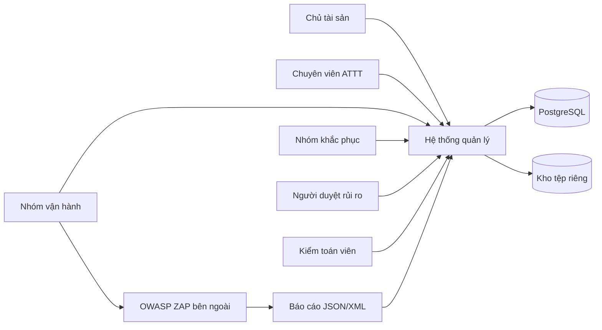
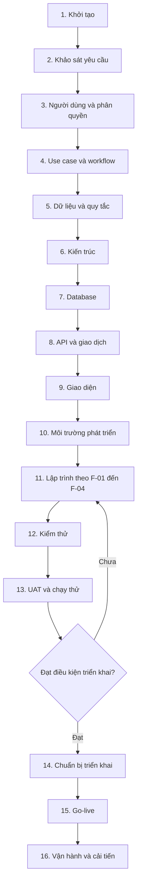
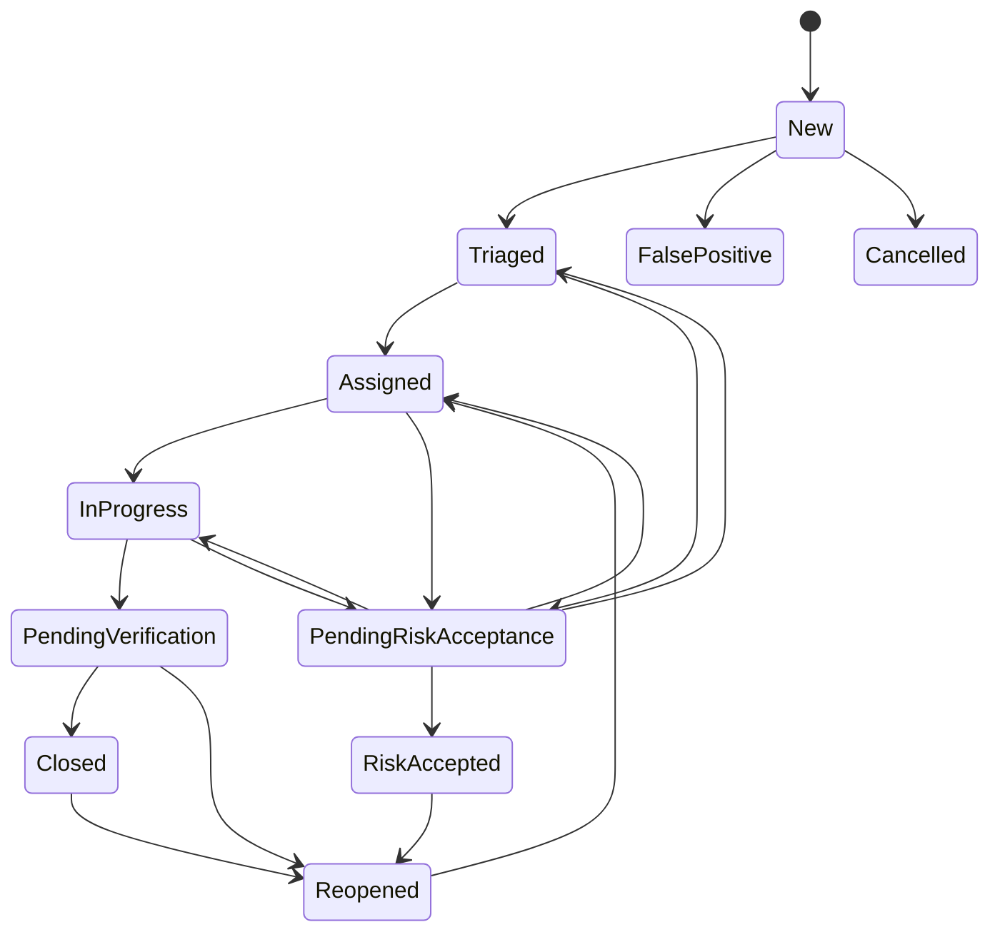
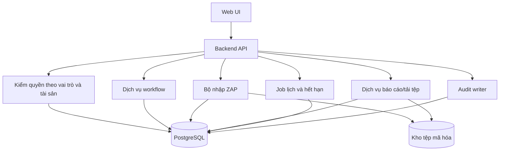

# Quy trình xây dựng Hệ thống quản lý quét lỗ hổng website định kỳ

## Thông tin tài liệu

| Thuộc tính | Nội dung |
|---|---|
| Tên hệ thống | Hệ thống quản lý quét lỗ hổng website định kỳ |
| Công cụ quét bên ngoài | OWASP ZAP |
| Phạm vi chức năng | Khai báo tài sản, lịch quét, nhập kết quả, theo dõi khắc phục |
| Trọng tâm | Final Severity, bảo mật báo cáo lỗ hổng, workflow xử lý |
| Nguồn yêu cầu nghiệp vụ | [`doi_tuong_sd_quy_trinh_hd.md`](doi_tuong_sd_quy_trinh_hd.md), phiên bản 2.2 |
| Mục đích tài liệu | Hướng dẫn đầy đủ quá trình xây dựng, nghiệm thu, triển khai và đưa hệ thống vào vận hành |
| Đối tượng đọc | Nhóm phân tích, thiết kế, lập trình, kiểm thử, ATTT, vận hành, chủ tài sản và người phê duyệt |

## Mục lục

1. [Mục tiêu và nguyên tắc xây dựng](#1-mục-tiêu-và-nguyên-tắc-xây-dựng)
2. [Ranh giới hệ thống](#2-ranh-giới-hệ-thống)
3. [Các bên tham gia](#3-các-bên-tham-gia)
4. [Tổng quan vòng đời xây dựng](#4-tổng-quan-vòng-đời-xây-dựng)
5. [Giai đoạn 1 — Khởi tạo đề tài](#5-giai-đoạn-1--khởi-tạo-đề-tài)
6. [Giai đoạn 2 — Khảo sát và xác định yêu cầu](#6-giai-đoạn-2--khảo-sát-và-xác-định-yêu-cầu)
7. [Giai đoạn 3 — Xác định đối tượng sử dụng và phân quyền](#7-giai-đoạn-3--xác-định-đối-tượng-sử-dụng-và-phân-quyền)
8. [Giai đoạn 4 — Phân tích use case và workflow](#8-giai-đoạn-4--phân-tích-use-case-và-workflow)
9. [Giai đoạn 5 — Phân tích dữ liệu và quy tắc nghiệp vụ](#9-giai-đoạn-5--phân-tích-dữ-liệu-và-quy-tắc-nghiệp-vụ)
10. [Giai đoạn 6 — Thiết kế kiến trúc hệ thống](#10-giai-đoạn-6--thiết-kế-kiến-trúc-hệ-thống)
11. [Giai đoạn 7 — Thiết kế cơ sở dữ liệu](#11-giai-đoạn-7--thiết-kế-cơ-sở-dữ-liệu)
12. [Giai đoạn 8 — Thiết kế API và giao dịch nghiệp vụ](#12-giai-đoạn-8--thiết-kế-api-và-giao-dịch-nghiệp-vụ)
13. [Giai đoạn 9 — Thiết kế giao diện](#13-giai-đoạn-9--thiết-kế-giao-diện)
14. [Giai đoạn 10 — Chuẩn bị môi trường và tiêu chuẩn phát triển](#14-giai-đoạn-10--chuẩn-bị-môi-trường-và-tiêu-chuẩn-phát-triển)
15. [Giai đoạn 11 — Lập trình hệ thống](#15-giai-đoạn-11--lập-trình-hệ-thống)
16. [Giai đoạn 12 — Kiểm thử](#16-giai-đoạn-12--kiểm-thử)
17. [Giai đoạn 13 — Kiểm thử chấp nhận và chạy thử](#17-giai-đoạn-13--kiểm-thử-chấp-nhận-và-chạy-thử)
18. [Giai đoạn 14 — Chuẩn bị triển khai](#18-giai-đoạn-14--chuẩn-bị-triển-khai)
19. [Giai đoạn 15 — Triển khai và đưa vào sử dụng](#19-giai-đoạn-15--triển-khai-và-đưa-vào-sử-dụng)
20. [Giai đoạn 16 — Vận hành và cải tiến](#20-giai-đoạn-16--vận-hành-và-cải-tiến)
21. [Quản lý chất lượng xuyên suốt](#21-quản-lý-chất-lượng-xuyên-suốt)
22. [Quản lý rủi ro dự án](#22-quản-lý-rủi-ro-dự-án)
23. [Hồ sơ bàn giao cuối cùng](#23-hồ-sơ-bàn-giao-cuối-cùng)
24. [Trạng thái hiện tại và bước tiếp theo](#24-trạng-thái-hiện-tại-và-bước-tiếp-theo)

## 1. Mục tiêu và nguyên tắc xây dựng

### 1.1. Mục tiêu sản phẩm

Hệ thống được xây dựng để quản lý tập trung:

1. Website nào được phép quét và phạm vi nào được phê duyệt.
2. Khi nào cần thực hiện quét định kỳ và ai chịu trách nhiệm vận hành.
3. Báo cáo OWASP ZAP nào đã được nhập, có hợp lệ hay không và các phát hiện nào được chuẩn hóa.
4. Ai đang xử lý lỗ hổng, thời hạn nào được áp dụng, bằng chứng khắc phục là gì và kết quả xác minh ra sao.
5. Lỗ hổng nào được đóng, mở lại, xác nhận sai hoặc chấp nhận rủi ro có thời hạn.
6. Ai đã truy cập hoặc thay đổi dữ liệu nhạy cảm và hành động đó có kết quả như thế nào.

### 1.2. Nguyên tắc thực hiện

- Mọi chức năng phải truy vết được về yêu cầu trong tài liệu nguồn.
- Chỉ triển khai bốn chức năng F-01 đến F-04 và nội dung hỗ trợ trực tiếp.
- OWASP ZAP chạy bên ngoài; hệ thống không khởi chạy, dừng hoặc điều khiển ZAP.
- Quyền truy cập được kiểm theo vai trò và tài sản, mặc định từ chối.
- Báo cáo gốc, chi tiết kỹ thuật và bằng chứng được xem là dữ liệu nhạy cảm.
- Source Risk, Source Confidence và Final Severity là ba khái niệm riêng.
- Không đóng Finding chỉ dựa trên xác nhận của người khắc phục; phải có báo cáo xác minh mới và kết luận ATTT.
- Dữ liệu lịch sử không bị ghi đè hoặc xóa cứng trong luồng sử dụng thông thường.
- Các chính sách chưa được đơn vị cung cấp, như thời hạn SLA hoặc thời gian lưu trữ, phải để cấu hình/phê duyệt; không tự đặt giá trị nghiệp vụ.
- Mỗi giai đoạn chỉ hoàn thành khi có sản phẩm bàn giao và bằng chứng kiểm tra rõ ràng.

## 2. Ranh giới hệ thống

### 2.1. Phần hệ thống phải thực hiện

| Mã | Phạm vi | Kết quả chính |
|---|---|---|
| F-01 | Khai báo tài sản | Tài sản, chủ sở hữu, mức quan trọng, phạm vi và khung giờ được duyệt |
| F-02 | Lịch quét | Lịch định kỳ, từng lần quét, trạng thái thực hiện và lý do lỗi/bỏ lỡ |
| F-03 | Nhập kết quả | Tệp ZAP gốc, kiểm định dạng, chống trùng, Finding, Occurrence, Observation và lỗi nhập |
| F-04 | Theo dõi khắc phục | Final Severity, phiếu, phân công, tiến độ, hạn, bằng chứng, xác minh, đóng/mở lại và rủi ro |

Phân quyền, audit, thông báo tối thiểu và báo cáo tối thiểu được xây dựng để bảo vệ và hỗ trợ bốn chức năng trên.

### 2.2. Phần nằm ngoài hệ thống

- Tự xây dựng bộ máy quét hoặc quy tắc phát hiện lỗ hổng.
- Thực hiện active scan, gửi payload hoặc khai thác website.
- Điều khiển OWASP ZAP bằng API hoặc Automation Framework.
- Nhập kết quả từ công cụ khác ngoài OWASP ZAP.
- Tự sửa mã nguồn, thư viện hoặc cấu hình website.
- Tích hợp kho mã nguồn, CI/CD nghiệp vụ hoặc ticket bên ngoài.
- Xây phân hệ SSO, email, BI, quản lý nhân sự hoặc quản lý tài sản doanh nghiệp.
- Xây hệ thống giám sát hạ tầng như một phân hệ sản phẩm độc lập.

Các công cụ build, test, triển khai tự động hoặc giám sát kỹ thuật dùng để phát triển/vận hành sản phẩm không được coi là chức năng nghiệp vụ mới.

### 2.3. Sơ đồ ranh giới

## 3. Các bên tham gia

### 3.1. Đối tượng sử dụng hệ thống

| Đối tượng | Trách nhiệm chính | Giới hạn quan trọng |
|---|---|---|
| Quản trị viên — ADMIN | Cấp/thu hồi vai trò và phạm vi tài sản; xem nhật ký quyền | Không mặc nhiên xem báo cáo hoặc sửa dữ liệu lỗ hổng |
| Chuyên viên ATTT — SECURITY | Phê duyệt tài sản/phạm vi/lịch; phân tích, xác nhận Final Severity, phân công, xác minh | Không bỏ qua bằng chứng hoặc quy tắc tách nhiệm vụ |
| Chủ sở hữu — OWNER | Khai báo/xác nhận tài sản, phạm vi, tác động; theo dõi và đề nghị rủi ro | Chỉ xem tài sản thuộc trách nhiệm/quyền được cấp |
| Nhóm vận hành — SCAN_OPS | Chạy ZAP bên ngoài; cập nhật lần quét và nhập báo cáo | Không tự xác nhận Final Severity hoặc tự đóng Finding |
| Nhóm khắc phục — REMEDIATOR | Tiếp nhận phiếu, cập nhật tiến độ, biện pháp và bằng chứng | Chỉ xem phiếu được giao; không tự xác nhận đóng |
| Người duyệt rủi ro — RISK_APPROVER | Phê duyệt/từ chối rủi ro theo thẩm quyền | Khác người đề nghị; quyết định có điều kiện và thời hạn |
| Kiểm toán viên — AUDITOR | Xem dữ liệu và lịch sử được cấp | Không sửa dữ liệu nghiệp vụ |

### 3.2. Vai trò trong nhóm xây dựng

| Vai trò dự án | Trách nhiệm |
|---|---|
| Người bảo trợ/chủ nhiệm | Phê duyệt mục tiêu, phạm vi, nguồn lực và quyết định đưa vào vận hành |
| Đại diện nghiệp vụ | Giải thích quy trình, xác nhận yêu cầu và thực hiện UAT |
| Chuyên gia ATTT | Xác nhận quy tắc severity, masking, tách nhiệm vụ, xác minh và rủi ro |
| Business Analyst | Thu thập yêu cầu, use case, workflow, tiêu chí chấp nhận và truy vết |
| Kiến trúc sư/Tech Lead | Chọn kiến trúc, tiêu chuẩn kỹ thuật, giao dịch, bảo mật và chiến lược triển khai |
| Backend Developer | API, phân quyền, nghiệp vụ, parser ZAP, database và audit |
| Frontend Developer | Giao diện, luồng thao tác, kiểm quyền hiển thị và xử lý lỗi an toàn |
| Database Engineer | Schema, migration, chỉ mục, backup/restore và tối ưu truy vấn |
| QA/Tester | Kế hoạch kiểm thử, dữ liệu test, tự động hóa, regression và báo cáo lỗi |
| DevOps/Vận hành | Môi trường, cấu hình, secrets, triển khai, giám sát kỹ thuật, sao lưu và rollback |
| Kiểm toán/đánh giá độc lập | Rà soát quyền, log, bằng chứng kiểm thử và tuân thủ trước go-live |

Một người có thể kiêm nhiều vai trò dự án ở nhóm nhỏ, nhưng các quyết định nghiệp vụ cần độc lập vẫn phải giữ nguyên, ví dụ người đề nghị rủi ro không tự phê duyệt.

### 3.3. Ma trận trách nhiệm rút gọn

Ký hiệu: **R** thực hiện, **A** chịu trách nhiệm cuối, **C** tham vấn, **I** được thông báo.

| Công việc | Chủ nhiệm | Nghiệp vụ/ATTT | BA | Dev | QA | Vận hành |
|---|---|---|---|---|---|---|
| Chốt phạm vi | A | C | R | I | I | I |
| Phê duyệt yêu cầu | A | R | R | C | C | I |
| Thiết kế kiến trúc/database | I | C | C | A/R | C | C |
| Thiết kế tiêu chí chấp nhận | I | A/C | R | C | R | I |
| Lập trình | I | C | C | A/R | C | C |
| Kiểm thử hệ thống/bảo mật | I | C | C | R | A/R | C |
| UAT | I | A/R | C | C | R | I |
| Phê duyệt go-live | A | C | I | C | C | R |
| Vận hành | I | C | I | C | C | A/R |

## 4. Tổng quan vòng đời xây dựng

Quy trình có thể thực hiện lặp theo từng chức năng, nhưng các cổng phê duyệt về phạm vi, bảo mật, database và go-live không được bỏ qua.

## 5. Giai đoạn 1 — Khởi tạo đề tài

### Mục tiêu

Xác định vấn đề cần giải quyết, mục tiêu, phạm vi, bên liên quan, nguyên tắc ra quyết định và điều kiện thành công.

### Công việc

1. Mô tả hiện trạng quét website và theo dõi khắc phục.
2. Xác định khó khăn: lịch rời rạc, báo cáo nhạy cảm, dữ liệu trùng, không rõ người chịu trách nhiệm, khó xác minh đóng.
3. Chốt bốn chức năng F-01 đến F-04.
4. Chốt OWASP ZAP là công cụ bên ngoài.
5. Liệt kê rõ nội dung ngoài phạm vi.
6. Xác định người phê duyệt yêu cầu, người phê duyệt bảo mật và người quyết định go-live.
7. Lập danh sách rủi ro ban đầu và cơ chế quản lý thay đổi.

### Sản phẩm bàn giao

- Tuyên bố mục tiêu và phạm vi.
- Danh sách bên liên quan.
- Danh sách nội dung ngoài phạm vi.
- Tiêu chí thành công cấp sản phẩm.
- Nhật ký quyết định và danh sách rủi ro dự án.

### Điều kiện hoàn thành

- Phạm vi được chủ nhiệm và đại diện nghiệp vụ chấp thuận.
- Không còn mâu thuẫn về việc hệ thống có điều khiển ZAP hay không.
- Có người chịu trách nhiệm phê duyệt ở các giai đoạn sau.

## 6. Giai đoạn 2 — Khảo sát và xác định yêu cầu

### Mục tiêu

Chuyển nhu cầu chung thành yêu cầu chức năng, phi chức năng, dữ liệu và tiêu chí chấp nhận có thể kiểm thử.

### Hoạt động khảo sát

- Phỏng vấn OWNER, SECURITY, SCAN_OPS, REMEDIATOR, RISK_APPROVER, AUDITOR và ADMIN.
- Thu thập biểu mẫu tài sản, quy tắc phạm vi, lịch hiện tại và mẫu báo cáo ZAP Traditional JSON/XML.
- Quan sát cách vận hành chạy ZAP và chuyển giao tệp.
- Thu thập quy định nội bộ về phân quyền, dữ liệu nhạy cảm, SLA, chấp nhận rủi ro, lưu trữ và audit.
- Mô tả các tình huống bình thường, ngoại lệ và thao tác đồng thời.

### Yêu cầu chức năng cần xác định

| Nhóm | Câu hỏi phải trả lời |
|---|---|
| Tài sản | Ai khai báo? Dữ liệu bắt buộc? Ai xác nhận/phê duyệt? Khi nào Active/Suspended/Retired? |
| Phạm vi | Include/Exclude dạng nào? Cách khớp domain/URL? Phiên bản hóa và phê duyệt ra sao? |
| Lịch | Chu kỳ, múi giờ, hiệu lực, khung giờ, nhóm vận hành và xử lý Missed/Failed thế nào? |
| Nhập ZAP | Mẫu JSON/XML nào? Giới hạn tệp? Checksum? Xử lý zero alert, partial, rejected và nhập lặp? |
| Finding | Công thức fingerprint? Cách chuẩn hóa URL/parameter/method? Cách xử lý tái xuất hiện? |
| Severity | Ai đánh giá? Bằng chứng gì? Khi nào cần reviewer thứ hai? SLA lấy từ đâu? |
| Phiếu | Ai phân công? Cách đổi người/hạn? Dữ liệu bản sửa và lịch sử nào bắt buộc? |
| Xác minh | Scan nào được dùng? Thế nào là bao phủ? Ai được kết luận Closed/Reopened? |
| Rủi ro | Ai đề nghị/duyệt? Thẩm quyền, điều kiện, hạn, từ chối và gia hạn ra sao? |
| Bảo mật | Ai xem bản gốc/evidence? Masking gì? Khi nào ghi audit? Link tải hết hạn/thu hồi thế nào? |

### Yêu cầu phi chức năng

- Bảo mật: xác thực, phân quyền, mã hóa truyền/lưu, quản lý secrets và chống lộ thông tin.
- Toàn vẹn: chống trùng, giao dịch nguyên tử, FK, checksum, lịch sử bất biến.
- Hiệu năng: thời gian phản hồi, kích thước tệp, số Finding/tài sản và số lần quét dự kiến.
- Khả dụng: thời gian phục vụ, bảo trì và cách xử lý khi kho tệp/database không sẵn sàng.
- Sao lưu/khôi phục: RPO, RTO và lịch kiểm tra restore phải do đơn vị phê duyệt.
- Quan sát kỹ thuật: health check, log ứng dụng, metric lỗi/độ trễ/dung lượng và cảnh báo vận hành.
- Dễ sử dụng: thông báo lỗi rõ nhưng không lộ dữ liệu nhạy cảm; workflow hạn chế thao tác sai.
- Khả năng bảo trì: migration có phiên bản, test tự động, tài liệu API và quy ước code.

### Chính sách phải được đơn vị cung cấp

- Bảng SLA theo Final Severity.
- Căn cứ reviewer thứ hai và thẩm quyền phê duyệt rủi ro.
- Thời hạn lưu tệp gốc, Finding, phiếu, báo cáo xuất và audit.
- Giới hạn dung lượng/tần suất upload.
- Chính sách masking và phân loại dữ liệu.
- Mức độ sẵn sàng, RPO/RTO và cửa sổ bảo trì.

Nếu chưa có giá trị chính thức, ghi là “chờ chính sách”, không tự điền số liệu vào thiết kế sản phẩm.

### Sản phẩm bàn giao

- Tài liệu yêu cầu nghiệp vụ và ranh giới.
- Danh sách yêu cầu chức năng/phi chức năng có mã.
- Tiêu chí chấp nhận cho từng yêu cầu.
- Mẫu dữ liệu ZAP đã loại bí mật dùng cho phát triển/test.
- Ma trận truy vết yêu cầu.

### Điều kiện hoàn thành

- Mỗi yêu cầu rõ chủ thể, điều kiện đầu vào, kết quả, lỗi và tiêu chí kiểm thử.
- Những điểm chưa chốt có người chịu trách nhiệm và không bị biến thành giả định ngầm.
- Đại diện nghiệp vụ và ATTT phê duyệt baseline yêu cầu.

## 7. Giai đoạn 3 — Xác định đối tượng sử dụng và phân quyền

### Mục tiêu

Xác định đúng trách nhiệm của bảy vai trò và ngăn việc suy diễn quyền vượt tài sản hoặc vượt nhiệm vụ.

### Công việc

1. Lập ma trận vai trò × hành động.
2. Với mỗi hành động, ghi phạm vi tài sản, điều kiện trạng thái và dữ liệu được phép xem.
3. Tách quyền xem Finding đã che khỏi quyền xem báo cáo gốc/evidence nhạy cảm.
4. Quy định OWNER chỉ xem tài sản thuộc trách nhiệm/quyền.
5. Quy định REMEDIATOR chỉ xem phiếu được giao.
6. Quy định ADMIN chỉ quản trị quyền, không tự có quyền đọc lỗ hổng.
7. Xác định các quy tắc độc lập:
   - Người nhập không tự xác nhận Final Severity của kết quả đó.
   - Người khắc phục không tự kết luận Closed.
   - Người đề nghị rủi ro không tự phê duyệt.
8. Xác định các hành động phải audit, gồm cả thành công, từ chối và thất bại.

### Mẫu đặc tả quyền cho một hành động

| Trường | Ví dụ cần mô tả |
|---|---|
| Hành động | Xem báo cáo ZAP gốc |
| Vai trò nền | SECURITY hoặc vai trò được đơn vị cho phép |
| Điều kiện tài sản | Có `user_role.asset_id` còn hiệu lực |
| Quyền nhạy cảm | `can_read_raw_report=true` và có lý do cấp |
| Điều kiện tài khoản | Người dùng đang active |
| Audit | Ghi actor, thời gian, asset, batch/file, kết quả và lý do từ chối nếu có |
| Dữ liệu trả về | Stream tệp sau kiểm quyền; không trả object key/key ref cho giao diện |

### Sản phẩm bàn giao

- Danh sách đối tượng sử dụng.
- Ma trận vai trò–chức năng–tài sản.
- Ma trận quyền dữ liệu nhạy cảm.
- Quy tắc tách nhiệm vụ.
- Danh sách sự kiện audit bắt buộc.

### Điều kiện hoàn thành

- Mọi API dự kiến đều ánh xạ được tới vai trò và phạm vi.
- Không có quyền wildcard ngầm từ vai trò chưa gắn tài sản.
- Các trường hợp ADMIN, REMEDIATOR và quyền bản gốc được kiểm riêng.

## 8. Giai đoạn 4 — Phân tích use case và workflow

### Mục tiêu

Mô tả từng tương tác từ lúc bắt đầu đến lúc hoàn thành hoặc thất bại, bao gồm trạng thái và dữ liệu audit.

### Cấu trúc một use case

Mỗi use case cần có:

- Mã và tên.
- Mục tiêu.
- Actor chính/phụ.
- Tiền điều kiện.
- Sự kiện kích hoạt.
- Luồng chính.
- Luồng thay thế và ngoại lệ.
- Hậu điều kiện khi thành công/thất bại.
- Dữ liệu tạo hoặc thay đổi.
- Quyền và audit.
- Tiêu chí chấp nhận.

### Danh sách use case tối thiểu

| Nhóm | Use case |
|---|---|
| F-01 | Khai báo tài sản; tạo phiên bản phạm vi; xác nhận; phê duyệt/từ chối; tạm dừng/ngừng tài sản |
| F-02 | Tạo/sửa/phê duyệt lịch; sinh kỳ; ghi nhận bắt đầu/kết thúc; Failed/Missed/Cancelled |
| F-03 | Tải tệp; phát hiện nhập lặp; kiểm tệp; nhập thành công; nhập một phần; từ chối; xem lỗi |
| F-04 | Đánh giá severity; kết luận False Positive/Cancelled; tạo/phân công phiếu; cập nhật; đổi hạn; yêu cầu xác minh; đóng/mở lại; đề nghị/duyệt/từ chối/gia hạn rủi ro |
| Hỗ trợ | Cấp/thu hồi quyền; xem/tải dữ liệu nhạy cảm; xuất/thu hồi báo cáo; xem thông báo/audit |

### Workflow Finding

Mỗi cạnh phải có actor, điều kiện, lý do, bằng chứng/căn cứ, dữ liệu cập nhật và audit. Không tự bổ sung cạnh trạng thái không có trong nguồn.

### Sản phẩm bàn giao

- Use case specification.
- Activity/sequence diagram cho các luồng phức tạp.
- State machine của Asset, Schedule, Scan, ImportBatch, Finding và RiskAcceptance.
- Bảng điều kiện trên từng cạnh workflow.
- Tiêu chí chấp nhận theo luồng chính và ngoại lệ.

### Điều kiện hoàn thành

- Mọi trạng thái đều có cách đi vào và kết thúc hợp lệ.
- Mọi ngoại lệ trong nguồn có cách xử lý và không làm mất dữ liệu hợp lệ.
- Không có use case điều khiển ZAP hoặc chức năng ngoài phạm vi.

## 9. Giai đoạn 5 — Phân tích dữ liệu và quy tắc nghiệp vụ

### Mục tiêu

Xác định thực thể, thuộc tính, danh tính, lịch sử, dữ liệu nhạy cảm và quy tắc toàn vẹn trước khi thiết kế vật lý.

### Công việc

1. Lập danh sách thuật ngữ và định nghĩa duy nhất.
2. Phân biệt cấu hình hiện hành với snapshot/lịch sử.
3. Xác định dữ liệu gốc, dữ liệu chuẩn hóa và dữ liệu kết luận.
4. Xác định PK, business key, unique key và FK.
5. Xác định dữ liệu bắt buộc theo trạng thái.
6. Xác định dữ liệu phải che, mã hóa hoặc lưu ngoài database.
7. Xác định quy tắc chống trùng và thao tác đồng thời.
8. Xác định chính sách lưu lịch sử và không xóa cứng.

### Ba cấp dữ liệu phát hiện

| Cấp | Ý nghĩa | Khóa chính nghiệp vụ |
|---|---|---|
| Finding | Một lỗ hổng ổn định trên một tài sản | Asset + fingerprint |
| FindingOccurrence | Finding xuất hiện trong một scan | Finding + Scan |
| FindingObservation | Một dòng/instance trong một lô/file | Batch + record locator |

Không gộp ba cấp này vì sẽ làm mất khả năng chống trùng, tái xuất hiện và truy vết nhiều tệp nguồn.

### Quy tắc fingerprint

Fingerprint gồm tài sản, alert reference/rule ID, URL chuẩn hóa, parameter/input vector và HTTP method nếu có. Attack/Evidence không tham gia fingerprint. Cần có tài liệu chuẩn hóa và bộ test cố định để cùng một vị trí luôn cho cùng fingerprint, trong khi các vị trí có ý nghĩa khác nhau không bị gộp nhầm.

### Sản phẩm bàn giao

- Mô hình khái niệm và logic.
- Danh mục thực thể/thuộc tính.
- Ma trận dữ liệu nhạy cảm.
- Quy tắc fingerprint, chống trùng và lịch sử.
- Danh sách ràng buộc DB và ràng buộc ứng dụng.

### Điều kiện hoàn thành

- Mỗi dữ liệu có một nơi lưu chính thức.
- Không trộn Source Severity với Final Severity.
- Có đường truy vết từ Observation về file, scan và asset.
- Có đường truy vết từ Closed/Risk Accepted về kết quả hoặc quyết định.

## 10. Giai đoạn 6 — Thiết kế kiến trúc hệ thống

### Mục tiêu

Chọn cấu trúc kỹ thuật đủ để triển khai, bảo mật và vận hành bốn chức năng mà không tạo phân hệ ngoài phạm vi.

### Các thành phần logic

Đây là các thành phần logic, không bắt buộc triển khai thành nhiều dịch vụ riêng. Với quy mô đề tài, một backend module hóa và một database thường đơn giản hơn microservice.

### Quyết định kiến trúc cần chốt

- Công nghệ frontend/backend và phiên bản hỗ trợ.
- PostgreSQL và công cụ migration.
- Kho tệp riêng, cơ chế mã hóa và quản lý khóa.
- Phương thức xác thực phù hợp môi trường; không xây phân hệ SSO nếu không thuộc phạm vi.
- Cách chạy job sinh kỳ, thông báo và kiểm hết hạn.
- Giới hạn upload, streaming và tránh giữ toàn tệp trong bộ nhớ.
- Cơ chế audit không bị mất khi giao dịch lỗi rollback.
- Cách phân tách tài khoản kết nối database và quyền tối thiểu.
- Chiến lược cấu hình, secrets, backup, restore và rollback.

### Luồng lưu tệp an toàn

1. Máy chủ xác thực và kiểm quyền upload.
2. Stream tệp vào vùng tạm an toàn, giới hạn dung lượng và tính checksum.
3. Xác định tệp nhập lặp trước khi chuẩn hóa.
4. Lưu byte gốc bất biến vào kho riêng có mã hóa.
5. Database chỉ lưu object key, checksum, kích thước, loại và key reference.
6. Parser đọc qua quyền dịch vụ, không phát URL công khai.
7. Tải xuống phải kiểm quyền hiện hành, audit và dùng liên kết ngắn hạn/stream có kiểm soát.

### Sản phẩm bàn giao

- Sơ đồ kiến trúc logic và triển khai.
- Danh sách quyết định kiến trúc cùng lý do.
- Mô hình đe dọa sơ bộ.
- Thiết kế quản lý cấu hình/secrets và tệp.
- Yêu cầu môi trường, dung lượng và backup.

### Điều kiện hoàn thành

- Có phương án bảo vệ database, tệp và khóa.
- Thành phần nào chịu trách nhiệm cho mỗi quy tắc đã rõ.
- Không phụ thuộc vào việc backend có quyền database không giới hạn.

## 11. Giai đoạn 7 — Thiết kế cơ sở dữ liệu

### Mục tiêu

Chuyển mô hình nghiệp vụ thành schema có thể triển khai, đảm bảo toàn vẹn, truy vết và số bảng phù hợp.

### Công việc

1. Thiết kế bảng, cột, kiểu dữ liệu và miền trạng thái.
2. Xác định PK, FK đơn/FK ghép, UNIQUE, CHECK và index.
3. Tách bảng hiện hành, lịch sử và bảng nối.
4. Thiết kế con trỏ hiện hành như current scope/review/ticket event/verification result.
5. Thiết kế metadata tệp gốc, evidence và báo cáo xuất.
6. Thiết kế guard cho dữ liệu bất biến và cạnh workflow.
7. Thiết kế view an toàn không trả object key/key reference/dữ liệu mã hóa.
8. Viết migration tạo mới và bộ test database.
9. Vẽ ERD và đối chiếu từng bảng với tài liệu nguồn.

### Sản phẩm hiện có

- [Thiết kế tổng thể 27 bảng](database/01_thiet_ke_co_so_du_lieu.md).
- [Từ điển dữ liệu](database/02_tu_dien_du_lieu.md).
- [ERD](database/03_so_do_erd.md).
- [Ràng buộc và giao dịch](database/04_rang_buoc_va_giao_dich.md).
- [Giải thích chi tiết từng bảng](database/07_giai_thich_chi_tiet_cac_bang.md).
- [SQL schema/guard/view](database/sql/01_schema.sql).

### Điều kiện hoàn thành

- SQL chạy thành công trên database trống.
- Tất cả bảng trong model, từ điển, ERD và SQL khớp nhau.
- Test đạt cho ràng buộc quan trọng và các bảng gộp.
- Không nạp tài khoản, quyền người dùng hoặc SLA giả vào môi trường thật.
- Có kế hoạch migration riêng nếu đã có dữ liệu cũ.

## 12. Giai đoạn 8 — Thiết kế API và giao dịch nghiệp vụ

### Mục tiêu

Xác định hợp đồng giữa giao diện và backend, đồng thời biến workflow thành giao dịch nguyên tử có kiểm quyền/audit.

### Đặc tả bắt buộc cho mỗi API

| Nội dung | Yêu cầu |
|---|---|
| Mục đích | API phục vụ use case và yêu cầu nào |
| Method/path | Quy ước nhất quán, có version khi cần |
| Actor | Vai trò nào được gọi |
| Phạm vi | Cách kiểm `asset_id`, owner, phiếu được giao và quyền nhạy cảm |
| Request | Kiểu, bắt buộc, giới hạn, chuẩn hóa và idempotency key |
| Response | Dữ liệu tối thiểu, masking và pagination |
| Trạng thái | Trạng thái nguồn/đích và điều kiện chuyển |
| Giao dịch | Bảng khóa, thứ tự khóa, dữ liệu ghi và audit |
| Lỗi | Mã HTTP, mã nghiệp vụ, thông báo an toàn và khi nào retry |
| Đồng thời | `row_version`, unique conflict hoặc lock được xử lý thế nào |
| Audit | Hành động, đối tượng, trước/sau, kết quả và correlation ID |
| Kiểm thử | Các ca thành công, sai quyền, sai trạng thái, trùng và cạnh tranh |

### Nhóm API dự kiến

Tên path cuối cùng do nhóm phát triển chốt; danh sách dưới đây mô tả năng lực, không phải cam kết giao diện URL.

| Nhóm | Năng lực API |
|---|---|
| Auth/context | Đăng nhập hoặc nhận danh tính; lấy người dùng và quyền trên asset |
| Assets | Tạo/xem/sửa Draft; tạo/gửi/xác nhận/phê duyệt scope; đổi trạng thái asset |
| Schedules/scans | Tạo/sửa/phê duyệt lịch; danh sách kỳ; cập nhật kết quả scan ngoài hệ thống |
| Imports | Upload; trạng thái lô; danh sách lỗi; xem/tải bản gốc theo quyền |
| Findings | Danh sách/chi tiết đã che; occurrences; observations; reviews; state actions |
| Tickets | Tạo phiếu; phân công; tiến độ/bản sửa; đổi hạn; lịch sử |
| Verification | Tạo yêu cầu; gắn scan/import; đánh giá; áp dụng Closed/Reopened |
| Risk | Tạo/bổ sung/duyệt/từ chối/gia hạn; danh sách sắp hết hạn |
| Reports | Xuất; danh sách asset trong file; tải; thu hồi |
| Audit/notifications | Tra cứu audit theo quyền; hộp thông báo; đánh dấu đã đọc |

### Giao dịch mẫu: đóng Finding

1. Xác thực SECURITY và quyền trên asset.
2. Bắt đầu giao dịch; khóa Finding, VerificationRequest và TicketEvent làm căn cứ.
3. Kiểm Finding đang Pending Verification và `row_version` khớp.
4. Kiểm người đánh giá không phải người thực sự khắc phục.
5. Kiểm scan Verification mới sau khắc phục, đúng scope/tài sản.
6. Kiểm ImportBatch Completed hoặc Partial đủ giá trị xác minh.
7. Kiểm coverage được xác nhận và fingerprint không còn.
8. Ghi VerificationResult bất biến.
9. Cập nhật `finding.verification_result_id`, status Closed và row version.
10. Ghi AuditLog liên kết result/evidence với from/to status.
11. Cập nhật yêu cầu Evaluated, commit và tạo thông báo tối thiểu.

Nếu một bước thất bại, rollback toàn bộ thay đổi nghiệp vụ. Audit từ chối/lỗi cần được ghi bằng cơ chế không bị rollback cùng giao dịch thất bại.

### Sản phẩm bàn giao

- [OpenAPI 3.1/API specification](api_design/01_openapi.yaml).
- [Danh mục mã lỗi nghiệp vụ](api_design/02_danh_muc_ma_loi.md).
- [Hợp đồng giao dịch cho mọi cạnh workflow](api_design/03_hop_dong_giao_dich.md).
- [Ma trận API–vai trò–tài sản–audit](api_design/04_ma_tran_api_quyen_audit.md).
- [Sequence diagram cho Import, Close/Reopen và Risk Approval](api_design/05_sequence_diagrams.md).
- [Truy vết use case và cổng nghiệm thu giai đoạn 8](api_design/06_truy_vet_va_nghiem_thu.md).
- [Mẫu request/response cho các giao dịch trọng yếu](api_design/07_mau_request_response.md).

### Điều kiện hoàn thành

- Mọi use case có API hoặc xử lý máy chủ tương ứng.
- Mọi API thay đổi trạng thái có điều kiện, giao dịch và audit.
- Không trả dữ liệu tệp/khóa nhạy cảm trong API thông thường.

## 13. Giai đoạn 9 — Thiết kế giao diện

### Mục tiêu

Tạo luồng thao tác dễ hiểu, phản ánh đúng trạng thái/quyền và giảm khả năng thực hiện sai nghiệp vụ.

### Màn hình tối thiểu

- Đăng nhập và thông tin người dùng/quyền hiện hành.
- Danh sách/chi tiết tài sản, phiên bản scope, rule và khung giờ.
- Danh sách/chi tiết lịch và từng lần quét.
- Upload báo cáo, tiến trình lô, thống kê và lỗi đã che.
- Danh sách/chi tiết Finding, nguồn xuất hiện, Source Risk/Confidence và Final Severity.
- Form đánh giá/kết luận, bằng chứng và reviewer thứ hai.
- Phiếu xử lý, người phụ trách, tiến độ, hạn và lịch sử.
- Yêu cầu/kết quả xác minh.
- Đề nghị/quyết định/gia hạn rủi ro.
- Báo cáo xuất, tải/thu hồi; thông báo; audit theo quyền.

### Nguyên tắc giao diện

- Chỉ hiển thị hành động hợp lệ với quyền và trạng thái, nhưng backend vẫn kiểm lại.
- Phân biệt rõ Source Severity, Confidence và Final Severity.
- Không hiển thị object key, encryption key reference hoặc token hash.
- Dữ liệu Attack/Evidence/URL/parameter được masking theo quyền.
- Trước hành động quan trọng, hiển thị điều kiện, ảnh hưởng và yêu cầu lý do/bằng chứng.
- Lỗi quyền không xác nhận sự tồn tại của tài sản/Finding mà người dùng không được xem.
- Upload hiển thị checksum/trạng thái; nhập trùng trả lô cũ thay vì tạo dữ liệu mới.
- Lịch sử hiển thị ai, khi nào, trước/sau và lý do.

### Sản phẩm bàn giao

- [Sitemap và user flow](ui_design/01_sitemap_va_user_flow.md).
- [Danh mục màn hình, wireframe và prototype cho luồng chính/ngoại lệ](ui_design/02_danh_muc_man_hinh_va_wireframe.md).
- [Design system nhỏ, nhất quán](ui_design/03_design_system.md).
- [Danh sách trường hiển thị/masking theo vai trò](ui_design/04_ma_tran_hien_thi_masking.md).
- [Tiêu chí accessibility và responsive phù hợp môi trường sử dụng](ui_design/05_accessibility_responsive.md).
- [Ma trận truy vết 32 màn hình với use case và 57 API operation](ui_design/06_ma_tran_truy_vet_ui_api.md).
- [Kịch bản usability, review theo vai trò và nghiệm thu](ui_design/07_usability_va_nghiem_thu.md).

### Điều kiện hoàn thành

- Đại diện từng vai trò duyệt prototype liên quan.
- Luồng không tạo hành động trái workflow.
- Mọi dữ liệu nhạy cảm có quy tắc hiển thị cụ thể.

## 14. Giai đoạn 10 — Chuẩn bị môi trường và tiêu chuẩn phát triển

### Mục tiêu

Tạo nền tảng phát triển lặp lại được, không dùng dữ liệu thật hoặc secrets trong mã nguồn.

### Môi trường

| Môi trường | Mục đích | Dữ liệu |
|---|---|---|
| Local | Lập trình cá nhân | Dữ liệu giả, tệp ZAP đã làm sạch |
| Test/CI | Test tự động | Fixture tái tạo, không có bí mật |
| Staging/UAT | Kiểm thử gần production và UAT | Dữ liệu giả/đã khử định danh, cấu hình gần thật |
| Production | Vận hành chính thức | Dữ liệu thật, quyền/secrets được kiểm soát |

### Công việc

- Khởi tạo repository và quy tắc branch/review phù hợp nhóm.
- Tạo cấu trúc frontend/backend/database/migration/test/documentation.
- Chốt coding convention, lint, format, error handling và log an toàn.
- Quản lý secrets ngoài mã nguồn; tạo secrets riêng theo môi trường.
- Tạo migration baseline và quy trình nâng/hạ phiên bản được kiểm soát.
- Tạo dữ liệu seed chỉ cho danh mục cố định; không seed SLA/tài khoản thật.
- Thiết lập build/test tự động cho mã nguồn như một hoạt động phát triển.
- Thiết lập dependency scanning, secret scanning và cập nhật thư viện.
- Quy định pull request phải có truy vết yêu cầu và bằng chứng test.

### Sản phẩm bàn giao

- [Repository có cấu trúc chuẩn và điểm bắt đầu](README.md).
- [Hướng dẫn chạy local/test](docs/development/01_local_setup.md).
- [Pipeline build/test, dependency/secret checks](.github/workflows/ci.yml).
- [Quy tắc coding, error handling và log an toàn](docs/development/02_coding_standards.md).
- [Quy tắc cấu hình/secrets](docs/development/03_configuration_and_secrets.md).
- [Migration baseline bất biến, checksum và fixture test](docs/development/04_migrations.md).
- [Quy tắc branch, pull request và review](docs/development/06_branch_and_review.md).
- [Definition of Done](docs/development/05_definition_of_done.md).

### Điều kiện hoàn thành

- Thành viên mới có thể dựng môi trường theo tài liệu.
- Không có secret/dữ liệu lỗ hổng thật trong repository hoặc log build.
- Migration và test chạy lặp lại được từ trạng thái sạch.

## 15. Giai đoạn 11 — Lập trình hệ thống

### 15.1. Nguyên tắc chia nhỏ

Triển khai theo lát cắt hoàn chỉnh: database → backend → quyền/audit → giao diện → test cho một chức năng. Không xây toàn bộ frontend trước backend hoặc viết parser trước khi chốt fingerprint.

### 15.2. Thứ tự đề xuất

#### Nền tảng dùng chung

1. Cấu hình ứng dụng và kết nối database.
2. Xác thực/danh tính người dùng.
3. Middleware kiểm role + asset scope + tài khoản active.
4. Cơ chế audit và correlation ID.
5. Kho tệp, checksum, mã hóa và streaming.
6. Chuẩn phản hồi/lỗi, pagination và masking.

#### Lát cắt F-01

1. CRUD cần thiết cho Asset Draft.
2. Phiên bản scope, rule Include/Exclude và khung giờ.
3. Gửi xác nhận, phê duyệt/từ chối và kích hoạt.
4. Phân quyền trên tài sản và audit.
5. Giao diện, validation và test.

**Điều kiện hoàn thành F-01:** không kích hoạt asset thiếu owner/criticality/scope Approved; không sửa scope đã quyết định; người không có quyền không xem/sửa.

#### Lát cắt F-02

1. Tạo/cập nhật/phê duyệt lịch.
2. Kiểm scope, target, timezone và khung giờ.
3. Sinh ScanOccurrence idempotent theo kỳ.
4. Ghi nhận Completed/Failed/Missed/Cancelled.
5. Thông báo tối thiểu và audit.

**Điều kiện hoàn thành F-02:** không tạo trùng kỳ; lịch Active chỉ dùng Asset/scope hợp lệ; không có mã điều khiển ZAP.

#### Lát cắt F-03

1. Upload streaming, giới hạn kích thước, kiểm checksum và lưu file gốc.
2. Chống nhập lặp theo asset/scan/checksum.
3. Nhận dạng/kiểm Traditional JSON/XML.
4. Parser an toàn, giới hạn tài nguyên và xử lý dữ liệu lỗi.
5. Chuẩn hóa URL/parameter/method và tạo fingerprint.
6. Upsert Finding/Occurrence, insert Observation/Error theo giao dịch.
7. Trạng thái Completed/Partial/Rejected/Failed và thống kê.
8. Masking, quyền bản gốc, audit và test với mẫu ZAP.

**Điều kiện hoàn thành F-03:** nhập lặp không nhân dữ liệu; zero alert vẫn Completed; Partial giữ dòng hợp lệ; Rejected không tạo Finding; mọi Observation truy được về file/scan/asset.

#### Lát cắt F-04A — Phân tích và phiếu

1. Review Severity/False Positive/Cancelled/Recheck.
2. Reviewer thứ hai cho trường hợp bắt buộc.
3. SLA được phê duyệt và tính hạn.
4. Tạo phiếu, Assignment, Progress, Deadline event.
5. Lịch sử/con trỏ hiện hành, optimistic locking và audit.

**Điều kiện hoàn thành:** Final Severity chỉ từ review Applied; không ghi đè lịch sử; phân công có người/hạn/SLA; bản sửa có action/evidence/tác giả/thời gian.

#### Lát cắt F-04B — Xác minh

1. Tạo VerificationRequest từ TicketEvent khắc phục.
2. Lập/ghi nhận Scan Verification bên ngoài.
3. Nhập file xác minh qua F-03.
4. Đánh giá coverage/fingerprint và lưu VerificationResult.
5. Đóng/mở lại theo tách nhiệm vụ và audit.

**Điều kiện hoàn thành:** người khắc phục không tự đóng; scan sau bản sửa; báo cáo hợp lệ/bao phủ; Closed trỏ kết quả không còn fingerprint.

#### Lát cắt F-04C — Chấp nhận rủi ro

1. Tạo đề nghị từ trạng thái hợp lệ.
2. Bổ sung khuyến nghị và thông tin còn thiếu.
3. Phê duyệt/từ chối độc lập theo thẩm quyền.
4. Áp dụng Risk Accepted hoặc khôi phục đúng trạng thái trước.
5. Gia hạn bằng hồ sơ mới; xử lý hết hạn/vi phạm/rủi ro tăng.

**Điều kiện hoàn thành:** người đề nghị khác người duyệt; quyết định có căn cứ/điều kiện/hạn; không sửa quyết định cũ; hết hạn được phát hiện và xử lý.

#### Báo cáo, tải và thông báo

1. Các báo cáo tối thiểu theo tài sản, severity, trạng thái, lịch, lô và phiếu.
2. Masking theo người nhận.
3. Tệp xuất có nhãn, trace code, người/thời điểm xuất và danh sách asset.
4. Token ngẫu nhiên chỉ lưu hash, link có hạn và thu hồi được.
5. Kiểm quyền hiện hành trên mọi asset cho mỗi lần tải và ghi audit.
6. Thông báo chỉ có mã, trạng thái và đường dẫn nội bộ.

### Tiêu chuẩn hoàn thành một thay đổi

- Có yêu cầu/use case/tiêu chí chấp nhận tương ứng.
- Code được review.
- Migration có thể chạy từ database sạch và nâng từ phiên bản trước.
- Có test cho logic quan trọng và lỗi quyền/trạng thái.
- Không ghi secret/dữ liệu nhạy cảm vào log.
- API/documentation được cập nhật.
- Không thêm endpoint/bảng/chức năng ngoài phạm vi mà chưa qua quản lý thay đổi.

## 16. Giai đoạn 12 — Kiểm thử

### Mục tiêu

Chứng minh hệ thống đáp ứng yêu cầu, bảo vệ dữ liệu, giữ workflow và hoạt động ổn định trong điều kiện dự kiến.

### Các lớp kiểm thử

| Lớp test | Nội dung |
|---|---|
| Unit | Chuẩn hóa URL, fingerprint, state condition, masking, SLA selection, permission predicate |
| Database | PK/FK/UNIQUE/CHECK, trigger, view, migration, dữ liệu bất biến và lịch sử |
| Parser | JSON/XML hợp lệ, zero alert, nhiều site/alert/instance, thiếu trường, sai loại, file lớn, nội dung bất thường |
| Integration | API + database + object storage + audit + job |
| Contract | Request/response, mã lỗi và schema API |
| Workflow | Toàn bộ cạnh Finding, Asset, Schedule, Import và Risk |
| Authorization | Mỗi vai trò trên asset có/không quyền, quyền bản gốc, Remediator chỉ phiếu được giao, Admin không mặc nhiên đọc |
| Concurrency | Upload trùng, áp review cũ, cập nhật phiếu từ event cũ, hai quyết định rủi ro, hai lần chuyển trạng thái |
| Security | Upload, path traversal, parser abuse, injection, IDOR, session, CSRF phù hợp kiến trúc, secret/log leakage |
| Performance | Upload/parse, danh sách Finding, lịch sử phiếu/audit, báo cáo và job theo tải dự kiến |
| Recovery | Backup/restore database, khôi phục metadata–object storage nhất quán, rollback release |
| End-to-end | F-01 → F-02 → F-03 → F-04 trên dữ liệu test |

### Bộ ca nghiệp vụ bắt buộc

- Asset thiếu owner/criticality/scope không Active.
- Scope Approved không sửa; thay đổi tạo version mới.
- Lịch không tạo trên Asset Suspended hoặc scope sai.
- Missed/Failed/Cancelled phải có lý do và không tự tạo lần quét thay thế.
- Cùng file/asset/scan nhập lại trả lô cũ.
- Tệp sai bị Rejected và không tạo Finding.
- Partial giữ Observation hợp lệ và ImportError.
- Zero alert Completed và dùng được cho xác minh khi đủ coverage.
- Cùng Finding/scan chỉ một Occurrence nhưng nhiều Observation nguồn được phép.
- ZAP High không tự thành Final Critical.
- Hạ High/Critical cần reviewer độc lập.
- Người nhập không tự xác nhận mức độ cuối của kết quả đó.
- Đổi assignee/due date giữ lịch sử trước/sau.
- Người khắc phục không tự Closed.
- Closed cần scan/batch xác minh mới, hợp lệ, bao phủ và không fingerprint.
- Closed có fingerprint xuất hiện lại chuyển Reopened.
- Người đề nghị rủi ro không tự duyệt; quyết định có thời hạn.
- Gia hạn tạo hồ sơ mới, không thay hạn quyết định cũ.
- Admin không đọc báo cáo gốc chỉ vì có vai trò Admin.
- Token tải hết hạn/thu hồi hoặc mất quyền hiện hành không tải được.
- Audit ghi cả thành công, từ chối và thất bại, không chứa bí mật.

### Quản lý lỗi

Mỗi lỗi cần có mã, mức độ, môi trường, bước tái hiện, kết quả thực tế/mong đợi, bằng chứng đã che, yêu cầu liên quan, người xử lý và trạng thái. Lỗi bảo mật nghiêm trọng hoặc làm sai workflow phải được xử lý trước go-live; không hạ mức chỉ để đạt tiến độ.

### Sản phẩm bàn giao

- Test plan và test cases.
- Bộ test tự động và dữ liệu test.
- Báo cáo coverage theo logic quan trọng.
- Báo cáo security/performance/recovery.
- Danh sách lỗi và bằng chứng retest/regression.

### Điều kiện hoàn thành

- Toàn bộ tiêu chí chấp nhận đạt hoặc có ngoại lệ được đúng người phê duyệt.
- Không còn lỗi chặn vận hành hoặc lỗi bảo mật nghiêm trọng chưa xử lý.
- Migration, backup/restore và rollback đã được thử ở môi trường phù hợp.

## 17. Giai đoạn 13 — Kiểm thử chấp nhận và chạy thử

### Mục tiêu

Để người dùng nghiệp vụ xác nhận hệ thống phù hợp quy trình thật trước khi dùng dữ liệu thật trên diện rộng.

### Chuẩn bị UAT

- Chọn đại diện của bảy vai trò cần thiết.
- Dùng tài khoản và phạm vi tài sản riêng cho UAT.
- Dùng website/tệp ZAP thử nghiệm được cho phép và đã loại bí mật không cần thiết.
- Chuẩn bị kịch bản theo bốn chức năng và ngoại lệ.
- Đào tạo ngắn về workflow, severity, dữ liệu nhạy cảm và báo lỗi.
- Xác định cách ghi nhận kết quả, lỗi và yêu cầu thay đổi.

### Kịch bản UAT xuyên suốt

1. Owner khai báo tài sản và scope.
2. Owner xác nhận, SECURITY phê duyệt.
3. SECURITY tạo lịch, Owner xác nhận thời gian, lịch được kích hoạt.
4. SCAN_OPS ghi nhận lần quét và nhập báo cáo ZAP.
5. SECURITY phân tích, xác nhận Final Severity và tạo phiếu.
6. REMEDIATOR cập nhật bản sửa/evidence.
7. SECURITY tạo yêu cầu xác minh; SCAN_OPS chạy ZAP và nhập báo cáo mới.
8. SECURITY đóng hoặc mở lại theo kết quả.
9. Thực hiện một nhánh đề nghị/từ chối hoặc duyệt rủi ro.
10. AUDITOR kiểm tra lịch sử; kiểm quyền bản gốc và báo cáo xuất.

### Chạy thử/pilot

Nếu đơn vị yêu cầu pilot, chọn số lượng tài sản hạn chế, người dùng cụ thể và thời gian đánh giá được phê duyệt. Theo dõi lỗi nghiệp vụ, quyền, dung lượng, tốc độ nhập và chất lượng hướng dẫn. Pilot không được dùng để bỏ qua phê duyệt scope hoặc đưa dữ liệu thật vào môi trường không đủ bảo mật.

### Sản phẩm bàn giao

- Kịch bản và kết quả UAT.
- Danh sách lỗi/yêu cầu thay đổi đã phân loại.
- Biên bản người dùng chấp nhận hoặc điều kiện cần sửa.
- Báo cáo pilot nếu có.

### Điều kiện hoàn thành

- Đại diện nghiệp vụ và ATTT ký xác nhận các luồng chính.
- Mọi lỗi còn lại có đánh giá tác động và quyết định xử lý rõ ràng.
- Không biến phản hồi UAT ngoài phạm vi thành chức năng mới mà chưa phê duyệt thay đổi.

## 18. Giai đoạn 14 — Chuẩn bị triển khai

### Mục tiêu

Chuẩn bị môi trường production, cấu hình, dữ liệu nền, tài liệu vận hành và phương án quay lui trước khi thay đổi thực tế.

### Checklist hạ tầng và bảo mật

- Production tách khỏi test/staging.
- TLS, DNS và chứng thư được cấu hình đúng.
- Database không mở công khai; tài khoản kết nối có quyền tối thiểu.
- Object storage riêng, mã hóa, bucket/container policy và key management đã kiểm tra.
- Secrets được cung cấp qua cơ chế an toàn, không nằm trong mã hoặc image.
- Log/metric/health check không chứa dữ liệu lỗ hổng.
- Backup database và kho tệp được cấu hình; restore đã thử.
- Dung lượng, quota, retention và cảnh báo kỹ thuật đã xác định.
- Đồng hồ/múi giờ hệ thống nhất quán; lịch nghiệp vụ vẫn dùng timezone được khai báo.
- Dependency/image đã quét; thành phần có lỗ hổng nghiêm trọng được xử lý.

### Checklist ứng dụng và dữ liệu

- Release candidate đã qua test/UAT.
- Migration production đã review, có backup và rollback/forward-fix plan.
- Bảy vai trò và ma trận quyền cố định đúng phiên bản.
- Tài khoản quản trị ban đầu được cấp qua quy trình kiểm soát.
- SLA, thẩm quyền rủi ro, retention và masking dùng chính sách thật đã phê duyệt.
- Không nạp fixture, user test hoặc SLA mẫu.
- Mẫu báo cáo ZAP hỗ trợ đã được ghi rõ.
- Tài liệu API, người dùng và vận hành đúng release.
- Dashboard/alert kỹ thuật cần cho vận hành đã sẵn sàng nhưng không trở thành phân hệ nghiệp vụ.

### Kế hoạch triển khai

Kế hoạch phải nêu:

1. Phiên bản và phạm vi release.
2. Người chỉ huy triển khai và người quyết định rollback.
3. Cửa sổ triển khai được phê duyệt.
4. Thứ tự backup, migration, deploy backend/frontend/job và kiểm tra.
5. Cách xác minh schema, cấu hình, quyền, object storage và health.
6. Smoke test với dữ liệu an toàn.
7. Tiêu chí tiếp tục hoặc rollback.
8. Cách khôi phục database/tệp/cấu hình.
9. Kênh liên lạc và xử lý sự cố.
10. Theo dõi tăng cường sau go-live.

### Sản phẩm bàn giao

- Runbook triển khai và rollback.
- Checklist production readiness.
- Biên bản kiểm tra backup/restore.
- Danh sách cấu hình/chính sách production đã phê duyệt.
- Release notes và danh sách thay đổi database.

### Điều kiện hoàn thành

- Người chịu trách nhiệm kỹ thuật, nghiệp vụ và ATTT đều xác nhận sẵn sàng.
- Rollback có thể thực hiện và đã được diễn tập ở mức phù hợp.
- Không còn phụ thuộc production chưa được cấp hoặc chính sách quan trọng để trống.

## 19. Giai đoạn 15 — Triển khai và đưa vào sử dụng

### Mục tiêu

Đưa đúng release đã nghiệm thu vào production, xác nhận hoạt động và bàn giao quyền vận hành.

### Trình tự triển khai

1. Công bố bắt đầu cửa sổ triển khai và đóng băng thay đổi liên quan.
2. Kiểm tra backup gần nhất và điểm quay lui.
3. Áp dụng migration bằng tài khoản triển khai được kiểm soát.
4. Xác minh số bảng, FK, index, trigger/view và version migration.
5. Triển khai backend, frontend và job đã duyệt.
6. Cấp cấu hình/secrets bằng cơ chế production.
7. Chạy health check và smoke test.
8. Kiểm đăng nhập, phân quyền theo tài sản và quyền bản gốc.
9. Kiểm thử một luồng an toàn: Asset/scope thử được phê duyệt, Scan test và tệp ZAP đã làm sạch.
10. Kiểm audit, thông báo và báo cáo xuất/tải/thu hồi.
11. Theo dõi lỗi, độ trễ, kết nối database, queue/job và dung lượng tệp.
12. Nếu đạt tiêu chí, người có thẩm quyền xác nhận go-live; nếu không, thực hiện rollback theo runbook.

### Đào tạo và truyền thông

- Hướng dẫn theo vai trò, không dùng một tài liệu chung quá rộng cho mọi người.
- Nhấn mạnh ZAP vẫn chạy bên ngoài và báo cáo là dữ liệu nhạy cảm.
- Hướng dẫn phân biệt Risk/Confidence/Final Severity.
- Hướng dẫn upload, lỗi Partial/Rejected, phân công, evidence và xác minh.
- Hướng dẫn đề nghị/phê duyệt rủi ro có thời hạn.
- Hướng dẫn báo sự cố, yêu cầu quyền và thu hồi quyền.

### Tiêu chí go-live thành công

- Ứng dụng và các thành phần phụ thuộc healthy.
- Migration đúng phiên bản; không mất dữ liệu.
- Quyền cơ bản và tách nhiệm vụ hoạt động.
- Upload/nhập mẫu ZAP, workflow chính và audit hoạt động.
- Backup bắt đầu theo lịch và khả năng restore đã được xác nhận trước đó.
- Có đội trực và kênh hỗ trợ sau triển khai.

### Hồ sơ go-live

- Biên bản triển khai.
- Kết quả smoke test.
- Danh sách sự cố/phương án xử lý.
- Xác nhận go-live hoặc biên bản rollback.
- Phiên bản tài liệu bàn giao đúng release.

## 20. Giai đoạn 16 — Vận hành và cải tiến

### 20.1. Công việc vận hành thường xuyên

- Quản lý tài khoản, vai trò và asset scope; thu hồi quyền khi hết nhu cầu.
- Theo dõi lịch, Scan Missed/Failed và job sinh kỳ.
- Theo dõi lô Failed/Partial/Rejected và dung lượng kho tệp.
- Theo dõi phiếu sắp đến hạn/quá hạn, yêu cầu xác minh và rủi ro sắp hết hạn.
- Theo dõi health, lỗi, độ trễ, kết nối, tài nguyên và backup.
- Xem audit theo quyền, điều tra hành vi bất thường và bảo vệ log.
- Cập nhật dependency và vá lỗi theo quy trình thay đổi.
- Kiểm thử restore định kỳ theo chính sách.
- Xử lý retention bằng tác vụ được phê duyệt và có audit, ngoài luồng ứng dụng thông thường.

### 20.2. Xử lý sự cố

1. Tiếp nhận và phân loại sự cố kỹ thuật, dữ liệu hoặc bảo mật.
2. Giới hạn ảnh hưởng mà không làm mất bằng chứng.
3. Bảo vệ log/audit và thu hồi credential/token nếu cần.
4. Khôi phục dịch vụ theo runbook/RTO được duyệt.
5. Đối soát database và object storage.
6. Thông báo đúng đối tượng, không đưa chi tiết lỗ hổng vào kênh không an toàn.
7. Phân tích nguyên nhân, hành động khắc phục và cập nhật tài liệu/test.

### 20.3. Quản lý thay đổi sau vận hành

Mọi yêu cầu mới phải được phân loại:

- Sửa lỗi so với yêu cầu đã duyệt.
- Cải thiện phi chức năng không thay nghiệp vụ.
- Thay đổi chính sách của đơn vị.
- Thay đổi workflow/dữ liệu hiện có.
- Chức năng mới ngoài F-01 đến F-04.

Với thay đổi schema/API/workflow, phải cập nhật yêu cầu, truy vết, thiết kế, migration, test, tài liệu, UAT và kế hoạch triển khai. Không sửa trực tiếp dữ liệu production hoặc quyết định lịch sử để “khắc phục nhanh”.

### 20.4. Chỉ số vận hành nên theo dõi

Chỉ số dùng để vận hành bốn chức năng, không mở rộng thành phân hệ BI:

- Tỷ lệ Scan Completed/Failed/Missed.
- Số lô Completed/Partial/Rejected/Failed và thời gian xử lý.
- Số Finding theo Final Severity/trạng thái.
- Phiếu sắp đến hạn/quá hạn và thời gian chờ xác minh.
- Rủi ro sắp hết hạn.
- Số lần truy cập/tải dữ liệu nhạy cảm bị từ chối.
- Lỗi API, độ trễ, dung lượng database/kho tệp và kết quả backup.

### Điều kiện vận hành ổn định

- Không có sự cố nghiêm trọng lặp lại không có hành động khắc phục.
- Backup/restore, quyền và audit được kiểm tra theo lịch được phê duyệt.
- Runbook và danh sách liên lạc được cập nhật.
- Mọi release mới đi qua cùng cổng chất lượng cần thiết.

## 21. Quản lý chất lượng xuyên suốt

### 21.1. Ma trận truy vết

Mỗi yêu cầu phải nối được theo chuỗi:

`Yêu cầu → Use case → Quy tắc → Bảng/API/UI → Test case → Kết quả test → Release`

Ví dụ:

| Thành phần | Giá trị minh họa |
|---|---|
| Yêu cầu | BR-10 — Nhóm khắc phục không tự đóng Finding |
| Use case | Xác minh khắc phục |
| Dữ liệu | TicketEvent.remediated_by, VerificationResult.evaluated_by |
| API | Hành động đánh giá xác minh/áp dụng Closed |
| Kiểm soát | Quyền SECURITY + so sánh người thực sự khắc phục |
| Test | Người khắc phục tự kết luận Closed phải bị từ chối và có audit |
| Bằng chứng | Kết quả test, audit event và bản ghi trạng thái không đổi |

### 21.2. Cổng chất lượng

| Cổng | Điều kiện qua cổng |
|---|---|
| Yêu cầu | Baseline được nghiệp vụ/ATTT phê duyệt; ngoại lệ có người chịu trách nhiệm |
| Thiết kế | Kiến trúc, database, API, quyền, threat model và UI nhất quán |
| Code | Review, lint/build, migration và test liên quan đạt |
| Test hệ thống | Không còn lỗi chặn/nghiêm trọng; regression và security đạt |
| UAT | Người dùng nghiệp vụ chấp nhận luồng chính/ngoại lệ |
| Production readiness | Backup/restore, secrets, quyền, runbook, rollback và monitoring sẵn sàng |
| Go-live | Smoke test đạt và người có thẩm quyền xác nhận |

### 21.3. Quản lý phiên bản tài liệu

Mỗi tài liệu phải ghi phiên bản, ngày, người chịu trách nhiệm và release áp dụng. Khi schema thay đổi, cập nhật đồng thời SQL, model, từ điển, ERD, API, test và tài liệu giải thích. Không để tài liệu mô tả bảng hoặc trạng thái đã không còn tồn tại.

## 22. Quản lý rủi ro dự án

| Rủi ro | Ảnh hưởng | Biện pháp kiểm soát |
|---|---|---|
| Phạm vi tăng ngoài đề tài | Chậm, khó nghiệm thu | Truy vết tới F-01–F-04; thay đổi phải phê duyệt |
| Chưa có SLA/retention/thẩm quyền thật | Logic vận hành sai | Đánh dấu chờ chính sách; không tự đặt số liệu |
| Mẫu ZAP không đại diện | Parser sai/mất dữ liệu | Thu thập nhiều mẫu Traditional JSON/XML đã làm sạch; test hồi quy |
| Fingerprint không ổn định | Nhân đôi hoặc gộp nhầm Finding | Đặc tả chuẩn hóa, HMAC/version và bộ test cố định |
| Upload tệp độc hại/quá lớn | Mất tài nguyên hoặc bị khai thác | Streaming, giới hạn, parser an toàn, timeout và kiểm nội dung |
| Lộ báo cáo/evidence | Tăng khả năng khai thác website | Quyền asset, quyền nhạy cảm riêng, masking, mã hóa và audit |
| Admin có quyền quá rộng | Vi phạm tách nhiệm vụ | Admin chỉ quản trị quyền; tài khoản dịch vụ tối thiểu |
| Giao dịch đồng thời | Sai trạng thái hoặc quyết định xung đột | Row version, lock, unique key và kiểm lại trước commit |
| Audit bị mất khi rollback | Không truy vết thất bại | Cơ chế ghi audit thất bại độc lập và kiểm thử |
| Database và kho tệp lệch nhau | Mất nguồn hoặc file mồ côi | Quy trình upload/finalize, đối soát, cleanup được kiểm soát |
| Backup không restore được | Mất dữ liệu khi sự cố | Kiểm thử restore định kỳ và ghi bằng chứng |
| Quyết định rủi ro hết hạn không xử lý | Lỗ hổng tồn tại ngoài điều kiện | Job kiểm hạn, cảnh báo và mở lại theo workflow |
| Dữ liệu test chứa bí mật thật | Rò rỉ ngoài production | Khử định danh, dữ liệu giả, secret scanning |

Rủi ro phải có chủ sở hữu, mức ảnh hưởng/xác suất theo cách đánh giá của dự án, hành động, hạn và trạng thái. Không dùng bảng RiskAcceptance nghiệp vụ để thay sổ rủi ro dự án.

## 23. Hồ sơ bàn giao cuối cùng

### 23.1. Hồ sơ nghiệp vụ

- Mục tiêu, phạm vi và nội dung ngoài phạm vi.
- Tài liệu yêu cầu, thuật ngữ và ma trận truy vết.
- Danh sách actor, ma trận quyền và tách nhiệm vụ.
- Use case, activity/sequence diagram và state machine.
- Tiêu chí chấp nhận và biên bản UAT.

### 23.2. Hồ sơ thiết kế

- Kiến trúc logic/triển khai và danh sách quyết định.
- Threat model và thiết kế bảo mật.
- Thiết kế database, từ điển, ERD, ràng buộc và migration.
- OpenAPI, mã lỗi và hợp đồng giao dịch.
- Thiết kế UI và quy tắc masking.

### 23.3. Hồ sơ mã nguồn và kiểm thử

- Source code đúng release, dependency lock và hướng dẫn build.
- Migration/seed hợp lệ cho từng môi trường.
- Bộ test và fixture không có dữ liệu nhạy cảm.
- Báo cáo unit/integration/security/performance/recovery.
- Danh sách lỗi đã xử lý và lỗi còn lại được chấp thuận.

### 23.4. Hồ sơ triển khai và vận hành

- Cấu hình môi trường và danh sách secrets theo tên, không ghi giá trị bí mật.
- Runbook deploy, rollback, backup, restore và xử lý sự cố.
- Release notes, smoke test và biên bản go-live.
- Tài liệu người dùng theo vai trò.
- Tài liệu quản trị quyền và audit.
- Danh sách liên lạc, quy trình hỗ trợ và lịch công việc vận hành.

### 23.5. Tiêu chí hệ thống được xem là hoàn thiện

Hệ thống chỉ được xem là hoàn thiện và đủ điều kiện vận hành khi:

1. Bốn chức năng F-01 đến F-04 đáp ứng tiêu chí chấp nhận.
2. Mọi vai trò/phạm vi và tách nhiệm vụ được kiểm thử.
3. Báo cáo gốc/evidence/tệp xuất được bảo vệ và audit.
4. Workflow Finding, xác minh và rủi ro hoạt động đúng cạnh/điều kiện.
5. Migration, backup, restore và rollback đã có bằng chứng kiểm tra.
6. Không còn lỗi chặn hoặc lỗi bảo mật nghiêm trọng chưa xử lý.
7. UAT và production readiness được phê duyệt.
8. Người dùng/vận hành được đào tạo và có tài liệu đúng release.
9. Go-live/smoke test đạt và có đội hỗ trợ sau triển khai.
10. Tài liệu, mã nguồn, schema và phiên bản production khớp nhau.

## 24. Trạng thái hiện tại và bước tiếp theo

### Phần đã hoàn thành trong hồ sơ hiện tại

- Phạm vi đề tài và đối tượng sử dụng đã được xác định trong tài liệu nghiệp vụ phiên bản 2.2.
- Quy trình, workflow, mức độ và yêu cầu bảo mật đã được phân tích.
- Đã tạo bộ hồ sơ kiến trúc giai đoạn 6 gồm kiến trúc logic/triển khai, 20 quyết định, threat model 32 mối đe dọa, thiết kế cấu hình/secrets/tệp, sizing/backup và ma trận nghiệm thu; baseline đang chờ Tech Lead, ATTT và vận hành phê duyệt.
- Database đã được thiết kế còn 27 bảng, 344 thuộc tính và 91 FK.
- Đã có SQL schema, guard/view, từ điển, ERD, đối chiếu phạm vi và giải thích từng bảng.
- Bộ SQL hiện có 75/75 kiểm tra đạt trên PostgreSQL 17.5 nhúng; giới hạn kiểm chứng đã được ghi rõ.
- Đã tạo hồ sơ giai đoạn 8 gồm OpenAPI 3.1 với 57 operation, danh mục mã lỗi, hợp đồng giao dịch, ma trận quyền/audit, sequence diagram và truy vết toàn bộ UC về API/xử lý máy chủ; baseline đang chờ Product Owner, Tech Lead, ATTT và DBA/backend phê duyệt.
- Đã tạo hồ sơ giai đoạn 9 gồm sitemap/user flow, danh mục 32 màn hình, wireframe luồng chính và ngoại lệ, design system, ma trận hiển thị/masking cho 7 vai trò, accessibility/responsive, truy vết đủ 57 API operation và prototype tương tác; kiểm tra tự động đạt và baseline đang chờ đại diện vai trò, ATTT/Chủ dữ liệu, Product Owner và nhóm kỹ thuật phê duyệt.
- Đã hoàn thành baseline kỹ thuật giai đoạn 10: repository `main`, cấu trúc frontend/backend/ops/tests/docs; React 19.2.8 + TypeScript 6.0.3; ASP.NET Core/.NET SDK 10.0.400; PostgreSQL 17.11 khóa image digest; V001 khóa checksum; CI, dependency review, secret scan, Dependabot, PR template và Definition of Done. Kiểm tra cục bộ đạt: backend build 0 warning/0 error, frontend lint/format/3 test/build đạt, 75/75 kiểm tra database đạt; V001 chạy lại no-op và fixture chạy lặp an toàn trên container PostgreSQL 17.11 native đúng digest.

### Bước cần thực hiện ngay

Review/phê duyệt baseline giai đoạn 8–10; chốt các điểm policy còn chờ gồm ánh xạ OIDC `(issuer, subject)`, giới hạn upload/rate limit, masking, SLA và retention. Khi đưa repository lên nền tảng dùng chung, bật branch protection/secret scanning và chạy pipeline với PostgreSQL 17.11 native để lưu bằng chứng. Sau đó thực hiện **giai đoạn 11 — lập trình hệ thống**, bắt đầu từ nền tảng dùng chung rồi lát cắt F-01 theo thứ tự database → backend → quyền/audit → giao diện → test.

## Tài liệu liên quan

- [Tài liệu nghiệp vụ nguồn](doi_tuong_sd_quy_trinh_hd.md).
- [Hồ sơ kiến trúc giai đoạn 6](architecture/README.md).
- [Tổng quan bộ thiết kế database](database/README.md).
- [Thiết kế tổng thể 27 bảng](database/01_thiet_ke_co_so_du_lieu.md).
- [Từ điển dữ liệu](database/02_tu_dien_du_lieu.md).
- [ERD](database/03_so_do_erd.md).
- [Ràng buộc và giao dịch](database/04_rang_buoc_va_giao_dich.md).
- [Kiểm tra và giới hạn](database/05_kiem_tra_va_gioi_han.md).
- [Đối chiếu phạm vi](database/06_doi_chieu_pham_vi.md).
- [Giải thích chi tiết 27 bảng](database/07_giai_thich_chi_tiet_cac_bang.md).
- [Hồ sơ thiết kế API và giao dịch giai đoạn 8](api_design/README.md).
- [Hồ sơ thiết kế giao diện giai đoạn 9](ui_design/README.md).
- [Hồ sơ môi trường và tiêu chuẩn phát triển giai đoạn 10](docs/development/README.md).
