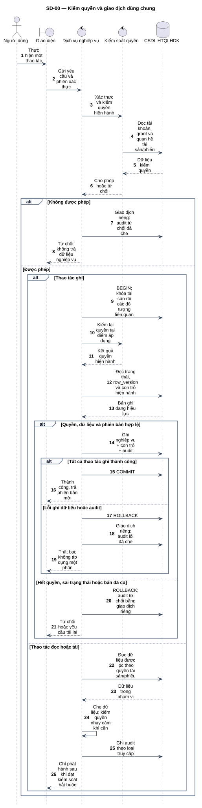

# SD-00 — Kiểm quyền và giao dịch dùng chung

Phiên bản 1.0 · 05/09/2026 · Đặc tả tương tác, chưa phải mã ứng dụng.

## 1. Mục tiêu và truy vết

**Kết quả cần đạt:** Yêu cầu hợp lệ được xử lý; mọi từ chối/lỗi không làm phát sinh thay đổi nghiệp vụ dở dang.

**Use Case:** UC-I02, UC-C07. [Danh mục và hợp đồng UC](../../dinh_dang_use_case_activity.md).

**Activity:** Quy tắc K-01/K-02 dùng chung cho mọi Activity.

**Tác nhân:** Người dùng.

## 2. Điều kiện và dữ liệu

**Tiền điều kiện:** Mỗi yêu cầu đến máy chủ; áp dụng cả đọc dữ liệu, ghi dữ liệu và tải tệp.

**Đầu vào:** Danh tính từ phiên xác thực; hành động; ID đối tượng; phạm vi tài sản; phiên bản đã đọc nếu cập nhật.

**Bảng liên quan:** `app_user`, `user_role`, `asset`, `audit_log`. Xem [từ điển dữ liệu](../../database/02_tu_dien_du_lieu.md).

**Quy tắc chung:** [SD-00](SD-00_kiem_quyen_va_giao_dich.md) áp dụng trên từng yêu cầu, bao gồm các nhánh lỗi không lặp lại đầy đủ trong hình. Không có quyền thì dừng trước bước đọc/ghi nghiệp vụ tiếp theo.

## 3. Các lifeline, từ trái sang phải

| Bí danh | Thành phần | Loại UML |
|---|---|---|
| `User` | Người dùng | actor |
| `UI` | Giao diện | boundary |
| `Svc` | Dịch vụ nghiệp vụ | control |
| `Auth` | Kiểm soát quyền | control |
| `DB` | CSDL HTQLHDK | database |

`Svc` là thành phần logic trong backend; không yêu cầu triển khai thành microservice. `DB` là cơ sở dữ liệu gồm các bảng liên quan, không phải một actor người dùng.

## 4. Trình tự nghiệp vụ

1. Giao diện gửi yêu cầu; máy chủ lấy danh tính từ phiên, không tin actor_id do trình duyệt khai báo.
2. Kiểm tài khoản hoạt động, vai trò, grant chưa thu hồi và quan hệ với đúng tài sản/phiếu.
3. Khi ghi, khóa đối tượng theo thứ tự ổn định và kiểm lại quyền, trạng thái, phiên bản.
4. Ghi dữ liệu nghiệp vụ, con trỏ hiện hành và audit trong cùng giao dịch; commit rồi mới trả thành công.
5. Khi lỗi hoặc bị từ chối, rollback phần nghiệp vụ và ghi audit riêng không chứa bí mật.

## 5. Nhánh thay thế và ngoại lệ

- Phiên không hợp lệ: không truy vấn nội dung nghiệp vụ, ghi audit từ chối với actor chưa xác định nếu cần.
- Sai phạm vi hoặc quyền đã bị thu hồi: từ chối; không tiết lộ đối tượng có tồn tại hay không.
- row_version hoặc current_event_id đã cũ: yêu cầu tải lại; không ghi đè thay đổi mới.
- Ghi audit bắt buộc thất bại: thao tác ghi rollback; đọc/tải nhạy cảm không phát hành dữ liệu.

Mọi lỗi kỹ thuật, từ chối và audit bắt buộc theo SD-00. Các bước ghi ký hiệu `TX` bao gồm kiểm điều kiện hiện hành, ghi nghiệp vụ và audit nguyên tử; không giữ khóa khi chờ thao tác người dùng. Dữ liệu chỉ được trả sau khi quyền và các kiểm soát bắt buộc đạt.

## 6. Sơ đồ và mã nguồn

[Ảnh PNG](../rendered/SD-00_kiem_quyen_va_giao_dich.png) · [SVG phóng to](../rendered/SD-00_kiem_quyen_va_giao_dich.svg) · [PlantUML](../plantuml/SD-00_kiem_quyen_va_giao_dich.puml) · [Mermaid](../mermaid/SD-00_kiem_quyen_va_giao_dich.mmd)

```plantuml
@startuml
hide footbox
skinparam backgroundColor #FFFFFF
skinparam shadowing false
skinparam defaultFontName Arial
skinparam defaultFontSize 13
skinparam sequenceMessageAlign center
skinparam maxMessageSize 58
skinparam BoxPadding 8
skinparam ArrowColor #334155
skinparam sequenceParticipantBackgroundColor #EAF2FB
skinparam sequenceParticipantBorderColor #334155
skinparam sequenceLifeLineBorderColor #94A3B8
skinparam sequenceGroupBorderColor #64748B
skinparam sequenceGroupHeaderFontColor #0F172A
skinparam sequenceGroupBackgroundColor #F8FAFC
skinparam sequenceReferenceBackgroundColor #EFF6FF
skinparam sequenceReferenceBorderColor #93C5FD
skinparam NoteBackgroundColor #FFF7E8
skinparam NoteBorderColor #D9A441
autonumber
title SD-00 — Kiểm quyền và giao dịch dùng chung
actor "Người dùng" as User
boundary "Giao diện" as UI
control "Dịch vụ nghiệp vụ" as Svc
control "Kiểm soát quyền" as Auth
database "CSDL HTQLHDK" as DB
User -> UI : Thực hiện một thao tác
UI -> Svc : Gửi yêu cầu và phiên xác thực
Svc -> Auth : Xác thực và kiểm quyền hiện hành
Auth -> DB : Đọc tài khoản, grant và quan hệ tài sản/phiếu
DB --> Auth : Dữ liệu kiểm quyền
Auth --> Svc : Cho phép hoặc từ chối
alt Không được phép
  Svc -> DB : Giao dịch riêng: audit từ chối đã che
  Svc --> UI : Từ chối, không trả dữ liệu nghiệp vụ
else Được phép
  alt Thao tác ghi
    Svc -> DB : BEGIN; khóa tài sản rồi các đối tượng liên quan
    Svc -> Auth : Kiểm lại quyền tại điểm áp dụng
    Auth --> Svc : Kết quả quyền hiện hành
    Svc -> DB : Đọc trạng thái, row_version và con trỏ hiện hành
    DB --> Svc : Bản ghi đang hiệu lực
    alt Quyền, dữ liệu và phiên bản hợp lệ
      Svc -> DB : Ghi nghiệp vụ + con trỏ + audit
      alt Tất cả thao tác ghi thành công
        Svc -> DB : COMMIT
        Svc --> UI : Thành công, trả phiên bản mới
      else Lỗi ghi dữ liệu hoặc audit
        Svc -> DB : ROLLBACK
        Svc -> DB : Giao dịch riêng: audit lỗi đã che
        Svc --> UI : Thất bại; không áp dụng một phần
      end
    else Hết quyền, sai trạng thái hoặc bản đã cũ
      Svc -> DB : ROLLBACK; audit từ chối bằng giao dịch riêng
      Svc --> UI : Từ chối hoặc yêu cầu tải lại
    end
  else Thao tác đọc hoặc tải
    Svc -> DB : Đọc dữ liệu được lọc theo quyền tài sản/phiếu
    DB --> Svc : Dữ liệu trong phạm vi
    Svc -> Svc : Che dữ liệu; kiểm quyền nhạy cảm khi cần
    Svc -> DB : Ghi audit theo loại truy cập
    Svc --> UI : Chỉ phát hành sau khi đạt kiểm soát bắt buộc
  end
end
@enduml
```

## 7. Lưu ý khi thiết kế và triển khai

Auth chỉ đọc dữ liệu phục vụ quyết định quyền trước khi cho phép; không trả nội dung lỗ hổng cho người chưa có quyền. Với ID không tồn tại, audit dùng object_id dạng chuỗi, không tạo FK giả. Nếu CSDL không ghi được audit lỗi, trả lỗi và ghi log vận hành tối thiểu đã che để đối soát; không báo thành công giả. Thông báo sau commit theo SD-18.

[Danh mục sơ đồ](../README.md) · [Quy ước](../00_quy_uoc_va_thanh_phan.md) · [Ma trận truy vết](../01_ma_tran_truy_vet.md)
