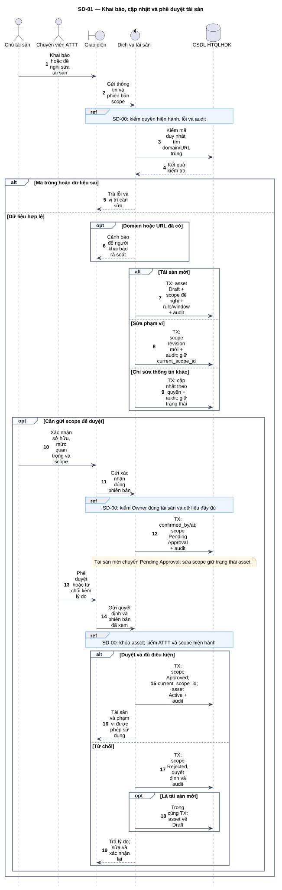
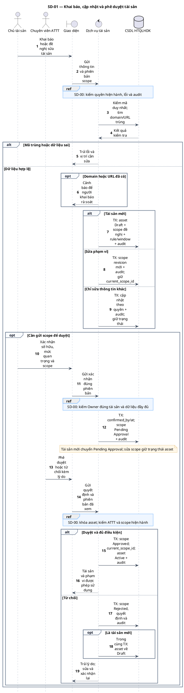

# SD-01 — Khai báo, cập nhật và phê duyệt tài sản

Phiên bản 1.0 · 05/09/2026 · Đặc tả tương tác, chưa phải mã ứng dụng.

## 1. Mục tiêu và truy vết

**Kết quả cần đạt:** Tài sản mới được duyệt thành Active; scope đề nghị chỉ có hiệu lực sau xác nhận và phê duyệt đúng phiên bản.

**Use Case:** UC-A01, UC-A02, UC-A03, UC-A04. [Danh mục và hợp đồng UC](../../dinh_dang_use_case_activity.md).

**Activity:** [AD-02](../../visual_paradigm_uml_md/03_activity_khai_bao_phe_duyet_tai_san.md).

**Tác nhân:** Chủ tài sản, Chuyên viên ATTT.

## 2. Điều kiện và dữ liệu

**Tiền điều kiện:** Chủ sở hữu/ATTT có quyền khai báo; khi sửa phải có quyền trên tài sản. Tài sản Retired xử lý theo SD-02.

**Đầu vào:** Mã, tên, domain, URL gốc, chủ sở hữu, nhóm kỹ thuật, mức quan trọng, scope Include/Exclude, khung giờ và lý do thay đổi.

**Bảng liên quan:** `asset`, `asset_scope_revision`, `asset_scope_rule`, `asset_scan_window`, `user_role`, `audit_log`. Xem [từ điển dữ liệu](../../database/02_tu_dien_du_lieu.md).

**Quy tắc chung:** [SD-00](SD-00_kiem_quyen_va_giao_dich.md) áp dụng trên từng yêu cầu, bao gồm các nhánh lỗi không lặp lại đầy đủ trong hình. Không có quyền thì dừng trước bước đọc/ghi nghiệp vụ tiếp theo.

## 3. Các lifeline, từ trái sang phải

| Bí danh | Thành phần | Loại UML |
|---|---|---|
| `Owner` | Chủ tài sản | actor |
| `Sec` | Chuyên viên ATTT | actor |
| `UI` | Giao diện | boundary |
| `Svc` | Dịch vụ tài sản | control |
| `DB` | CSDL HTQLHDK | database |

`Svc` là thành phần logic trong backend; không yêu cầu triển khai thành microservice. `DB` là cơ sở dữ liệu gồm các bảng liên quan, không phải một actor người dùng.

## 4. Trình tự nghiệp vụ

1. Người khai báo gửi thông tin; hệ thống kiểm mã duy nhất, domain/URL và cảnh báo trùng.
2. Tạo tài sản Draft hoặc lưu bản scope đề nghị mới; sửa thông tin không đổi scope giữ trạng thái hiện hành.
3. Chủ sở hữu xác nhận thông tin và phạm vi; hệ thống lưu người/thời điểm xác nhận.
4. ATTT rà soát đúng phiên bản đã xác nhận và quyết định.
5. Duyệt cập nhật current_scope_id và Active cùng audit; từ chối lưu lý do và giữ phạm vi cũ.

## 5. Nhánh thay thế và ngoại lệ

- Mã trùng hoặc URL sai: không lưu; domain/URL trùng chỉ cảnh báo, không tự cấm.
- Thiếu sở hữu/mức quan trọng/scope: chưa gửi duyệt; không kích hoạt tài sản.
- Scope thay đổi sau khi xác nhận hoặc đang chờ duyệt: phải xác nhận lại đúng phiên bản.
- Từ chối: tài sản mới về Draft; tài sản đang dùng giữ scope có hiệu lực.

Mọi lỗi kỹ thuật, từ chối và audit bắt buộc theo SD-00. Các bước ghi ký hiệu `TX` bao gồm kiểm điều kiện hiện hành, ghi nghiệp vụ và audit nguyên tử; không giữ khóa khi chờ thao tác người dùng. Dữ liệu chỉ được trả sau khi quyền và các kiểm soát bắt buộc đạt.

## 6. Sơ đồ và mã nguồn

[Ảnh PNG](../rendered/SD-01_khai_bao_phe_duyet_tai_san.png) · [SVG phóng to](../rendered/SD-01_khai_bao_phe_duyet_tai_san.svg) · [PlantUML](../plantuml/SD-01_khai_bao_phe_duyet_tai_san.puml) · [Mermaid](../mermaid/SD-01_khai_bao_phe_duyet_tai_san.mmd)

## 7. Lưu ý khi thiết kế và triển khai

Khai báo mới chưa có asset_id: chỉ OWNER/SECURITY theo quyền tạo trong ma trận cố định; không dùng grant NULL như quyền trên mọi tài sản. Sau tạo, quyền phạm vi phải được cấp hợp lệ mới làm các bước tiếp theo. Các bước TX là giao dịch ngắn riêng ở từng yêu cầu, không giữ khóa khi chờ con người duyệt.

[Danh mục sơ đồ](../README.md) · [Quy ước](../00_quy_uoc_va_thanh_phan.md) · [Ma trận truy vết](../01_ma_tran_truy_vet.md)
