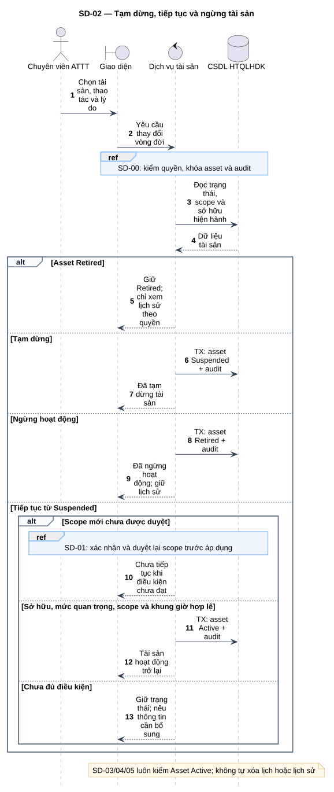
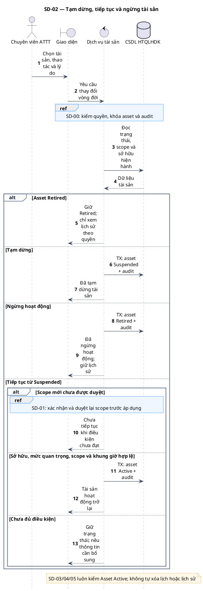

# SD-02 — Tạm dừng, tiếp tục và ngừng tài sản

Phiên bản 1.0 · 05/09/2026 · Đặc tả tương tác, chưa phải mã ứng dụng.

## 1. Mục tiêu và truy vết

**Kết quả cần đạt:** Suspended, Retired hoặc Active sau kiểm tra; dữ liệu lịch sử được giữ.

**Use Case:** UC-A02, UC-A05, UC-A06. [Danh mục và hợp đồng UC](../../dinh_dang_use_case_activity.md).

**Activity:** [AD-14](../../visual_paradigm_uml_md/15_activity_vong_doi_tai_san.md).

**Tác nhân:** Chuyên viên ATTT.

## 2. Điều kiện và dữ liệu

**Tiền điều kiện:** ATTT có quyền trên tài sản; thao tác dựa trên trạng thái hiện hành.

**Đầu vào:** asset_id, thao tác, lý do và phiên bản phạm vi liên quan.

**Bảng liên quan:** `asset`, `asset_scope_revision`, `scan_schedule`, `audit_log`. Xem [từ điển dữ liệu](../../database/02_tu_dien_du_lieu.md).

**Quy tắc chung:** [SD-00](SD-00_kiem_quyen_va_giao_dich.md) áp dụng trên từng yêu cầu, bao gồm các nhánh lỗi không lặp lại đầy đủ trong hình. Không có quyền thì dừng trước bước đọc/ghi nghiệp vụ tiếp theo.

## 3. Các lifeline, từ trái sang phải

| Bí danh | Thành phần | Loại UML |
|---|---|---|
| `Sec` | Chuyên viên ATTT | actor |
| `UI` | Giao diện | boundary |
| `Svc` | Dịch vụ tài sản | control |
| `DB` | CSDL HTQLHDK | database |

`Svc` là thành phần logic trong backend; không yêu cầu triển khai thành microservice. `DB` là cơ sở dữ liệu gồm các bảng liên quan, không phải một actor người dùng.

## 4. Trình tự nghiệp vụ

1. ATTT chọn thao tác và nhập lý do; hệ thống kiểm quyền, khóa tài sản và đọc trạng thái.
2. Tạm dừng đặt Suspended; ngừng hoạt động đặt Retired và ghi audit.
3. Tiếp tục chỉ xét tài sản Suspended còn đủ điều kiện; scope mới phải qua SD-01.
4. Các lần kích hoạt lịch, tạo kỳ quét và nhập tiếp theo đều kiểm asset Active.

## 5. Nhánh thay thế và ngoại lệ

- Retired: chỉ giữ/xem lịch sử; không tự suy diễn thao tác khôi phục.
- Scope chưa được duyệt: giữ Suspended, trả yêu cầu hoàn tất SD-01.
- Không hủy/xóa hàng loạt lịch hoặc lần quét chỉ vì tạm dừng tài sản.

Mọi lỗi kỹ thuật, từ chối và audit bắt buộc theo SD-00. Các bước ghi ký hiệu `TX` bao gồm kiểm điều kiện hiện hành, ghi nghiệp vụ và audit nguyên tử; không giữ khóa khi chờ thao tác người dùng. Dữ liệu chỉ được trả sau khi quyền và các kiểm soát bắt buộc đạt.

## 6. Sơ đồ và mã nguồn

[Ảnh PNG](../rendered/SD-02_vong_doi_tai_san.png) · [SVG phóng to](../rendered/SD-02_vong_doi_tai_san.svg) · [PlantUML](../plantuml/SD-02_vong_doi_tai_san.puml) · [Mermaid](../mermaid/SD-02_vong_doi_tai_san.mmd)

## 7. Lưu ý khi thiết kế và triển khai

Thông điệp là hợp đồng thiết kế ở mức thành phần, chưa ấn định framework, endpoint HTTP hoặc chữ ký hàm. Dữ liệu và trạng thái phải bám theo SQL hiện hành; không suy diễn mỗi thông điệp ghi là một giao dịch độc lập nếu hình ghi “cùng TX”.

[Danh mục sơ đồ](../README.md) · [Quy ước](../00_quy_uoc_va_thanh_phan.md) · [Ma trận truy vết](../01_ma_tran_truy_vet.md)
