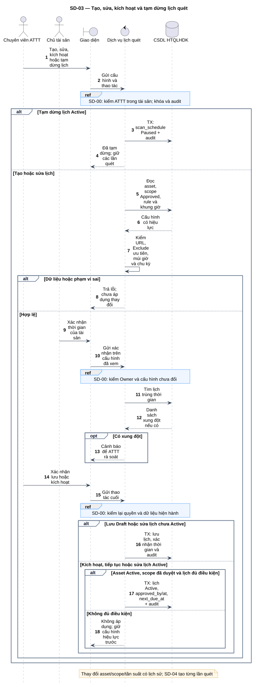
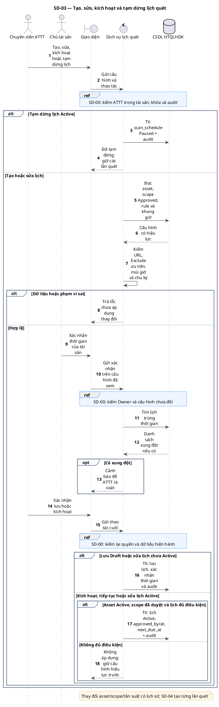

# SD-03 — Tạo, sửa, kích hoạt và tạm dừng lịch quét

Phiên bản 1.0 · 05/09/2026 · Đặc tả tương tác, chưa phải mã ứng dụng.

## 1. Mục tiêu và truy vết

**Kết quả cần đạt:** Lịch Draft/Active/Paused và lịch sử cập nhật; chưa chạy ZAP.

**Use Case:** UC-S01, UC-S02, UC-S03, UC-S04, UC-S08. [Danh mục và hợp đồng UC](../../dinh_dang_use_case_activity.md).

**Activity:** [AD-03](../../visual_paradigm_uml_md/04_activity_quan_ly_lich_quet.md).

**Tác nhân:** Chuyên viên ATTT, Chủ tài sản.

## 2. Điều kiện và dữ liệu

**Tiền điều kiện:** ATTT có quyền quản lý lịch; Chủ tài sản xác nhận thời gian trong đúng tài sản.

**Đầu vào:** Tài sản, scope_id, target_urls, tần suất, múi giờ, ngày hiệu lực/kết thúc, khung giờ, nhóm vận hành, ghi chú không chứa bí mật.

**Bảng liên quan:** `asset`, `asset_scope_revision`, `asset_scope_rule`, `asset_scan_window`, `scan_schedule`, `audit_log`. Xem [từ điển dữ liệu](../../database/02_tu_dien_du_lieu.md).

**Quy tắc chung:** [SD-00](SD-00_kiem_quyen_va_giao_dich.md) áp dụng trên từng yêu cầu, bao gồm các nhánh lỗi không lặp lại đầy đủ trong hình. Không có quyền thì dừng trước bước đọc/ghi nghiệp vụ tiếp theo.

## 3. Các lifeline, từ trái sang phải

| Bí danh | Thành phần | Loại UML |
|---|---|---|
| `Sec` | Chuyên viên ATTT | actor |
| `Owner` | Chủ tài sản | actor |
| `UI` | Giao diện | boundary |
| `Svc` | Dịch vụ lịch quét | control |
| `DB` | CSDL HTQLHDK | database |

`Svc` là thành phần logic trong backend; không yêu cầu triển khai thành microservice. `DB` là cơ sở dữ liệu gồm các bảng liên quan, không phải một actor người dùng.

## 4. Trình tự nghiệp vụ

1. ATTT nhập hoặc sửa cấu hình lịch; hệ thống kiểm URL, scope đã duyệt, thời gian và dữ liệu.
2. Chủ tài sản xác nhận thời gian; sửa thời gian sau xác nhận phải được xác nhận lại.
3. Lưu Draft hoặc cập nhật hợp lệ; cảnh báo lịch trùng thời gian để ATTT rà soát.
4. Kích hoạt/tiếp tục chỉ khi Asset Active, scope hiện hành hợp lệ và lịch còn hiệu lực.
5. Tạm dừng đặt Paused, giữ lịch sử và các lần quét.

## 5. Nhánh thay thế và ngoại lệ

- URL ngoài scope hoặc rơi vào Exclude: từ chối áp dụng.
- Asset không Active hoặc scope chưa duyệt: không kích hoạt và không áp dụng cập nhật Active.
- Xung đột thời gian: cảnh báo; không tự đặt quy tắc cấm tuyệt đối.
- Lịch Expired/Cancelled: không suy diễn quyền khôi phục khi nguồn chưa quy định.

Mọi lỗi kỹ thuật, từ chối và audit bắt buộc theo SD-00. Các bước ghi ký hiệu `TX` bao gồm kiểm điều kiện hiện hành, ghi nghiệp vụ và audit nguyên tử; không giữ khóa khi chờ thao tác người dùng. Dữ liệu chỉ được trả sau khi quyền và các kiểm soát bắt buộc đạt.

## 6. Sơ đồ và mã nguồn

[Ảnh PNG](../rendered/SD-03_quan_ly_lich_quet.png) · [SVG phóng to](../rendered/SD-03_quan_ly_lich_quet.svg) · [PlantUML](../plantuml/SD-03_quan_ly_lich_quet.puml) · [Mermaid](../mermaid/SD-03_quan_ly_lich_quet.mmd)

## 7. Lưu ý khi thiết kế và triển khai

Thông điệp là hợp đồng thiết kế ở mức thành phần, chưa ấn định framework, endpoint HTTP hoặc chữ ký hàm. Dữ liệu và trạng thái phải bám theo SQL hiện hành; không suy diễn mỗi thông điệp ghi là một giao dịch độc lập nếu hình ghi “cùng TX”.

[Danh mục sơ đồ](../README.md) · [Quy ước](../00_quy_uoc_va_thanh_phan.md) · [Ma trận truy vết](../01_ma_tran_truy_vet.md)
