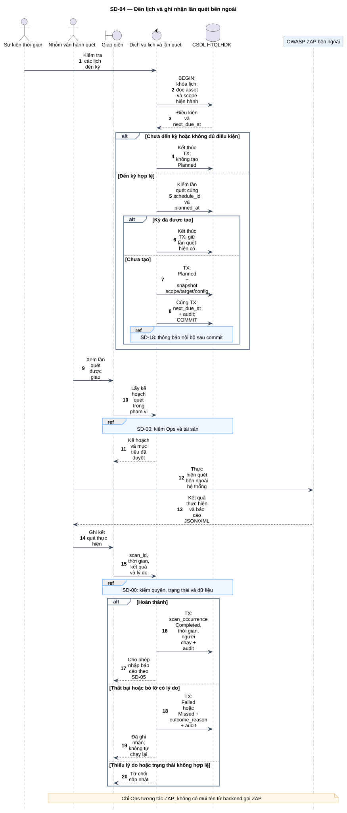
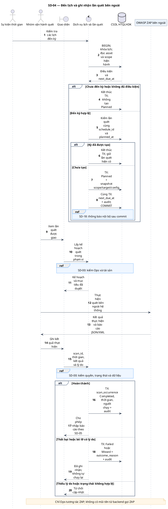

# SD-04 — Đến lịch và ghi nhận lần quét bên ngoài

Phiên bản 1.0 · 05/09/2026 · Đặc tả tương tác, chưa phải mã ứng dụng.

## 1. Mục tiêu và truy vết

**Kết quả cần đạt:** Tạo tối đa một Planned cho mỗi kỳ; Ops ghi kết quả thực tế; Completed chuyển sang nhập báo cáo SD-05.

**Use Case:** UC-S05, UC-S06, UC-S07. [Danh mục và hợp đồng UC](../../dinh_dang_use_case_activity.md).

**Activity:** [AD-11](../../visual_paradigm_uml_md/12_activity_thuc_hien_lan_quet.md).

**Tác nhân:** Sự kiện thời gian, Nhóm vận hành quét.

## 2. Điều kiện và dữ liệu

**Tiền điều kiện:** Một kỳ kiểm tra lịch hoặc yêu cầu cập nhật từ Ops có quyền; hệ thống chỉ quản lý lịch và kết quả thực hiện.

**Đầu vào:** Thời điểm kiểm tra; schedule_id; kỳ dự kiến; scan_id; thời điểm thực hiện; kết quả Completed/Failed/Missed và lý do.

**Bảng liên quan:** `asset`, `scan_schedule`, `scan_occurrence`, `audit_log`, `notification`. Xem [từ điển dữ liệu](../../database/02_tu_dien_du_lieu.md).

**Quy tắc chung:** [SD-00](SD-00_kiem_quyen_va_giao_dich.md) áp dụng trên từng yêu cầu, bao gồm các nhánh lỗi không lặp lại đầy đủ trong hình. Không có quyền thì dừng trước bước đọc/ghi nghiệp vụ tiếp theo.

## 3. Các lifeline, từ trái sang phải

| Bí danh | Thành phần | Loại UML |
|---|---|---|
| `Clock` | Sự kiện thời gian | actor |
| `Ops` | Nhóm vận hành quét | actor |
| `UI` | Giao diện | boundary |
| `Svc` | Dịch vụ lịch và lần quét | control |
| `DB` | CSDL HTQLHDK | database |
| `ZAP` | OWASP ZAP bên ngoài | participant |

`Svc` là thành phần logic trong backend; không yêu cầu triển khai thành microservice. `DB` là cơ sở dữ liệu gồm các bảng liên quan, không phải một actor người dùng.

## 4. Trình tự nghiệp vụ

1. Tác vụ lịch đọc lịch đến hạn và kiểm tài sản Active, lịch Active, scope và khung giờ.
2. Khóa lịch, kiểm kỳ đã tạo, lưu Planned với snapshot mục tiêu/cấu hình và cập nhật next_due_at cùng giao dịch.
3. Ops xem lần quét được giao, thực hiện OWASP ZAP ngoài hệ thống và xuất báo cáo.
4. Ops cập nhật kết quả thực tế; Failed/Missed bắt buộc lý do.
5. Hoàn thành mới nhập báo cáo; Result Imported do SD-05 xác lập.

## 5. Nhánh thay thế và ngoại lệ

- Chưa đến kỳ/lịch Paused/tài sản không Active: không tạo Planned.
- Hai tác vụ cùng xử lý một kỳ: khóa scan_schedule, kiểm lại kỳ đã có; chỉ tạo một lần quét.
- Failed hoặc Missed: lưu lý do, audit; không tự chạy thay thế.
- Scope đổi trước khi thực hiện: rà soát quyền/phạm vi hiện hành, không tự dùng scope chưa duyệt.

Mọi lỗi kỹ thuật, từ chối và audit bắt buộc theo SD-00. Các bước ghi ký hiệu `TX` bao gồm kiểm điều kiện hiện hành, ghi nghiệp vụ và audit nguyên tử; không giữ khóa khi chờ thao tác người dùng. Dữ liệu chỉ được trả sau khi quyền và các kiểm soát bắt buộc đạt.

## 6. Sơ đồ và mã nguồn

[Ảnh PNG](../rendered/SD-04_den_lich_quet_ben_ngoai.png) · [SVG phóng to](../rendered/SD-04_den_lich_quet_ben_ngoai.svg) · [PlantUML](../plantuml/SD-04_den_lich_quet_ben_ngoai.puml) · [Mermaid](../mermaid/SD-04_den_lich_quet_ben_ngoai.mmd)

## 7. Lưu ý khi thiết kế và triển khai

Chống trùng kỳ là hợp đồng ứng dụng trên khóa lịch; không khẳng định database hiện có UNIQUE(schedule_id, planned_at). Danh tính tác vụ hệ thống và audit actor_kind phân biệt với người dùng. Thông báo lịch sắp đến hạn/bỏ lỡ theo SD-18, không thêm dịch vụ email.

[Danh mục sơ đồ](../README.md) · [Quy ước](../00_quy_uoc_va_thanh_phan.md) · [Ma trận truy vết](../01_ma_tran_truy_vet.md)
