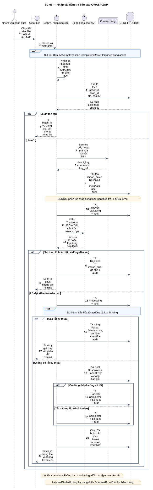

# SD-05 — Nhập và kiểm tra báo cáo OWASP ZAP

Phiên bản 1.0 · 05/09/2026 · Đặc tả tương tác, chưa phải mã ứng dụng.

## 1. Mục tiêu và truy vết

**Kết quả cần đạt:** Trả lô cũ nếu trùng; lô mới Completed/Partially Completed/Rejected/Failed và truy vết tệp gốc.

**Use Case:** UC-I01, UC-I02, UC-I03, UC-I04, UC-I05, UC-I06, UC-I07, UC-I09, UC-I11, UC-I12. [Danh mục và hợp đồng UC](../../dinh_dang_use_case_activity.md).

**Activity:** [AD-04](../../visual_paradigm_uml_md/05_activity_nhap_bao_cao_owasp_zap.md).

**Tác nhân:** Nhóm vận hành quét.

## 2. Điều kiện và dữ liệu

**Tiền điều kiện:** Ops có quyền nhập; Asset Active; lần quét cùng tài sản ở Completed hoặc Result Imported; có tệp báo cáo ZAP.

**Đầu vào:** asset_id, scan_id, tệp Traditional JSON/XML, phiên bản ZAP, mẫu báo cáo và metadata thực tế.

**Bảng liên quan:** `asset`, `scan_occurrence`, `import_batch`, `import_error`, `audit_log`. Xem [từ điển dữ liệu](../../database/02_tu_dien_du_lieu.md).

**Quy tắc chung:** [SD-00](SD-00_kiem_quyen_va_giao_dich.md) áp dụng trên từng yêu cầu, bao gồm các nhánh lỗi không lặp lại đầy đủ trong hình. Không có quyền thì dừng trước bước đọc/ghi nghiệp vụ tiếp theo.

## 3. Các lifeline, từ trái sang phải

| Bí danh | Thành phần | Loại UML |
|---|---|---|
| `Ops` | Nhóm vận hành quét | actor |
| `UI` | Giao diện | boundary |
| `Svc` | Dịch vụ nhập báo cáo | control |
| `Parser` | Bộ đọc báo cáo ZAP | control |
| `Store` | Kho tệp riêng | collections |
| `DB` | CSDL HTQLHDK | database |

`Svc` là thành phần logic trong backend; không yêu cầu triển khai thành microservice. `DB` là cơ sở dữ liệu gồm các bảng liên quan, không phải một actor người dùng.

## 4. Trình tự nghiệp vụ

1. Kiểm quyền và lần quét trước khi tra checksum; nhận tệp trong vùng tạm riêng với giới hạn kích thước.
2. Tính SHA-256 trên byte gốc, kiểm khóa lô asset + scan + checksum; trùng thì trả lô cũ.
3. Lưu byte gốc bất biến, mã hóa; ghi metadata Received và chuyển Validating.
4. Kiểm mẫu Traditional, cấu trúc toàn tệp, tài sản/phạm vi; phân loại lỗi cấp lô và lỗi từng bản ghi trước khi tạo Finding.
5. Gọi SD-06 cho từng dòng hợp lệ; lưu ImportError cho dòng lỗi và không làm mất dòng đã thành công.
6. Đối soát bộ đếm; hoàn tất lô và cập nhật lần quét Result Imported khi có lô Completed/Partially Completed.

## 5. Nhánh thay thế và ngoại lệ

- Cùng khóa lô, kể cả đồng thời: trả lô đã tồn tại ở bất kỳ trạng thái nào; không tự xử lý lại lô Failed.
- Sai toàn tệp/sai tài sản hoặc có bản ghi nhưng tất cả sai: Rejected trước ghi Finding.
- Báo cáo hợp lệ không Alert: Completed, tổng số 0; không tạo Finding giả.
- Có dòng đúng và sai: Partially Completed; báo rõ lỗi đã che và yêu cầu ATTT rà soát lỗi phạm vi.
- Lỗi kỹ thuật sau tạo lô: Failed, giữ truy vết phần đã commit; không kết luận xác minh hợp lệ.
- Kho tệp/CSDL lỗi trước tạo lô: trả lỗi và audit, dọn tệp tạm hoặc đối soát tệp chưa gắn metadata.

Mọi lỗi kỹ thuật, từ chối và audit bắt buộc theo SD-00. Các bước ghi ký hiệu `TX` bao gồm kiểm điều kiện hiện hành, ghi nghiệp vụ và audit nguyên tử; không giữ khóa khi chờ thao tác người dùng. Dữ liệu chỉ được trả sau khi quyền và các kiểm soát bắt buộc đạt.

## 6. Sơ đồ và mã nguồn

[Ảnh PNG](../rendered/SD-05_nhap_kiem_tra_bao_cao_zap.png) · [SVG phóng to](../rendered/SD-05_nhap_kiem_tra_bao_cao_zap.svg) · [PlantUML](../plantuml/SD-05_nhap_kiem_tra_bao_cao_zap.puml) · [Mermaid](../mermaid/SD-05_nhap_kiem_tra_bao_cao_zap.mmd)

```plantuml
@startuml
hide footbox
skinparam backgroundColor #FFFFFF
skinparam shadowing false
skinparam defaultFontName Arial
skinparam defaultFontSize 13
skinparam sequenceMessageAlign center
skinparam maxMessageSize 58
skinparam BoxPadding 8
skinparam ArrowColor #334155
skinparam sequenceParticipantBackgroundColor #EAF2FB
skinparam sequenceParticipantBorderColor #334155
skinparam sequenceLifeLineBorderColor #94A3B8
skinparam sequenceGroupBorderColor #64748B
skinparam sequenceGroupHeaderFontColor #0F172A
skinparam sequenceGroupBackgroundColor #F8FAFC
skinparam sequenceReferenceBackgroundColor #EFF6FF
skinparam sequenceReferenceBorderColor #93C5FD
skinparam NoteBackgroundColor #FFF7E8
skinparam NoteBorderColor #D9A441
autonumber
title SD-05 — Nhập và kiểm tra báo cáo OWASP ZAP
actor "Nhóm vận hành quét" as Ops
boundary "Giao diện" as UI
control "Dịch vụ nhập báo cáo" as Svc
control "Bộ đọc báo cáo ZAP" as Parser
collections "Kho tệp riêng" as Store
database "CSDL HTQLHDK" as DB
Ops -> UI : Chọn tài sản, lần quét và tệp ZAP
UI -> Svc : Tải tệp và metadata
ref over UI,DB : SD-00: Ops; Asset Active; scan Completed/Result Imported đúng asset
Svc -> Svc : Nhận có giới hạn; tính SHA-256 từ byte gốc
Svc -> DB : Tìm lô theo asset_id, scan_id, file_sha256
DB --> Svc : Lô hiện có hoặc chưa có
alt Lô đã tồn tại
  Svc --> UI : Trả batch_id và trạng thái cũ; không nhập lại
else Lô mới
  Svc -> Store : Lưu tệp gốc riêng, mã hóa và bất biến
  Store --> Svc : object_key, checksum, key_ref
  Svc -> DB : TX: tạo import_batch Received + metadata gốc + audit
  note over Svc,DB : UNIQUE phân xử nhập đồng thời; bên thua trả lô cũ và dừng
  Svc -> DB : TX: chuyển Validating + audit
  Svc -> Parser : Kiểm Traditional JSON/XML, cấu trúc, asset/scope
  Parser --> Svc : Lỗi toàn lô hoặc tập dòng hợp lệ/lỗi
  alt Sai toàn lô hoặc tất cả dòng đều sai
    Svc -> DB : TX: Rejected + import_error đã che + audit
    Svc --> UI : Lô bị từ chối; không tạo Finding
  else Lô đạt kiểm tra toàn cục
    Svc -> DB : TX: Processing + audit
    ref over Svc,DB : SD-06: chuẩn hóa từng dòng và lưu lỗi riêng
    alt Gặp lỗi kỹ thuật
      Svc -> DB : TX riêng: Failed, failure_code, bộ đếm thực tế + audit
      Svc --> UI : Lỗi xử lý; giữ truy vết phần đã commit
    else Không có lỗi kỹ thuật
      Svc -> DB : Đối soát Observation, ImportError và tổng bản ghi
      alt Có dòng thành công và lỗi
        Svc -> DB : TX: Partially Completed + bộ đếm + audit
      else Tất cả hợp lệ, kể cả 0 Alert
        Svc -> DB : TX: Completed + bộ đếm + audit
      end
      Svc -> DB : Cùng TX hoàn tất: scan Result Imported; COMMIT
      Svc --> UI : batch_id, trạng thái và thống kê đã che
    end
  end
end
note over Svc,Store : Lỗi kho/metadata: không báo thành công; đối soát tệp chưa liên kết
note over Svc,DB : Rejected/Failed không hạ trạng thái của scan đã có lô nhập thành công
@enduml
```

## 7. Lưu ý khi thiết kế và triển khai

Không giữ giao dịch SQL mở suốt thời gian upload/parse. Không có giao dịch ACID xuyên kho tệp và SQL: chuẩn bị tệp riêng trước, chỉ cho truy cập qua metadata đã commit; tệp tạm/chưa liên kết được đối soát theo chính sách, không xóa báo cáo gốc đã gắn lô. Parser XML phải vô hiệu external entities/DTD; nội dung mô tả ZAP là dữ liệu không tin cậy, phải escape khi hiển thị. Đây là kiểm soát triển khai parser, không phải chức năng điều khiển ZAP. Nếu tất cả dòng gặp lỗi kỹ thuật sau kiểm tra ban đầu: Failed, không dùng Partially Completed với 0 thành công. Lỗi dòng nghiệp vụ xác định ở tiền kiểm; SD-06 vẫn kiểm lại khi ghi.

[Danh mục sơ đồ](../README.md) · [Quy ước](../00_quy_uoc_va_thanh_phan.md) · [Ma trận truy vết](../01_ma_tran_truy_vet.md)
