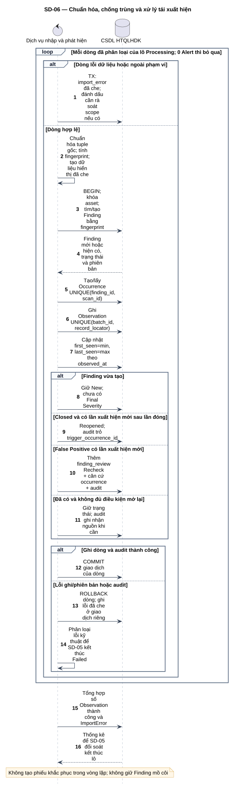

# SD-06 — Chuẩn hóa, chống trùng và xử lý tái xuất hiện

Phiên bản 1.0 · 05/09/2026 · Đặc tả tương tác, chưa phải mã ứng dụng.

## 1. Mục tiêu và truy vết

**Kết quả cần đạt:** Mỗi dòng thành công có Observation → Occurrence → Finding, truy ngược batch/scan/asset; không nhân đôi danh tính.

**Use Case:** UC-I07, UC-I08, UC-I09, UC-I10, UC-I11, UC-R11. [Danh mục và hợp đồng UC](../../dinh_dang_use_case_activity.md).

**Activity:** [AD-12](../../visual_paradigm_uml_md/13_activity_chuan_hoa_va_tai_xuat_hien.md), [AD-10](../../visual_paradigm_uml_md/11_activity_mo_lai_phat_hien.md).

**Tác nhân:** Xử lý nội bộ, chỉ gọi từ luồng cha đã kiểm quyền.

## 2. Điều kiện và dữ liệu

**Tiền điều kiện:** Được gọi nội bộ từ SD-05 khi lô Processing; đã qua kiểm tra toàn lô và phân loại từng dòng.

**Đầu vào:** batch_id, asset_id, scan_id, record_locator, Rule ID/Alert Ref, URL, tham số/input vector, HTTP method và dữ liệu nguồn.

**Bảng liên quan:** `import_batch`, `import_error`, `finding`, `finding_occurrence`, `finding_observation`, `finding_review`, `audit_log`. Xem [từ điển dữ liệu](../../database/02_tu_dien_du_lieu.md).

**Quy tắc chung:** [SD-00](SD-00_kiem_quyen_va_giao_dich.md) áp dụng trên từng yêu cầu, bao gồm các nhánh lỗi không lặp lại đầy đủ trong hình. Không có quyền thì dừng trước bước đọc/ghi nghiệp vụ tiếp theo.

## 3. Các lifeline, từ trái sang phải

| Bí danh | Thành phần | Loại UML |
|---|---|---|
| `Svc` | Dịch vụ nhập và phát hiện | control |
| `DB` | CSDL HTQLHDK | database |

`Svc` là thành phần logic trong backend; không yêu cầu triển khai thành microservice. `DB` là cơ sở dữ liệu gồm các bảng liên quan, không phải một actor người dùng.

## 4. Trình tự nghiệp vụ

1. Với mỗi dòng lỗi, lưu ImportError đã che; với dòng hợp lệ, chuẩn hóa danh tính trước khi che dữ liệu.
2. Tính fingerprint ổn định từ asset, rule, URL, parameter/input vector, HTTP method; không dùng Attack/Evidence.
3. Trong một giao dịch của dòng: tạo/lấy Finding, Occurrence theo Finding + scan và Observation theo batch + record_locator.
4. Cập nhật first_seen/last_seen theo thời điểm thực quét; giữ nguồn Risk và Confidence riêng.
5. Closed có lần xuất hiện mới sau lần đóng → Reopened; False Positive có yêu cầu Recheck; các trạng thái khác không tự chuyển.
6. Commit dữ liệu dòng và audit cùng nhau; lỗi dòng rollback rồi ghi lỗi riêng.

## 5. Nhánh thay thế và ngoại lệ

- Hai tệp khác nhau cùng scan chứa cùng Finding: dùng chung Occurrence, giữ Observation riêng.
- Cùng record_locator trong cùng batch: không tạo Observation hoặc chuyển trạng thái lặp.
- Báo cáo cũ nhập muộn: không tự coi là tái xuất hiện sau Closed; không lùi last_seen.
- False Positive tái xuất hiện: giữ trạng thái, thêm Recheck, không tự thêm cạnh FP → Reopened.
- Risk Accepted tiếp tục xuất hiện: ghi nguồn mới; chỉ SD-14 mở lại khi hết điều kiện.

Mọi lỗi kỹ thuật, từ chối và audit bắt buộc theo SD-00. Các bước ghi ký hiệu `TX` bao gồm kiểm điều kiện hiện hành, ghi nghiệp vụ và audit nguyên tử; không giữ khóa khi chờ thao tác người dùng. Dữ liệu chỉ được trả sau khi quyền và các kiểm soát bắt buộc đạt.

## 6. Sơ đồ và mã nguồn

[Ảnh PNG](../rendered/SD-06_chuan_hoa_chong_trung_tai_xuat_hien.png) · [SVG phóng to](../rendered/SD-06_chuan_hoa_chong_trung_tai_xuat_hien.svg) · [PlantUML](../plantuml/SD-06_chuan_hoa_chong_trung_tai_xuat_hien.puml) · [Mermaid](../mermaid/SD-06_chuan_hoa_chong_trung_tai_xuat_hien.mmd)

```plantuml
@startuml
hide footbox
skinparam backgroundColor #FFFFFF
skinparam shadowing false
skinparam defaultFontName Arial
skinparam defaultFontSize 13
skinparam sequenceMessageAlign center
skinparam maxMessageSize 58
skinparam BoxPadding 8
skinparam ArrowColor #334155
skinparam sequenceParticipantBackgroundColor #EAF2FB
skinparam sequenceParticipantBorderColor #334155
skinparam sequenceLifeLineBorderColor #94A3B8
skinparam sequenceGroupBorderColor #64748B
skinparam sequenceGroupHeaderFontColor #0F172A
skinparam sequenceGroupBackgroundColor #F8FAFC
skinparam sequenceReferenceBackgroundColor #EFF6FF
skinparam sequenceReferenceBorderColor #93C5FD
skinparam NoteBackgroundColor #FFF7E8
skinparam NoteBorderColor #D9A441
autonumber
title SD-06 — Chuẩn hóa, chống trùng và xử lý tái xuất hiện
control "Dịch vụ nhập và phát hiện" as Svc
database "CSDL HTQLHDK" as DB
loop Mỗi dòng đã phân loại của lô Processing; 0 Alert thì bỏ qua
  alt Dòng lỗi dữ liệu hoặc ngoài phạm vi
    Svc -> DB : TX: import_error đã che; đánh dấu cần rà soát scope nếu có
  else Dòng hợp lệ
    Svc -> Svc : Chuẩn hóa tuple gốc; tính fingerprint; tạo dữ liệu hiển thị đã che
    Svc -> DB : BEGIN; khóa asset; tìm/tạo Finding bằng fingerprint
    DB --> Svc : Finding mới hoặc hiện có, trạng thái và phiên bản
    Svc -> DB : Tạo/lấy Occurrence UNIQUE(finding_id, scan_id)
    Svc -> DB : Ghi Observation UNIQUE(batch_id, record_locator)
    Svc -> DB : Cập nhật first_seen=min, last_seen=max theo observed_at
    alt Finding vừa tạo
      Svc -> DB : Giữ New; chưa có Final Severity
    else Closed và có lần xuất hiện mới sau lần đóng
      Svc -> DB : Reopened; audit trỏ trigger_occurrence_id
    else False Positive có lần xuất hiện mới
      Svc -> DB : Thêm finding_review Recheck + căn cứ occurrence + audit
    else Đã có và không đủ điều kiện mở lại
      Svc -> DB : Giữ trạng thái; audit ghi nhận nguồn khi cần
    end
    alt Ghi dòng và audit thành công
      Svc -> DB : COMMIT giao dịch của dòng
    else Lỗi ghi/phiên bản hoặc audit
      Svc -> DB : ROLLBACK dòng; ghi lỗi đã che ở giao dịch riêng
      Svc -> Svc : Phân loại lỗi kỹ thuật để SD-05 kết thúc Failed
    end
  end
end
Svc -> DB : Tổng hợp số Observation thành công và ImportError
DB --> Svc : Thống kê để SD-05 đối soát kết thúc lô
note over Svc,DB : Không tạo phiếu khắc phục trong vòng lặp; không giữ Finding mồ côi
@enduml
```

## 7. Lưu ý khi thiết kế và triển khai

Fingerprint theo hợp đồng database mục 3: đề xuất HMAC-SHA-256 có identity_version, identity_key_ref và tuple mã hóa để đối chiếu. Quy tắc chuẩn hóa cần được hiện thực và kiểm thử với báo cáo thật trước dùng; tài liệu này không khẳng định parser đã tồn tại. Một bản ghi nguồn tương ứng vị trí alert/instance theo quy ước parser; record_locator phải ổn định trong cùng tệp. UNIQUE phân xử các cuộc đua; thao tác get-or-create cần xử lý xung đột mà không hủy dữ liệu dòng. Số thành công đếm Observation, không đếm Finding mới.

[Danh mục sơ đồ](../README.md) · [Quy ước](../00_quy_uoc_va_thanh_phan.md) · [Ma trận truy vết](../01_ma_tran_truy_vet.md)
