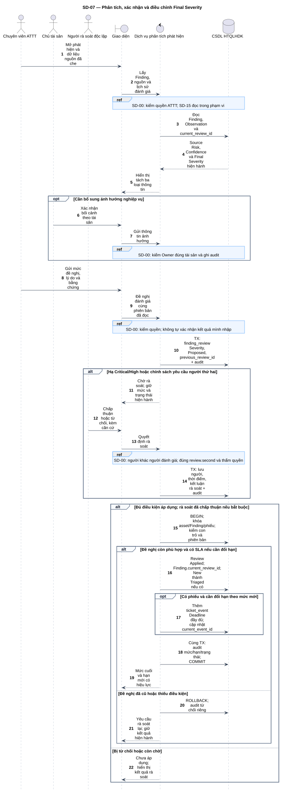

# SD-07 — Phân tích, xác nhận và điều chỉnh Final Severity

Phiên bản 1.0 · 05/09/2026 · Đặc tả tương tác, chưa phải mã ứng dụng.

## 1. Mục tiêu và truy vết

**Kết quả cần đạt:** Review được Applied và mức cuối hiện hành truy qua current_review_id; New → Triaged khi hợp lệ; lịch sử nguồn giữ nguyên.

**Use Case:** UC-T01, UC-T02, UC-T05, UC-T06. [Danh mục và hợp đồng UC](../../dinh_dang_use_case_activity.md).

**Activity:** [AD-05](../../visual_paradigm_uml_md/06_activity_phan_tich_final_severity.md).

**Tác nhân:** Chuyên viên ATTT, Chủ tài sản, Người rà soát độc lập.

## 2. Điều kiện và dữ liệu

**Tiền điều kiện:** ATTT có quyền phân tích; New khi triage, hoặc có đánh giá hiện hành khi điều chỉnh. Người nhập không tự xác nhận mức cuối của chính kết quả đó.

**Đầu vào:** finding_id, row_version, current_review_id đã xem, mức đề nghị, lý do, bằng chứng, bối cảnh và chính sách rà soát.

**Bảng liên quan:** `finding`, `finding_observation`, `finding_review`, `evidence`, `sla_rule`, `remediation_ticket`, `ticket_event`, `audit_log`. Xem [từ điển dữ liệu](../../database/02_tu_dien_du_lieu.md).

**Quy tắc chung:** [SD-00](SD-00_kiem_quyen_va_giao_dich.md) áp dụng trên từng yêu cầu, bao gồm các nhánh lỗi không lặp lại đầy đủ trong hình. Không có quyền thì dừng trước bước đọc/ghi nghiệp vụ tiếp theo.

## 3. Các lifeline, từ trái sang phải

| Bí danh | Thành phần | Loại UML |
|---|---|---|
| `Sec` | Chuyên viên ATTT | actor |
| `Owner` | Chủ tài sản | actor |
| `Reviewer` | Người rà soát độc lập | actor |
| `UI` | Giao diện | boundary |
| `Svc` | Dịch vụ phân tích phát hiện | control |
| `DB` | CSDL HTQLHDK | database |

`Svc` là thành phần logic trong backend; không yêu cầu triển khai thành microservice. `DB` là cơ sở dữ liệu gồm các bảng liên quan, không phải một actor người dùng.

## 4. Trình tự nghiệp vụ

1. ATTT đọc dữ liệu đã che và nguồn Risk/Confidence; yêu cầu Owner xác nhận ảnh hưởng nếu cần.
2. Gửi mức đề nghị cùng lý do, bằng chứng và căn cứ mức cũ.
3. Hạ Critical/High phải chờ người thứ hai độc lập, đúng thẩm quyền; chưa có kết quả thì giữ mức hiện hành.
4. Khi áp dụng, khóa Finding và kiểm lại current_review_id để tránh áp đề nghị cũ.
5. Ghi Applied, cập nhật current_review_id, chuyển New → Triaged nếu phù hợp; cập nhật hạn phiếu bị ảnh hưởng cùng audit.

## 5. Nhánh thay thế và ngoại lệ

- Thiếu bằng chứng, lý do hoặc tự đánh giá kết quả mình nhập: từ chối.
- Người thứ hai không độc lập/sai thẩm quyền: không áp dụng; phản hồi và audit.
- Người rà soát từ chối: Review Rejected; giữ mức và trạng thái hiện hành.
- Đề nghị dựa trên review cũ: yêu cầu đánh giá lại, không ghi đè.
- Thiếu SLA được duyệt khi cần đổi hạn phiếu: chưa áp dụng toàn bộ thay đổi; không tự đặt số ngày.

Mọi lỗi kỹ thuật, từ chối và audit bắt buộc theo SD-00. Các bước ghi ký hiệu `TX` bao gồm kiểm điều kiện hiện hành, ghi nghiệp vụ và audit nguyên tử; không giữ khóa khi chờ thao tác người dùng. Dữ liệu chỉ được trả sau khi quyền và các kiểm soát bắt buộc đạt.

## 6. Sơ đồ và mã nguồn

[Ảnh PNG](../rendered/SD-07_phan_tich_final_severity.png) · [SVG phóng to](../rendered/SD-07_phan_tich_final_severity.svg) · [PlantUML](../plantuml/SD-07_phan_tich_final_severity.puml) · [Mermaid](../mermaid/SD-07_phan_tich_final_severity.mmd)

```plantuml
@startuml
hide footbox
skinparam backgroundColor #FFFFFF
skinparam shadowing false
skinparam defaultFontName Arial
skinparam defaultFontSize 13
skinparam sequenceMessageAlign center
skinparam maxMessageSize 58
skinparam BoxPadding 8
skinparam ArrowColor #334155
skinparam sequenceParticipantBackgroundColor #EAF2FB
skinparam sequenceParticipantBorderColor #334155
skinparam sequenceLifeLineBorderColor #94A3B8
skinparam sequenceGroupBorderColor #64748B
skinparam sequenceGroupHeaderFontColor #0F172A
skinparam sequenceGroupBackgroundColor #F8FAFC
skinparam sequenceReferenceBackgroundColor #EFF6FF
skinparam sequenceReferenceBorderColor #93C5FD
skinparam NoteBackgroundColor #FFF7E8
skinparam NoteBorderColor #D9A441
autonumber
title SD-07 — Phân tích, xác nhận và điều chỉnh Final Severity
actor "Chuyên viên ATTT" as Sec
actor "Chủ tài sản" as Owner
actor "Người rà soát độc lập" as Reviewer
boundary "Giao diện" as UI
control "Dịch vụ phân tích phát hiện" as Svc
database "CSDL HTQLHDK" as DB
Sec -> UI : Mở phát hiện và dữ liệu nguồn đã che
UI -> Svc : Lấy Finding, nguồn và lịch sử đánh giá
ref over UI,DB : SD-00: kiểm quyền ATTT; SD-15 đọc trong phạm vi
Svc -> DB : Đọc Finding, Observation và current_review_id
DB --> Svc : Source Risk, Confidence và Final Severity hiện hành
Svc --> UI : Hiển thị tách ba loại thông tin
opt Cần bổ sung ảnh hưởng nghiệp vụ
  Owner -> UI : Xác nhận bối cảnh theo tài sản
  UI -> Svc : Gửi thông tin ảnh hưởng
  ref over UI,DB : SD-00: kiểm Owner đúng tài sản và ghi audit
end
Sec -> UI : Gửi mức đề nghị, lý do và bằng chứng
UI -> Svc : Đề nghị đánh giá cùng phiên bản đã đọc
ref over UI,DB : SD-00: kiểm quyền; không tự xác nhận kết quả mình nhập
Svc -> DB : TX: finding_review Severity, Proposed, previous_review_id + audit
alt Hạ Critical/High hoặc chính sách yêu cầu người thứ hai
  Svc --> UI : Chờ rà soát; giữ mức và trạng thái hiện hành
  Reviewer -> UI : Chấp thuận hoặc từ chối, kèm căn cứ
  UI -> Svc : Quyết định rà soát
  ref over UI,DB : SD-00: người khác người đánh giá; đúng review.second và thẩm quyền
  Svc -> DB : TX: lưu người, thời điểm, kết luận rà soát + audit
end
alt Đủ điều kiện áp dụng; rà soát đã chấp thuận nếu bắt buộc
  Svc -> DB : BEGIN; khóa asset/Finding/phiếu; kiểm con trỏ và phiên bản
  alt Đề nghị còn phù hợp và có SLA nếu cần đổi hạn
    Svc -> DB : Review Applied; Finding.current_review_id; New thành Triaged nếu có
    opt Có phiếu và cần đổi hạn theo mức mới
      Svc -> DB : Thêm ticket_event Deadline đầy đủ; cập nhật current_event_id
    end
    Svc -> DB : Cùng TX: audit mức/hạn/trạng thái; COMMIT
    Svc --> UI : Mức cuối và hạn mới có hiệu lực
  else Đề nghị đã cũ hoặc thiếu điều kiện
    Svc -> DB : ROLLBACK; audit từ chối riêng
    Svc --> UI : Yêu cầu rà soát lại; giữ kết quả hiện hành
  end
else Bị từ chối hoặc còn chờ
  Svc --> UI : Chưa áp dụng; hiển thị kết quả rà soát
end
@enduml
```

## 7. Lưu ý khi thiết kế và triển khai

Không thêm cột final_severity vào finding: database truy mức hiện hành từ finding_review qua current_review_id, có view v_finding_current. Source High không tự thành Critical; Confidence không được dùng thay severity. Lý do và các trường nhập tay phải lọc bí mật trước lưu/hiển thị dù tên cột không có hậu tố _masked. SD-09 quy định chuỗi sự kiện và snapshot hạn; khi thay mức ảnh hưởng hạn, các cập nhật liên quan nằm trong cùng giao dịch áp dụng mức.

[Danh mục sơ đồ](../README.md) · [Quy ước](../00_quy_uoc_va_thanh_phan.md) · [Ma trận truy vết](../01_ma_tran_truy_vet.md)
