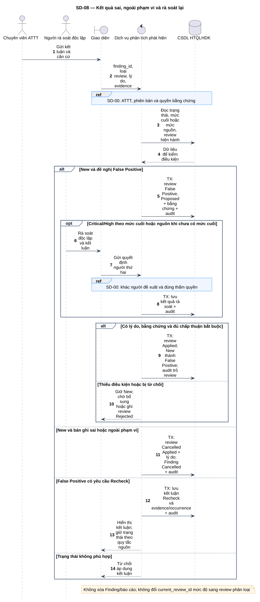
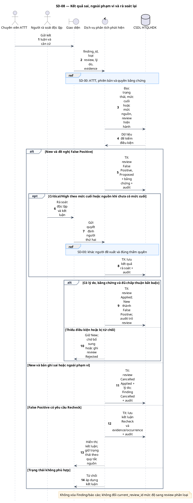

# SD-08 — Kết quả sai, ngoài phạm vi và rà soát lại

Phiên bản 1.0 · 05/09/2026 · Đặc tả tương tác, chưa phải mã ứng dụng.

## 1. Mục tiêu và truy vết

**Kết quả cần đạt:** New → False Positive/Cancelled theo căn cứ; Recheck lưu kết luận mà không tự thêm cạnh đảo ngược False Positive.

**Use Case:** UC-T01, UC-T03, UC-T04, UC-T06. [Danh mục và hợp đồng UC](../../dinh_dang_use_case_activity.md).

**Activity:** [AD-07](../../visual_paradigm_uml_md/09_activity_false_positive_ngoai_pham_vi.md).

**Tác nhân:** Chuyên viên ATTT, Người rà soát độc lập.

## 2. Điều kiện và dữ liệu

**Tiền điều kiện:** ATTT xử lý Finding New; hoặc có yêu cầu Recheck do False Positive tái xuất hiện.

**Đầu vào:** finding_id, loại kết luận, lý do, bằng chứng; review/occurrence liên quan; kết quả rà soát thứ hai khi cần.

**Bảng liên quan:** `finding`, `finding_observation`, `finding_review`, `evidence`, `audit_log`. Xem [từ điển dữ liệu](../../database/02_tu_dien_du_lieu.md).

**Quy tắc chung:** [SD-00](SD-00_kiem_quyen_va_giao_dich.md) áp dụng trên từng yêu cầu, bao gồm các nhánh lỗi không lặp lại đầy đủ trong hình. Không có quyền thì dừng trước bước đọc/ghi nghiệp vụ tiếp theo.

## 3. Các lifeline, từ trái sang phải

| Bí danh | Thành phần | Loại UML |
|---|---|---|
| `Sec` | Chuyên viên ATTT | actor |
| `Reviewer` | Người rà soát độc lập | actor |
| `UI` | Giao diện | boundary |
| `Svc` | Dịch vụ phân tích phát hiện | control |
| `DB` | CSDL HTQLHDK | database |

`Svc` là thành phần logic trong backend; không yêu cầu triển khai thành microservice. `DB` là cơ sở dữ liệu gồm các bảng liên quan, không phải một actor người dùng.

## 4. Trình tự nghiệp vụ

1. ATTT xem dữ liệu nguồn và bằng chứng, chọn False Positive hoặc Cancelled.
2. False Positive phải có lý do và bằng chứng; Critical/High cần người thứ hai khác người đề xuất.
3. Khi đủ điều kiện, lưu finding_review Applied và cập nhật trạng thái cùng audit trỏ review.
4. Với Recheck, lưu kết luận và căn cứ lần xuất hiện mới; không tự bỏ qua cảnh báo tái xuất hiện.

## 5. Nhánh thay thế và ngoại lệ

- Chưa có Final Severity: dùng mức nguồn để không bỏ lọt yêu cầu rà soát High.
- Thiếu bằng chứng hoặc người thứ hai chưa đồng ý: giữ New và review Proposed.
- New → Cancelled cần lý do bản ghi sai/ngoài phạm vi; giữ báo cáo gốc.
- Recheck đảo ngược kết luận cũ: ghi nhận và chờ quy tắc nghiệp vụ bổ sung, không tự chuyển FP → Reopened.

Mọi lỗi kỹ thuật, từ chối và audit bắt buộc theo SD-00. Các bước ghi ký hiệu `TX` bao gồm kiểm điều kiện hiện hành, ghi nghiệp vụ và audit nguyên tử; không giữ khóa khi chờ thao tác người dùng. Dữ liệu chỉ được trả sau khi quyền và các kiểm soát bắt buộc đạt.

## 6. Sơ đồ và mã nguồn

[Ảnh PNG](../rendered/SD-08_false_positive_ngoai_pham_vi.png) · [SVG phóng to](../rendered/SD-08_false_positive_ngoai_pham_vi.svg) · [PlantUML](../plantuml/SD-08_false_positive_ngoai_pham_vi.puml) · [Mermaid](../mermaid/SD-08_false_positive_ngoai_pham_vi.mmd)

## 7. Lưu ý khi thiết kế và triển khai

current_review_id là con trỏ đánh giá mức độ hiện hành; review False Positive/Cancelled được truy qua audit, không làm mất lịch sử severity. Rà soát Recheck vẫn tuân kiểm quyền, bằng chứng, căn cứ và các điều kiện rà soát độc lập phù hợp; không coi đó là cách bỏ qua điều kiện của kết luận False Positive.

[Danh mục sơ đồ](../README.md) · [Quy ước](../00_quy_uoc_va_thanh_phan.md) · [Ma trận truy vết](../01_ma_tran_truy_vet.md)
