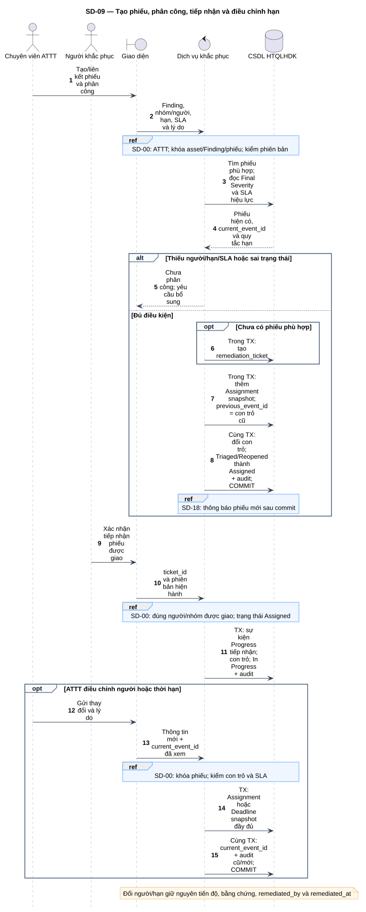
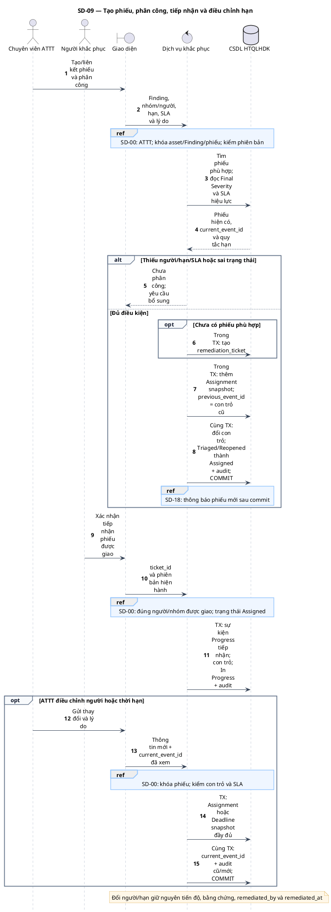

# SD-09 — Tạo phiếu, phân công, tiếp nhận và điều chỉnh hạn

Phiên bản 1.0 · 05/09/2026 · Đặc tả tương tác, chưa phải mã ứng dụng.

## 1. Mục tiêu và truy vết

**Kết quả cần đạt:** Tạo/liên kết phiếu phù hợp, Assigned rồi In Progress khi tiếp nhận; mọi đổi người/hạn có lịch sử đầy đủ.

**Use Case:** UC-R01, UC-R02, UC-R03, UC-R13. [Danh mục và hợp đồng UC](../../dinh_dang_use_case_activity.md).

**Activity:** [AD-06](../../visual_paradigm_uml_md/07_activity_khac_phuc_va_xac_minh.md), [AD-16](../../visual_paradigm_uml_md/17_activity_thoi_han_thong_bao.md).

**Tác nhân:** Chuyên viên ATTT, Người khắc phục.

## 2. Điều kiện và dữ liệu

**Tiền điều kiện:** ATTT phân công từ Triaged/Reopened; người khắc phục tiếp nhận từ Assigned. Điều chỉnh chỉ trên phiếu có quyền.

**Đầu vào:** finding_id, ticket_id nếu có, nhóm/người phụ trách, SLA được duyệt, thời hạn và lý do; current_event_id đã đọc.

**Bảng liên quan:** `finding`, `remediation_ticket`, `ticket_event`, `sla_rule`, `team`, `team_member`, `audit_log`. Xem [từ điển dữ liệu](../../database/02_tu_dien_du_lieu.md).

**Quy tắc chung:** [SD-00](SD-00_kiem_quyen_va_giao_dich.md) áp dụng trên từng yêu cầu, bao gồm các nhánh lỗi không lặp lại đầy đủ trong hình. Không có quyền thì dừng trước bước đọc/ghi nghiệp vụ tiếp theo.

## 3. Các lifeline, từ trái sang phải

| Bí danh | Thành phần | Loại UML |
|---|---|---|
| `Sec` | Chuyên viên ATTT | actor |
| `Fix` | Người khắc phục | actor |
| `UI` | Giao diện | boundary |
| `Svc` | Dịch vụ khắc phục | control |
| `DB` | CSDL HTQLHDK | database |

`Svc` là thành phần logic trong backend; không yêu cầu triển khai thành microservice. `DB` là cơ sở dữ liệu gồm các bảng liên quan, không phải một actor người dùng.

## 4. Trình tự nghiệp vụ

1. ATTT chọn người và hạn theo SLA đã được đơn vị phê duyệt; khóa Finding/phiếu.
2. Tìm phiếu phù hợp trong chu kỳ xử lý để liên kết; chỉ tạo khi cần, không tạo mỗi lần nhập hoặc mở lại.
3. Ghi ticket_event Assignment dạng snapshot, cập nhật current_event_id; Triaged/Reopened → Assigned.
4. Người được giao xác nhận tiếp nhận; Assigned → In Progress và ghi sự kiện/audit.
5. Đổi người hoặc hạn thêm sự kiện mới dựa trên con trỏ hiện hành, giữ dữ liệu bản sửa và lý do.

## 5. Nhánh thay thế và ngoại lệ

- Thiếu người phụ trách/hạn hoặc SLA chưa được duyệt: chưa phân công.
- Reopened: phải xác định thời hạn mới, không tự tái dùng hạn cũ.
- Người khác người được giao/ngoài nhóm được giao: không được tiếp nhận.
- Con trỏ sự kiện đã cũ: tải lại, không nối lịch sử vào bản lỗi thời.

Mọi lỗi kỹ thuật, từ chối và audit bắt buộc theo SD-00. Các bước ghi ký hiệu `TX` bao gồm kiểm điều kiện hiện hành, ghi nghiệp vụ và audit nguyên tử; không giữ khóa khi chờ thao tác người dùng. Dữ liệu chỉ được trả sau khi quyền và các kiểm soát bắt buộc đạt.

## 6. Sơ đồ và mã nguồn

[Ảnh PNG](../rendered/SD-09_phan_cong_tiep_nhan_dieu_chinh_han.png) · [SVG phóng to](../rendered/SD-09_phan_cong_tiep_nhan_dieu_chinh_han.svg) · [PlantUML](../plantuml/SD-09_phan_cong_tiep_nhan_dieu_chinh_han.puml) · [Mermaid](../mermaid/SD-09_phan_cong_tiep_nhan_dieu_chinh_han.mmd)

## 7. Lưu ý khi thiết kế và triển khai

Nguồn không giới hạn một phiếu cho toàn bộ vòng đời Finding; database không có UNIQUE(finding_id) trên phiếu. Ứng dụng cần chống tạo trùng do gửi lại thao tác bằng khóa và kiểm phiếu hiện hành. Người đổi hạn không trở thành tác giả khắc phục. Thông báo lỗi không rollback phiếu đã commit; xử lý phục hồi theo SD-18.

[Danh mục sơ đồ](../README.md) · [Quy ước](../00_quy_uoc_va_thanh_phan.md) · [Ma trận truy vết](../01_ma_tran_truy_vet.md)
