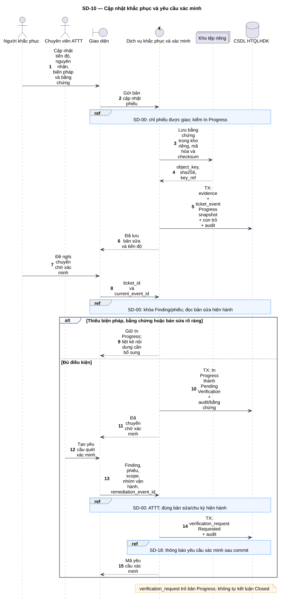
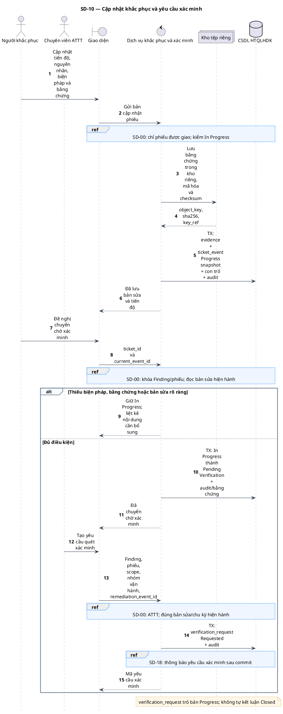

# SD-10 — Cập nhật khắc phục và yêu cầu xác minh

Phiên bản 1.0 · 05/09/2026 · Đặc tả tương tác, chưa phải mã ứng dụng.

## 1. Mục tiêu và truy vết

**Kết quả cần đạt:** Bản sửa được lưu bất biến qua ticket_event; đủ điều kiện mới Pending Verification; yêu cầu tham chiếu đúng remediation_event_id.

**Use Case:** UC-R04, UC-R05, UC-R06, UC-R07. [Danh mục và hợp đồng UC](../../dinh_dang_use_case_activity.md).

**Activity:** [AD-06](../../visual_paradigm_uml_md/07_activity_khac_phuc_va_xac_minh.md).

**Tác nhân:** Người khắc phục, Chuyên viên ATTT.

## 2. Điều kiện và dữ liệu

**Tiền điều kiện:** Finding In Progress, người cập nhật có quyền trên phiếu được giao; ATTT tạo yêu cầu xác minh từ Pending Verification.

**Đầu vào:** Tiến độ, nguyên nhân, biện pháp, bằng chứng, thời điểm bản sửa; yêu cầu xác minh gắn scope và nhóm vận hành.

**Bảng liên quan:** `finding`, `remediation_ticket`, `ticket_event`, `evidence`, `verification_request`, `audit_log`, `notification`. Xem [từ điển dữ liệu](../../database/02_tu_dien_du_lieu.md).

**Quy tắc chung:** [SD-00](SD-00_kiem_quyen_va_giao_dich.md) áp dụng trên từng yêu cầu, bao gồm các nhánh lỗi không lặp lại đầy đủ trong hình. Không có quyền thì dừng trước bước đọc/ghi nghiệp vụ tiếp theo.

## 3. Các lifeline, từ trái sang phải

| Bí danh | Thành phần | Loại UML |
|---|---|---|
| `Fix` | Người khắc phục | actor |
| `Sec` | Chuyên viên ATTT | actor |
| `UI` | Giao diện | boundary |
| `Svc` | Dịch vụ khắc phục và xác minh | control |
| `Store` | Kho tệp riêng | collections |
| `DB` | CSDL HTQLHDK | database |

`Svc` là thành phần logic trong backend; không yêu cầu triển khai thành microservice. `DB` là cơ sở dữ liệu gồm các bảng liên quan, không phải một actor người dùng.

## 4. Trình tự nghiệp vụ

1. Người khắc phục cập nhật tiến độ và gửi bằng chứng; kho riêng lưu bằng chứng, giao diện chỉ hiển thị phần đã che.
2. Lưu Progress snapshot và con trỏ cùng audit; xác định người/thời điểm khắc phục từ phía máy chủ.
3. Khi yêu cầu chờ xác minh, kiểm có biện pháp, bằng chứng và bản sửa rõ ràng; đủ mới chuyển Pending Verification.
4. ATTT tạo verification_request gắn tài sản, Finding, phiếu, scope, nhóm vận hành và đúng bản sửa.
5. Thông báo yêu cầu xác minh cho nhóm có quyền sau commit.

## 5. Nhánh thay thế và ngoại lệ

- 100% tiến độ nhưng thiếu biện pháp hoặc bằng chứng: giữ In Progress.
- Tải bằng chứng thất bại hoặc thiếu metadata toàn vẹn: chưa chuyển Pending Verification.
- Bản sửa/phiếu đã thay đổi: phải rà soát lại, không tạo yêu cầu trên bản cũ vô tình.
- Nhóm khắc phục không được gửi thao tác Closed.

Mọi lỗi kỹ thuật, từ chối và audit bắt buộc theo SD-00. Các bước ghi ký hiệu `TX` bao gồm kiểm điều kiện hiện hành, ghi nghiệp vụ và audit nguyên tử; không giữ khóa khi chờ thao tác người dùng. Dữ liệu chỉ được trả sau khi quyền và các kiểm soát bắt buộc đạt.

## 6. Sơ đồ và mã nguồn

[Ảnh PNG](../rendered/SD-10_cap_nhat_khac_phuc_yeu_cau_xac_minh.png) · [SVG phóng to](../rendered/SD-10_cap_nhat_khac_phuc_yeu_cau_xac_minh.svg) · [PlantUML](../plantuml/SD-10_cap_nhat_khac_phuc_yeu_cau_xac_minh.puml) · [Mermaid](../mermaid/SD-10_cap_nhat_khac_phuc_yeu_cau_xac_minh.mmd)

## 7. Lưu ý khi thiết kế và triển khai

Mỗi bản cập nhật Progress là snapshot đầy đủ; không sửa sự kiện cũ. Tác giả bản sửa là người thực sự thực hiện, không suy từ người được giao trong quá khứ; máy chủ phải kiểm những người cùng tham gia khi quyết định đóng ở SD-11. Nếu kho tệp thành công nhưng SQL rollback, áp dụng đối soát tệp chưa liên kết như SD-05. Không mở giao dịch SQL trong thời gian người dùng đang tải tệp.

[Danh mục sơ đồ](../README.md) · [Quy ước](../00_quy_uoc_va_thanh_phan.md) · [Ma trận truy vết](../01_ma_tran_truy_vet.md)
