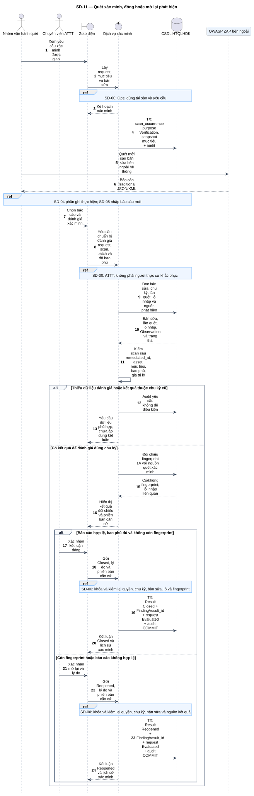

# SD-11 — Quét xác minh, đóng hoặc mở lại phát hiện

Phiên bản 1.0 · 05/09/2026 · Đặc tả tương tác, chưa phải mã ứng dụng.

## 1. Mục tiêu và truy vết

**Kết quả cần đạt:** Closed khi báo cáo mới hợp lệ không còn fingerprint và ATTT xác nhận; còn lỗi/kết quả không hợp lệ → Reopened.

**Use Case:** UC-R08, UC-R09, UC-R10, UC-R11. [Danh mục và hợp đồng UC](../../dinh_dang_use_case_activity.md).

**Activity:** [AD-06](../../visual_paradigm_uml_md/07_activity_khac_phuc_va_xac_minh.md).

**Tác nhân:** Nhóm vận hành quét, Chuyên viên ATTT.

## 2. Điều kiện và dữ liệu

**Tiền điều kiện:** Có Finding Pending Verification và yêu cầu gắn bản sửa; Ops thực hiện ZAP ngoài; ATTT đánh giá độc lập với người thực sự sửa.

**Đầu vào:** request_id, remediation_event_id, scan_id, batch_id, độ bao phủ, có/không fingerprint, lý do và bản Finding đã đọc.

**Bảng liên quan:** `finding`, `ticket_event`, `verification_request`, `scan_occurrence`, `import_batch`, `finding_occurrence`, `finding_observation`, `verification_result`, `audit_log`. Xem [từ điển dữ liệu](../../database/02_tu_dien_du_lieu.md).

**Quy tắc chung:** [SD-00](SD-00_kiem_quyen_va_giao_dich.md) áp dụng trên từng yêu cầu, bao gồm các nhánh lỗi không lặp lại đầy đủ trong hình. Không có quyền thì dừng trước bước đọc/ghi nghiệp vụ tiếp theo.

## 3. Các lifeline, từ trái sang phải

| Bí danh | Thành phần | Loại UML |
|---|---|---|
| `Ops` | Nhóm vận hành quét | actor |
| `Sec` | Chuyên viên ATTT | actor |
| `UI` | Giao diện | boundary |
| `Svc` | Dịch vụ xác minh | control |
| `DB` | CSDL HTQLHDK | database |
| `ZAP` | OWASP ZAP bên ngoài | participant |

`Svc` là thành phần logic trong backend; không yêu cầu triển khai thành microservice. `DB` là cơ sở dữ liệu gồm các bảng liên quan, không phải một actor người dùng.

## 4. Trình tự nghiệp vụ

1. Ops xem yêu cầu và thực hiện ZAP mới sau khắc phục; tạo bản lần quét purpose Verification theo mục tiêu đã duyệt, ghi kết quả và nhập qua SD-05.
2. ATTT chọn báo cáo để đối chiếu với đúng bản sửa, tài sản, scope/mục tiêu và chu kỳ hiện hành.
3. Máy chủ kiểm quyền độc lập, thời điểm quét sau khắc phục, trạng thái lô và bằng chứng độ bao phủ.
4. Đối chiếu fingerprint; dữ liệu thiếu/lỗi không được hiểu là không còn lỗ hổng.
5. Ghi VerificationResult, chuyển Finding, gắn verification_result_id, cập nhật yêu cầu Evaluated và audit trong cùng giao dịch.

## 5. Nhánh thay thế và ngoại lệ

- Còn fingerprint: ATTT kết luận Reopened và trả luồng phân công SD-09.
- Báo cáo sai tài sản, cũ, thiếu bao phủ, Failed/Rejected hoặc không đủ giá trị: Reopened theo kết luận ATTT.
- Lô Partially Completed: chỉ dùng khi chứng minh phần lỗi không ảnh hưởng mục tiêu xác minh; nếu không chứng minh thì không hợp lệ.
- Người thực sự khắc phục tự đóng, hoặc kết quả thuộc chu kỳ cũ: từ chối áp dụng.
- Chưa có kết quả để đánh giá: tiếp tục chờ; không tự Closed hoặc tự Reopened chỉ vì chưa nộp.

Mọi lỗi kỹ thuật, từ chối và audit bắt buộc theo SD-00. Các bước ghi ký hiệu `TX` bao gồm kiểm điều kiện hiện hành, ghi nghiệp vụ và audit nguyên tử; không giữ khóa khi chờ thao tác người dùng. Dữ liệu chỉ được trả sau khi quyền và các kiểm soát bắt buộc đạt.

## 6. Sơ đồ và mã nguồn

[Ảnh PNG](../rendered/SD-11_quet_xac_minh_dong_mo_lai.png) · [SVG phóng to](../rendered/SD-11_quet_xac_minh_dong_mo_lai.svg) · [PlantUML](../plantuml/SD-11_quet_xac_minh_dong_mo_lai.puml) · [Mermaid](../mermaid/SD-11_quet_xac_minh_dong_mo_lai.mmd)

```plantuml
@startuml
hide footbox
skinparam backgroundColor #FFFFFF
skinparam shadowing false
skinparam defaultFontName Arial
skinparam defaultFontSize 13
skinparam sequenceMessageAlign center
skinparam maxMessageSize 58
skinparam BoxPadding 8
skinparam ArrowColor #334155
skinparam sequenceParticipantBackgroundColor #EAF2FB
skinparam sequenceParticipantBorderColor #334155
skinparam sequenceLifeLineBorderColor #94A3B8
skinparam sequenceGroupBorderColor #64748B
skinparam sequenceGroupHeaderFontColor #0F172A
skinparam sequenceGroupBackgroundColor #F8FAFC
skinparam sequenceReferenceBackgroundColor #EFF6FF
skinparam sequenceReferenceBorderColor #93C5FD
skinparam NoteBackgroundColor #FFF7E8
skinparam NoteBorderColor #D9A441
autonumber
title SD-11 — Quét xác minh, đóng hoặc mở lại phát hiện
actor "Nhóm vận hành quét" as Ops
actor "Chuyên viên ATTT" as Sec
boundary "Giao diện" as UI
control "Dịch vụ xác minh" as Svc
database "CSDL HTQLHDK" as DB
participant "OWASP ZAP bên ngoài" as ZAP
Ops -> UI : Xem yêu cầu xác minh được giao
UI -> Svc : Lấy request, mục tiêu và bản sửa
ref over UI,DB : SD-00: Ops; đúng tài sản và yêu cầu
Svc --> UI : Kế hoạch xác minh
Svc -> DB : TX: scan_occurrence purpose Verification, snapshot mục tiêu + audit
Ops -> ZAP : Quét mới sau bản sửa bên ngoài hệ thống
ZAP --> Ops : Báo cáo Traditional JSON/XML
ref over Ops,DB : SD-04 phần ghi thực hiện; SD-05 nhập báo cáo mới
Sec -> UI : Chọn báo cáo và đánh giá xác minh
UI -> Svc : Yêu cầu chuẩn bị đánh giá request, scan, batch và độ bao phủ
ref over UI,DB : SD-00: ATTT; không phải người thực sự khắc phục
Svc -> DB : Đọc bản sửa, chu kỳ, lần quét, lô nhập và nguồn phát hiện
DB --> Svc : Bản sửa, lần quét, lô nhập, Observation và trạng thái
Svc -> Svc : Kiểm scan sau remediated_at, asset, mục tiêu, bao phủ, giá trị lô
alt Thiếu dữ liệu đánh giá hoặc kết quả thuộc chu kỳ cũ
  Svc -> DB : Audit yêu cầu không đủ điều kiện
  Svc --> UI : Yêu cầu dữ liệu phù hợp; chưa áp dụng kết luận
else Có kết quả để đánh giá đúng chu kỳ
  Svc -> DB : Đối chiếu fingerprint với nguồn quét xác minh
  DB --> Svc : Có/không fingerprint; lỗi nhập liên quan
  Svc --> UI : Hiển thị kết quả đối chiếu và phiên bản căn cứ
  alt Báo cáo hợp lệ, bao phủ đủ và không còn fingerprint
    Sec -> UI : Xác nhận kết luận đóng
    UI -> Svc : Gửi Closed, lý do và phiên bản căn cứ
    ref over UI,DB : SD-00: khóa và kiểm lại quyền, chu kỳ, bản sửa, lô và fingerprint
    Svc -> DB : TX: Result Closed + Finding/result_id + request Evaluated + audit; COMMIT
    Svc --> UI : Kết luận Closed và lịch sử xác minh
  else Còn fingerprint hoặc báo cáo không hợp lệ
    Sec -> UI : Xác nhận mở lại và lý do
    UI -> Svc : Gửi Reopened, lý do và phiên bản căn cứ
    ref over UI,DB : SD-00: khóa và kiểm lại quyền, chu kỳ, bản sửa và nguồn kết quả
    Svc -> DB : TX: Result Reopened + Finding/result_id + request Evaluated + audit; COMMIT
    Svc --> UI : Kết luận Reopened và lịch sử xác minh
  end
end
@enduml
```

## 7. Lưu ý khi thiết kế và triển khai

Không buộc scan sau requested_at; nguồn chỉ yêu cầu quét mới sau bản sửa. Người từng được phân công nhưng không thực sự sửa không mặc nhiên bị cấm xác minh. Các cờ is_valid/coverage_confirmed là kết quả kiểm và xác nhận có căn cứ, không tin trực tiếp giá trị client gửi. Kết quả sai asset không được chèn FK ghép sai: kết luận không hợp lệ tham chiếu nguồn hợp lệ có thể liên kết, hoặc để nguồn tùy chọn NULL theo schema và giải thích trong reason/audit; không dựng scan/batch giả. Giai đoạn chuẩn bị và giai đoạn xác nhận cuối là hai yêu cầu riêng, không giữ khóa khi chờ con người.

[Danh mục sơ đồ](../README.md) · [Quy ước](../00_quy_uoc_va_thanh_phan.md) · [Ma trận truy vết](../01_ma_tran_truy_vet.md)
