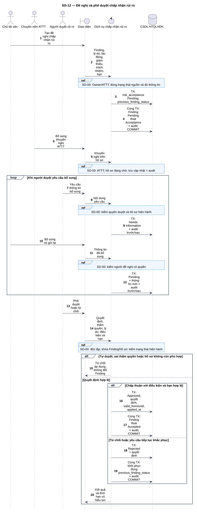
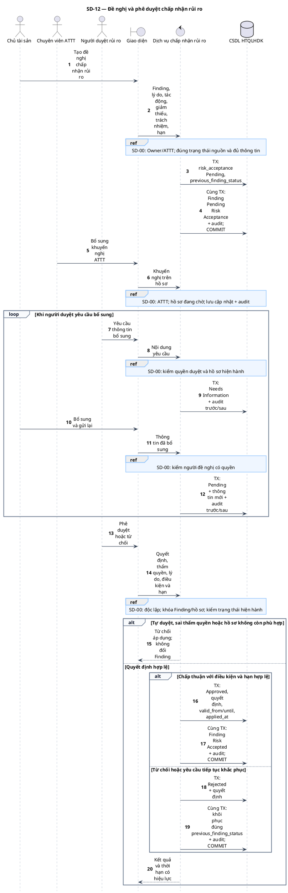

# SD-12 — Đề nghị và phê duyệt chấp nhận rủi ro

Phiên bản 1.0 · 05/09/2026 · Đặc tả tương tác, chưa phải mã ứng dụng.

## 1. Mục tiêu và truy vết

**Kết quả cần đạt:** Đề nghị được duyệt → Risk Accepted; bị từ chối → đúng trạng thái trước; bổ sung vẫn chờ quyết định.

**Use Case:** UC-RA01, UC-RA02, UC-RA03, UC-RA04. [Danh mục và hợp đồng UC](../../dinh_dang_use_case_activity.md).

**Activity:** [AD-08](../../visual_paradigm_uml_md/08_activity_chap_nhan_rui_ro.md).

**Tác nhân:** Chủ tài sản, Chuyên viên ATTT, Người duyệt rủi ro.

## 2. Điều kiện và dữ liệu

**Tiền điều kiện:** Chủ tài sản/ATTT đề nghị từ Triaged, Assigned hoặc In Progress; người duyệt độc lập, có quyền và thẩm quyền thật.

**Đầu vào:** Lý do, tác động, biện pháp giảm thiểu, người chịu trách nhiệm, hạn đề nghị; khuyến nghị ATTT; quyết định, điều kiện và hạn có hiệu lực.

**Bảng liên quan:** `finding`, `risk_acceptance`, `audit_log`, `notification`. Xem [từ điển dữ liệu](../../database/02_tu_dien_du_lieu.md).

**Quy tắc chung:** [SD-00](SD-00_kiem_quyen_va_giao_dich.md) áp dụng trên từng yêu cầu, bao gồm các nhánh lỗi không lặp lại đầy đủ trong hình. Không có quyền thì dừng trước bước đọc/ghi nghiệp vụ tiếp theo.

## 3. Các lifeline, từ trái sang phải

| Bí danh | Thành phần | Loại UML |
|---|---|---|
| `Owner` | Chủ tài sản | actor |
| `Sec` | Chuyên viên ATTT | actor |
| `Approver` | Người duyệt rủi ro | actor |
| `UI` | Giao diện | boundary |
| `Svc` | Dịch vụ chấp nhận rủi ro | control |
| `DB` | CSDL HTQLHDK | database |

`Svc` là thành phần logic trong backend; không yêu cầu triển khai thành microservice. `DB` là cơ sở dữ liệu gồm các bảng liên quan, không phải một actor người dùng.

## 4. Trình tự nghiệp vụ

1. Chủ tài sản hoặc ATTT tạo đề nghị; lưu previous_finding_status trước chuyển Pending Risk Acceptance.
2. ATTT bổ sung khuyến nghị; người duyệt xem hồ sơ và có thể yêu cầu bổ sung.
3. Bổ sung ghi before/after, gửi lại để rà soát; không tự coi là đã duyệt.
4. Khi quyết định, kiểm độc lập, thẩm quyền và hồ sơ còn phù hợp trạng thái hiện hành.
5. Duyệt lưu điều kiện, thời hạn, applied_at và Risk Accepted cùng audit; từ chối khôi phục previous_finding_status.

## 5. Nhánh thay thế và ngoại lệ

- Người đề nghị tự duyệt hoặc không có thẩm quyền: từ chối và audit.
- Thiếu lý do/tác động/giảm thiểu/hạn: chưa tạo đề nghị.
- Hồ sơ cũ khi một quyết định khác đã được áp dụng: không áp dụng chồng.
- Yêu cầu bổ sung: risk_acceptance Needs Information nhưng Finding vẫn Pending Risk Acceptance.

Mọi lỗi kỹ thuật, từ chối và audit bắt buộc theo SD-00. Các bước ghi ký hiệu `TX` bao gồm kiểm điều kiện hiện hành, ghi nghiệp vụ và audit nguyên tử; không giữ khóa khi chờ thao tác người dùng. Dữ liệu chỉ được trả sau khi quyền và các kiểm soát bắt buộc đạt.

## 6. Sơ đồ và mã nguồn

[Ảnh PNG](../rendered/SD-12_de_nghi_phe_duyet_rui_ro.png) · [SVG phóng to](../rendered/SD-12_de_nghi_phe_duyet_rui_ro.svg) · [PlantUML](../plantuml/SD-12_de_nghi_phe_duyet_rui_ro.puml) · [Mermaid](../mermaid/SD-12_de_nghi_phe_duyet_rui_ro.mmd)

## 7. Lưu ý khi thiết kế và triển khai

Nhóm khắc phục có thể cung cấp ý kiến nhưng không tự tạo chuyển trạng thái rủi ro chính thức. Quyết định Approved/Rejected bất biến; bổ sung khi còn Pending/Needs Information có audit trước/sau. Có thể có nhiều hồ sơ chờ theo schema; ứng dụng kiểm đúng hồ sơ và trạng thái tại thời điểm áp dụng, không tự thêm UNIQUE ngoài nguồn. Nếu valid_from ở tương lai, chỉ áp dụng khi đến hiệu lực và còn đủ điều kiện; không coi approved là đang được chấp nhận trước valid_from.

[Danh mục sơ đồ](../README.md) · [Quy ước](../00_quy_uoc_va_thanh_phan.md) · [Ma trận truy vết](../01_ma_tran_truy_vet.md)
