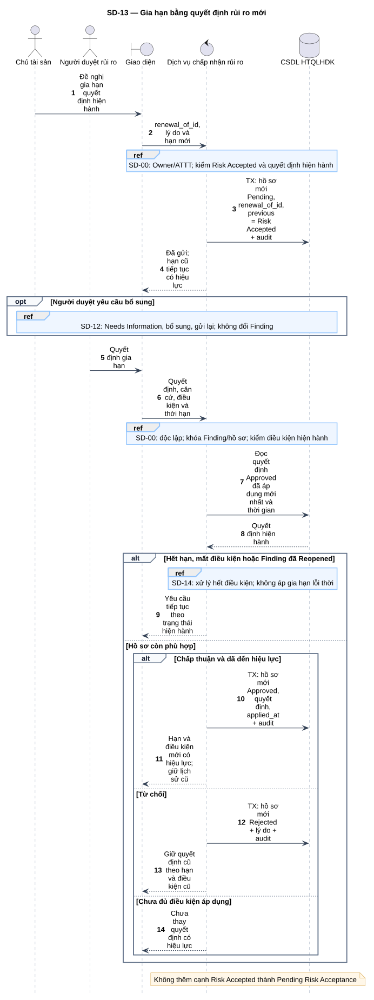
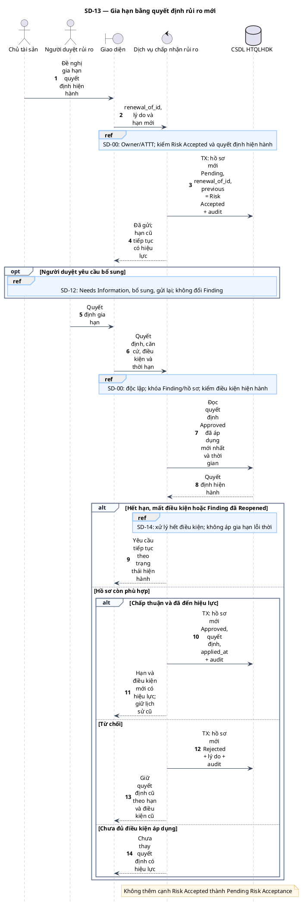

# SD-13 — Gia hạn bằng quyết định rủi ro mới

Phiên bản 1.0 · 05/09/2026 · Đặc tả tương tác, chưa phải mã ứng dụng.

## 1. Mục tiêu và truy vết

**Kết quả cần đạt:** Hồ sơ gia hạn là bản ghi mới; chỉ quyết định được duyệt và áp dụng mới thay quyết định có hiệu lực.

**Use Case:** UC-RA02, UC-RA03, UC-RA04, UC-RA07. [Danh mục và hợp đồng UC](../../dinh_dang_use_case_activity.md).

**Activity:** [AD-13](../../visual_paradigm_uml_md/14_activity_gia_han_rui_ro.md).

**Tác nhân:** Chủ tài sản, Người duyệt rủi ro.

## 2. Điều kiện và dữ liệu

**Tiền điều kiện:** Có quyết định Approved đã áp dụng; Finding đang Risk Accepted, quyết định hiện hành còn được xét hợp lệ.

**Đầu vào:** renewal_of_id, lý do, đánh giá mới, biện pháp giảm thiểu, hạn đề nghị mới và căn cứ phê duyệt.

**Bảng liên quan:** `finding`, `risk_acceptance`, `audit_log`, `notification`. Xem [từ điển dữ liệu](../../database/02_tu_dien_du_lieu.md).

**Quy tắc chung:** [SD-00](SD-00_kiem_quyen_va_giao_dich.md) áp dụng trên từng yêu cầu, bao gồm các nhánh lỗi không lặp lại đầy đủ trong hình. Không có quyền thì dừng trước bước đọc/ghi nghiệp vụ tiếp theo.

## 3. Các lifeline, từ trái sang phải

| Bí danh | Thành phần | Loại UML |
|---|---|---|
| `Owner` | Chủ tài sản | actor |
| `Approver` | Người duyệt rủi ro | actor |
| `UI` | Giao diện | boundary |
| `Svc` | Dịch vụ chấp nhận rủi ro | control |
| `DB` | CSDL HTQLHDK | database |

`Svc` là thành phần logic trong backend; không yêu cầu triển khai thành microservice. `DB` là cơ sở dữ liệu gồm các bảng liên quan, không phải một actor người dùng.

## 4. Trình tự nghiệp vụ

1. Owner/ATTT gửi đề nghị gia hạn tham chiếu quyết định cũ qua renewal_of_id.
2. Tạo risk_acceptance mới với previous_finding_status Risk Accepted; giữ Finding và thời hạn cũ.
3. Người duyệt độc lập rà soát; bổ sung đi lại quy trình chờ mà không tự kéo dài hạn.
4. Khi duyệt, kiểm quyết định cũ/chu kỳ còn hiện hành và thời gian hiệu lực; ghi quyết định mới/applied_at cùng audit.
5. Nếu đã hết điều kiện, SD-14 mở lại; xử lý tiếp theo theo trạng thái nguồn cho phép.

## 5. Nhánh thay thế và ngoại lệ

- Gia hạn Pending/Needs Information: không kéo dài hạn cũ.
- Từ chối gia hạn: lưu Rejected ở hồ sơ mới; quyết định cũ giữ hiệu lực theo điều kiện/hạn cũ.
- Người đề nghị tự duyệt: từ chối.
- Finding đã Reopened hoặc có quyết định hiện hành khác: không áp gia hạn lỗi thời lên trạng thái mới.

Mọi lỗi kỹ thuật, từ chối và audit bắt buộc theo SD-00. Các bước ghi ký hiệu `TX` bao gồm kiểm điều kiện hiện hành, ghi nghiệp vụ và audit nguyên tử; không giữ khóa khi chờ thao tác người dùng. Dữ liệu chỉ được trả sau khi quyền và các kiểm soát bắt buộc đạt.

## 6. Sơ đồ và mã nguồn

[Ảnh PNG](../rendered/SD-13_gia_han_rui_ro.png) · [SVG phóng to](../rendered/SD-13_gia_han_rui_ro.svg) · [PlantUML](../plantuml/SD-13_gia_han_rui_ro.puml) · [Mermaid](../mermaid/SD-13_gia_han_rui_ro.mmd)

## 7. Lưu ý khi thiết kế và triển khai

v_latest_applied_risk chỉ chọn Approved đã áp dụng, không lấy đề nghị mới nhất bất kể trạng thái. Quyết định cũ không bị sửa ngày hết hạn. Khi gia hạn được áp dụng vẫn phải soát điều kiện nghiệp vụ, không chỉ đọc cờ within_time_window.

[Danh mục sơ đồ](../README.md) · [Quy ước](../00_quy_uoc_va_thanh_phan.md) · [Ma trận truy vết](../01_ma_tran_truy_vet.md)
