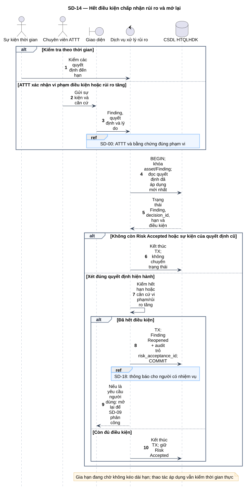
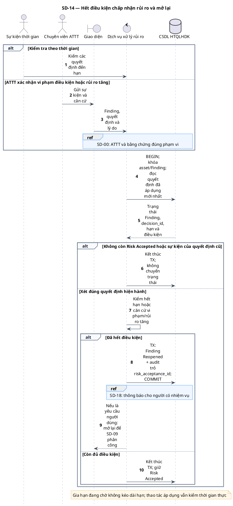

# SD-14 — Hết điều kiện chấp nhận rủi ro và mở lại

Phiên bản 1.0 · 05/09/2026 · Đặc tả tương tác, chưa phải mã ứng dụng.

## 1. Mục tiêu và truy vết

**Kết quả cần đạt:** Risk Accepted → Reopened khi đủ căn cứ; trường hợp khác giữ trạng thái và dữ liệu quyết định.

**Use Case:** UC-RA05, UC-RA06, UC-R11. [Danh mục và hợp đồng UC](../../dinh_dang_use_case_activity.md).

**Activity:** [AD-10](../../visual_paradigm_uml_md/11_activity_mo_lai_phat_hien.md).

**Tác nhân:** Sự kiện thời gian, Chuyên viên ATTT.

## 2. Điều kiện và dữ liệu

**Tiền điều kiện:** Có sự kiện thời gian hoặc ATTT xác nhận vi phạm điều kiện/rủi ro tăng; xử lý quyết định đã áp dụng hiện hành.

**Đầu vào:** finding_id, decision_id, thời điểm máy chủ, căn cứ hết hạn/vi phạm/rủi ro tăng.

**Bảng liên quan:** `finding`, `risk_acceptance`, `audit_log`, `notification`. Xem [từ điển dữ liệu](../../database/02_tu_dien_du_lieu.md).

**Quy tắc chung:** [SD-00](SD-00_kiem_quyen_va_giao_dich.md) áp dụng trên từng yêu cầu, bao gồm các nhánh lỗi không lặp lại đầy đủ trong hình. Không có quyền thì dừng trước bước đọc/ghi nghiệp vụ tiếp theo.

## 3. Các lifeline, từ trái sang phải

| Bí danh | Thành phần | Loại UML |
|---|---|---|
| `Clock` | Sự kiện thời gian | actor |
| `Sec` | Chuyên viên ATTT | actor |
| `UI` | Giao diện | boundary |
| `Svc` | Dịch vụ xử lý rủi ro | control |
| `DB` | CSDL HTQLHDK | database |

`Svc` là thành phần logic trong backend; không yêu cầu triển khai thành microservice. `DB` là cơ sở dữ liệu gồm các bảng liên quan, không phải một actor người dùng.

## 4. Trình tự nghiệp vụ

1. Tác vụ kiểm thời hạn hoặc ATTT gửi sự kiện vi phạm/rủi ro tăng với căn cứ.
2. Khóa Finding, đọc trạng thái và quyết định Approved đã áp dụng mới nhất.
3. Kiểm lại quyết định chưa bị thay thế; xét hạn và điều kiện, không coi gia hạn đang chờ là có hiệu lực.
4. Nếu mất điều kiện, chuyển Reopened, audit liên kết risk_acceptance_id và thông báo tối thiểu.
5. ATTT tiếp tục SD-09 để phân công và đặt thời hạn mới.

## 5. Nhánh thay thế và ngoại lệ

- Sự kiện lặp lại hoặc quyết định đã bị thay thế: không chuyển/audit chuyển trạng thái lần hai.
- Đã có gia hạn hợp lệ được áp dụng: xét hạn/điều kiện mới.
- Chưa hết hạn và không có căn cứ vi phạm/rủi ro tăng: giữ Risk Accepted.
- ATTT không có quyền hoặc căn cứ chưa xác nhận: từ chối thay đổi.

Mọi lỗi kỹ thuật, từ chối và audit bắt buộc theo SD-00. Các bước ghi ký hiệu `TX` bao gồm kiểm điều kiện hiện hành, ghi nghiệp vụ và audit nguyên tử; không giữ khóa khi chờ thao tác người dùng. Dữ liệu chỉ được trả sau khi quyền và các kiểm soát bắt buộc đạt.

## 6. Sơ đồ và mã nguồn

[Ảnh PNG](../rendered/SD-14_het_dieu_kien_rui_ro_mo_lai.png) · [SVG phóng to](../rendered/SD-14_het_dieu_kien_rui_ro_mo_lai.svg) · [PlantUML](../plantuml/SD-14_het_dieu_kien_rui_ro_mo_lai.puml) · [Mermaid](../mermaid/SD-14_het_dieu_kien_rui_ro_mo_lai.mmd)

## 7. Lưu ý khi thiết kế và triển khai

Đây là tác vụ thời gian trong ứng dụng quản lý, không phải hệ thống giám sát rủi ro bên ngoài. Khi xem/áp dụng quyết định phải kiểm hiệu lực thực tại thời điểm thao tác, không chờ tác vụ định kỳ mới nhận biết hết hạn. Closed tái xuất hiện được xử lý ở SD-06; xác minh mở lại ở SD-11, không nhập nhằng ba nguồn mở lại.

[Danh mục sơ đồ](../README.md) · [Quy ước](../00_quy_uoc_va_thanh_phan.md) · [Ma trận truy vết](../01_ma_tran_truy_vet.md)
