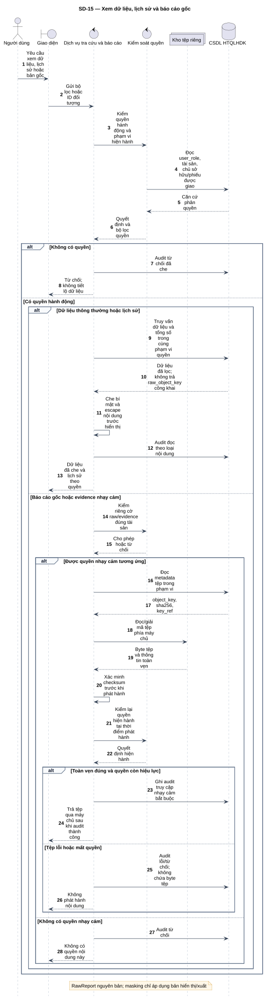

# SD-15 — Xem dữ liệu, lịch sử và báo cáo gốc

Phiên bản 1.0 · 05/09/2026 · Đặc tả tương tác, chưa phải mã ứng dụng.

## 1. Mục tiêu và truy vết

**Kết quả cần đạt:** Chỉ trả dữ liệu trong quyền hiện hành; raw giữ nguyên byte và audit; nội dung thông thường đã che.

**Use Case:** UC-A07, UC-I12, UC-T06, UC-C04, UC-C06, UC-C09. [Danh mục và hợp đồng UC](../../dinh_dang_use_case_activity.md).

**Activity:** [AD-09](../../visual_paradigm_uml_md/10_activity_bao_mat_bao_cao.md).

**Tác nhân:** Người dùng.

## 2. Điều kiện và dữ liệu

**Tiền điều kiện:** Người dùng được xác thực, có quyền đọc theo tài sản/nhiệm vụ. Báo cáo gốc và evidence nhạy cảm có quyền riêng.

**Đầu vào:** Loại nội dung, bộ lọc, ID tài sản/phát hiện/lô/phiếu/evidence; mục đích đọc nhạy cảm khi chính sách yêu cầu.

**Bảng liên quan:** `app_user`, `user_role`, `asset`, `finding`, `import_batch`, `remediation_ticket`, `ticket_event`, `finding_review`, `evidence`, `audit_log`. Xem [từ điển dữ liệu](../../database/02_tu_dien_du_lieu.md).

**Quy tắc chung:** [SD-00](SD-00_kiem_quyen_va_giao_dich.md) áp dụng trên từng yêu cầu, bao gồm các nhánh lỗi không lặp lại đầy đủ trong hình. Không có quyền thì dừng trước bước đọc/ghi nghiệp vụ tiếp theo.

## 3. Các lifeline, từ trái sang phải

| Bí danh | Thành phần | Loại UML |
|---|---|---|
| `User` | Người dùng | actor |
| `UI` | Giao diện | boundary |
| `Svc` | Dịch vụ tra cứu và báo cáo | control |
| `Auth` | Kiểm soát quyền | control |
| `Store` | Kho tệp riêng | collections |
| `DB` | CSDL HTQLHDK | database |

`Svc` là thành phần logic trong backend; không yêu cầu triển khai thành microservice. `DB` là cơ sở dữ liệu gồm các bảng liên quan, không phải một actor người dùng.

## 4. Trình tự nghiệp vụ

1. Người dùng yêu cầu danh sách, chi tiết, lịch sử hoặc bản gốc; máy chủ kiểm quyền theo hành động.
2. Truy vấn luôn lọc quyền tài sản/phiếu; áp dụng cùng bộ lọc cho số lượng, phân trang và thống kê.
3. Dữ liệu thông thường được che, escape nội dung không tin cậy trước hiển thị.
4. Đọc raw/evidence nhạy cảm kiểm cờ quyền riêng, đúng asset và grant chưa thu hồi.
5. Đọc kho riêng, xác minh checksum, kiểm quyền lại trước phát hành, ghi audit rồi mới trả nội dung.

## 5. Nhánh thay thế và ngoại lệ

- Admin không có quyền đọc lỗ hổng mặc định; Auditor chỉ đọc, Remediator theo phiếu được giao.
- Grant asset_id NULL không là wildcard; không dùng filter phía trình duyệt thay kiểm server.
- Quyền raw không đồng nghĩa quyền evidence nhạy cảm và ngược lại.
- Checksum không khớp/tệp thiếu/không ghi được audit bắt buộc: không trả tệp; ghi lỗi đã che.
- Mất quyền giữa lúc yêu cầu và phát hành: từ chối phát hành nội dung.

Mọi lỗi kỹ thuật, từ chối và audit bắt buộc theo SD-00. Các bước ghi ký hiệu `TX` bao gồm kiểm điều kiện hiện hành, ghi nghiệp vụ và audit nguyên tử; không giữ khóa khi chờ thao tác người dùng. Dữ liệu chỉ được trả sau khi quyền và các kiểm soát bắt buộc đạt.

## 6. Sơ đồ và mã nguồn

[Ảnh PNG](../rendered/SD-15_xem_du_lieu_bao_cao_goc.png) · [SVG phóng to](../rendered/SD-15_xem_du_lieu_bao_cao_goc.svg) · [PlantUML](../plantuml/SD-15_xem_du_lieu_bao_cao_goc.puml) · [Mermaid](../mermaid/SD-15_xem_du_lieu_bao_cao_goc.mmd)

```plantuml
@startuml
hide footbox
skinparam backgroundColor #FFFFFF
skinparam shadowing false
skinparam defaultFontName Arial
skinparam defaultFontSize 13
skinparam sequenceMessageAlign center
skinparam maxMessageSize 58
skinparam BoxPadding 8
skinparam ArrowColor #334155
skinparam sequenceParticipantBackgroundColor #EAF2FB
skinparam sequenceParticipantBorderColor #334155
skinparam sequenceLifeLineBorderColor #94A3B8
skinparam sequenceGroupBorderColor #64748B
skinparam sequenceGroupHeaderFontColor #0F172A
skinparam sequenceGroupBackgroundColor #F8FAFC
skinparam sequenceReferenceBackgroundColor #EFF6FF
skinparam sequenceReferenceBorderColor #93C5FD
skinparam NoteBackgroundColor #FFF7E8
skinparam NoteBorderColor #D9A441
autonumber
title SD-15 — Xem dữ liệu, lịch sử và báo cáo gốc
actor "Người dùng" as User
boundary "Giao diện" as UI
control "Dịch vụ tra cứu và báo cáo" as Svc
control "Kiểm soát quyền" as Auth
collections "Kho tệp riêng" as Store
database "CSDL HTQLHDK" as DB
User -> UI : Yêu cầu xem dữ liệu, lịch sử hoặc bản gốc
UI -> Svc : Gửi bộ lọc hoặc ID đối tượng
Svc -> Auth : Kiểm quyền hành động và phạm vi hiện hành
Auth -> DB : Đọc user_role, tài sản, chủ sở hữu/phiếu được giao
DB --> Auth : Căn cứ phân quyền
Auth --> Svc : Quyết định và bộ lọc quyền
alt Không có quyền
  Svc -> DB : Audit từ chối đã che
  Svc --> UI : Từ chối; không tiết lộ dữ liệu
else Có quyền hành động
  alt Dữ liệu thông thường hoặc lịch sử
    Svc -> DB : Truy vấn dữ liệu và tổng số trong cùng phạm vi quyền
    DB --> Svc : Dữ liệu đã lọc; không trả raw_object_key công khai
    Svc -> Svc : Che bí mật và escape nội dung trước hiển thị
    Svc -> DB : Audit đọc theo loại nội dung
    Svc --> UI : Dữ liệu đã che và lịch sử theo quyền
  else Báo cáo gốc hoặc evidence nhạy cảm
    Svc -> Auth : Kiểm riêng cờ raw/evidence đúng tài sản
    Auth --> Svc : Cho phép hoặc từ chối
    alt Được quyền nhạy cảm tương ứng
      Svc -> DB : Đọc metadata tệp trong phạm vi
      DB --> Svc : object_key, sha256, key_ref
      Svc -> Store : Đọc/giải mã tệp phía máy chủ
      Store --> Svc : Byte tệp và thông tin toàn vẹn
      Svc -> Svc : Xác minh checksum trước khi phát hành
      Svc -> Auth : Kiểm lại quyền hiện hành tại thời điểm phát hành
      Auth --> Svc : Quyết định hiện hành
      alt Toàn vẹn đúng và quyền còn hiệu lực
        Svc -> DB : Ghi audit truy cập nhạy cảm bắt buộc
        Svc --> UI : Trả tệp qua máy chủ sau khi audit thành công
      else Tệp lỗi hoặc mất quyền
        Svc -> DB : Audit lỗi/từ chối; không chứa byte tệp
        Svc --> UI : Không phát hành nội dung
      end
    else Không có quyền nhạy cảm
      Svc -> DB : Audit từ chối
      Svc --> UI : Không có quyền nội dung này
    end
  end
end
note over Svc,Store : RawReport nguyên bản; masking chỉ áp dụng bản hiển thị/xuất
@enduml
```

## 7. Lưu ý khi thiết kế và triển khai

Các view database không thay RLS hoặc lọc quyền máy chủ. Luồng đọc lịch sử chỉ đọc audit/sự kiện; không có thao tác sửa nhật ký. Với audit quyền của Admin, dùng SD-17 thay truy vấn toàn bộ audit nghiệp vụ. Báo cáo HTML đính kèm không được chạy như mã trong origin ứng dụng; chỉ nguồn Traditional JSON/XML đi vào parser SD-05.

[Danh mục sơ đồ](../README.md) · [Quy ước](../00_quy_uoc_va_thanh_phan.md) · [Ma trận truy vết](../01_ma_tran_truy_vet.md)
