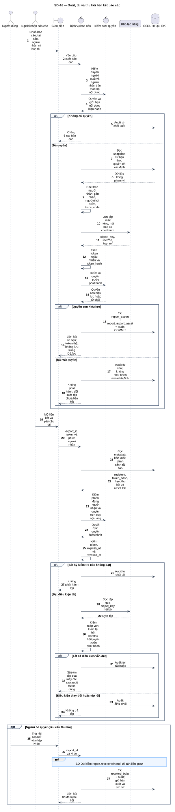

# SD-16 — Xuất, tải và thu hồi liên kết báo cáo

Phiên bản 1.0 · 05/09/2026 · Đặc tả tương tác, chưa phải mã ứng dụng.

## 1. Mục tiêu và truy vết

**Kết quả cần đạt:** Một lần phát hành tạo tệp riêng có trace_code và người nhận; tải kiểm quyền mọi tài sản; thu hồi vô hiệu các lượt tải tiếp theo.

**Use Case:** UC-C05, UC-C10. [Danh mục và hợp đồng UC](../../dinh_dang_use_case_activity.md).

**Activity:** [AD-09](../../visual_paradigm_uml_md/10_activity_bao_mat_bao_cao.md).

**Tác nhân:** Người dùng, Người nhận báo cáo.

## 2. Điều kiện và dữ liệu

**Tiền điều kiện:** Người xuất có quyền trên nội dung được chọn; người nhận xác định và có quyền phù hợp; bản xuất là dữ liệu đã che.

**Đầu vào:** Loại báo cáo trong phạm vi, danh sách tài sản, bộ lọc, recipient_id, hạn tải, nhãn nhạy cảm; token khi tải; export_id khi thu hồi.

**Bảng liên quan:** `app_user`, `user_role`, `report_export`, `report_export_asset`, `audit_log`. Xem [từ điển dữ liệu](../../database/02_tu_dien_du_lieu.md).

**Quy tắc chung:** [SD-00](SD-00_kiem_quyen_va_giao_dich.md) áp dụng trên từng yêu cầu, bao gồm các nhánh lỗi không lặp lại đầy đủ trong hình. Không có quyền thì dừng trước bước đọc/ghi nghiệp vụ tiếp theo.

## 3. Các lifeline, từ trái sang phải

| Bí danh | Thành phần | Loại UML |
|---|---|---|
| `User` | Người dùng | actor |
| `Receiver` | Người nhận báo cáo | actor |
| `UI` | Giao diện | boundary |
| `Svc` | Dịch vụ báo cáo | control |
| `Auth` | Kiểm soát quyền | control |
| `Store` | Kho tệp riêng | collections |
| `DB` | CSDL HTQLHDK | database |

`Svc` là thành phần logic trong backend; không yêu cầu triển khai thành microservice. `DB` là cơ sở dữ liệu gồm các bảng liên quan, không phải một actor người dùng.

## 4. Trình tự nghiệp vụ

1. Người xuất chọn báo cáo và người nhận; kiểm quyền của cả hai, bao gồm giới hạn phiếu khi có.
2. Tạo snapshot dữ liệu trong quyền, che theo người nhận, gắn nhãn/người/thời điểm/mã truy vết.
3. Lưu tệp riêng, tạo token ngẫu nhiên, chỉ ghi token_hash; lưu report_export + danh sách tài sản + audit cùng giao dịch.
4. Người nhận tải qua máy chủ: kiểm phiên, đúng recipient_id, token, hết hạn/thu hồi và quyền hiện hành trên mọi tài sản/nội dung trong tệp.
5. Kiểm checksum, quyền lại và audit trước phát hành; thu hồi cập nhật revoked_by/at cùng audit.

## 5. Nhánh thay thế và ngoại lệ

- Mất quyền một tài sản hoặc giới hạn phiếu thay đổi: từ chối toàn bộ tệp đã phát hành; cần xuất mới theo phạm vi mới.
- Đúng token nhưng sai người nhận/hết hạn/thu hồi: không tải.
- Kho tệp thành công, giao dịch SQL thất bại: không phát hành link; đối soát tệp chưa liên kết.
- Checksum lỗi hoặc audit thất bại: không trả nội dung.
- Tái phát hành cho người khác hoặc đổi nội dung/hạn: tạo bản xuất mới, không sửa bản đã phát hành.

Mọi lỗi kỹ thuật, từ chối và audit bắt buộc theo SD-00. Các bước ghi ký hiệu `TX` bao gồm kiểm điều kiện hiện hành, ghi nghiệp vụ và audit nguyên tử; không giữ khóa khi chờ thao tác người dùng. Dữ liệu chỉ được trả sau khi quyền và các kiểm soát bắt buộc đạt.

## 6. Sơ đồ và mã nguồn

[Ảnh PNG](../rendered/SD-16_xuat_tai_thu_hoi_bao_cao.png) · [SVG phóng to](../rendered/SD-16_xuat_tai_thu_hoi_bao_cao.svg) · [PlantUML](../plantuml/SD-16_xuat_tai_thu_hoi_bao_cao.puml) · [Mermaid](../mermaid/SD-16_xuat_tai_thu_hoi_bao_cao.mmd)

```plantuml
@startuml
hide footbox
skinparam backgroundColor #FFFFFF
skinparam shadowing false
skinparam defaultFontName Arial
skinparam defaultFontSize 13
skinparam sequenceMessageAlign center
skinparam maxMessageSize 58
skinparam BoxPadding 8
skinparam ArrowColor #334155
skinparam sequenceParticipantBackgroundColor #EAF2FB
skinparam sequenceParticipantBorderColor #334155
skinparam sequenceLifeLineBorderColor #94A3B8
skinparam sequenceGroupBorderColor #64748B
skinparam sequenceGroupHeaderFontColor #0F172A
skinparam sequenceGroupBackgroundColor #F8FAFC
skinparam sequenceReferenceBackgroundColor #EFF6FF
skinparam sequenceReferenceBorderColor #93C5FD
skinparam NoteBackgroundColor #FFF7E8
skinparam NoteBorderColor #D9A441
autonumber
title SD-16 — Xuất, tải và thu hồi liên kết báo cáo
actor "Người dùng" as User
actor "Người nhận báo cáo" as Receiver
boundary "Giao diện" as UI
control "Dịch vụ báo cáo" as Svc
control "Kiểm soát quyền" as Auth
collections "Kho tệp riêng" as Store
database "CSDL HTQLHDK" as DB
User -> UI : Chọn báo cáo, tài sản, người nhận và hạn tải
UI -> Svc : Yêu cầu xuất báo cáo
Svc -> Auth : Kiểm quyền người xuất và người nhận trên toàn bộ nội dung
Auth --> Svc : Quyền và giới hạn nội dung hiện hành
alt Không đủ quyền
  Svc -> DB : Audit từ chối xuất
  Svc --> UI : Không tạo báo cáo
else Đủ quyền
  Svc -> DB : Đọc snapshot dữ liệu theo quyền đã xác định
  DB --> Svc : Dữ liệu trong phạm vi
  Svc -> Svc : Che theo người nhận; gắn nhãn, người/thời điểm, trace_code
  Svc -> Store : Lưu tệp xuất riêng, mã hóa và checksum
  Store --> Svc : object_key, sha256, key_ref
  Svc -> Svc : Sinh token ngẫu nhiên và token_hash
  Svc -> Auth : Kiểm lại quyền trước phát hành
  Auth --> Svc : Quyền còn hiệu lực hoặc từ chối
  alt Quyền còn hiệu lực
    Svc -> DB : TX: report_export + report_export_asset + audit; COMMIT
    Svc --> UI : Liên kết có hạn; token thật không lưu trong DB/log
  else Đã mất quyền
    Svc -> DB : Audit từ chối; không phát hành metadata/link
    Svc --> UI : Không phát hành; đối soát tệp chưa liên kết
  end
end
Receiver -> UI : Mở liên kết và yêu cầu tải
UI -> Svc : export_id, token và phiên người nhận
Svc -> DB : Đọc metadata bản xuất; danh sách tài sản
DB --> Svc : recipient, token_hash, hạn, thu hồi và asset IDs
Svc -> Auth : Kiểm phiên, đúng người nhận và quyền trên mọi nội dung
Auth --> Svc : Quyết định quyền hiện hành
Svc -> Svc : Kiểm token, expires_at và revoked_at
alt Bất kỳ kiểm tra nào không đạt
  Svc -> DB : Audit từ chối tải
  Svc --> UI : Không phát hành tệp
else Đạt điều kiện tải
  Svc -> Store : Đọc tệp qua object_key nội bộ
  Store --> Svc : Byte tệp
  Svc -> Svc : Kiểm toàn vẹn; kiểm lại hết hạn/thu hồi/quyền trước phát hành
  alt Tất cả điều kiện vẫn đạt
    Svc -> DB : Audit tải bắt buộc
    Svc --> UI : Stream tệp qua máy chủ sau audit thành công
  else Điều kiện thay đổi hoặc tệp lỗi
    Svc -> DB : Audit lỗi/từ chối
    Svc --> UI : Không trả tệp
  end
end
opt Người có quyền yêu cầu thu hồi
  User -> UI : Thu hồi liên kết và nhập lý do
  UI -> Svc : export_id và lý do
  ref over UI,DB : SD-00: kiểm report.revoke trên mọi tài sản liên quan
  Svc -> DB : TX: revoked_by/at + audit; giữ bản xuất và lịch sử
  Svc --> UI : Liên kết đã bị thu hồi
end
@enduml
```

## 7. Lưu ý khi thiết kế và triển khai

Một link có hạn không thay thế quyền. Không trả URL công khai hoặc URL kho tệp cho phép bỏ qua kiểm quyền hiện hành. Tệp phát hành cần có manifest nội bộ bất biến của phạm vi nội dung (đặc biệt các phiếu) trong gói tệp riêng để kiểm lại giới hạn theo nhiệm vụ; đây là chi tiết lưu tệp, không thêm bảng. Nếu không chứng minh được toàn bộ nội dung vẫn trong quyền người nhận thì từ chối tải và tạo bản xuất mới. Kiểm quyền/thu hồi tại điểm bắt đầu phát hành; không hứa thu hồi được các byte người dùng đã tải. K-02 yêu cầu audit riêng cho lỗi SQL/kho tệp và mọi nhánh dừng.

[Danh mục sơ đồ](../README.md) · [Quy ước](../00_quy_uoc_va_thanh_phan.md) · [Ma trận truy vết](../01_ma_tran_truy_vet.md)
