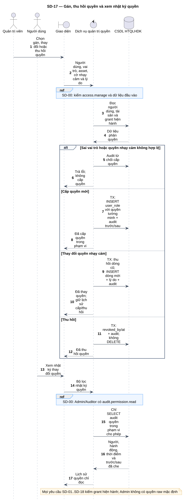
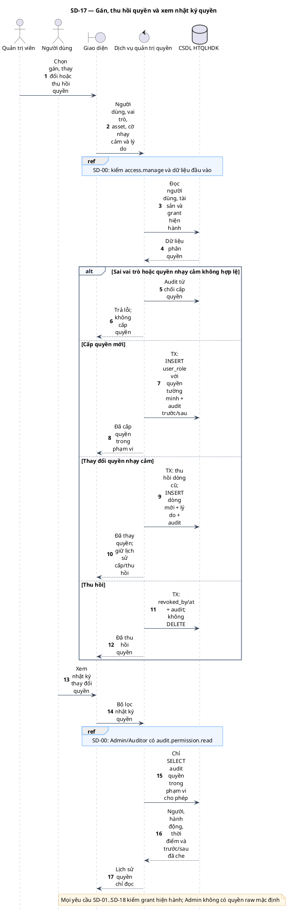

# SD-17 — Gán, thu hồi quyền và xem nhật ký quyền

Phiên bản 1.0 · 05/09/2026 · Đặc tả tương tác, chưa phải mã ứng dụng.

## 1. Mục tiêu và truy vết

**Kết quả cần đạt:** Quyền được cấp/thu hồi có lịch sử; mọi lần đọc/tải sau đó kiểm trạng thái grant hiện hành.

**Use Case:** UC-C01, UC-C02, UC-C03. [Danh mục và hợp đồng UC](../../dinh_dang_use_case_activity.md).

**Activity:** [AD-15](../../visual_paradigm_uml_md/16_activity_phan_quyen.md).

**Tác nhân:** Quản trị viên, Người dùng.

## 2. Điều kiện và dữ liệu

**Tiền điều kiện:** Admin có access.manage; người xem nhật ký quyền là Admin hoặc Auditor có quyền tương ứng.

**Đầu vào:** user_id, role_code thuộc bảy vai trò cố định, asset_id cụ thể nếu cấp phạm vi, cờ raw/evidence, lý do; grant_id khi thu hồi.

**Bảng liên quan:** `app_user`, `user_role`, `asset`, `audit_log`. Xem [từ điển dữ liệu](../../database/02_tu_dien_du_lieu.md).

**Quy tắc chung:** [SD-00](SD-00_kiem_quyen_va_giao_dich.md) áp dụng trên từng yêu cầu, bao gồm các nhánh lỗi không lặp lại đầy đủ trong hình. Không có quyền thì dừng trước bước đọc/ghi nghiệp vụ tiếp theo.

## 3. Các lifeline, từ trái sang phải

| Bí danh | Thành phần | Loại UML |
|---|---|---|
| `Admin` | Quản trị viên | actor |
| `User` | Người dùng | actor |
| `UI` | Giao diện | boundary |
| `Svc` | Dịch vụ quản trị quyền | control |
| `DB` | CSDL HTQLHDK | database |

`Svc` là thành phần logic trong backend; không yêu cầu triển khai thành microservice. `DB` là cơ sở dữ liệu gồm các bảng liên quan, không phải một actor người dùng.

## 4. Trình tự nghiệp vụ

1. Admin chọn tài khoản, vai trò, tài sản và quyền nhạy cảm tường minh nếu cần.
2. Máy chủ kiểm vai trò cố định, tài khoản/tài sản hợp lệ; không dùng quyền quản trị để xem lỗ hổng.
3. Cấp quyền thêm user_role với thông tin cấp và audit; thay cờ nhạy cảm thu hồi dòng cũ, thêm dòng mới cùng giao dịch.
4. Thu hồi cập nhật revoked_by/at, giữ hàng lịch sử; không xóa grant.
5. Xem audit quyền chỉ đọc category/hành động liên quan quyền, không mở toàn bộ nội dung nghiệp vụ.

## 5. Nhánh thay thế và ngoại lệ

- Quyền nhạy cảm thiếu asset cụ thể/lý do hoặc gán cho ADMIN: từ chối.
- Vai trò hợp lệ nhưng asset NULL: chỉ ghi nhận vai trò, không cấp đọc/ghi toàn hệ thống.
- Thu hồi đã thực hiện: trả kết quả hiện có; không tạo lại quyền.
- Auditor không được gán/thu hồi quyền; chỉ xem nhật ký được cấp.

Mọi lỗi kỹ thuật, từ chối và audit bắt buộc theo SD-00. Các bước ghi ký hiệu `TX` bao gồm kiểm điều kiện hiện hành, ghi nghiệp vụ và audit nguyên tử; không giữ khóa khi chờ thao tác người dùng. Dữ liệu chỉ được trả sau khi quyền và các kiểm soát bắt buộc đạt.

## 6. Sơ đồ và mã nguồn

[Ảnh PNG](../rendered/SD-17_gan_thu_hoi_quyen_audit.png) · [SVG phóng to](../rendered/SD-17_gan_thu_hoi_quyen_audit.svg) · [PlantUML](../plantuml/SD-17_gan_thu_hoi_quyen_audit.puml) · [Mermaid](../mermaid/SD-17_gan_thu_hoi_quyen_audit.mmd)

## 7. Lưu ý khi thiết kế và triển khai

Không tạo chức năng vai trò/quyền động; v_role_permission là ma trận cố định. Cache quyền nếu có phải bị vô hiệu khi cấp/thu hồi, hoặc kiểm nguồn hiện hành tại mọi thao tác nhạy cảm. Gán thêm vai trò không được dùng để vượt phân tách nhiệm vụ khi duyệt rủi ro hoặc xác minh.

[Danh mục sơ đồ](../README.md) · [Quy ước](../00_quy_uoc_va_thanh_phan.md) · [Ma trận truy vết](../01_ma_tran_truy_vet.md)
