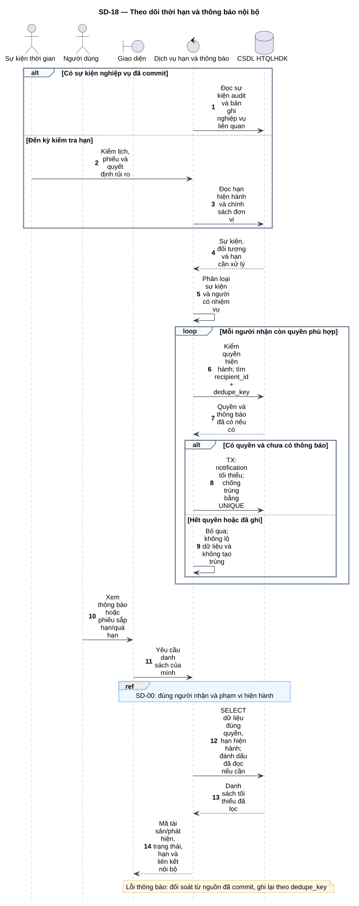
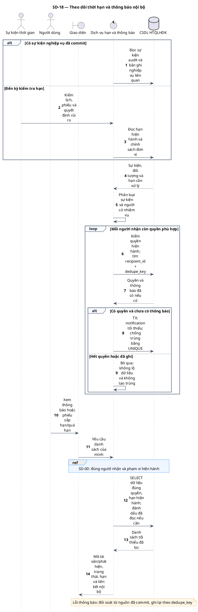

# SD-18 — Theo dõi thời hạn và thông báo nội bộ

Phiên bản 1.0 · 05/09/2026 · Đặc tả tương tác, chưa phải mã ứng dụng.

## 1. Mục tiêu và truy vết

**Kết quả cần đạt:** Thông báo tối thiểu, không trùng cùng sự kiện; xem sắp hạn/quá hạn dựa trên chính sách được duyệt.

**Use Case:** UC-R12, UC-C08. [Danh mục và hợp đồng UC](../../dinh_dang_use_case_activity.md).

**Activity:** [AD-16](../../visual_paradigm_uml_md/17_activity_thoi_han_thong_bao.md).

**Tác nhân:** Sự kiện thời gian, Người dùng.

## 2. Điều kiện và dữ liệu

**Tiền điều kiện:** Sự kiện nghiệp vụ đã commit hoặc kỳ kiểm tra thời hạn; người xem có quyền tương ứng.

**Đầu vào:** Sự kiện, đối tượng, trạng thái, thời điểm và người nhận theo nhiệm vụ; dedupe_key ổn định theo sự kiện/người nhận.

**Bảng liên quan:** `scan_schedule`, `scan_occurrence`, `import_batch`, `finding`, `remediation_ticket`, `ticket_event`, `sla_rule`, `risk_acceptance`, `notification`, `audit_log`. Xem [từ điển dữ liệu](../../database/02_tu_dien_du_lieu.md).

**Quy tắc chung:** [SD-00](SD-00_kiem_quyen_va_giao_dich.md) áp dụng trên từng yêu cầu, bao gồm các nhánh lỗi không lặp lại đầy đủ trong hình. Không có quyền thì dừng trước bước đọc/ghi nghiệp vụ tiếp theo.

## 3. Các lifeline, từ trái sang phải

| Bí danh | Thành phần | Loại UML |
|---|---|---|
| `Clock` | Sự kiện thời gian | actor |
| `User` | Người dùng | actor |
| `UI` | Giao diện | boundary |
| `Svc` | Dịch vụ hạn và thông báo | control |
| `DB` | CSDL HTQLHDK | database |

`Svc` là thành phần logic trong backend; không yêu cầu triển khai thành microservice. `DB` là cơ sở dữ liệu gồm các bảng liên quan, không phải một actor người dùng.

## 4. Trình tự nghiệp vụ

1. Đọc sự kiện đã commit hoặc dữ liệu hạn hiện hành; không tự đặt thời hạn SLA.
2. Xác định các sự kiện trong nguồn và người nhận hiện còn quyền theo tài sản/phiếu.
3. Tạo notification chỉ chứa mã, trạng thái, đường dẫn nội bộ; chống trùng theo recipient + dedupe_key.
4. Người dùng xem danh sách: kiểm người nhận và quyền hiện hành; mở liên kết kiểm lại ở nghiệp vụ đích.
5. Nếu ghi thông báo lỗi, không rollback nghiệp vụ đã commit; tác vụ đối soát đọc lại nguồn sự kiện để ghi lại không trùng.

## 5. Nhánh thay thế và ngoại lệ

- Không có SLA được duyệt: chưa tính hạn giả; nêu cấu hình cần có trong nghiệp vụ liên quan.
- Quyền người nhận bị thu hồi: không tạo/hiển thị nội dung ngoài quyền; liên kết đích tiếp tục kiểm quyền.
- Lặp tác vụ hoặc thử lại sau lỗi: không nhân đôi thông báo cùng sự kiện.
- Không gửi Attack, Evidence, token hoặc nội dung báo cáo qua thông báo.

Mọi lỗi kỹ thuật, từ chối và audit bắt buộc theo SD-00. Các bước ghi ký hiệu `TX` bao gồm kiểm điều kiện hiện hành, ghi nghiệp vụ và audit nguyên tử; không giữ khóa khi chờ thao tác người dùng. Dữ liệu chỉ được trả sau khi quyền và các kiểm soát bắt buộc đạt.

## 6. Sơ đồ và mã nguồn

[Ảnh PNG](../rendered/SD-18_thoi_han_va_thong_bao.png) · [SVG phóng to](../rendered/SD-18_thoi_han_va_thong_bao.svg) · [PlantUML](../plantuml/SD-18_thoi_han_va_thong_bao.puml) · [Mermaid](../mermaid/SD-18_thoi_han_va_thong_bao.mmd)

## 7. Lưu ý khi thiết kế và triển khai

Sự kiện nguồn: lịch sắp đến hạn/bỏ lỡ; lô Failed/Partially Completed; Critical/High; phiếu mới/sắp hạn/quá hạn; yêu cầu xác minh; đề nghị rủi ro chờ duyệt/sắp hết hạn. Ngưỡng “sắp đến hạn” là cấu hình theo chính sách đơn vị chưa được nguồn ấn định, không đặt số giờ/ngày mặc định mới. Đối soát có thể đọc audit_log/bản ghi nghiệp vụ làm nguồn và UNIQUE notification để tránh mất thông báo giữa commit và phát hành; không bổ sung bảng outbox hoặc email ngoài phạm vi.

[Danh mục sơ đồ](../README.md) · [Quy ước](../00_quy_uoc_va_thanh_phan.md) · [Ma trận truy vết](../01_ma_tran_truy_vet.md)
