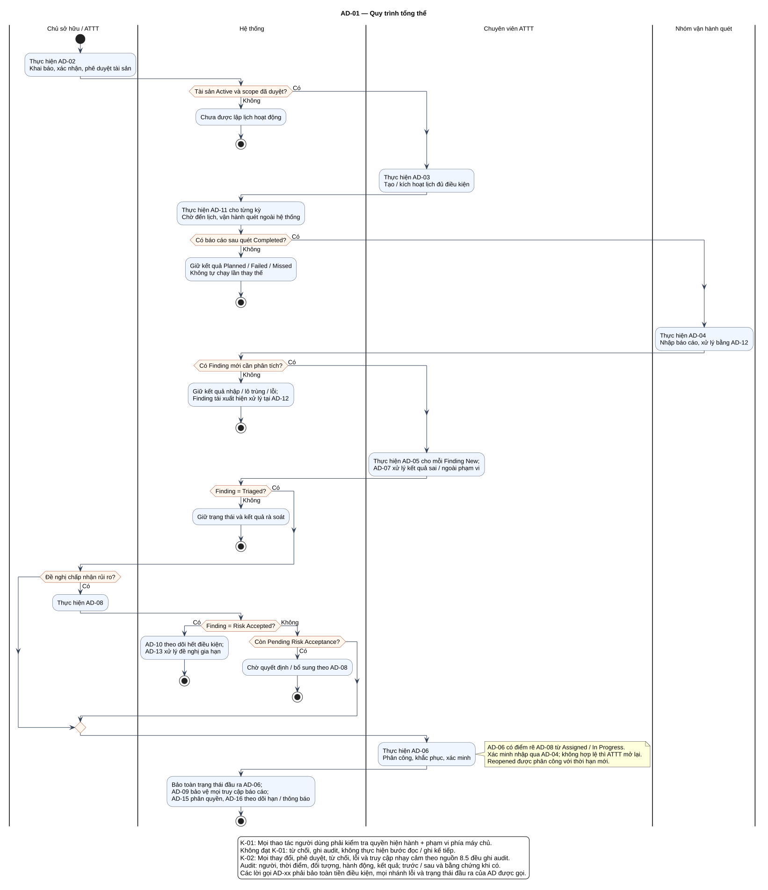

# AD-01 — Quy trình tổng thể

## 1. Mục đích và phạm vi

**Mục đích:** Giải thích luồng “Quy trình tổng thể” đúng theo sơ đồ và giữ ranh giới bốn chức năng nguồn.

| Thuộc tính | Nội dung |
|---|---|
| ID | `AD-01` |
| Nguồn | Mục 4; 7; 8 của `doi_tuong_sd_quy_trinh_hd.md` |
| Điều kiện vào | Bắt đầu quản lý tài sản hoặc tiếp tục từ quy trình con tương ứng. |
| Kết quả/hậu điều kiện | Kết quả từng quy trình con được bảo toàn; không bỏ qua guard khi nối luồng. |
| Use Case liên quan | [UC-C07](../tai_lieu_use_case/UC-C07_ghi_nhat_ky_hanh_dong_nhay_cam.md) |
| Mã sơ đồ | [Markdown](../visual_paradigm_uml_md/02_activity_tong_the.md) · [PlantUML](../visual_paradigm_uml_md/plantuml/02_activity_tong_the.puml) |

## 2. Swimlane và trách nhiệm

- **Chủ sở hữu / ATTT:** thực hiện các hành động nằm trong swimlane; không kế thừa quyền quyết định của lane khác.
- **Hệ thống:** thực hiện các hành động nằm trong swimlane; không kế thừa quyền quyết định của lane khác.
- **Chuyên viên ATTT:** thực hiện các hành động nằm trong swimlane; không kế thừa quyền quyết định của lane khác.
- **Nhóm vận hành quét:** thực hiện các hành động nằm trong swimlane; không kế thừa quyền quyết định của lane khác.

Lane **Hệ thống** biểu diễn xử lý nội bộ, không phải actor. Khi một lane ghép nhiều vai trò bằng dấu `/`, chỉ vai trò thỏa guard/trạng thái của nhánh mới thực hiện. ZAP luôn do nhóm vận hành dùng bên ngoài; hành động “khắc phục” cũng xảy ra ngoài hệ thống quản lý, hệ thống chỉ ghi nhận tiến độ/evidence.

## 3. Luồng chi tiết theo sơ đồ

| Bước | Swimlane | Hành động/ý nghĩa |
|---:|---|---|
| 1 | Chủ sở hữu / ATTT | Thực hiện AD-02 Khai báo, xác nhận, phê duyệt tài sản |
| 2 | Hệ thống | Chưa được lập lịch hoạt động |
| 3 | Chuyên viên ATTT | Thực hiện AD-03 Tạo / kích hoạt lịch đủ điều kiện |
| 4 | Hệ thống | Thực hiện AD-11 cho từng kỳ Chờ đến lịch, vận hành quét ngoài hệ thống |
| 5 | Hệ thống | Giữ kết quả Planned / Failed / Missed Không tự chạy lần thay thế |
| 6 | Nhóm vận hành quét | Thực hiện AD-04 Nhập báo cáo, xử lý bằng AD-12 |
| 7 | Hệ thống | Giữ kết quả nhập / lô trùng / lỗi; Finding tái xuất hiện xử lý tại AD-12 |
| 8 | Chuyên viên ATTT | Thực hiện AD-05 cho mỗi Finding New; AD-07 xử lý kết quả sai / ngoài phạm vi |
| 9 | Hệ thống | Giữ trạng thái và kết quả rà soát |
| 10 | Chủ sở hữu / ATTT | Thực hiện AD-08 |
| 11 | Hệ thống | AD-10 theo dõi hết điều kiện; AD-13 xử lý đề nghị gia hạn |
| 12 | Hệ thống | Chờ quyết định / bổ sung theo AD-08 |
| 13 | Chuyên viên ATTT | Thực hiện AD-06 Phân công, khắc phục, xác minh |
| 14 | Hệ thống | Bảo toàn trạng thái đầu ra AD-06; AD-09 bảo vệ mọi truy cập báo cáo; AD-15 phân quyền, AD-16 theo dõi hạn / thông báo |

Thứ tự trên phản ánh các action trong PlantUML. Khi gặp decision/loop ở mục 4, chỉ đi theo nhánh có guard đúng; action sau điểm hợp nhất chỉ được thực hiện nếu nhánh trước cho phép tiếp tục. Lời gọi `AD-xx` giữ toàn bộ tiền điều kiện, nhánh lỗi và hậu điều kiện của Activity được gọi.

## 4. Điểm quyết định, nhánh và vòng lặp

| STT | Loại | Điều kiện/giá trị kiểm tra | Nhánh thể hiện |
|---:|---|---|---|
| 1 | Decision | Tài sản Active và scope đã duyệt? | Có |
| 2 | Else | Nhánh còn lại | Không |
| 3 | Decision | Có báo cáo sau quét Completed? | Có |
| 4 | Else | Nhánh còn lại | Không |
| 5 | Decision | Có Finding mới cần phân tích? | Có |
| 6 | Else | Nhánh còn lại | Không |
| 7 | Decision | Finding = Triaged? | Có |
| 8 | Else | Nhánh còn lại | Không |
| 9 | Decision | Đề nghị chấp nhận rủi ro? | Có |
| 10 | Decision | Finding = Risk Accepted? | Có |
| 11 | Else | Nhánh còn lại | Không |
| 12 | Decision | Còn Pending Risk Acceptance? | Có |

- Nhánh “Không” không được hiểu là thành công khi dữ liệu thiếu hoặc thao tác bị từ chối.
- Vòng lặp bổ sung chỉ thoát sau khi kiểm tra lại đạt; yêu cầu bổ sung rủi ro phải quay lại người duyệt.
- Với Activity chạy theo sự kiện/kỳ kiểm tra, một nút kết thúc chỉ kết thúc lần đánh giá hiện tại, không hủy việc theo dõi các kỳ sau.

## 5. Dữ liệu và trạng thái bị tác động

| Bước | Swimlane | Ghi nhận/thay đổi |
|---:|---|---|
| 3 | Chuyên viên ATTT | Thực hiện AD-03 Tạo / kích hoạt lịch đủ điều kiện |
| 5 | Hệ thống | Giữ kết quả Planned / Failed / Missed Không tự chạy lần thay thế |
| 8 | Chuyên viên ATTT | Thực hiện AD-05 cho mỗi Finding New; AD-07 xử lý kết quả sai / ngoài phạm vi |

Mọi cạnh chuyển Finding phải thuộc bảng nguồn mục 7.2. Danh sách trạng thái Asset/Schedule/Occurrence/ImportBatch không được đọc thành chuỗi chuyển bắt buộc. Không hard delete dữ liệu truy vết.

## 6. Ngoại lệ và kiểm soát

- Sai quyền/phạm vi: từ chối theo K-01 và audit; không tiếp tục action đọc/ghi.
- Sai trạng thái/đầu vào: giữ dữ liệu đang có, trả lỗi hoặc yêu cầu bổ sung theo nhánh của hình.
- Lỗi/từ chối/chuyển trạng thái/truy cập nhạy cảm: audit theo K-02, kể cả khi nhánh kết thúc sớm.
- Dữ liệu bí mật được masking ở giao diện/bản xuất; RawReport bất biến và kiểm tra toàn vẹn.
- Activity không tạo tích hợp ZAP API, email, SSO, BI, CI/CD, kho mã hoặc ticket ngoài.

## 7. Cách đọc và kiểm tra hình

1. Bắt đầu tại nút đen, xác định lane đang chịu trách nhiệm.
2. Đọc action từ trên xuống cho tới decision; chọn guard đúng và không bỏ qua nhánh lỗi.
3. Tại vòng lặp, quay lại đúng điểm kiểm tra; không đi tới hậu điều kiện khi còn thiếu dữ liệu.
4. Đối chiếu action đổi trạng thái với mục 5 và tài liệu UC liên kết.
5. Kết thúc tại nút đích; kiểm tra hậu điều kiện ở mục 1 đã đạt.

**Điểm kiểm tra chính:** Kết quả từng quy trình con được bảo toàn; không bỏ qua guard khi nối luồng.
