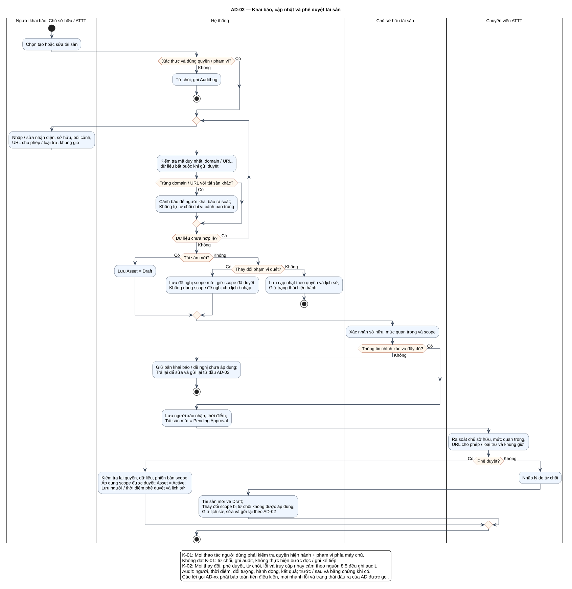

# AD-02 — Khai báo, cập nhật và phê duyệt tài sản

## 1. Mục đích và phạm vi

**Mục đích:** Giải thích luồng “Khai báo, cập nhật và phê duyệt tài sản” đúng theo sơ đồ và giữ ranh giới bốn chức năng nguồn.

| Thuộc tính | Nội dung |
|---|---|
| ID | `AD-02` |
| Nguồn | Mục 4; 5.1; 8.5 của `doi_tuong_sd_quy_trinh_hd.md` |
| Điều kiện vào | Chủ sở hữu hoặc ATTT có quyền khai báo/cập nhật; tài sản ngừng hoạt động xử lý AD-14. |
| Kết quả/hậu điều kiện | Draft/Pending Approval/Active; scope mới chỉ được áp dụng khi ATTT duyệt. |
| Use Case liên quan | [UC-A01](../tai_lieu_use_case/UC-A01_khai_bao_tai_san.md), [UC-A02](../tai_lieu_use_case/UC-A02_cap_nhat_thong_tin_tai_san.md), [UC-A03](../tai_lieu_use_case/UC-A03_xac_nhan_thong_tin_tai_san.md), [UC-A04](../tai_lieu_use_case/UC-A04_phe_duyet_pham_vi_quet.md) |
| Mã sơ đồ | [Markdown](../visual_paradigm_uml_md/03_activity_khai_bao_phe_duyet_tai_san.md) · [PlantUML](../visual_paradigm_uml_md/plantuml/03_activity_khai_bao_phe_duyet_tai_san.puml) |

## 2. Swimlane và trách nhiệm

- **Người khai báo: Chủ sở hữu / ATTT:** thực hiện các hành động nằm trong swimlane; không kế thừa quyền quyết định của lane khác.
- **Hệ thống:** thực hiện các hành động nằm trong swimlane; không kế thừa quyền quyết định của lane khác.
- **Chủ sở hữu tài sản:** thực hiện các hành động nằm trong swimlane; không kế thừa quyền quyết định của lane khác.
- **Chuyên viên ATTT:** thực hiện các hành động nằm trong swimlane; không kế thừa quyền quyết định của lane khác.

Lane **Hệ thống** biểu diễn xử lý nội bộ, không phải actor. Khi một lane ghép nhiều vai trò bằng dấu `/`, chỉ vai trò thỏa guard/trạng thái của nhánh mới thực hiện. ZAP luôn do nhóm vận hành dùng bên ngoài; hành động “khắc phục” cũng xảy ra ngoài hệ thống quản lý, hệ thống chỉ ghi nhận tiến độ/evidence.

## 3. Luồng chi tiết theo sơ đồ

| Bước | Swimlane | Hành động/ý nghĩa |
|---:|---|---|
| 1 | Người khai báo: Chủ sở hữu / ATTT | Chọn tạo hoặc sửa tài sản |
| 2 | Hệ thống | Từ chối; ghi AuditLog |
| 3 | Người khai báo: Chủ sở hữu / ATTT | Nhập / sửa nhận diện, sở hữu, bối cảnh, URL cho phép / loại trừ, khung giờ |
| 4 | Hệ thống | Kiểm tra mã duy nhất, domain / URL, dữ liệu bắt buộc khi gửi duyệt |
| 5 | Hệ thống | Cảnh báo để người khai báo rà soát; Không tự từ chối chỉ vì cảnh báo trùng |
| 6 | Hệ thống | Lưu Asset = Draft |
| 7 | Hệ thống | Lưu đề nghị scope mới, giữ scope đã duyệt; Không dùng scope đề nghị cho lịch / nhập |
| 8 | Hệ thống | Lưu cập nhật theo quyền và lịch sử; Giữ trạng thái hiện hành |
| 9 | Chủ sở hữu tài sản | Xác nhận sở hữu, mức quan trọng và scope |
| 10 | Hệ thống | Giữ bản khai báo / đề nghị chưa áp dụng; Trả lại để sửa và gửi lại từ đầu AD-02 |
| 11 | Hệ thống | Lưu người xác nhận, thời điểm; Tài sản mới = Pending Approval |
| 12 | Chuyên viên ATTT | Rà soát chủ sở hữu, mức quan trọng, URL cho phép / loại trừ và khung giờ |
| 13 | Hệ thống | Kiểm tra lại quyền, dữ liệu, phiên bản scope; Áp dụng scope được duyệt; Asset = Active; Lưu người / thời điểm phê duyệt và lịch sử |
| 14 | Chuyên viên ATTT | Nhập lý do từ chối |
| 15 | Hệ thống | Tài sản mới về Draft; Thay đổi scope bị từ chối không được áp dụng; Giữ lịch sử, sửa và gửi lại theo AD-02 |

Thứ tự trên phản ánh các action trong PlantUML. Khi gặp decision/loop ở mục 4, chỉ đi theo nhánh có guard đúng; action sau điểm hợp nhất chỉ được thực hiện nếu nhánh trước cho phép tiếp tục. Lời gọi `AD-xx` giữ toàn bộ tiền điều kiện, nhánh lỗi và hậu điều kiện của Activity được gọi.

## 4. Điểm quyết định, nhánh và vòng lặp

| STT | Loại | Điều kiện/giá trị kiểm tra | Nhánh thể hiện |
|---:|---|---|---|
| 1 | Decision | Xác thực và đúng quyền / phạm vi? | Có |
| 2 | Else | Nhánh còn lại | Không |
| 3 | Decision | Trùng domain / URL với tài sản khác? | Có |
| 4 | repeat while | Dữ liệu chưa hợp lệ? | Có / Không |
| 5 | Decision | Tài sản mới? | Có |
| 6 | Else | Nhánh còn lại | Không |
| 7 | Decision | Thay đổi phạm vi quét? | Có |
| 8 | Else | Nhánh còn lại | Không |
| 9 | Decision | Thông tin chính xác và đầy đủ? | Có |
| 10 | Else | Nhánh còn lại | Không |
| 11 | Decision | Phê duyệt? | Có |
| 12 | Else | Nhánh còn lại | Không |

- Nhánh “Không” không được hiểu là thành công khi dữ liệu thiếu hoặc thao tác bị từ chối.
- Vòng lặp bổ sung chỉ thoát sau khi kiểm tra lại đạt; yêu cầu bổ sung rủi ro phải quay lại người duyệt.
- Với Activity chạy theo sự kiện/kỳ kiểm tra, một nút kết thúc chỉ kết thúc lần đánh giá hiện tại, không hủy việc theo dõi các kỳ sau.

## 5. Dữ liệu và trạng thái bị tác động

| Bước | Swimlane | Ghi nhận/thay đổi |
|---:|---|---|
| 1 | Người khai báo: Chủ sở hữu / ATTT | Chọn tạo hoặc sửa tài sản |
| 2 | Hệ thống | Từ chối; ghi AuditLog |
| 6 | Hệ thống | Lưu Asset = Draft |
| 7 | Hệ thống | Lưu đề nghị scope mới, giữ scope đã duyệt; Không dùng scope đề nghị cho lịch / nhập |
| 8 | Hệ thống | Lưu cập nhật theo quyền và lịch sử; Giữ trạng thái hiện hành |
| 10 | Hệ thống | Giữ bản khai báo / đề nghị chưa áp dụng; Trả lại để sửa và gửi lại từ đầu AD-02 |
| 11 | Hệ thống | Lưu người xác nhận, thời điểm; Tài sản mới = Pending Approval |
| 13 | Hệ thống | Kiểm tra lại quyền, dữ liệu, phiên bản scope; Áp dụng scope được duyệt; Asset = Active; Lưu người / thời điểm phê duyệt và lịch sử |
| 15 | Hệ thống | Tài sản mới về Draft; Thay đổi scope bị từ chối không được áp dụng; Giữ lịch sử, sửa và gửi lại theo AD-02 |

Mọi cạnh chuyển Finding phải thuộc bảng nguồn mục 7.2. Danh sách trạng thái Asset/Schedule/Occurrence/ImportBatch không được đọc thành chuỗi chuyển bắt buộc. Không hard delete dữ liệu truy vết.

## 6. Ngoại lệ và kiểm soát

- Sai quyền/phạm vi: từ chối theo K-01 và audit; không tiếp tục action đọc/ghi.
- Sai trạng thái/đầu vào: giữ dữ liệu đang có, trả lỗi hoặc yêu cầu bổ sung theo nhánh của hình.
- Lỗi/từ chối/chuyển trạng thái/truy cập nhạy cảm: audit theo K-02, kể cả khi nhánh kết thúc sớm.
- Dữ liệu bí mật được masking ở giao diện/bản xuất; RawReport bất biến và kiểm tra toàn vẹn.
- Activity không tạo tích hợp ZAP API, email, SSO, BI, CI/CD, kho mã hoặc ticket ngoài.

## 7. Cách đọc và kiểm tra hình

1. Bắt đầu tại nút đen, xác định lane đang chịu trách nhiệm.
2. Đọc action từ trên xuống cho tới decision; chọn guard đúng và không bỏ qua nhánh lỗi.
3. Tại vòng lặp, quay lại đúng điểm kiểm tra; không đi tới hậu điều kiện khi còn thiếu dữ liệu.
4. Đối chiếu action đổi trạng thái với mục 5 và tài liệu UC liên kết.
5. Kết thúc tại nút đích; kiểm tra hậu điều kiện ở mục 1 đã đạt.

**Điểm kiểm tra chính:** Draft/Pending Approval/Active; scope mới chỉ được áp dụng khi ATTT duyệt.
