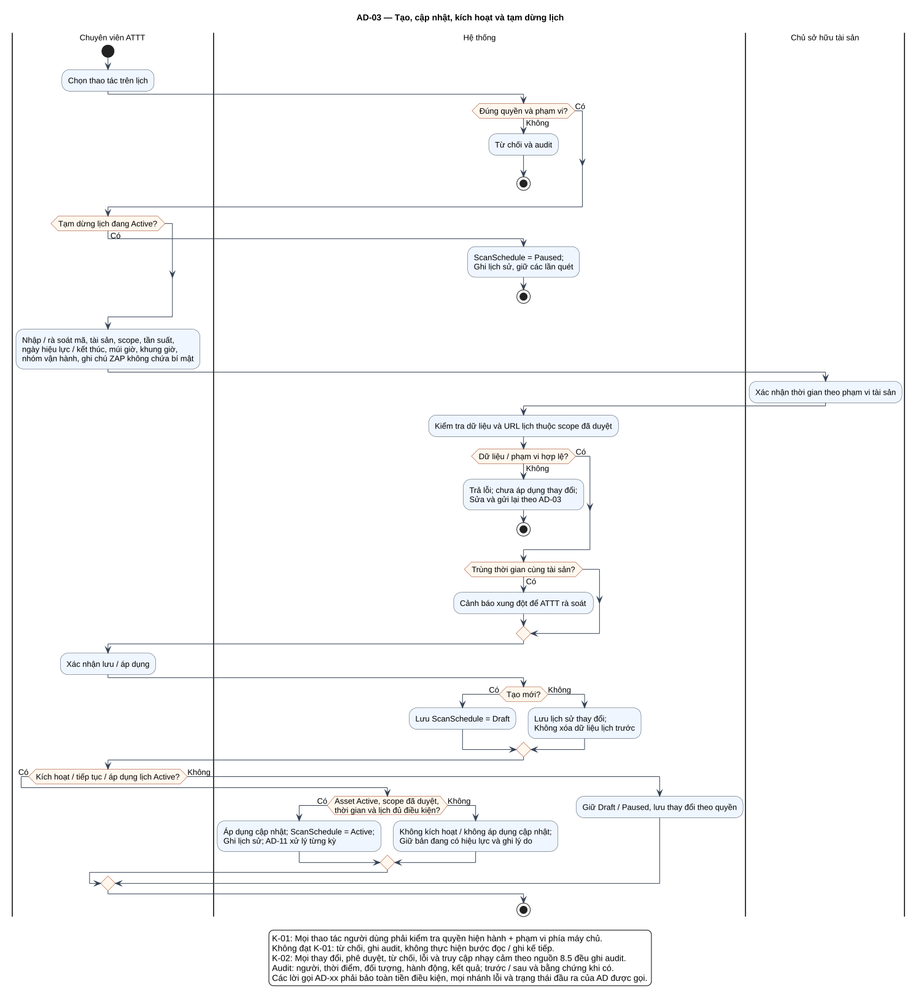

# AD-03 — Tạo, cập nhật, kích hoạt và tạm dừng lịch

## 1. Mục đích và phạm vi

**Mục đích:** Giải thích luồng “Tạo, cập nhật, kích hoạt và tạm dừng lịch” đúng theo sơ đồ và giữ ranh giới bốn chức năng nguồn.

| Thuộc tính | Nội dung |
|---|---|
| ID | `AD-03` |
| Nguồn | Mục 3.3; 5.2; 8.5 của `doi_tuong_sd_quy_trinh_hd.md` |
| Điều kiện vào | ATTT có quyền quản lý lịch theo tài sản. |
| Kết quả/hậu điều kiện | Draft/Active/Paused; lần quét được xử lý ở AD-11. |
| Use Case liên quan | [UC-S01](../tai_lieu_use_case/UC-S01_tao_lich_quet.md), [UC-S02](../tai_lieu_use_case/UC-S02_cap_nhat_lich_quet.md), [UC-S03](../tai_lieu_use_case/UC-S03_kich_hoat_hoac_tiep_tuc_lich.md), [UC-S04](../tai_lieu_use_case/UC-S04_tam_dung_lich.md), [UC-S08](../tai_lieu_use_case/UC-S08_xac_nhan_thoi_gian_quet.md) |
| Mã sơ đồ | [Markdown](../visual_paradigm_uml_md/04_activity_quan_ly_lich_quet.md) · [PlantUML](../visual_paradigm_uml_md/plantuml/04_activity_quan_ly_lich_quet.puml) |

## 2. Swimlane và trách nhiệm

- **Chuyên viên ATTT:** thực hiện các hành động nằm trong swimlane; không kế thừa quyền quyết định của lane khác.
- **Hệ thống:** thực hiện các hành động nằm trong swimlane; không kế thừa quyền quyết định của lane khác.
- **Chủ sở hữu tài sản:** thực hiện các hành động nằm trong swimlane; không kế thừa quyền quyết định của lane khác.

Lane **Hệ thống** biểu diễn xử lý nội bộ, không phải actor. Khi một lane ghép nhiều vai trò bằng dấu `/`, chỉ vai trò thỏa guard/trạng thái của nhánh mới thực hiện. ZAP luôn do nhóm vận hành dùng bên ngoài; hành động “khắc phục” cũng xảy ra ngoài hệ thống quản lý, hệ thống chỉ ghi nhận tiến độ/evidence.

## 3. Luồng chi tiết theo sơ đồ

| Bước | Swimlane | Hành động/ý nghĩa |
|---:|---|---|
| 1 | Chuyên viên ATTT | Chọn thao tác trên lịch |
| 2 | Hệ thống | Từ chối và audit |
| 3 | Hệ thống | ScanSchedule = Paused; Ghi lịch sử, giữ các lần quét |
| 4 | Chuyên viên ATTT | Nhập / rà soát mã, tài sản, scope, tần suất, ngày hiệu lực / kết thúc, múi giờ, khung giờ, nhóm vận hành, ghi chú ZAP không chứa bí mật |
| 5 | Chủ sở hữu tài sản | Xác nhận thời gian theo phạm vi tài sản |
| 6 | Hệ thống | Kiểm tra dữ liệu và URL lịch thuộc scope đã duyệt |
| 7 | Hệ thống | Trả lỗi; chưa áp dụng thay đổi; Sửa và gửi lại theo AD-03 |
| 8 | Hệ thống | Cảnh báo xung đột để ATTT rà soát |
| 9 | Chuyên viên ATTT | Xác nhận lưu / áp dụng |
| 10 | Hệ thống | Lưu ScanSchedule = Draft |
| 11 | Hệ thống | Lưu lịch sử thay đổi; Không xóa dữ liệu lịch trước |
| 12 | Hệ thống | Áp dụng cập nhật; ScanSchedule = Active; Ghi lịch sử; AD-11 xử lý từng kỳ |
| 13 | Hệ thống | Không kích hoạt / không áp dụng cập nhật; Giữ bản đang có hiệu lực và ghi lý do |
| 14 | Hệ thống | Giữ Draft / Paused, lưu thay đổi theo quyền |

Thứ tự trên phản ánh các action trong PlantUML. Khi gặp decision/loop ở mục 4, chỉ đi theo nhánh có guard đúng; action sau điểm hợp nhất chỉ được thực hiện nếu nhánh trước cho phép tiếp tục. Lời gọi `AD-xx` giữ toàn bộ tiền điều kiện, nhánh lỗi và hậu điều kiện của Activity được gọi.

## 4. Điểm quyết định, nhánh và vòng lặp

| STT | Loại | Điều kiện/giá trị kiểm tra | Nhánh thể hiện |
|---:|---|---|---|
| 1 | Decision | Đúng quyền và phạm vi? | Có |
| 2 | Else | Nhánh còn lại | Không |
| 3 | Decision | Tạm dừng lịch đang Active? | Có |
| 4 | Decision | Dữ liệu / phạm vi hợp lệ? | Có |
| 5 | Else | Nhánh còn lại | Không |
| 6 | Decision | Trùng thời gian cùng tài sản? | Có |
| 7 | Decision | Tạo mới? | Có |
| 8 | Else | Nhánh còn lại | Không |
| 9 | Decision | Kích hoạt / tiếp tục / áp dụng lịch Active? | Có |
| 10 | Decision | Asset Active, scope đã duyệt, thời gian và lịch đủ điều kiện? | Có |
| 11 | Else | Nhánh còn lại | Không |
| 12 | Else | Nhánh còn lại | Không |

- Nhánh “Không” không được hiểu là thành công khi dữ liệu thiếu hoặc thao tác bị từ chối.
- Vòng lặp bổ sung chỉ thoát sau khi kiểm tra lại đạt; yêu cầu bổ sung rủi ro phải quay lại người duyệt.
- Với Activity chạy theo sự kiện/kỳ kiểm tra, một nút kết thúc chỉ kết thúc lần đánh giá hiện tại, không hủy việc theo dõi các kỳ sau.

## 5. Dữ liệu và trạng thái bị tác động

| Bước | Swimlane | Ghi nhận/thay đổi |
|---:|---|---|
| 3 | Hệ thống | ScanSchedule = Paused; Ghi lịch sử, giữ các lần quét |
| 4 | Chuyên viên ATTT | Nhập / rà soát mã, tài sản, scope, tần suất, ngày hiệu lực / kết thúc, múi giờ, khung giờ, nhóm vận hành, ghi chú ZAP không chứa bí mật |
| 7 | Hệ thống | Trả lỗi; chưa áp dụng thay đổi; Sửa và gửi lại theo AD-03 |
| 9 | Chuyên viên ATTT | Xác nhận lưu / áp dụng |
| 10 | Hệ thống | Lưu ScanSchedule = Draft |
| 11 | Hệ thống | Lưu lịch sử thay đổi; Không xóa dữ liệu lịch trước |
| 12 | Hệ thống | Áp dụng cập nhật; ScanSchedule = Active; Ghi lịch sử; AD-11 xử lý từng kỳ |
| 13 | Hệ thống | Không kích hoạt / không áp dụng cập nhật; Giữ bản đang có hiệu lực và ghi lý do |
| 14 | Hệ thống | Giữ Draft / Paused, lưu thay đổi theo quyền |

Mọi cạnh chuyển Finding phải thuộc bảng nguồn mục 7.2. Danh sách trạng thái Asset/Schedule/Occurrence/ImportBatch không được đọc thành chuỗi chuyển bắt buộc. Không hard delete dữ liệu truy vết.

## 6. Ngoại lệ và kiểm soát

- Sai quyền/phạm vi: từ chối theo K-01 và audit; không tiếp tục action đọc/ghi.
- Sai trạng thái/đầu vào: giữ dữ liệu đang có, trả lỗi hoặc yêu cầu bổ sung theo nhánh của hình.
- Lỗi/từ chối/chuyển trạng thái/truy cập nhạy cảm: audit theo K-02, kể cả khi nhánh kết thúc sớm.
- Dữ liệu bí mật được masking ở giao diện/bản xuất; RawReport bất biến và kiểm tra toàn vẹn.
- Activity không tạo tích hợp ZAP API, email, SSO, BI, CI/CD, kho mã hoặc ticket ngoài.

## 7. Cách đọc và kiểm tra hình

1. Bắt đầu tại nút đen, xác định lane đang chịu trách nhiệm.
2. Đọc action từ trên xuống cho tới decision; chọn guard đúng và không bỏ qua nhánh lỗi.
3. Tại vòng lặp, quay lại đúng điểm kiểm tra; không đi tới hậu điều kiện khi còn thiếu dữ liệu.
4. Đối chiếu action đổi trạng thái với mục 5 và tài liệu UC liên kết.
5. Kết thúc tại nút đích; kiểm tra hậu điều kiện ở mục 1 đã đạt.

**Điểm kiểm tra chính:** Draft/Active/Paused; lần quét được xử lý ở AD-11.
