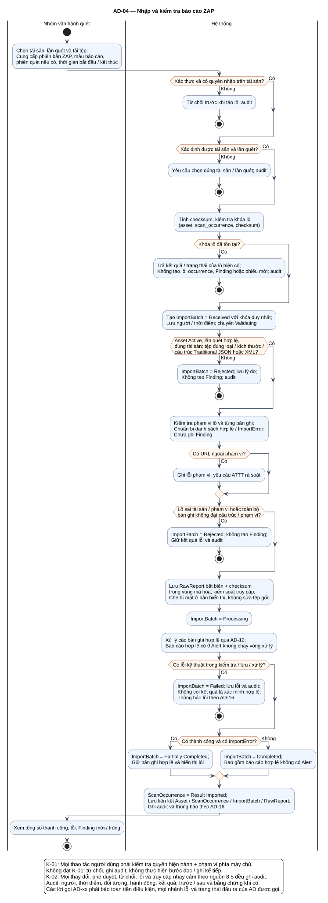

# AD-04 — Nhập và kiểm tra báo cáo ZAP

## 1. Mục đích và phạm vi

**Mục đích:** Giải thích luồng “Nhập và kiểm tra báo cáo ZAP” đúng theo sơ đồ và giữ ranh giới bốn chức năng nguồn.

| Thuộc tính | Nội dung |
|---|---|
| ID | `AD-04` |
| Nguồn | Mục 5.3; 7.6; 8.3–8.5 của `doi_tuong_sd_quy_trinh_hd.md` |
| Điều kiện vào | Ops tải một báo cáo Traditional JSON/XML vào tài sản và lần quét xác định. |
| Kết quả/hậu điều kiện | Kết quả lô cũ hoặc Completed/Partially Completed/Rejected/Failed; Rejected không tạo Finding. |
| Use Case liên quan | [UC-I01](../tai_lieu_use_case/UC-I01_nhap_bao_cao_zap.md), [UC-I02](../tai_lieu_use_case/UC-I02_kiem_tra_quyen_nhap.md), [UC-I03](../tai_lieu_use_case/UC-I03_kiem_tra_tai_san_va_lan_quet.md), [UC-I04](../tai_lieu_use_case/UC-I04_kiem_tra_dinh_dang_bao_cao.md), [UC-I05](../tai_lieu_use_case/UC-I05_kiem_tra_pham_vi_url.md), [UC-I06](../tai_lieu_use_case/UC-I06_luu_bao_cao_goc_bat_bien.md), [UC-I07](../tai_lieu_use_case/UC-I07_che_du_lieu_nhay_cam.md), [UC-I09](../tai_lieu_use_case/UC-I09_chong_nhap_trung.md), [UC-I11](../tai_lieu_use_case/UC-I11_ghi_nhan_loi_nhap.md), [UC-I12](../tai_lieu_use_case/UC-I12_xem_ket_qua_lo_nhap.md), [UC-R08](../tai_lieu_use_case/UC-R08_cap_nhat_ket_qua_quet_xac_minh.md) |
| Mã sơ đồ | [Markdown](../visual_paradigm_uml_md/05_activity_nhap_bao_cao_owasp_zap.md) · [PlantUML](../visual_paradigm_uml_md/plantuml/05_activity_nhap_bao_cao_owasp_zap.puml) |

## 2. Swimlane và trách nhiệm

- **Nhóm vận hành quét:** thực hiện các hành động nằm trong swimlane; không kế thừa quyền quyết định của lane khác.
- **Hệ thống:** thực hiện các hành động nằm trong swimlane; không kế thừa quyền quyết định của lane khác.

Lane **Hệ thống** biểu diễn xử lý nội bộ, không phải actor. Khi một lane ghép nhiều vai trò bằng dấu `/`, chỉ vai trò thỏa guard/trạng thái của nhánh mới thực hiện. ZAP luôn do nhóm vận hành dùng bên ngoài; hành động “khắc phục” cũng xảy ra ngoài hệ thống quản lý, hệ thống chỉ ghi nhận tiến độ/evidence.

## 3. Luồng chi tiết theo sơ đồ

| Bước | Swimlane | Hành động/ý nghĩa |
|---:|---|---|
| 1 | Nhóm vận hành quét | Chọn tài sản, lần quét và tải tệp; Cung cấp phiên bản ZAP, mẫu báo cáo, phiên quét nếu có, thời gian bắt đầu / kết thúc |
| 2 | Hệ thống | Từ chối trước khi tạo lô; audit |
| 3 | Hệ thống | Yêu cầu chọn đúng tài sản / lần quét; audit |
| 4 | Hệ thống | Tính checksum, kiểm tra khóa lô (asset, scan_occurrence, checksum) |
| 5 | Hệ thống | Trả kết quả / trạng thái của lô hiện có; Không tạo lô, occurrence, Finding hoặc phiếu mới; audit |
| 6 | Hệ thống | Tạo ImportBatch = Received với khóa duy nhất; Lưu người / thời điểm; chuyển Validating |
| 7 | Hệ thống | ImportBatch = Rejected; lưu lý do; Không tạo Finding; audit |
| 8 | Hệ thống | Kiểm tra phạm vi lô và từng bản ghi; Chuẩn bị danh sách hợp lệ / ImportError; Chưa ghi Finding |
| 9 | Hệ thống | Ghi lỗi phạm vi; yêu cầu ATTT rà soát |
| 10 | Hệ thống | ImportBatch = Rejected; không tạo Finding; Giữ kết quả lỗi và audit |
| 11 | Hệ thống | Lưu RawReport bất biến + checksum trong vùng mã hóa, kiểm soát truy cập; Che bí mật ở bản hiển thị, không sửa tệp gốc |
| 12 | Hệ thống | ImportBatch = Processing |
| 13 | Hệ thống | Xử lý các bản ghi hợp lệ qua AD-12; Báo cáo hợp lệ có 0 Alert không chạy vòng xử lý |
| 14 | Hệ thống | ImportBatch = Failed; lưu lỗi và audit; Không coi kết quả là xác minh hợp lệ; Thông báo lỗi theo AD-16 |
| 15 | Hệ thống | ImportBatch = Partially Completed; Giữ bản ghi hợp lệ và hiển thị lỗi |
| 16 | Hệ thống | ImportBatch = Completed; Bao gồm báo cáo hợp lệ không có Alert |
| 17 | Hệ thống | ScanOccurrence = Result Imported; Lưu liên kết Asset / ScanOccurrence / ImportBatch / RawReport; Ghi audit và thông báo theo AD-16 |
| 18 | Nhóm vận hành quét | Xem tổng số thành công, lỗi, Finding mới / trùng |

Thứ tự trên phản ánh các action trong PlantUML. Khi gặp decision/loop ở mục 4, chỉ đi theo nhánh có guard đúng; action sau điểm hợp nhất chỉ được thực hiện nếu nhánh trước cho phép tiếp tục. Lời gọi `AD-xx` giữ toàn bộ tiền điều kiện, nhánh lỗi và hậu điều kiện của Activity được gọi.

## 4. Điểm quyết định, nhánh và vòng lặp

| STT | Loại | Điều kiện/giá trị kiểm tra | Nhánh thể hiện |
|---:|---|---|---|
| 1 | Decision | Xác thực và có quyền nhập trên tài sản? | Có |
| 2 | Else | Nhánh còn lại | Không |
| 3 | Decision | Xác định được tài sản và lần quét? | Có |
| 4 | Else | Nhánh còn lại | Không |
| 5 | Decision | Khóa lô đã tồn tại? | Có |
| 6 | Decision | Asset Active, lần quét hợp lệ, đúng tài sản; tệp đúng loại / kích thước / cấu trúc Traditional JSON hoặc XML? | Có |
| 7 | Else | Nhánh còn lại | Không |
| 8 | Decision | Có URL ngoài phạm vi? | Có |
| 9 | Decision | Lô sai tài sản / phạm vi hoặc toàn bộ bản ghi không đạt cấu trúc / phạm vi? | Có |
| 10 | Decision | Có lỗi kỹ thuật trong kiểm tra / lưu / xử lý? | Có |
| 11 | Decision | Có thành công và có ImportError? | Có |
| 12 | Else | Nhánh còn lại | Không |

- Nhánh “Không” không được hiểu là thành công khi dữ liệu thiếu hoặc thao tác bị từ chối.
- Vòng lặp bổ sung chỉ thoát sau khi kiểm tra lại đạt; yêu cầu bổ sung rủi ro phải quay lại người duyệt.
- Với Activity chạy theo sự kiện/kỳ kiểm tra, một nút kết thúc chỉ kết thúc lần đánh giá hiện tại, không hủy việc theo dõi các kỳ sau.

## 5. Dữ liệu và trạng thái bị tác động

| Bước | Swimlane | Ghi nhận/thay đổi |
|---:|---|---|
| 2 | Hệ thống | Từ chối trước khi tạo lô; audit |
| 5 | Hệ thống | Trả kết quả / trạng thái của lô hiện có; Không tạo lô, occurrence, Finding hoặc phiếu mới; audit |
| 6 | Hệ thống | Tạo ImportBatch = Received với khóa duy nhất; Lưu người / thời điểm; chuyển Validating |
| 7 | Hệ thống | ImportBatch = Rejected; lưu lý do; Không tạo Finding; audit |
| 8 | Hệ thống | Kiểm tra phạm vi lô và từng bản ghi; Chuẩn bị danh sách hợp lệ / ImportError; Chưa ghi Finding |
| 9 | Hệ thống | Ghi lỗi phạm vi; yêu cầu ATTT rà soát |
| 10 | Hệ thống | ImportBatch = Rejected; không tạo Finding; Giữ kết quả lỗi và audit |
| 11 | Hệ thống | Lưu RawReport bất biến + checksum trong vùng mã hóa, kiểm soát truy cập; Che bí mật ở bản hiển thị, không sửa tệp gốc |
| 12 | Hệ thống | ImportBatch = Processing |
| 13 | Hệ thống | Xử lý các bản ghi hợp lệ qua AD-12; Báo cáo hợp lệ có 0 Alert không chạy vòng xử lý |
| 14 | Hệ thống | ImportBatch = Failed; lưu lỗi và audit; Không coi kết quả là xác minh hợp lệ; Thông báo lỗi theo AD-16 |
| 15 | Hệ thống | ImportBatch = Partially Completed; Giữ bản ghi hợp lệ và hiển thị lỗi |
| 16 | Hệ thống | ImportBatch = Completed; Bao gồm báo cáo hợp lệ không có Alert |
| 17 | Hệ thống | ScanOccurrence = Result Imported; Lưu liên kết Asset / ScanOccurrence / ImportBatch / RawReport; Ghi audit và thông báo theo AD-16 |

Mọi cạnh chuyển Finding phải thuộc bảng nguồn mục 7.2. Danh sách trạng thái Asset/Schedule/Occurrence/ImportBatch không được đọc thành chuỗi chuyển bắt buộc. Không hard delete dữ liệu truy vết.

## 6. Ngoại lệ và kiểm soát

- Sai quyền/phạm vi: từ chối theo K-01 và audit; không tiếp tục action đọc/ghi.
- Sai trạng thái/đầu vào: giữ dữ liệu đang có, trả lỗi hoặc yêu cầu bổ sung theo nhánh của hình.
- Lỗi/từ chối/chuyển trạng thái/truy cập nhạy cảm: audit theo K-02, kể cả khi nhánh kết thúc sớm.
- Dữ liệu bí mật được masking ở giao diện/bản xuất; RawReport bất biến và kiểm tra toàn vẹn.
- Activity không tạo tích hợp ZAP API, email, SSO, BI, CI/CD, kho mã hoặc ticket ngoài.

## 7. Cách đọc và kiểm tra hình

1. Bắt đầu tại nút đen, xác định lane đang chịu trách nhiệm.
2. Đọc action từ trên xuống cho tới decision; chọn guard đúng và không bỏ qua nhánh lỗi.
3. Tại vòng lặp, quay lại đúng điểm kiểm tra; không đi tới hậu điều kiện khi còn thiếu dữ liệu.
4. Đối chiếu action đổi trạng thái với mục 5 và tài liệu UC liên kết.
5. Kết thúc tại nút đích; kiểm tra hậu điều kiện ở mục 1 đã đạt.

**Điểm kiểm tra chính:** Kết quả lô cũ hoặc Completed/Partially Completed/Rejected/Failed; Rejected không tạo Finding.

**Quy ước lỗi riêng AD-04:** lỗi kỹ thuật sau khi tạo lô đi `Failed`; lỗi cấu trúc/phạm vi toàn lô đi `Rejected`; vừa có thành công vừa có ImportError đi `Partially Completed`; tệp hợp lệ 0 Alert có thể `Completed` và không tạo Finding giả.
