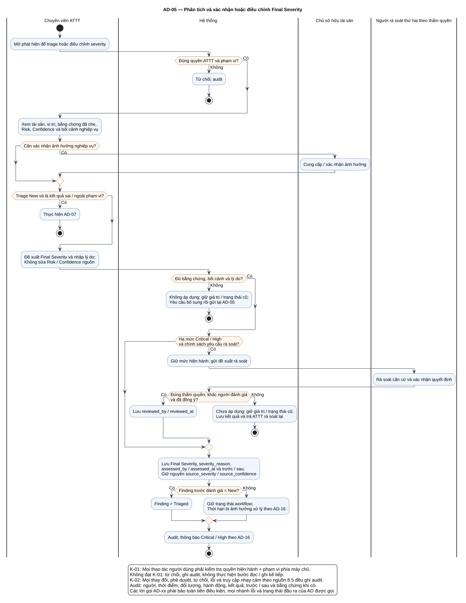

# AD-05 — Phân tích và xác nhận hoặc điều chỉnh Final Severity

## 1. Mục đích và phạm vi

**Mục đích:** Giải thích luồng “Phân tích và xác nhận hoặc điều chỉnh Final Severity” đúng theo sơ đồ và giữ ranh giới bốn chức năng nguồn.

| Thuộc tính | Nội dung |
|---|---|
| ID | `AD-05` |
| Nguồn | Mục 6; 7.2–7.3 của `doi_tuong_sd_quy_trinh_hd.md` |
| Điều kiện vào | ATTT có quyền; New khi triage, hoặc Finding đã đánh giá khi điều chỉnh mức độ. |
| Kết quả/hậu điều kiện | New → Triaged chỉ sau xác nhận hợp lệ; điều chỉnh severity không tự đổi trạng thái workflow. |
| Use Case liên quan | [UC-T01](../tai_lieu_use_case/UC-T01_ra_soat_phat_hien_moi.md), [UC-T02](../tai_lieu_use_case/UC-T02_xac_nhan_final_severity.md), [UC-T05](../tai_lieu_use_case/UC-T05_xac_nhan_anh_huong_nghiep_vu.md) |
| Mã sơ đồ | [Markdown](../visual_paradigm_uml_md/06_activity_phan_tich_final_severity.md) · [PlantUML](../visual_paradigm_uml_md/plantuml/06_activity_phan_tich_final_severity.puml) |

## 2. Swimlane và trách nhiệm

- **Chuyên viên ATTT:** thực hiện các hành động nằm trong swimlane; không kế thừa quyền quyết định của lane khác.
- **Hệ thống:** thực hiện các hành động nằm trong swimlane; không kế thừa quyền quyết định của lane khác.
- **Chủ sở hữu tài sản:** thực hiện các hành động nằm trong swimlane; không kế thừa quyền quyết định của lane khác.
- **Người rà soát thứ hai theo thẩm quyền:** thực hiện các hành động nằm trong swimlane; không kế thừa quyền quyết định của lane khác.

Lane **Hệ thống** biểu diễn xử lý nội bộ, không phải actor. Khi một lane ghép nhiều vai trò bằng dấu `/`, chỉ vai trò thỏa guard/trạng thái của nhánh mới thực hiện. ZAP luôn do nhóm vận hành dùng bên ngoài; hành động “khắc phục” cũng xảy ra ngoài hệ thống quản lý, hệ thống chỉ ghi nhận tiến độ/evidence.

## 3. Luồng chi tiết theo sơ đồ

| Bước | Swimlane | Hành động/ý nghĩa |
|---:|---|---|
| 1 | Chuyên viên ATTT | Mở phát hiện để triage hoặc điều chỉnh severity |
| 2 | Hệ thống | Từ chối; audit |
| 3 | Chuyên viên ATTT | Xem tài sản, vị trí, bằng chứng đã che, Risk, Confidence và bối cảnh nghiệp vụ |
| 4 | Chủ sở hữu tài sản | Cung cấp / xác nhận ảnh hưởng |
| 5 | Chuyên viên ATTT | Thực hiện AD-07 |
| 6 | Chuyên viên ATTT | Đề xuất Final Severity và nhập lý do; Không sửa Risk / Confidence nguồn |
| 7 | Hệ thống | Không áp dụng; giữ giá trị / trạng thái cũ; Yêu cầu bổ sung rồi gửi lại AD-05 |
| 8 | Hệ thống | Giữ mức hiện hành; gửi đề xuất rà soát |
| 9 | Người rà soát thứ hai theo thẩm quyền | Rà soát căn cứ và xác nhận quyết định |
| 10 | Hệ thống | Lưu reviewed_by / reviewed_at |
| 11 | Hệ thống | Chưa áp dụng; giữ giá trị / trạng thái cũ; Lưu kết quả và trả ATTT rà soát lại |
| 12 | Hệ thống | Lưu Final Severity, severity_reason, assessed_by / assessed_at và trước / sau; Giữ nguyên source_severity / source_confidence |
| 13 | Hệ thống | Finding = Triaged |
| 14 | Hệ thống | Giữ trạng thái workflow; Thời hạn bị ảnh hưởng xử lý theo AD-16 |
| 15 | Hệ thống | Audit; thông báo Critical / High theo AD-16 |

Thứ tự trên phản ánh các action trong PlantUML. Khi gặp decision/loop ở mục 4, chỉ đi theo nhánh có guard đúng; action sau điểm hợp nhất chỉ được thực hiện nếu nhánh trước cho phép tiếp tục. Lời gọi `AD-xx` giữ toàn bộ tiền điều kiện, nhánh lỗi và hậu điều kiện của Activity được gọi.

## 4. Điểm quyết định, nhánh và vòng lặp

| STT | Loại | Điều kiện/giá trị kiểm tra | Nhánh thể hiện |
|---:|---|---|---|
| 1 | Decision | Đúng quyền ATTT và phạm vi? | Có |
| 2 | Else | Nhánh còn lại | Không |
| 3 | Decision | Cần xác nhận ảnh hưởng nghiệp vụ? | Có |
| 4 | Decision | Triage New và là kết quả sai / ngoài phạm vi? | Có |
| 5 | Decision | Đủ bằng chứng, bối cảnh và lý do? | Có |
| 6 | Else | Nhánh còn lại | Không |
| 7 | Decision | Hạ mức Critical / High và chính sách yêu cầu rà soát? | Có |
| 8 | Decision | Đúng thẩm quyền, khác người đánh giá và đã đồng ý? | Có |
| 9 | Else | Nhánh còn lại | Không |
| 10 | Decision | Finding trước đánh giá = New? | Có |
| 11 | Else | Nhánh còn lại | Không |

- Nhánh “Không” không được hiểu là thành công khi dữ liệu thiếu hoặc thao tác bị từ chối.
- Vòng lặp bổ sung chỉ thoát sau khi kiểm tra lại đạt; yêu cầu bổ sung rủi ro phải quay lại người duyệt.
- Với Activity chạy theo sự kiện/kỳ kiểm tra, một nút kết thúc chỉ kết thúc lần đánh giá hiện tại, không hủy việc theo dõi các kỳ sau.

## 5. Dữ liệu và trạng thái bị tác động

| Bước | Swimlane | Ghi nhận/thay đổi |
|---:|---|---|
| 7 | Hệ thống | Không áp dụng; giữ giá trị / trạng thái cũ; Yêu cầu bổ sung rồi gửi lại AD-05 |
| 10 | Hệ thống | Lưu reviewed_by / reviewed_at |
| 11 | Hệ thống | Chưa áp dụng; giữ giá trị / trạng thái cũ; Lưu kết quả và trả ATTT rà soát lại |
| 12 | Hệ thống | Lưu Final Severity, severity_reason, assessed_by / assessed_at và trước / sau; Giữ nguyên source_severity / source_confidence |
| 13 | Hệ thống | Finding = Triaged |

Mọi cạnh chuyển Finding phải thuộc bảng nguồn mục 7.2. Danh sách trạng thái Asset/Schedule/Occurrence/ImportBatch không được đọc thành chuỗi chuyển bắt buộc. Không hard delete dữ liệu truy vết.

## 6. Ngoại lệ và kiểm soát

- Sai quyền/phạm vi: từ chối theo K-01 và audit; không tiếp tục action đọc/ghi.
- Sai trạng thái/đầu vào: giữ dữ liệu đang có, trả lỗi hoặc yêu cầu bổ sung theo nhánh của hình.
- Lỗi/từ chối/chuyển trạng thái/truy cập nhạy cảm: audit theo K-02, kể cả khi nhánh kết thúc sớm.
- Dữ liệu bí mật được masking ở giao diện/bản xuất; RawReport bất biến và kiểm tra toàn vẹn.
- Activity không tạo tích hợp ZAP API, email, SSO, BI, CI/CD, kho mã hoặc ticket ngoài.

## 7. Cách đọc và kiểm tra hình

1. Bắt đầu tại nút đen, xác định lane đang chịu trách nhiệm.
2. Đọc action từ trên xuống cho tới decision; chọn guard đúng và không bỏ qua nhánh lỗi.
3. Tại vòng lặp, quay lại đúng điểm kiểm tra; không đi tới hậu điều kiện khi còn thiếu dữ liệu.
4. Đối chiếu action đổi trạng thái với mục 5 và tài liệu UC liên kết.
5. Kết thúc tại nút đích; kiểm tra hậu điều kiện ở mục 1 đã đạt.

**Điểm kiểm tra chính:** New → Triaged chỉ sau xác nhận hợp lệ; điều chỉnh severity không tự đổi trạng thái workflow.
