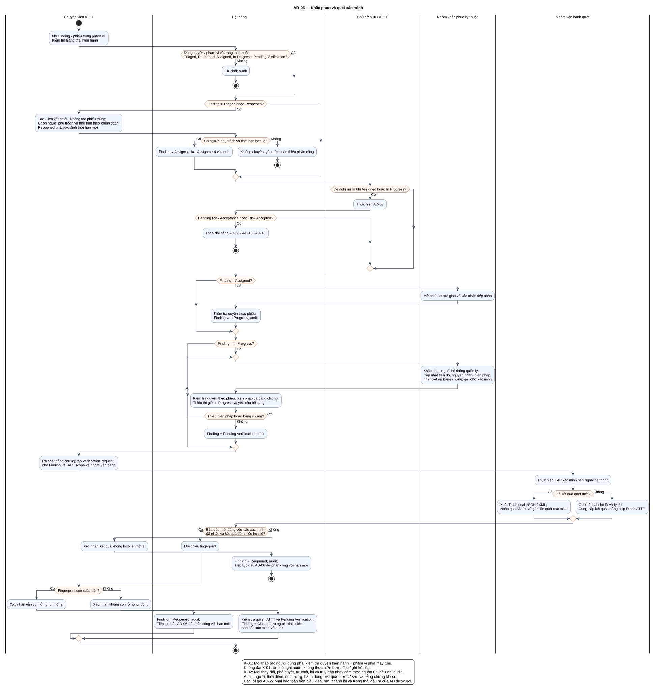

# AD-06 — Khắc phục và quét xác minh

## 1. Mục đích và phạm vi

**Mục đích:** Giải thích luồng “Khắc phục và quét xác minh” đúng theo sơ đồ và giữ ranh giới bốn chức năng nguồn.

| Thuộc tính | Nội dung |
|---|---|
| ID | `AD-06` |
| Nguồn | Mục 5.4; 6.5; 7.2; 7.5 của `doi_tuong_sd_quy_trinh_hd.md` |
| Điều kiện vào | ATTT tiếp tục Triaged/Reopened; người được giao tiếp tục Assigned/In Progress; xác minh từ Pending Verification. |
| Kết quả/hậu điều kiện | Closed chỉ do ATTT với ZAP mới hợp lệ; còn lỗi hoặc kết quả không hợp lệ → Reopened. |
| Use Case liên quan | [UC-R01](../tai_lieu_use_case/UC-R01_tao_phieu_khac_phuc.md), [UC-R02](../tai_lieu_use_case/UC-R02_phan_cong_xu_ly.md), [UC-R03](../tai_lieu_use_case/UC-R03_tiep_nhan_phieu.md), [UC-R04](../tai_lieu_use_case/UC-R04_cap_nhat_tien_do.md), [UC-R05](../tai_lieu_use_case/UC-R05_cap_nhat_bien_phap_va_bang_chung.md), [UC-R06](../tai_lieu_use_case/UC-R06_chuyen_cho_xac_minh.md), [UC-R07](../tai_lieu_use_case/UC-R07_tao_yeu_cau_quet_xac_minh.md), [UC-R08](../tai_lieu_use_case/UC-R08_cap_nhat_ket_qua_quet_xac_minh.md), [UC-R09](../tai_lieu_use_case/UC-R09_doi_chieu_dau_van_tay_phat_hien.md), [UC-R10](../tai_lieu_use_case/UC-R10_dong_phat_hien.md), [UC-R11](../tai_lieu_use_case/UC-R11_mo_lai_phat_hien.md) |
| Mã sơ đồ | [Markdown](../visual_paradigm_uml_md/07_activity_khac_phuc_va_xac_minh.md) · [PlantUML](../visual_paradigm_uml_md/plantuml/07_activity_khac_phuc_va_xac_minh.puml) |

## 2. Swimlane và trách nhiệm

- **Chuyên viên ATTT:** thực hiện các hành động nằm trong swimlane; không kế thừa quyền quyết định của lane khác.
- **Hệ thống:** thực hiện các hành động nằm trong swimlane; không kế thừa quyền quyết định của lane khác.
- **Chủ sở hữu / ATTT:** thực hiện các hành động nằm trong swimlane; không kế thừa quyền quyết định của lane khác.
- **Nhóm khắc phục kỹ thuật:** thực hiện các hành động nằm trong swimlane; không kế thừa quyền quyết định của lane khác.
- **Nhóm vận hành quét:** thực hiện các hành động nằm trong swimlane; không kế thừa quyền quyết định của lane khác.

Lane **Hệ thống** biểu diễn xử lý nội bộ, không phải actor. Khi một lane ghép nhiều vai trò bằng dấu `/`, chỉ vai trò thỏa guard/trạng thái của nhánh mới thực hiện. ZAP luôn do nhóm vận hành dùng bên ngoài; hành động “khắc phục” cũng xảy ra ngoài hệ thống quản lý, hệ thống chỉ ghi nhận tiến độ/evidence.

## 3. Luồng chi tiết theo sơ đồ

| Bước | Swimlane | Hành động/ý nghĩa |
|---:|---|---|
| 1 | Chuyên viên ATTT | Mở Finding / phiếu trong phạm vi; Kiểm tra trạng thái hiện hành |
| 2 | Hệ thống | Từ chối; audit |
| 3 | Chuyên viên ATTT | Tạo / liên kết phiếu, không tạo phiếu trùng; Chọn người phụ trách và thời hạn theo chính sách; Reopened phải xác định thời hạn mới |
| 4 | Hệ thống | Finding = Assigned; lưu Assignment và audit |
| 5 | Hệ thống | Không chuyển; yêu cầu hoàn thiện phân công |
| 6 | Chủ sở hữu / ATTT | Thực hiện AD-08 |
| 7 | Hệ thống | Theo dõi bằng AD-08 / AD-10 / AD-13 |
| 8 | Nhóm khắc phục kỹ thuật | Mở phiếu được giao và xác nhận tiếp nhận |
| 9 | Hệ thống | Kiểm tra quyền theo phiếu; Finding = In Progress; audit |
| 10 | Nhóm khắc phục kỹ thuật | Khắc phục ngoài hệ thống quản lý; Cập nhật tiến độ, nguyên nhân, biện pháp, nhận xét và bằng chứng; gửi chờ xác minh |
| 11 | Hệ thống | Kiểm tra quyền theo phiếu, biện pháp và bằng chứng; Thiếu thì giữ In Progress và yêu cầu bổ sung |
| 12 | Hệ thống | Finding = Pending Verification; audit |
| 13 | Chuyên viên ATTT | Rà soát bằng chứng; tạo VerificationRequest cho Finding, tài sản, scope và nhóm vận hành |
| 14 | Nhóm vận hành quét | Thực hiện ZAP xác minh bên ngoài hệ thống |
| 15 | Nhóm vận hành quét | Xuất Traditional JSON / XML; Nhập qua AD-04 và gắn lần quét xác minh |
| 16 | Nhóm vận hành quét | Ghi thất bại / bỏ lỡ và lý do; Cung cấp kết quả không hợp lệ cho ATTT |
| 17 | Hệ thống | Đối chiếu fingerprint |
| 18 | Chuyên viên ATTT | Xác nhận kết quả không hợp lệ; mở lại |
| 19 | Hệ thống | Finding = Reopened; audit; Tiếp tục đầu AD-06 để phân công với hạn mới |
| 20 | Chuyên viên ATTT | Xác nhận vẫn còn lỗ hổng; mở lại |
| 21 | Hệ thống | Finding = Reopened; audit; Tiếp tục đầu AD-06 để phân công với hạn mới |
| 22 | Chuyên viên ATTT | Xác nhận không còn lỗ hổng; đóng |
| 23 | Hệ thống | Kiểm tra quyền ATTT và Pending Verification; Finding = Closed; lưu người, thời điểm, báo cáo xác minh và audit |

Thứ tự trên phản ánh các action trong PlantUML. Khi gặp decision/loop ở mục 4, chỉ đi theo nhánh có guard đúng; action sau điểm hợp nhất chỉ được thực hiện nếu nhánh trước cho phép tiếp tục. Lời gọi `AD-xx` giữ toàn bộ tiền điều kiện, nhánh lỗi và hậu điều kiện của Activity được gọi.

## 4. Điểm quyết định, nhánh và vòng lặp

| STT | Loại | Điều kiện/giá trị kiểm tra | Nhánh thể hiện |
|---:|---|---|---|
| 1 | Decision | Đúng quyền / phạm vi và trạng thái thuộc Triaged, Reopened, Assigned, In Progress, Pending Verification? | Có |
| 2 | Else | Nhánh còn lại | Không |
| 3 | Decision | Finding = Triaged hoặc Reopened? | Có |
| 4 | Decision | Có người phụ trách và thời hạn hợp lệ? | Có |
| 5 | Else | Nhánh còn lại | Không |
| 6 | Decision | Đề nghị rủi ro khi Assigned hoặc In Progress? | Có |
| 7 | Decision | Pending Risk Acceptance hoặc Risk Accepted? | Có |
| 8 | Decision | Finding = Assigned? | Có |
| 9 | Decision | Finding = In Progress? | Có |
| 10 | repeat while | Thiếu biện pháp hoặc bằng chứng? | Có / Không |
| 11 | Decision | Có kết quả quét mới? | Có |
| 12 | Else | Nhánh còn lại | Không |
| 13 | Decision | Báo cáo mới đúng yêu cầu xác minh, đã nhập và kết quả đối chiếu hợp lệ? | Có |
| 14 | Else | Nhánh còn lại | Không |
| 15 | Decision | Fingerprint còn xuất hiện? | Có |
| 16 | Else | Nhánh còn lại | Không |

- Nhánh “Không” không được hiểu là thành công khi dữ liệu thiếu hoặc thao tác bị từ chối.
- Vòng lặp bổ sung chỉ thoát sau khi kiểm tra lại đạt; yêu cầu bổ sung rủi ro phải quay lại người duyệt.
- Với Activity chạy theo sự kiện/kỳ kiểm tra, một nút kết thúc chỉ kết thúc lần đánh giá hiện tại, không hủy việc theo dõi các kỳ sau.

## 5. Dữ liệu và trạng thái bị tác động

| Bước | Swimlane | Ghi nhận/thay đổi |
|---:|---|---|
| 3 | Chuyên viên ATTT | Tạo / liên kết phiếu, không tạo phiếu trùng; Chọn người phụ trách và thời hạn theo chính sách; Reopened phải xác định thời hạn mới |
| 4 | Hệ thống | Finding = Assigned; lưu Assignment và audit |
| 9 | Hệ thống | Kiểm tra quyền theo phiếu; Finding = In Progress; audit |
| 10 | Nhóm khắc phục kỹ thuật | Khắc phục ngoài hệ thống quản lý; Cập nhật tiến độ, nguyên nhân, biện pháp, nhận xét và bằng chứng; gửi chờ xác minh |
| 11 | Hệ thống | Kiểm tra quyền theo phiếu, biện pháp và bằng chứng; Thiếu thì giữ In Progress và yêu cầu bổ sung |
| 12 | Hệ thống | Finding = Pending Verification; audit |
| 13 | Chuyên viên ATTT | Rà soát bằng chứng; tạo VerificationRequest cho Finding, tài sản, scope và nhóm vận hành |
| 16 | Nhóm vận hành quét | Ghi thất bại / bỏ lỡ và lý do; Cung cấp kết quả không hợp lệ cho ATTT |
| 19 | Hệ thống | Finding = Reopened; audit; Tiếp tục đầu AD-06 để phân công với hạn mới |
| 21 | Hệ thống | Finding = Reopened; audit; Tiếp tục đầu AD-06 để phân công với hạn mới |
| 23 | Hệ thống | Kiểm tra quyền ATTT và Pending Verification; Finding = Closed; lưu người, thời điểm, báo cáo xác minh và audit |

Mọi cạnh chuyển Finding phải thuộc bảng nguồn mục 7.2. Danh sách trạng thái Asset/Schedule/Occurrence/ImportBatch không được đọc thành chuỗi chuyển bắt buộc. Không hard delete dữ liệu truy vết.

## 6. Ngoại lệ và kiểm soát

- Sai quyền/phạm vi: từ chối theo K-01 và audit; không tiếp tục action đọc/ghi.
- Sai trạng thái/đầu vào: giữ dữ liệu đang có, trả lỗi hoặc yêu cầu bổ sung theo nhánh của hình.
- Lỗi/từ chối/chuyển trạng thái/truy cập nhạy cảm: audit theo K-02, kể cả khi nhánh kết thúc sớm.
- Dữ liệu bí mật được masking ở giao diện/bản xuất; RawReport bất biến và kiểm tra toàn vẹn.
- Activity không tạo tích hợp ZAP API, email, SSO, BI, CI/CD, kho mã hoặc ticket ngoài.

## 7. Cách đọc và kiểm tra hình

1. Bắt đầu tại nút đen, xác định lane đang chịu trách nhiệm.
2. Đọc action từ trên xuống cho tới decision; chọn guard đúng và không bỏ qua nhánh lỗi.
3. Tại vòng lặp, quay lại đúng điểm kiểm tra; không đi tới hậu điều kiện khi còn thiếu dữ liệu.
4. Đối chiếu action đổi trạng thái với mục 5 và tài liệu UC liên kết.
5. Kết thúc tại nút đích; kiểm tra hậu điều kiện ở mục 1 đã đạt.

**Điểm kiểm tra chính:** Closed chỉ do ATTT với ZAP mới hợp lệ; còn lỗi hoặc kết quả không hợp lệ → Reopened.
