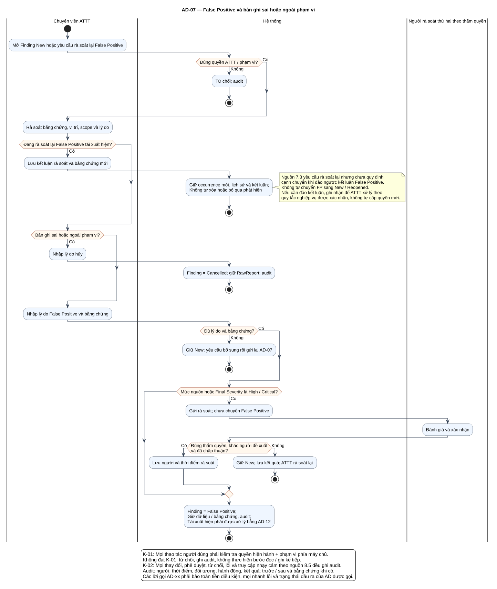

# AD-07 — False Positive và bản ghi sai hoặc ngoài phạm vi

## 1. Mục đích và phạm vi

**Mục đích:** Giải thích luồng “False Positive và bản ghi sai hoặc ngoài phạm vi” đúng theo sơ đồ và giữ ranh giới bốn chức năng nguồn.

| Thuộc tính | Nội dung |
|---|---|
| ID | `AD-07` |
| Nguồn | Mục 7.2–7.3; 8.5 của `doi_tuong_sd_quy_trinh_hd.md` |
| Điều kiện vào | ATTT xử lý Finding New; hoặc rà soát lại False Positive tái xuất hiện. |
| Kết quả/hậu điều kiện | New → False Positive/Cancelled theo nguồn; tái rà soát không tự bỏ qua hoặc thêm cạnh trạng thái mới. |
| Use Case liên quan | [UC-T03](../tai_lieu_use_case/UC-T03_xac_nhan_false_positive.md), [UC-T04](../tai_lieu_use_case/UC-T04_huy_phat_hien_sai_hoac_ngoai_pham_vi.md) |
| Mã sơ đồ | [Markdown](../visual_paradigm_uml_md/09_activity_false_positive_ngoai_pham_vi.md) · [PlantUML](../visual_paradigm_uml_md/plantuml/09_activity_false_positive_ngoai_pham_vi.puml) |

## 2. Swimlane và trách nhiệm

- **Chuyên viên ATTT:** thực hiện các hành động nằm trong swimlane; không kế thừa quyền quyết định của lane khác.
- **Hệ thống:** thực hiện các hành động nằm trong swimlane; không kế thừa quyền quyết định của lane khác.
- **Người rà soát thứ hai theo thẩm quyền:** thực hiện các hành động nằm trong swimlane; không kế thừa quyền quyết định của lane khác.

Lane **Hệ thống** biểu diễn xử lý nội bộ, không phải actor. Khi một lane ghép nhiều vai trò bằng dấu `/`, chỉ vai trò thỏa guard/trạng thái của nhánh mới thực hiện. ZAP luôn do nhóm vận hành dùng bên ngoài; hành động “khắc phục” cũng xảy ra ngoài hệ thống quản lý, hệ thống chỉ ghi nhận tiến độ/evidence.

## 3. Luồng chi tiết theo sơ đồ

| Bước | Swimlane | Hành động/ý nghĩa |
|---:|---|---|
| 1 | Chuyên viên ATTT | Mở Finding New hoặc yêu cầu rà soát lại False Positive |
| 2 | Hệ thống | Từ chối; audit |
| 3 | Chuyên viên ATTT | Rà soát bằng chứng, vị trí, scope và lý do |
| 4 | Chuyên viên ATTT | Lưu kết luận rà soát và bằng chứng mới |
| 5 | Hệ thống | Giữ occurrence mới, lịch sử và kết luận; Không tự xóa hoặc bỏ qua phát hiện |
| 6 | Chuyên viên ATTT | Nhập lý do hủy |
| 7 | Hệ thống | Finding = Cancelled; giữ RawReport; audit |
| 8 | Chuyên viên ATTT | Nhập lý do False Positive và bằng chứng |
| 9 | Hệ thống | Giữ New; yêu cầu bổ sung rồi gửi lại AD-07 |
| 10 | Hệ thống | Gửi rà soát; chưa chuyển False Positive |
| 11 | Người rà soát thứ hai theo thẩm quyền | Đánh giá và xác nhận |
| 12 | Hệ thống | Lưu người và thời điểm rà soát |
| 13 | Hệ thống | Giữ New; lưu kết quả; ATTT rà soát lại |
| 14 | Hệ thống | Finding = False Positive; Giữ dữ liệu / bằng chứng, audit; Tái xuất hiện phải được xử lý bằng AD-12 |

Thứ tự trên phản ánh các action trong PlantUML. Khi gặp decision/loop ở mục 4, chỉ đi theo nhánh có guard đúng; action sau điểm hợp nhất chỉ được thực hiện nếu nhánh trước cho phép tiếp tục. Lời gọi `AD-xx` giữ toàn bộ tiền điều kiện, nhánh lỗi và hậu điều kiện của Activity được gọi.

## 4. Điểm quyết định, nhánh và vòng lặp

| STT | Loại | Điều kiện/giá trị kiểm tra | Nhánh thể hiện |
|---:|---|---|---|
| 1 | Decision | Đúng quyền ATTT / phạm vi? | Có |
| 2 | Else | Nhánh còn lại | Không |
| 3 | Decision | Đang rà soát lại False Positive tái xuất hiện? | Có |
| 4 | Decision | Bản ghi sai hoặc ngoài phạm vi? | Có |
| 5 | Decision | Đủ lý do và bằng chứng? | Có |
| 6 | Else | Nhánh còn lại | Không |
| 7 | Decision | Mức nguồn hoặc Final Severity là High / Critical? | Có |
| 8 | Decision | Đúng thẩm quyền, khác người đề xuất và đã chấp thuận? | Có |
| 9 | Else | Nhánh còn lại | Không |

- Nhánh “Không” không được hiểu là thành công khi dữ liệu thiếu hoặc thao tác bị từ chối.
- Vòng lặp bổ sung chỉ thoát sau khi kiểm tra lại đạt; yêu cầu bổ sung rủi ro phải quay lại người duyệt.
- Với Activity chạy theo sự kiện/kỳ kiểm tra, một nút kết thúc chỉ kết thúc lần đánh giá hiện tại, không hủy việc theo dõi các kỳ sau.

## 5. Dữ liệu và trạng thái bị tác động

| Bước | Swimlane | Ghi nhận/thay đổi |
|---:|---|---|
| 1 | Chuyên viên ATTT | Mở Finding New hoặc yêu cầu rà soát lại False Positive |
| 4 | Chuyên viên ATTT | Lưu kết luận rà soát và bằng chứng mới |
| 7 | Hệ thống | Finding = Cancelled; giữ RawReport; audit |
| 8 | Chuyên viên ATTT | Nhập lý do False Positive và bằng chứng |
| 9 | Hệ thống | Giữ New; yêu cầu bổ sung rồi gửi lại AD-07 |
| 10 | Hệ thống | Gửi rà soát; chưa chuyển False Positive |
| 12 | Hệ thống | Lưu người và thời điểm rà soát |
| 13 | Hệ thống | Giữ New; lưu kết quả; ATTT rà soát lại |
| 14 | Hệ thống | Finding = False Positive; Giữ dữ liệu / bằng chứng, audit; Tái xuất hiện phải được xử lý bằng AD-12 |

Mọi cạnh chuyển Finding phải thuộc bảng nguồn mục 7.2. Danh sách trạng thái Asset/Schedule/Occurrence/ImportBatch không được đọc thành chuỗi chuyển bắt buộc. Không hard delete dữ liệu truy vết.

## 6. Ngoại lệ và kiểm soát

- Sai quyền/phạm vi: từ chối theo K-01 và audit; không tiếp tục action đọc/ghi.
- Sai trạng thái/đầu vào: giữ dữ liệu đang có, trả lỗi hoặc yêu cầu bổ sung theo nhánh của hình.
- Lỗi/từ chối/chuyển trạng thái/truy cập nhạy cảm: audit theo K-02, kể cả khi nhánh kết thúc sớm.
- Dữ liệu bí mật được masking ở giao diện/bản xuất; RawReport bất biến và kiểm tra toàn vẹn.
- Activity không tạo tích hợp ZAP API, email, SSO, BI, CI/CD, kho mã hoặc ticket ngoài.

## 7. Cách đọc và kiểm tra hình

1. Bắt đầu tại nút đen, xác định lane đang chịu trách nhiệm.
2. Đọc action từ trên xuống cho tới decision; chọn guard đúng và không bỏ qua nhánh lỗi.
3. Tại vòng lặp, quay lại đúng điểm kiểm tra; không đi tới hậu điều kiện khi còn thiếu dữ liệu.
4. Đối chiếu action đổi trạng thái với mục 5 và tài liệu UC liên kết.
5. Kết thúc tại nút đích; kiểm tra hậu điều kiện ở mục 1 đã đạt.

**Điểm kiểm tra chính:** New → False Positive/Cancelled theo nguồn; tái rà soát không tự bỏ qua hoặc thêm cạnh trạng thái mới.

**Giới hạn nguồn:** nguồn yêu cầu rà soát lại False Positive tái xuất hiện nhưng chưa định nghĩa cạnh đảo ngược. Activity lưu occurrence/kết luận và không tự thêm `False Positive → New/Reopened`.
