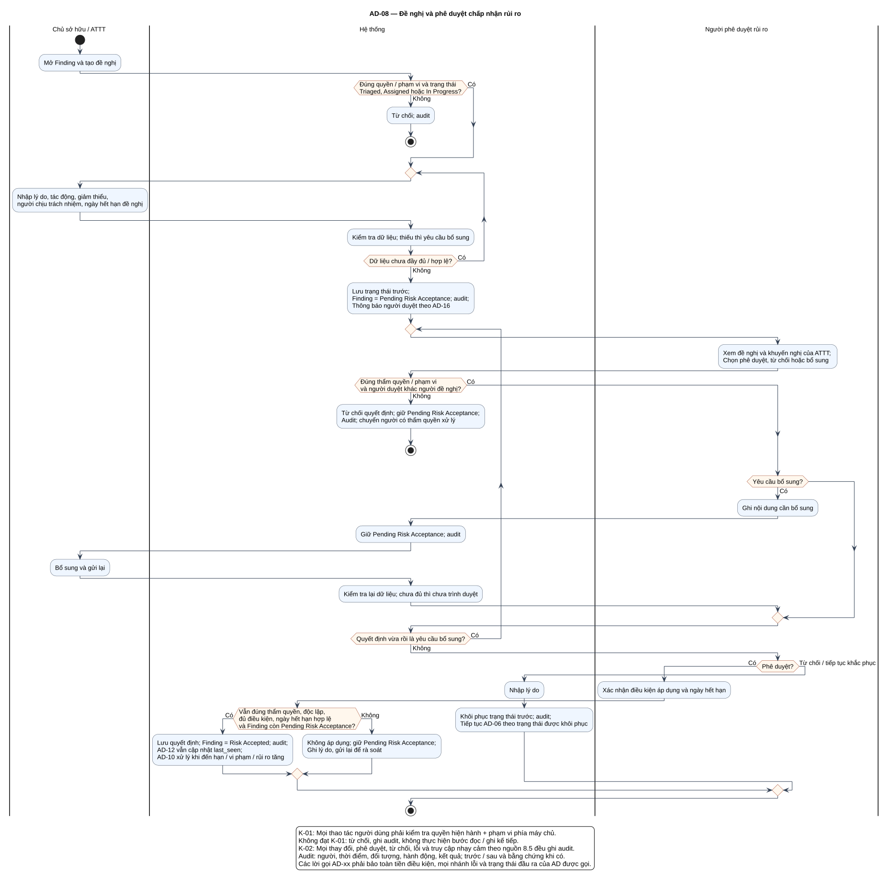

# AD-08 — Đề nghị và phê duyệt chấp nhận rủi ro

## 1. Mục đích và phạm vi

**Mục đích:** Giải thích luồng “Đề nghị và phê duyệt chấp nhận rủi ro” đúng theo sơ đồ và giữ ranh giới bốn chức năng nguồn.

| Thuộc tính | Nội dung |
|---|---|
| ID | `AD-08` |
| Nguồn | Mục 3.4; 7.2; 7.4 của `doi_tuong_sd_quy_trinh_hd.md` |
| Điều kiện vào | Chủ tài sản/ATTT đề nghị từ Triaged, Assigned hoặc In Progress. |
| Kết quả/hậu điều kiện | Risk Accepted hoặc khôi phục trạng thái trước; bổ sung chưa quyết định thì vẫn Pending Risk Acceptance. |
| Use Case liên quan | [UC-RA01](../tai_lieu_use_case/UC-RA01_tao_de_nghi_chap_nhan_rui_ro.md), [UC-RA02](../tai_lieu_use_case/UC-RA02_ra_soat_de_nghi.md), [UC-RA03](../tai_lieu_use_case/UC-RA03_phe_duyet_chap_nhan_rui_ro.md), [UC-RA04](../tai_lieu_use_case/UC-RA04_tu_choi_hoac_yeu_cau_bo_sung.md) |
| Mã sơ đồ | [Markdown](../visual_paradigm_uml_md/08_activity_chap_nhan_rui_ro.md) · [PlantUML](../visual_paradigm_uml_md/plantuml/08_activity_chap_nhan_rui_ro.puml) |

## 2. Swimlane và trách nhiệm

- **Chủ sở hữu / ATTT:** thực hiện các hành động nằm trong swimlane; không kế thừa quyền quyết định của lane khác.
- **Hệ thống:** thực hiện các hành động nằm trong swimlane; không kế thừa quyền quyết định của lane khác.
- **Người phê duyệt rủi ro:** thực hiện các hành động nằm trong swimlane; không kế thừa quyền quyết định của lane khác.

Lane **Hệ thống** biểu diễn xử lý nội bộ, không phải actor. Khi một lane ghép nhiều vai trò bằng dấu `/`, chỉ vai trò thỏa guard/trạng thái của nhánh mới thực hiện. ZAP luôn do nhóm vận hành dùng bên ngoài; hành động “khắc phục” cũng xảy ra ngoài hệ thống quản lý, hệ thống chỉ ghi nhận tiến độ/evidence.

## 3. Luồng chi tiết theo sơ đồ

| Bước | Swimlane | Hành động/ý nghĩa |
|---:|---|---|
| 1 | Chủ sở hữu / ATTT | Mở Finding và tạo đề nghị |
| 2 | Hệ thống | Từ chối; audit |
| 3 | Chủ sở hữu / ATTT | Nhập lý do, tác động, giảm thiểu, người chịu trách nhiệm, ngày hết hạn đề nghị |
| 4 | Hệ thống | Kiểm tra dữ liệu; thiếu thì yêu cầu bổ sung |
| 5 | Hệ thống | Lưu trạng thái trước; Finding = Pending Risk Acceptance; audit; Thông báo người duyệt theo AD-16 |
| 6 | Người phê duyệt rủi ro | Xem đề nghị và khuyến nghị của ATTT; Chọn phê duyệt, từ chối hoặc bổ sung |
| 7 | Hệ thống | Từ chối quyết định; giữ Pending Risk Acceptance; Audit; chuyển người có thẩm quyền xử lý |
| 8 | Người phê duyệt rủi ro | Ghi nội dung cần bổ sung |
| 9 | Hệ thống | Giữ Pending Risk Acceptance; audit |
| 10 | Chủ sở hữu / ATTT | Bổ sung và gửi lại |
| 11 | Hệ thống | Kiểm tra lại dữ liệu; chưa đủ thì chưa trình duyệt |
| 12 | Người phê duyệt rủi ro | Xác nhận điều kiện áp dụng và ngày hết hạn |
| 13 | Hệ thống | Lưu quyết định; Finding = Risk Accepted; audit; AD-12 vẫn cập nhật last_seen; AD-10 xử lý khi đến hạn / vi phạm / rủi ro tăng |
| 14 | Hệ thống | Không áp dụng; giữ Pending Risk Acceptance; Ghi lý do, gửi lại để rà soát |
| 15 | Hệ thống | Nhập lý do |
| 16 | Hệ thống | Khôi phục trạng thái trước; audit; Tiếp tục AD-06 theo trạng thái được khôi phục |

Thứ tự trên phản ánh các action trong PlantUML. Khi gặp decision/loop ở mục 4, chỉ đi theo nhánh có guard đúng; action sau điểm hợp nhất chỉ được thực hiện nếu nhánh trước cho phép tiếp tục. Lời gọi `AD-xx` giữ toàn bộ tiền điều kiện, nhánh lỗi và hậu điều kiện của Activity được gọi.

## 4. Điểm quyết định, nhánh và vòng lặp

| STT | Loại | Điều kiện/giá trị kiểm tra | Nhánh thể hiện |
|---:|---|---|---|
| 1 | Decision | Đúng quyền / phạm vi và trạng thái Triaged, Assigned hoặc In Progress? | Có |
| 2 | Else | Nhánh còn lại | Không |
| 3 | repeat while | Dữ liệu chưa đầy đủ / hợp lệ? | Có / Không |
| 4 | Decision | Đúng thẩm quyền / phạm vi và người duyệt khác người đề nghị? | Có |
| 5 | Else | Nhánh còn lại | Không |
| 6 | Decision | Yêu cầu bổ sung? | Có |
| 7 | repeat while | Quyết định vừa rồi là yêu cầu bổ sung? | Có / Không |
| 8 | Decision | Phê duyệt? | Có |
| 9 | Decision | Vẫn đúng thẩm quyền, độc lập, đủ điều kiện, ngày hết hạn hợp lệ và Finding còn Pending Risk Acceptance? | Có |
| 10 | Else | Nhánh còn lại | Không |
| 11 | Else | Nhánh còn lại | Từ chối / tiếp tục khắc phục |

- Nhánh “Không” không được hiểu là thành công khi dữ liệu thiếu hoặc thao tác bị từ chối.
- Vòng lặp bổ sung chỉ thoát sau khi kiểm tra lại đạt; yêu cầu bổ sung rủi ro phải quay lại người duyệt.
- Với Activity chạy theo sự kiện/kỳ kiểm tra, một nút kết thúc chỉ kết thúc lần đánh giá hiện tại, không hủy việc theo dõi các kỳ sau.

## 5. Dữ liệu và trạng thái bị tác động

| Bước | Swimlane | Ghi nhận/thay đổi |
|---:|---|---|
| 1 | Chủ sở hữu / ATTT | Mở Finding và tạo đề nghị |
| 5 | Hệ thống | Lưu trạng thái trước; Finding = Pending Risk Acceptance; audit; Thông báo người duyệt theo AD-16 |
| 7 | Hệ thống | Từ chối quyết định; giữ Pending Risk Acceptance; Audit; chuyển người có thẩm quyền xử lý |
| 8 | Người phê duyệt rủi ro | Ghi nội dung cần bổ sung |
| 9 | Hệ thống | Giữ Pending Risk Acceptance; audit |
| 12 | Người phê duyệt rủi ro | Xác nhận điều kiện áp dụng và ngày hết hạn |
| 13 | Hệ thống | Lưu quyết định; Finding = Risk Accepted; audit; AD-12 vẫn cập nhật last_seen; AD-10 xử lý khi đến hạn / vi phạm / rủi ro tăng |
| 14 | Hệ thống | Không áp dụng; giữ Pending Risk Acceptance; Ghi lý do, gửi lại để rà soát |

Mọi cạnh chuyển Finding phải thuộc bảng nguồn mục 7.2. Danh sách trạng thái Asset/Schedule/Occurrence/ImportBatch không được đọc thành chuỗi chuyển bắt buộc. Không hard delete dữ liệu truy vết.

## 6. Ngoại lệ và kiểm soát

- Sai quyền/phạm vi: từ chối theo K-01 và audit; không tiếp tục action đọc/ghi.
- Sai trạng thái/đầu vào: giữ dữ liệu đang có, trả lỗi hoặc yêu cầu bổ sung theo nhánh của hình.
- Lỗi/từ chối/chuyển trạng thái/truy cập nhạy cảm: audit theo K-02, kể cả khi nhánh kết thúc sớm.
- Dữ liệu bí mật được masking ở giao diện/bản xuất; RawReport bất biến và kiểm tra toàn vẹn.
- Activity không tạo tích hợp ZAP API, email, SSO, BI, CI/CD, kho mã hoặc ticket ngoài.

## 7. Cách đọc và kiểm tra hình

1. Bắt đầu tại nút đen, xác định lane đang chịu trách nhiệm.
2. Đọc action từ trên xuống cho tới decision; chọn guard đúng và không bỏ qua nhánh lỗi.
3. Tại vòng lặp, quay lại đúng điểm kiểm tra; không đi tới hậu điều kiện khi còn thiếu dữ liệu.
4. Đối chiếu action đổi trạng thái với mục 5 và tài liệu UC liên kết.
5. Kết thúc tại nút đích; kiểm tra hậu điều kiện ở mục 1 đã đạt.

**Điểm kiểm tra chính:** Risk Accepted hoặc khôi phục trạng thái trước; bổ sung chưa quyết định thì vẫn Pending Risk Acceptance.
