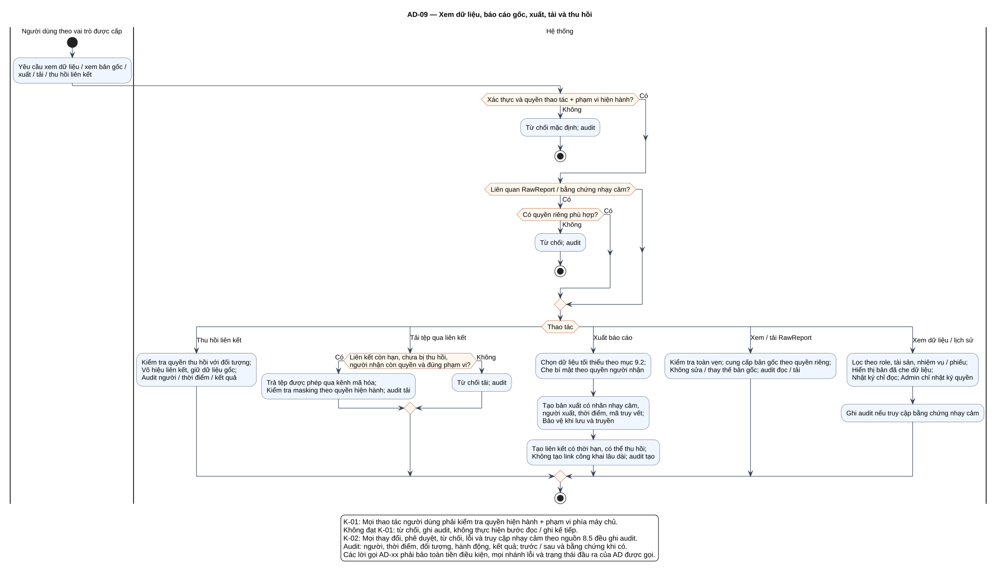

# AD-09 — Xem dữ liệu, báo cáo gốc, xuất, tải và thu hồi

## 1. Mục đích và phạm vi

**Mục đích:** Giải thích luồng “Xem dữ liệu, báo cáo gốc, xuất, tải và thu hồi” đúng theo sơ đồ và giữ ranh giới bốn chức năng nguồn.

| Thuộc tính | Nội dung |
|---|---|
| ID | `AD-09` |
| Nguồn | Mục 3.3; 8; 9.2 của `doi_tuong_sd_quy_trinh_hd.md` |
| Điều kiện vào | Người dùng đã được gán quyền cụ thể; quyền RawReport tách riêng. |
| Kết quả/hậu điều kiện | Chỉ trả dữ liệu đúng phạm vi; bản gốc bất biến; mọi truy cập nhạy cảm và tạo/tải/thu hồi có audit. |
| Use Case liên quan | [UC-A07](../tai_lieu_use_case/UC-A07_xem_tai_san_theo_pham_vi.md), [UC-I07](../tai_lieu_use_case/UC-I07_che_du_lieu_nhay_cam.md), [UC-I12](../tai_lieu_use_case/UC-I12_xem_ket_qua_lo_nhap.md), [UC-T06](../tai_lieu_use_case/UC-T06_xem_lich_su_thay_doi_muc_do.md), [UC-C03](../tai_lieu_use_case/UC-C03_xem_nhat_ky_thay_doi_quyen.md), [UC-C04](../tai_lieu_use_case/UC-C04_xem_bao_cao_goc_theo_quyen.md), [UC-C05](../tai_lieu_use_case/UC-C05_xuat_hoac_tai_bao_cao.md), [UC-C06](../tai_lieu_use_case/UC-C06_xem_lich_su_nghiep_vu.md), [UC-C07](../tai_lieu_use_case/UC-C07_ghi_nhat_ky_hanh_dong_nhay_cam.md), [UC-C09](../tai_lieu_use_case/UC-C09_xem_du_lieu_nghiep_vu_theo_pham_vi.md), [UC-C10](../tai_lieu_use_case/UC-C10_thu_hoi_lien_ket_bao_cao.md) |
| Mã sơ đồ | [Markdown](../visual_paradigm_uml_md/10_activity_bao_mat_bao_cao.md) · [PlantUML](../visual_paradigm_uml_md/plantuml/10_activity_bao_mat_bao_cao.puml) |

## 2. Swimlane và trách nhiệm

- **Người dùng theo vai trò được cấp:** thực hiện các hành động nằm trong swimlane; không kế thừa quyền quyết định của lane khác.
- **Hệ thống:** thực hiện các hành động nằm trong swimlane; không kế thừa quyền quyết định của lane khác.

Lane **Hệ thống** biểu diễn xử lý nội bộ, không phải actor. Khi một lane ghép nhiều vai trò bằng dấu `/`, chỉ vai trò thỏa guard/trạng thái của nhánh mới thực hiện. ZAP luôn do nhóm vận hành dùng bên ngoài; hành động “khắc phục” cũng xảy ra ngoài hệ thống quản lý, hệ thống chỉ ghi nhận tiến độ/evidence.

## 3. Luồng chi tiết theo sơ đồ

| Bước | Swimlane | Hành động/ý nghĩa |
|---:|---|---|
| 1 | Người dùng theo vai trò được cấp | Yêu cầu xem dữ liệu / xem bản gốc / xuất / tải / thu hồi liên kết |
| 2 | Hệ thống | Từ chối mặc định; audit |
| 3 | Hệ thống | Từ chối; audit |
| 4 | Hệ thống | Kiểm tra quyền thu hồi với đối tượng; Vô hiệu liên kết, giữ dữ liệu gốc; Audit người / thời điểm / kết quả |
| 5 | Hệ thống | Trả tệp được phép qua kênh mã hóa; Kiểm tra masking theo quyền hiện hành; audit tải |
| 6 | Hệ thống | Từ chối tải; audit |
| 7 | Hệ thống | Chọn dữ liệu tối thiểu theo mục 9.2; Che bí mật theo quyền người nhận |
| 8 | Hệ thống | Tạo bản xuất có nhãn nhạy cảm, người xuất, thời điểm, mã truy vết; Bảo vệ khi lưu và truyền |
| 9 | Hệ thống | Tạo liên kết có thời hạn, có thể thu hồi; Không tạo link công khai lâu dài; audit tạo |
| 10 | Hệ thống | Kiểm tra toàn vẹn; cung cấp bản gốc theo quyền riêng; Không sửa / thay thế bản gốc; audit đọc / tải |
| 11 | Hệ thống | Lọc theo role, tài sản, nhiệm vụ / phiếu; Hiển thị bản đã che dữ liệu; Nhật ký chỉ đọc; Admin chỉ nhật ký quyền |
| 12 | Hệ thống | Ghi audit nếu truy cập bằng chứng nhạy cảm |

Thứ tự trên phản ánh các action trong PlantUML. Khi gặp decision/loop ở mục 4, chỉ đi theo nhánh có guard đúng; action sau điểm hợp nhất chỉ được thực hiện nếu nhánh trước cho phép tiếp tục. Lời gọi `AD-xx` giữ toàn bộ tiền điều kiện, nhánh lỗi và hậu điều kiện của Activity được gọi.

## 4. Điểm quyết định, nhánh và vòng lặp

| STT | Loại | Điều kiện/giá trị kiểm tra | Nhánh thể hiện |
|---:|---|---|---|
| 1 | Decision | Xác thực và quyền thao tác + phạm vi hiện hành? | Có |
| 2 | Else | Nhánh còn lại | Không |
| 3 | Decision | Liên quan RawReport / bằng chứng nhạy cảm? | Có |
| 4 | Decision | Có quyền riêng phù hợp? | Có |
| 5 | Else | Nhánh còn lại | Không |
| 6 | Switch | Thao tác | các case |
| 7 | Case | Giá trị thao tác | Thu hồi liên kết |
| 8 | Case | Giá trị thao tác | Tải tệp qua liên kết |
| 9 | Decision | Liên kết còn hạn, chưa bị thu hồi, người nhận còn quyền và đúng phạm vi? | Có |
| 10 | Else | Nhánh còn lại | Không |
| 11 | Case | Giá trị thao tác | Xuất báo cáo |
| 12 | Case | Giá trị thao tác | Xem / tải RawReport |
| 13 | Case | Giá trị thao tác | Xem dữ liệu / lịch sử |

- Nhánh “Không” không được hiểu là thành công khi dữ liệu thiếu hoặc thao tác bị từ chối.
- Vòng lặp bổ sung chỉ thoát sau khi kiểm tra lại đạt; yêu cầu bổ sung rủi ro phải quay lại người duyệt.
- Với Activity chạy theo sự kiện/kỳ kiểm tra, một nút kết thúc chỉ kết thúc lần đánh giá hiện tại, không hủy việc theo dõi các kỳ sau.

## 5. Dữ liệu và trạng thái bị tác động

| Bước | Swimlane | Ghi nhận/thay đổi |
|---:|---|---|
| 1 | Người dùng theo vai trò được cấp | Yêu cầu xem dữ liệu / xem bản gốc / xuất / tải / thu hồi liên kết |
| 4 | Hệ thống | Kiểm tra quyền thu hồi với đối tượng; Vô hiệu liên kết, giữ dữ liệu gốc; Audit người / thời điểm / kết quả |
| 8 | Hệ thống | Tạo bản xuất có nhãn nhạy cảm, người xuất, thời điểm, mã truy vết; Bảo vệ khi lưu và truyền |
| 9 | Hệ thống | Tạo liên kết có thời hạn, có thể thu hồi; Không tạo link công khai lâu dài; audit tạo |
| 12 | Hệ thống | Ghi audit nếu truy cập bằng chứng nhạy cảm |

Mọi cạnh chuyển Finding phải thuộc bảng nguồn mục 7.2. Danh sách trạng thái Asset/Schedule/Occurrence/ImportBatch không được đọc thành chuỗi chuyển bắt buộc. Không hard delete dữ liệu truy vết.

## 6. Ngoại lệ và kiểm soát

- Sai quyền/phạm vi: từ chối theo K-01 và audit; không tiếp tục action đọc/ghi.
- Sai trạng thái/đầu vào: giữ dữ liệu đang có, trả lỗi hoặc yêu cầu bổ sung theo nhánh của hình.
- Lỗi/từ chối/chuyển trạng thái/truy cập nhạy cảm: audit theo K-02, kể cả khi nhánh kết thúc sớm.
- Dữ liệu bí mật được masking ở giao diện/bản xuất; RawReport bất biến và kiểm tra toàn vẹn.
- Activity không tạo tích hợp ZAP API, email, SSO, BI, CI/CD, kho mã hoặc ticket ngoài.

## 7. Cách đọc và kiểm tra hình

1. Bắt đầu tại nút đen, xác định lane đang chịu trách nhiệm.
2. Đọc action từ trên xuống cho tới decision; chọn guard đúng và không bỏ qua nhánh lỗi.
3. Tại vòng lặp, quay lại đúng điểm kiểm tra; không đi tới hậu điều kiện khi còn thiếu dữ liệu.
4. Đối chiếu action đổi trạng thái với mục 5 và tài liệu UC liên kết.
5. Kết thúc tại nút đích; kiểm tra hậu điều kiện ở mục 1 đã đạt.

**Điểm kiểm tra chính:** Chỉ trả dữ liệu đúng phạm vi; bản gốc bất biến; mọi truy cập nhạy cảm và tạo/tải/thu hồi có audit.
