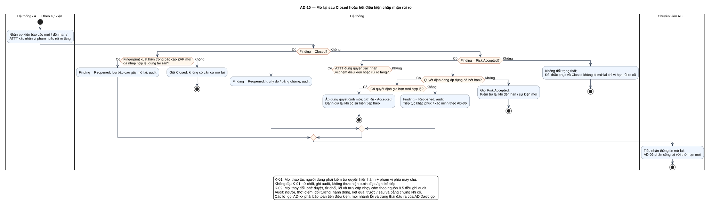

# AD-10 — Mở lại sau Closed hoặc hết điều kiện chấp nhận rủi ro

## 1. Mục đích và phạm vi

**Mục đích:** Giải thích luồng “Mở lại sau Closed hoặc hết điều kiện chấp nhận rủi ro” đúng theo sơ đồ và giữ ranh giới bốn chức năng nguồn.

| Thuộc tính | Nội dung |
|---|---|
| ID | `AD-10` |
| Nguồn | Mục 5.3.5; 7.2; 7.4 của `doi_tuong_sd_quy_trinh_hd.md` |
| Điều kiện vào | AD-12 báo fingerprint tái xuất hiện; hoặc đến hạn quyết định rủi ro; hoặc ATTT xác nhận vi phạm/rủi ro tăng. |
| Kết quả/hậu điều kiện | Reopened khi có trigger hợp lệ; nếu không thì giữ trạng thái. Mỗi sự kiện mới gọi lại Activity. |
| Use Case liên quan | [UC-R11](../tai_lieu_use_case/UC-R11_mo_lai_phat_hien.md), [UC-RA05](../tai_lieu_use_case/UC-RA05_theo_doi_ngay_het_han.md), [UC-RA06](../tai_lieu_use_case/UC-RA06_mo_lai_khi_het_dieu_kien_rui_ro.md) |
| Mã sơ đồ | [Markdown](../visual_paradigm_uml_md/11_activity_mo_lai_phat_hien.md) · [PlantUML](../visual_paradigm_uml_md/plantuml/11_activity_mo_lai_phat_hien.puml) |

## 2. Swimlane và trách nhiệm

- **Hệ thống / ATTT theo sự kiện:** thực hiện các hành động nằm trong swimlane; không kế thừa quyền quyết định của lane khác.
- **Hệ thống:** thực hiện các hành động nằm trong swimlane; không kế thừa quyền quyết định của lane khác.
- **Chuyên viên ATTT:** thực hiện các hành động nằm trong swimlane; không kế thừa quyền quyết định của lane khác.

Lane **Hệ thống** biểu diễn xử lý nội bộ, không phải actor. Khi một lane ghép nhiều vai trò bằng dấu `/`, chỉ vai trò thỏa guard/trạng thái của nhánh mới thực hiện. ZAP luôn do nhóm vận hành dùng bên ngoài; hành động “khắc phục” cũng xảy ra ngoài hệ thống quản lý, hệ thống chỉ ghi nhận tiến độ/evidence.

## 3. Luồng chi tiết theo sơ đồ

| Bước | Swimlane | Hành động/ý nghĩa |
|---:|---|---|
| 1 | Hệ thống / ATTT theo sự kiện | Nhận sự kiện báo cáo mới / đến hạn / ATTT xác nhận vi phạm hoặc rủi ro tăng |
| 2 | Hệ thống | Finding = Reopened; lưu báo cáo gây mở lại; audit |
| 3 | Hệ thống | Giữ Closed; không có căn cứ mở lại |
| 4 | Hệ thống | Finding = Reopened; lưu lý do / bằng chứng; audit |
| 5 | Hệ thống | Áp dụng quyết định mới; giữ Risk Accepted; Đánh giá lại khi có sự kiện tiếp theo |
| 6 | Hệ thống | Finding = Reopened; audit; Tiếp tục khắc phục / xác minh theo AD-06 |
| 7 | Hệ thống | Giữ Risk Accepted; Kiểm tra lại khi đến hạn / sự kiện mới |
| 8 | Hệ thống | Không đổi trạng thái; Đã khắc phục và Closed không bị mở lại chỉ vì hạn rủi ro cũ |
| 9 | Chuyên viên ATTT | Tiếp nhận thông tin mở lại; AD-06 phân công lại với thời hạn mới |

Thứ tự trên phản ánh các action trong PlantUML. Khi gặp decision/loop ở mục 4, chỉ đi theo nhánh có guard đúng; action sau điểm hợp nhất chỉ được thực hiện nếu nhánh trước cho phép tiếp tục. Lời gọi `AD-xx` giữ toàn bộ tiền điều kiện, nhánh lỗi và hậu điều kiện của Activity được gọi.

## 4. Điểm quyết định, nhánh và vòng lặp

| STT | Loại | Điều kiện/giá trị kiểm tra | Nhánh thể hiện |
|---:|---|---|---|
| 1 | Decision | Finding = Closed? | Có |
| 2 | Decision | Fingerprint xuất hiện trong báo cáo ZAP mới đã nhập hợp lệ, đúng tài sản? | Có |
| 3 | Else | Nhánh còn lại | Không |
| 4 | Else | Nhánh còn lại | Không |
| 5 | Decision | Finding = Risk Accepted? | Có |
| 6 | Decision | ATTT đúng quyền xác nhận vi phạm điều kiện hoặc rủi ro tăng? | Có |
| 7 | Else | Nhánh còn lại | Không |
| 8 | Decision | Quyết định đang áp dụng đã hết hạn? | Có |
| 9 | Decision | Có quyết định gia hạn mới hợp lệ? | Có |
| 10 | Else | Nhánh còn lại | Không |
| 11 | Else | Nhánh còn lại | Không |
| 12 | Else | Nhánh còn lại | Không |

- Nhánh “Không” không được hiểu là thành công khi dữ liệu thiếu hoặc thao tác bị từ chối.
- Vòng lặp bổ sung chỉ thoát sau khi kiểm tra lại đạt; yêu cầu bổ sung rủi ro phải quay lại người duyệt.
- Với Activity chạy theo sự kiện/kỳ kiểm tra, một nút kết thúc chỉ kết thúc lần đánh giá hiện tại, không hủy việc theo dõi các kỳ sau.

## 5. Dữ liệu và trạng thái bị tác động

| Bước | Swimlane | Ghi nhận/thay đổi |
|---:|---|---|
| 2 | Hệ thống | Finding = Reopened; lưu báo cáo gây mở lại; audit |
| 3 | Hệ thống | Giữ Closed; không có căn cứ mở lại |
| 4 | Hệ thống | Finding = Reopened; lưu lý do / bằng chứng; audit |
| 5 | Hệ thống | Áp dụng quyết định mới; giữ Risk Accepted; Đánh giá lại khi có sự kiện tiếp theo |
| 6 | Hệ thống | Finding = Reopened; audit; Tiếp tục khắc phục / xác minh theo AD-06 |
| 7 | Hệ thống | Giữ Risk Accepted; Kiểm tra lại khi đến hạn / sự kiện mới |
| 8 | Hệ thống | Không đổi trạng thái; Đã khắc phục và Closed không bị mở lại chỉ vì hạn rủi ro cũ |

Mọi cạnh chuyển Finding phải thuộc bảng nguồn mục 7.2. Danh sách trạng thái Asset/Schedule/Occurrence/ImportBatch không được đọc thành chuỗi chuyển bắt buộc. Không hard delete dữ liệu truy vết.

## 6. Ngoại lệ và kiểm soát

- Sai quyền/phạm vi: từ chối theo K-01 và audit; không tiếp tục action đọc/ghi.
- Sai trạng thái/đầu vào: giữ dữ liệu đang có, trả lỗi hoặc yêu cầu bổ sung theo nhánh của hình.
- Lỗi/từ chối/chuyển trạng thái/truy cập nhạy cảm: audit theo K-02, kể cả khi nhánh kết thúc sớm.
- Dữ liệu bí mật được masking ở giao diện/bản xuất; RawReport bất biến và kiểm tra toàn vẹn.
- Activity không tạo tích hợp ZAP API, email, SSO, BI, CI/CD, kho mã hoặc ticket ngoài.

## 7. Cách đọc và kiểm tra hình

1. Bắt đầu tại nút đen, xác định lane đang chịu trách nhiệm.
2. Đọc action từ trên xuống cho tới decision; chọn guard đúng và không bỏ qua nhánh lỗi.
3. Tại vòng lặp, quay lại đúng điểm kiểm tra; không đi tới hậu điều kiện khi còn thiếu dữ liệu.
4. Đối chiếu action đổi trạng thái với mục 5 và tài liệu UC liên kết.
5. Kết thúc tại nút đích; kiểm tra hậu điều kiện ở mục 1 đã đạt.

**Điểm kiểm tra chính:** Reopened khi có trigger hợp lệ; nếu không thì giữ trạng thái. Mỗi sự kiện mới gọi lại Activity.

**Phân biệt trigger:** Pending Verification do ATTT mở lại trong AD-06; AD-10 chỉ xử lý Closed tái xuất hiện hoặc Risk Accepted hết hạn/vi phạm/rủi ro tăng.
