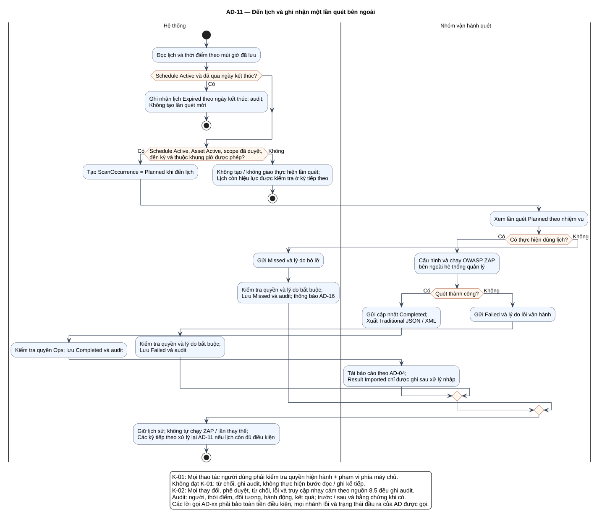

# AD-11 — Đến lịch và ghi nhận một lần quét bên ngoài

## 1. Mục đích và phạm vi

**Mục đích:** Giải thích luồng “Đến lịch và ghi nhận một lần quét bên ngoài” đúng theo sơ đồ và giữ ranh giới bốn chức năng nguồn.

| Thuộc tính | Nội dung |
|---|---|
| ID | `AD-11` |
| Nguồn | Mục 5.2; 7.6; 9.1 của `doi_tuong_sd_quy_trinh_hd.md` |
| Điều kiện vào | Một kỳ kiểm tra lịch; Ops có quyền cập nhật trạng thái lần quét. |
| Kết quả/hậu điều kiện | Không đến kỳ thì không tạo Planned; Failed/Missed có lý do; thành công chuyển F-03. |
| Use Case liên quan | [UC-S05](../tai_lieu_use_case/UC-S05_theo_doi_lich_den_han.md), [UC-S06](../tai_lieu_use_case/UC-S06_cap_nhat_trang_thai_lan_quet.md), [UC-S07](../tai_lieu_use_case/UC-S07_ghi_nhan_quet_that_bai_hoac_bo_lo.md) |
| Mã sơ đồ | [Markdown](../visual_paradigm_uml_md/12_activity_thuc_hien_lan_quet.md) · [PlantUML](../visual_paradigm_uml_md/plantuml/12_activity_thuc_hien_lan_quet.puml) |

## 2. Swimlane và trách nhiệm

- **Hệ thống:** thực hiện các hành động nằm trong swimlane; không kế thừa quyền quyết định của lane khác.
- **Nhóm vận hành quét:** thực hiện các hành động nằm trong swimlane; không kế thừa quyền quyết định của lane khác.

Lane **Hệ thống** biểu diễn xử lý nội bộ, không phải actor. Khi một lane ghép nhiều vai trò bằng dấu `/`, chỉ vai trò thỏa guard/trạng thái của nhánh mới thực hiện. ZAP luôn do nhóm vận hành dùng bên ngoài; hành động “khắc phục” cũng xảy ra ngoài hệ thống quản lý, hệ thống chỉ ghi nhận tiến độ/evidence.

## 3. Luồng chi tiết theo sơ đồ

| Bước | Swimlane | Hành động/ý nghĩa |
|---:|---|---|
| 1 | Hệ thống | Đọc lịch và thời điểm theo múi giờ đã lưu |
| 2 | Hệ thống | Ghi nhận lịch Expired theo ngày kết thúc; audit; Không tạo lần quét mới |
| 3 | Hệ thống | Tạo ScanOccurrence = Planned khi đến lịch |
| 4 | Hệ thống | Không tạo / không giao thực hiện lần quét; Lịch còn hiệu lực được kiểm tra ở kỳ tiếp theo |
| 5 | Nhóm vận hành quét | Xem lần quét Planned theo nhiệm vụ |
| 6 | Nhóm vận hành quét | Cấu hình và chạy OWASP ZAP bên ngoài hệ thống quản lý |
| 7 | Nhóm vận hành quét | Gửi cập nhật Completed; Xuất Traditional JSON / XML |
| 8 | Hệ thống | Kiểm tra quyền Ops; lưu Completed và audit |
| 9 | Nhóm vận hành quét | Tải báo cáo theo AD-04; Result Imported chỉ được ghi sau xử lý nhập |
| 10 | Nhóm vận hành quét | Gửi Failed và lý do lỗi vận hành |
| 11 | Hệ thống | Kiểm tra quyền và lý do bắt buộc; Lưu Failed và audit |
| 12 | Hệ thống | Gửi Missed và lý do bỏ lỡ |
| 13 | Hệ thống | Kiểm tra quyền và lý do bắt buộc; Lưu Missed và audit; thông báo AD-16 |
| 14 | Hệ thống | Giữ lịch sử; không tự chạy ZAP / lần thay thế; Các kỳ tiếp theo xử lý lại AD-11 nếu lịch còn đủ điều kiện |

Thứ tự trên phản ánh các action trong PlantUML. Khi gặp decision/loop ở mục 4, chỉ đi theo nhánh có guard đúng; action sau điểm hợp nhất chỉ được thực hiện nếu nhánh trước cho phép tiếp tục. Lời gọi `AD-xx` giữ toàn bộ tiền điều kiện, nhánh lỗi và hậu điều kiện của Activity được gọi.

## 4. Điểm quyết định, nhánh và vòng lặp

| STT | Loại | Điều kiện/giá trị kiểm tra | Nhánh thể hiện |
|---:|---|---|---|
| 1 | Decision | Schedule Active và đã qua ngày kết thúc? | Có |
| 2 | Decision | Schedule Active, Asset Active, scope đã duyệt, đến kỳ và thuộc khung giờ được phép? | Có |
| 3 | Else | Nhánh còn lại | Không |
| 4 | Decision | Có thực hiện đúng lịch? | Có |
| 5 | Decision | Quét thành công? | Có |
| 6 | Else | Nhánh còn lại | Không |
| 7 | Else | Nhánh còn lại | Không |

- Nhánh “Không” không được hiểu là thành công khi dữ liệu thiếu hoặc thao tác bị từ chối.
- Vòng lặp bổ sung chỉ thoát sau khi kiểm tra lại đạt; yêu cầu bổ sung rủi ro phải quay lại người duyệt.
- Với Activity chạy theo sự kiện/kỳ kiểm tra, một nút kết thúc chỉ kết thúc lần đánh giá hiện tại, không hủy việc theo dõi các kỳ sau.

## 5. Dữ liệu và trạng thái bị tác động

| Bước | Swimlane | Ghi nhận/thay đổi |
|---:|---|---|
| 1 | Hệ thống | Đọc lịch và thời điểm theo múi giờ đã lưu |
| 2 | Hệ thống | Ghi nhận lịch Expired theo ngày kết thúc; audit; Không tạo lần quét mới |
| 3 | Hệ thống | Tạo ScanOccurrence = Planned khi đến lịch |
| 4 | Hệ thống | Không tạo / không giao thực hiện lần quét; Lịch còn hiệu lực được kiểm tra ở kỳ tiếp theo |
| 5 | Nhóm vận hành quét | Xem lần quét Planned theo nhiệm vụ |
| 7 | Nhóm vận hành quét | Gửi cập nhật Completed; Xuất Traditional JSON / XML |
| 8 | Hệ thống | Kiểm tra quyền Ops; lưu Completed và audit |
| 9 | Nhóm vận hành quét | Tải báo cáo theo AD-04; Result Imported chỉ được ghi sau xử lý nhập |
| 10 | Nhóm vận hành quét | Gửi Failed và lý do lỗi vận hành |
| 11 | Hệ thống | Kiểm tra quyền và lý do bắt buộc; Lưu Failed và audit |
| 12 | Hệ thống | Gửi Missed và lý do bỏ lỡ |
| 13 | Hệ thống | Kiểm tra quyền và lý do bắt buộc; Lưu Missed và audit; thông báo AD-16 |

Mọi cạnh chuyển Finding phải thuộc bảng nguồn mục 7.2. Danh sách trạng thái Asset/Schedule/Occurrence/ImportBatch không được đọc thành chuỗi chuyển bắt buộc. Không hard delete dữ liệu truy vết.

## 6. Ngoại lệ và kiểm soát

- Sai quyền/phạm vi: từ chối theo K-01 và audit; không tiếp tục action đọc/ghi.
- Sai trạng thái/đầu vào: giữ dữ liệu đang có, trả lỗi hoặc yêu cầu bổ sung theo nhánh của hình.
- Lỗi/từ chối/chuyển trạng thái/truy cập nhạy cảm: audit theo K-02, kể cả khi nhánh kết thúc sớm.
- Dữ liệu bí mật được masking ở giao diện/bản xuất; RawReport bất biến và kiểm tra toàn vẹn.
- Activity không tạo tích hợp ZAP API, email, SSO, BI, CI/CD, kho mã hoặc ticket ngoài.

## 7. Cách đọc và kiểm tra hình

1. Bắt đầu tại nút đen, xác định lane đang chịu trách nhiệm.
2. Đọc action từ trên xuống cho tới decision; chọn guard đúng và không bỏ qua nhánh lỗi.
3. Tại vòng lặp, quay lại đúng điểm kiểm tra; không đi tới hậu điều kiện khi còn thiếu dữ liệu.
4. Đối chiếu action đổi trạng thái với mục 5 và tài liệu UC liên kết.
5. Kết thúc tại nút đích; kiểm tra hậu điều kiện ở mục 1 đã đạt.

**Điểm kiểm tra chính:** Không đến kỳ thì không tạo Planned; Failed/Missed có lý do; thành công chuyển F-03.
