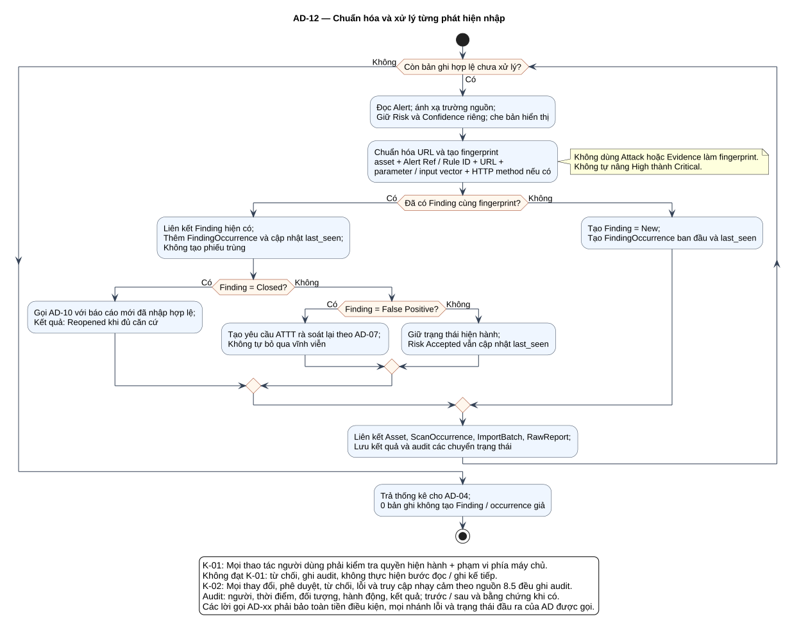

# AD-12 — Chuẩn hóa và xử lý từng phát hiện nhập

## 1. Mục đích và phạm vi

**Mục đích:** Giải thích luồng “Chuẩn hóa và xử lý từng phát hiện nhập” đúng theo sơ đồ và giữ ranh giới bốn chức năng nguồn.

| Thuộc tính | Nội dung |
|---|---|
| ID | `AD-12` |
| Nguồn | Mục 5.3.4–5.3.5; 7.3–7.4 của `doi_tuong_sd_quy_trinh_hd.md` |
| Điều kiện vào | Chỉ các bản ghi đã qua kiểm tra của lô không trùng từ AD-04. |
| Kết quả/hậu điều kiện | Finding/occurrence được truy vết; số liệu xử lý trả AD-04, lỗi kỹ thuật trả nhánh Failed. |
| Use Case liên quan | [UC-I08](../tai_lieu_use_case/UC-I08_chuan_hoa_du_lieu_zap.md), [UC-I09](../tai_lieu_use_case/UC-I09_chong_nhap_trung.md), [UC-I10](../tai_lieu_use_case/UC-I10_tao_hoac_cap_nhat_phat_hien.md) |
| Mã sơ đồ | [Markdown](../visual_paradigm_uml_md/13_activity_chuan_hoa_va_tai_xuat_hien.md) · [PlantUML](../visual_paradigm_uml_md/plantuml/13_activity_chuan_hoa_va_tai_xuat_hien.puml) |

## 2. Swimlane và trách nhiệm

- **Hệ thống:** thực hiện các hành động nằm trong swimlane; không kế thừa quyền quyết định của lane khác.

Lane **Hệ thống** biểu diễn xử lý nội bộ, không phải actor. Khi một lane ghép nhiều vai trò bằng dấu `/`, chỉ vai trò thỏa guard/trạng thái của nhánh mới thực hiện. ZAP luôn do nhóm vận hành dùng bên ngoài; hành động “khắc phục” cũng xảy ra ngoài hệ thống quản lý, hệ thống chỉ ghi nhận tiến độ/evidence.

## 3. Luồng chi tiết theo sơ đồ

| Bước | Swimlane | Hành động/ý nghĩa |
|---:|---|---|
| 1 | Hệ thống | Đọc Alert; ánh xạ trường nguồn; Giữ Risk và Confidence riêng; che bản hiển thị |
| 2 | Hệ thống | Chuẩn hóa URL và tạo fingerprint asset + Alert Ref / Rule ID + URL + parameter / input vector + HTTP method nếu có |
| 3 | Hệ thống | Liên kết Finding hiện có; Thêm FindingOccurrence và cập nhật last_seen; Không tạo phiếu trùng |
| 4 | Hệ thống | Gọi AD-10 với báo cáo mới đã nhập hợp lệ; Kết quả: Reopened khi đủ căn cứ |
| 5 | Hệ thống | Tạo yêu cầu ATTT rà soát lại theo AD-07; Không tự bỏ qua vĩnh viễn |
| 6 | Hệ thống | Giữ trạng thái hiện hành; Risk Accepted vẫn cập nhật last_seen |
| 7 | Hệ thống | Tạo Finding = New; Tạo FindingOccurrence ban đầu và last_seen |
| 8 | Hệ thống | Liên kết Asset, ScanOccurrence, ImportBatch, RawReport; Lưu kết quả và audit các chuyển trạng thái |
| 9 | Hệ thống | Trả thống kê cho AD-04; 0 bản ghi không tạo Finding / occurrence giả |

Thứ tự trên phản ánh các action trong PlantUML. Khi gặp decision/loop ở mục 4, chỉ đi theo nhánh có guard đúng; action sau điểm hợp nhất chỉ được thực hiện nếu nhánh trước cho phép tiếp tục. Lời gọi `AD-xx` giữ toàn bộ tiền điều kiện, nhánh lỗi và hậu điều kiện của Activity được gọi.

## 4. Điểm quyết định, nhánh và vòng lặp

| STT | Loại | Điều kiện/giá trị kiểm tra | Nhánh thể hiện |
|---:|---|---|---|
| 1 | while | Còn bản ghi hợp lệ chưa xử lý? | Có |
| 2 | Decision | Đã có Finding cùng fingerprint? | Có |
| 3 | Decision | Finding = Closed? | Có |
| 4 | Else | Nhánh còn lại | Không |
| 5 | Decision | Finding = False Positive? | Có |
| 6 | Else | Nhánh còn lại | Không |
| 7 | Else | Nhánh còn lại | Không |
| 8 | endwhile | Không | lặp/thoát |

- Nhánh “Không” không được hiểu là thành công khi dữ liệu thiếu hoặc thao tác bị từ chối.
- Vòng lặp bổ sung chỉ thoát sau khi kiểm tra lại đạt; yêu cầu bổ sung rủi ro phải quay lại người duyệt.
- Với Activity chạy theo sự kiện/kỳ kiểm tra, một nút kết thúc chỉ kết thúc lần đánh giá hiện tại, không hủy việc theo dõi các kỳ sau.

## 5. Dữ liệu và trạng thái bị tác động

| Bước | Swimlane | Ghi nhận/thay đổi |
|---:|---|---|
| 2 | Hệ thống | Chuẩn hóa URL và tạo fingerprint asset + Alert Ref / Rule ID + URL + parameter / input vector + HTTP method nếu có |
| 3 | Hệ thống | Liên kết Finding hiện có; Thêm FindingOccurrence và cập nhật last_seen; Không tạo phiếu trùng |
| 4 | Hệ thống | Gọi AD-10 với báo cáo mới đã nhập hợp lệ; Kết quả: Reopened khi đủ căn cứ |
| 5 | Hệ thống | Tạo yêu cầu ATTT rà soát lại theo AD-07; Không tự bỏ qua vĩnh viễn |
| 6 | Hệ thống | Giữ trạng thái hiện hành; Risk Accepted vẫn cập nhật last_seen |
| 7 | Hệ thống | Tạo Finding = New; Tạo FindingOccurrence ban đầu và last_seen |
| 8 | Hệ thống | Liên kết Asset, ScanOccurrence, ImportBatch, RawReport; Lưu kết quả và audit các chuyển trạng thái |
| 9 | Hệ thống | Trả thống kê cho AD-04; 0 bản ghi không tạo Finding / occurrence giả |

Mọi cạnh chuyển Finding phải thuộc bảng nguồn mục 7.2. Danh sách trạng thái Asset/Schedule/Occurrence/ImportBatch không được đọc thành chuỗi chuyển bắt buộc. Không hard delete dữ liệu truy vết.

## 6. Ngoại lệ và kiểm soát

- Sai quyền/phạm vi: từ chối theo K-01 và audit; không tiếp tục action đọc/ghi.
- Sai trạng thái/đầu vào: giữ dữ liệu đang có, trả lỗi hoặc yêu cầu bổ sung theo nhánh của hình.
- Lỗi/từ chối/chuyển trạng thái/truy cập nhạy cảm: audit theo K-02, kể cả khi nhánh kết thúc sớm.
- Dữ liệu bí mật được masking ở giao diện/bản xuất; RawReport bất biến và kiểm tra toàn vẹn.
- Activity không tạo tích hợp ZAP API, email, SSO, BI, CI/CD, kho mã hoặc ticket ngoài.

## 7. Cách đọc và kiểm tra hình

1. Bắt đầu tại nút đen, xác định lane đang chịu trách nhiệm.
2. Đọc action từ trên xuống cho tới decision; chọn guard đúng và không bỏ qua nhánh lỗi.
3. Tại vòng lặp, quay lại đúng điểm kiểm tra; không đi tới hậu điều kiện khi còn thiếu dữ liệu.
4. Đối chiếu action đổi trạng thái với mục 5 và tài liệu UC liên kết.
5. Kết thúc tại nút đích; kiểm tra hậu điều kiện ở mục 1 đã đạt.

**Điểm kiểm tra chính:** Finding/occurrence được truy vết; số liệu xử lý trả AD-04, lỗi kỹ thuật trả nhánh Failed.
