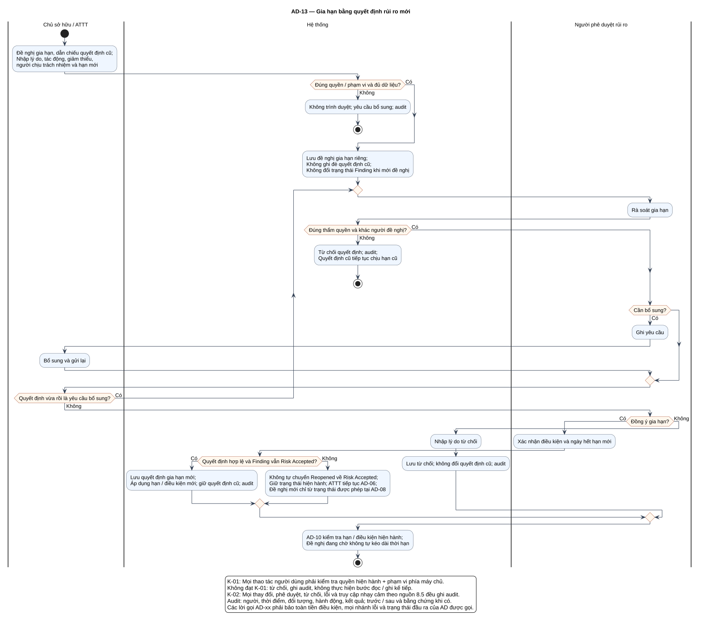

# AD-13 — Gia hạn bằng quyết định rủi ro mới

## 1. Mục đích và phạm vi

**Mục đích:** Giải thích luồng “Gia hạn bằng quyết định rủi ro mới” đúng theo sơ đồ và giữ ranh giới bốn chức năng nguồn.

| Thuộc tính | Nội dung |
|---|---|
| ID | `AD-13` |
| Nguồn | Mục 3.4; 7.4; 8.5 của `doi_tuong_sd_quy_trinh_hd.md` |
| Điều kiện vào | Có quyết định rủi ro được đề nghị gia hạn. |
| Kết quả/hậu điều kiện | Quyết định cũ bất biến; quyết định gia hạn chỉ hiệu lực khi được duyệt độc lập. |
| Use Case liên quan | [UC-RA07](../tai_lieu_use_case/UC-RA07_gia_han_chap_nhan_rui_ro.md) |
| Mã sơ đồ | [Markdown](../visual_paradigm_uml_md/14_activity_gia_han_rui_ro.md) · [PlantUML](../visual_paradigm_uml_md/plantuml/14_activity_gia_han_rui_ro.puml) |

## 2. Swimlane và trách nhiệm

- **Chủ sở hữu / ATTT:** thực hiện các hành động nằm trong swimlane; không kế thừa quyền quyết định của lane khác.
- **Hệ thống:** thực hiện các hành động nằm trong swimlane; không kế thừa quyền quyết định của lane khác.
- **Người phê duyệt rủi ro:** thực hiện các hành động nằm trong swimlane; không kế thừa quyền quyết định của lane khác.

Lane **Hệ thống** biểu diễn xử lý nội bộ, không phải actor. Khi một lane ghép nhiều vai trò bằng dấu `/`, chỉ vai trò thỏa guard/trạng thái của nhánh mới thực hiện. ZAP luôn do nhóm vận hành dùng bên ngoài; hành động “khắc phục” cũng xảy ra ngoài hệ thống quản lý, hệ thống chỉ ghi nhận tiến độ/evidence.

## 3. Luồng chi tiết theo sơ đồ

| Bước | Swimlane | Hành động/ý nghĩa |
|---:|---|---|
| 1 | Chủ sở hữu / ATTT | Đề nghị gia hạn, dẫn chiếu quyết định cũ; Nhập lý do, tác động, giảm thiểu, người chịu trách nhiệm và hạn mới |
| 2 | Hệ thống | Không trình duyệt; yêu cầu bổ sung; audit |
| 3 | Hệ thống | Lưu đề nghị gia hạn riêng; Không ghi đè quyết định cũ; Không đổi trạng thái Finding khi mới đề nghị |
| 4 | Người phê duyệt rủi ro | Rà soát gia hạn |
| 5 | Hệ thống | Từ chối quyết định; audit; Quyết định cũ tiếp tục chịu hạn cũ |
| 6 | Người phê duyệt rủi ro | Ghi yêu cầu |
| 7 | Chủ sở hữu / ATTT | Bổ sung và gửi lại |
| 8 | Người phê duyệt rủi ro | Xác nhận điều kiện và ngày hết hạn mới |
| 9 | Hệ thống | Lưu quyết định gia hạn mới; Áp dụng hạn / điều kiện mới; giữ quyết định cũ; audit |
| 10 | Hệ thống | Không tự chuyển Reopened về Risk Accepted; Giữ trạng thái hiện hành; ATTT tiếp tục AD-06; Đề nghị mới chỉ từ trạng thái được phép tại AD-08 |
| 11 | Hệ thống | Nhập lý do từ chối |
| 12 | Hệ thống | Lưu từ chối; không đổi quyết định cũ; audit |
| 13 | Hệ thống | AD-10 kiểm tra hạn / điều kiện hiện hành; Đề nghị đang chờ không tự kéo dài thời hạn |

Thứ tự trên phản ánh các action trong PlantUML. Khi gặp decision/loop ở mục 4, chỉ đi theo nhánh có guard đúng; action sau điểm hợp nhất chỉ được thực hiện nếu nhánh trước cho phép tiếp tục. Lời gọi `AD-xx` giữ toàn bộ tiền điều kiện, nhánh lỗi và hậu điều kiện của Activity được gọi.

## 4. Điểm quyết định, nhánh và vòng lặp

| STT | Loại | Điều kiện/giá trị kiểm tra | Nhánh thể hiện |
|---:|---|---|---|
| 1 | Decision | Đúng quyền / phạm vi và đủ dữ liệu? | Có |
| 2 | Else | Nhánh còn lại | Không |
| 3 | Decision | Đúng thẩm quyền và khác người đề nghị? | Có |
| 4 | Else | Nhánh còn lại | Không |
| 5 | Decision | Cần bổ sung? | Có |
| 6 | repeat while | Quyết định vừa rồi là yêu cầu bổ sung? | Có / Không |
| 7 | Decision | Đồng ý gia hạn? | Có |
| 8 | Decision | Quyết định hợp lệ và Finding vẫn Risk Accepted? | Có |
| 9 | Else | Nhánh còn lại | Không |
| 10 | Else | Nhánh còn lại | Không |

- Nhánh “Không” không được hiểu là thành công khi dữ liệu thiếu hoặc thao tác bị từ chối.
- Vòng lặp bổ sung chỉ thoát sau khi kiểm tra lại đạt; yêu cầu bổ sung rủi ro phải quay lại người duyệt.
- Với Activity chạy theo sự kiện/kỳ kiểm tra, một nút kết thúc chỉ kết thúc lần đánh giá hiện tại, không hủy việc theo dõi các kỳ sau.

## 5. Dữ liệu và trạng thái bị tác động

| Bước | Swimlane | Ghi nhận/thay đổi |
|---:|---|---|
| 3 | Hệ thống | Lưu đề nghị gia hạn riêng; Không ghi đè quyết định cũ; Không đổi trạng thái Finding khi mới đề nghị |
| 6 | Người phê duyệt rủi ro | Ghi yêu cầu |
| 9 | Hệ thống | Lưu quyết định gia hạn mới; Áp dụng hạn / điều kiện mới; giữ quyết định cũ; audit |
| 10 | Hệ thống | Không tự chuyển Reopened về Risk Accepted; Giữ trạng thái hiện hành; ATTT tiếp tục AD-06; Đề nghị mới chỉ từ trạng thái được phép tại AD-08 |
| 12 | Hệ thống | Lưu từ chối; không đổi quyết định cũ; audit |

Mọi cạnh chuyển Finding phải thuộc bảng nguồn mục 7.2. Danh sách trạng thái Asset/Schedule/Occurrence/ImportBatch không được đọc thành chuỗi chuyển bắt buộc. Không hard delete dữ liệu truy vết.

## 6. Ngoại lệ và kiểm soát

- Sai quyền/phạm vi: từ chối theo K-01 và audit; không tiếp tục action đọc/ghi.
- Sai trạng thái/đầu vào: giữ dữ liệu đang có, trả lỗi hoặc yêu cầu bổ sung theo nhánh của hình.
- Lỗi/từ chối/chuyển trạng thái/truy cập nhạy cảm: audit theo K-02, kể cả khi nhánh kết thúc sớm.
- Dữ liệu bí mật được masking ở giao diện/bản xuất; RawReport bất biến và kiểm tra toàn vẹn.
- Activity không tạo tích hợp ZAP API, email, SSO, BI, CI/CD, kho mã hoặc ticket ngoài.

## 7. Cách đọc và kiểm tra hình

1. Bắt đầu tại nút đen, xác định lane đang chịu trách nhiệm.
2. Đọc action từ trên xuống cho tới decision; chọn guard đúng và không bỏ qua nhánh lỗi.
3. Tại vòng lặp, quay lại đúng điểm kiểm tra; không đi tới hậu điều kiện khi còn thiếu dữ liệu.
4. Đối chiếu action đổi trạng thái với mục 5 và tài liệu UC liên kết.
5. Kết thúc tại nút đích; kiểm tra hậu điều kiện ở mục 1 đã đạt.

**Điểm kiểm tra chính:** Quyết định cũ bất biến; quyết định gia hạn chỉ hiệu lực khi được duyệt độc lập.
