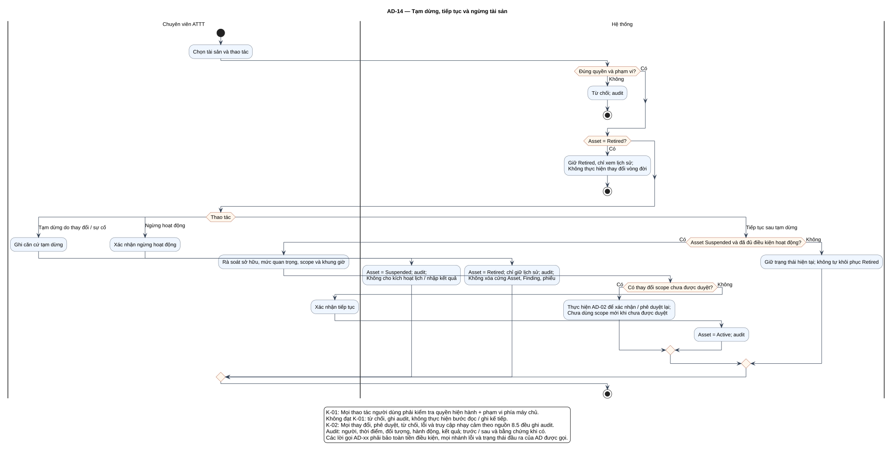

# AD-14 — Tạm dừng, tiếp tục và ngừng tài sản

## 1. Mục đích và phạm vi

**Mục đích:** Giải thích luồng “Tạm dừng, tiếp tục và ngừng tài sản” đúng theo sơ đồ và giữ ranh giới bốn chức năng nguồn.

| Thuộc tính | Nội dung |
|---|---|
| ID | `AD-14` |
| Nguồn | Mục 5.1.2–5.1.3; 8.5–8.6 của `doi_tuong_sd_quy_trinh_hd.md` |
| Điều kiện vào | ATTT có quyền trên tài sản; không định nghĩa thêm trạng thái. |
| Kết quả/hậu điều kiện | Suspended/Retired hoặc Active sau kiểm tra lại; lịch sử được bảo toàn. |
| Use Case liên quan | [UC-A02](../tai_lieu_use_case/UC-A02_cap_nhat_thong_tin_tai_san.md), [UC-A05](../tai_lieu_use_case/UC-A05_tam_dung_tai_san.md), [UC-A06](../tai_lieu_use_case/UC-A06_ngung_hoat_dong_tai_san.md) |
| Mã sơ đồ | [Markdown](../visual_paradigm_uml_md/15_activity_vong_doi_tai_san.md) · [PlantUML](../visual_paradigm_uml_md/plantuml/15_activity_vong_doi_tai_san.puml) |

## 2. Swimlane và trách nhiệm

- **Chuyên viên ATTT:** thực hiện các hành động nằm trong swimlane; không kế thừa quyền quyết định của lane khác.
- **Hệ thống:** thực hiện các hành động nằm trong swimlane; không kế thừa quyền quyết định của lane khác.

Lane **Hệ thống** biểu diễn xử lý nội bộ, không phải actor. Khi một lane ghép nhiều vai trò bằng dấu `/`, chỉ vai trò thỏa guard/trạng thái của nhánh mới thực hiện. ZAP luôn do nhóm vận hành dùng bên ngoài; hành động “khắc phục” cũng xảy ra ngoài hệ thống quản lý, hệ thống chỉ ghi nhận tiến độ/evidence.

## 3. Luồng chi tiết theo sơ đồ

| Bước | Swimlane | Hành động/ý nghĩa |
|---:|---|---|
| 1 | Chuyên viên ATTT | Chọn tài sản và thao tác |
| 2 | Hệ thống | Từ chối; audit |
| 3 | Hệ thống | Giữ Retired, chỉ xem lịch sử; Không thực hiện thay đổi vòng đời |
| 4 | Chuyên viên ATTT | Ghi căn cứ tạm dừng |
| 5 | Hệ thống | Asset = Suspended; audit; Không cho kích hoạt lịch / nhập kết quả |
| 6 | Chuyên viên ATTT | Xác nhận ngừng hoạt động |
| 7 | Hệ thống | Asset = Retired; chỉ giữ lịch sử; audit; Không xóa cứng Asset, Finding, phiếu |
| 8 | Chuyên viên ATTT | Rà soát sở hữu, mức quan trọng, scope và khung giờ |
| 9 | Hệ thống | Thực hiện AD-02 để xác nhận / phê duyệt lại; Chưa dùng scope mới khi chưa được duyệt |
| 10 | Chuyên viên ATTT | Xác nhận tiếp tục |
| 11 | Hệ thống | Asset = Active; audit |
| 12 | Hệ thống | Giữ trạng thái hiện tại; không tự khôi phục Retired |

Thứ tự trên phản ánh các action trong PlantUML. Khi gặp decision/loop ở mục 4, chỉ đi theo nhánh có guard đúng; action sau điểm hợp nhất chỉ được thực hiện nếu nhánh trước cho phép tiếp tục. Lời gọi `AD-xx` giữ toàn bộ tiền điều kiện, nhánh lỗi và hậu điều kiện của Activity được gọi.

## 4. Điểm quyết định, nhánh và vòng lặp

| STT | Loại | Điều kiện/giá trị kiểm tra | Nhánh thể hiện |
|---:|---|---|---|
| 1 | Decision | Đúng quyền và phạm vi? | Có |
| 2 | Else | Nhánh còn lại | Không |
| 3 | Decision | Asset = Retired? | Có |
| 4 | Switch | Thao tác | các case |
| 5 | Case | Giá trị thao tác | Tạm dừng do thay đổi / sự cố |
| 6 | Case | Giá trị thao tác | Ngừng hoạt động |
| 7 | Case | Giá trị thao tác | Tiếp tục sau tạm dừng |
| 8 | Decision | Asset Suspended và đã đủ điều kiện hoạt động? | Có |
| 9 | Decision | Có thay đổi scope chưa được duyệt? | Có |
| 10 | Else | Nhánh còn lại | Không |
| 11 | Else | Nhánh còn lại | Không |

- Nhánh “Không” không được hiểu là thành công khi dữ liệu thiếu hoặc thao tác bị từ chối.
- Vòng lặp bổ sung chỉ thoát sau khi kiểm tra lại đạt; yêu cầu bổ sung rủi ro phải quay lại người duyệt.
- Với Activity chạy theo sự kiện/kỳ kiểm tra, một nút kết thúc chỉ kết thúc lần đánh giá hiện tại, không hủy việc theo dõi các kỳ sau.

## 5. Dữ liệu và trạng thái bị tác động

| Bước | Swimlane | Ghi nhận/thay đổi |
|---:|---|---|
| 3 | Hệ thống | Giữ Retired, chỉ xem lịch sử; Không thực hiện thay đổi vòng đời |
| 4 | Chuyên viên ATTT | Ghi căn cứ tạm dừng |
| 5 | Hệ thống | Asset = Suspended; audit; Không cho kích hoạt lịch / nhập kết quả |
| 7 | Hệ thống | Asset = Retired; chỉ giữ lịch sử; audit; Không xóa cứng Asset, Finding, phiếu |
| 11 | Hệ thống | Asset = Active; audit |
| 12 | Hệ thống | Giữ trạng thái hiện tại; không tự khôi phục Retired |

Mọi cạnh chuyển Finding phải thuộc bảng nguồn mục 7.2. Danh sách trạng thái Asset/Schedule/Occurrence/ImportBatch không được đọc thành chuỗi chuyển bắt buộc. Không hard delete dữ liệu truy vết.

## 6. Ngoại lệ và kiểm soát

- Sai quyền/phạm vi: từ chối theo K-01 và audit; không tiếp tục action đọc/ghi.
- Sai trạng thái/đầu vào: giữ dữ liệu đang có, trả lỗi hoặc yêu cầu bổ sung theo nhánh của hình.
- Lỗi/từ chối/chuyển trạng thái/truy cập nhạy cảm: audit theo K-02, kể cả khi nhánh kết thúc sớm.
- Dữ liệu bí mật được masking ở giao diện/bản xuất; RawReport bất biến và kiểm tra toàn vẹn.
- Activity không tạo tích hợp ZAP API, email, SSO, BI, CI/CD, kho mã hoặc ticket ngoài.

## 7. Cách đọc và kiểm tra hình

1. Bắt đầu tại nút đen, xác định lane đang chịu trách nhiệm.
2. Đọc action từ trên xuống cho tới decision; chọn guard đúng và không bỏ qua nhánh lỗi.
3. Tại vòng lặp, quay lại đúng điểm kiểm tra; không đi tới hậu điều kiện khi còn thiếu dữ liệu.
4. Đối chiếu action đổi trạng thái với mục 5 và tài liệu UC liên kết.
5. Kết thúc tại nút đích; kiểm tra hậu điều kiện ở mục 1 đã đạt.

**Điểm kiểm tra chính:** Suspended/Retired hoặc Active sau kiểm tra lại; lịch sử được bảo toàn.
