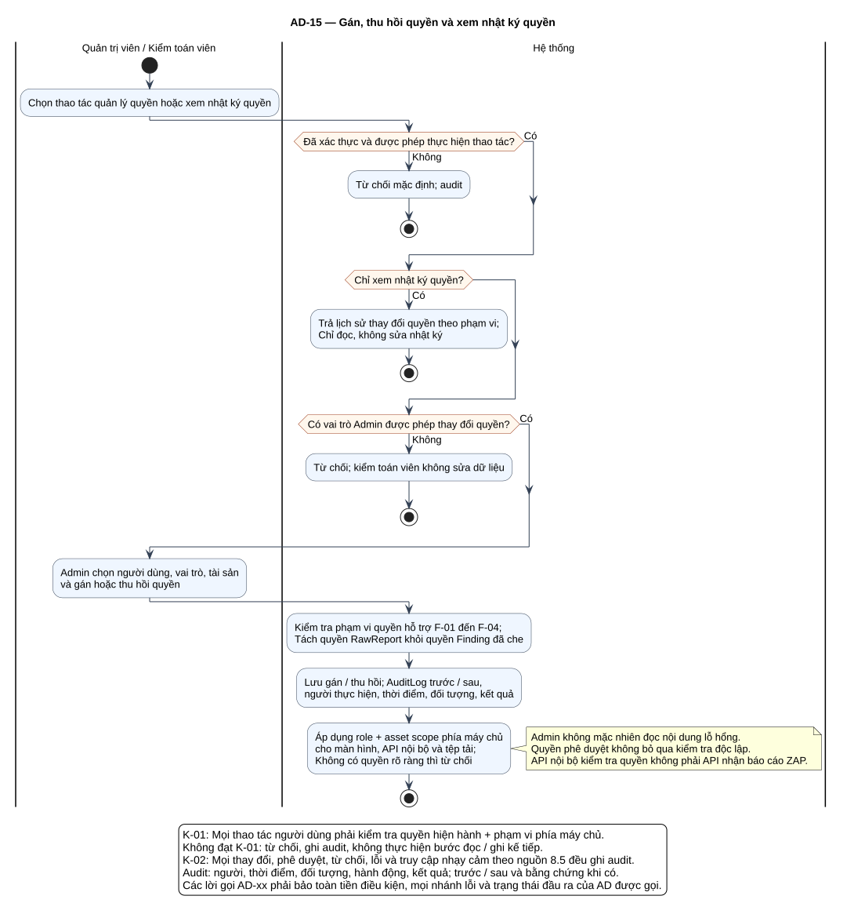

# AD-15 — Gán, thu hồi quyền và xem nhật ký quyền

## 1. Mục đích và phạm vi

**Mục đích:** Giải thích luồng “Gán, thu hồi quyền và xem nhật ký quyền” đúng theo sơ đồ và giữ ranh giới bốn chức năng nguồn.

| Thuộc tính | Nội dung |
|---|---|
| ID | `AD-15` |
| Nguồn | Mục 3.2–3.4; 8.2; 8.5 của `doi_tuong_sd_quy_trinh_hd.md` |
| Điều kiện vào | Admin quản trị quyền; kiểm toán xem nhật ký theo quyền. |
| Kết quả/hậu điều kiện | Thay đổi quyền có audit; mọi truy cập dữ liệu sau đó đánh giá quyền hiện hành. |
| Use Case liên quan | [UC-C01](../tai_lieu_use_case/UC-C01_gan_vai_tro_va_pham_vi_tai_san.md), [UC-C02](../tai_lieu_use_case/UC-C02_thu_hoi_quyen.md), [UC-C03](../tai_lieu_use_case/UC-C03_xem_nhat_ky_thay_doi_quyen.md), [UC-C07](../tai_lieu_use_case/UC-C07_ghi_nhat_ky_hanh_dong_nhay_cam.md) |
| Mã sơ đồ | [Markdown](../visual_paradigm_uml_md/16_activity_phan_quyen.md) · [PlantUML](../visual_paradigm_uml_md/plantuml/16_activity_phan_quyen.puml) |

## 2. Swimlane và trách nhiệm

- **Quản trị viên / Kiểm toán viên:** thực hiện các hành động nằm trong swimlane; không kế thừa quyền quyết định của lane khác.
- **Hệ thống:** thực hiện các hành động nằm trong swimlane; không kế thừa quyền quyết định của lane khác.

Lane **Hệ thống** biểu diễn xử lý nội bộ, không phải actor. Khi một lane ghép nhiều vai trò bằng dấu `/`, chỉ vai trò thỏa guard/trạng thái của nhánh mới thực hiện. ZAP luôn do nhóm vận hành dùng bên ngoài; hành động “khắc phục” cũng xảy ra ngoài hệ thống quản lý, hệ thống chỉ ghi nhận tiến độ/evidence.

## 3. Luồng chi tiết theo sơ đồ

| Bước | Swimlane | Hành động/ý nghĩa |
|---:|---|---|
| 1 | Quản trị viên / Kiểm toán viên | Chọn thao tác quản lý quyền hoặc xem nhật ký quyền |
| 2 | Hệ thống | Từ chối mặc định; audit |
| 3 | Hệ thống | Trả lịch sử thay đổi quyền theo phạm vi; Chỉ đọc, không sửa nhật ký |
| 4 | Hệ thống | Từ chối; kiểm toán viên không sửa dữ liệu |
| 5 | Quản trị viên / Kiểm toán viên | Admin chọn người dùng, vai trò, tài sản và gán hoặc thu hồi quyền |
| 6 | Hệ thống | Kiểm tra phạm vi quyền hỗ trợ F-01 đến F-04; Tách quyền RawReport khỏi quyền Finding đã che |
| 7 | Hệ thống | Lưu gán / thu hồi; AuditLog trước / sau, người thực hiện, thời điểm, đối tượng, kết quả |
| 8 | Hệ thống | Áp dụng role + asset scope phía máy chủ cho màn hình, API nội bộ và tệp tải; Không có quyền rõ ràng thì từ chối |

Thứ tự trên phản ánh các action trong PlantUML. Khi gặp decision/loop ở mục 4, chỉ đi theo nhánh có guard đúng; action sau điểm hợp nhất chỉ được thực hiện nếu nhánh trước cho phép tiếp tục. Lời gọi `AD-xx` giữ toàn bộ tiền điều kiện, nhánh lỗi và hậu điều kiện của Activity được gọi.

## 4. Điểm quyết định, nhánh và vòng lặp

| STT | Loại | Điều kiện/giá trị kiểm tra | Nhánh thể hiện |
|---:|---|---|---|
| 1 | Decision | Đã xác thực và được phép thực hiện thao tác? | Có |
| 2 | Else | Nhánh còn lại | Không |
| 3 | Decision | Chỉ xem nhật ký quyền? | Có |
| 4 | Decision | Có vai trò Admin được phép thay đổi quyền? | Có |
| 5 | Else | Nhánh còn lại | Không |

- Nhánh “Không” không được hiểu là thành công khi dữ liệu thiếu hoặc thao tác bị từ chối.
- Vòng lặp bổ sung chỉ thoát sau khi kiểm tra lại đạt; yêu cầu bổ sung rủi ro phải quay lại người duyệt.
- Với Activity chạy theo sự kiện/kỳ kiểm tra, một nút kết thúc chỉ kết thúc lần đánh giá hiện tại, không hủy việc theo dõi các kỳ sau.

## 5. Dữ liệu và trạng thái bị tác động

| Bước | Swimlane | Ghi nhận/thay đổi |
|---:|---|---|
| 5 | Quản trị viên / Kiểm toán viên | Admin chọn người dùng, vai trò, tài sản và gán hoặc thu hồi quyền |
| 7 | Hệ thống | Lưu gán / thu hồi; AuditLog trước / sau, người thực hiện, thời điểm, đối tượng, kết quả |
| 8 | Hệ thống | Áp dụng role + asset scope phía máy chủ cho màn hình, API nội bộ và tệp tải; Không có quyền rõ ràng thì từ chối |

Mọi cạnh chuyển Finding phải thuộc bảng nguồn mục 7.2. Danh sách trạng thái Asset/Schedule/Occurrence/ImportBatch không được đọc thành chuỗi chuyển bắt buộc. Không hard delete dữ liệu truy vết.

## 6. Ngoại lệ và kiểm soát

- Sai quyền/phạm vi: từ chối theo K-01 và audit; không tiếp tục action đọc/ghi.
- Sai trạng thái/đầu vào: giữ dữ liệu đang có, trả lỗi hoặc yêu cầu bổ sung theo nhánh của hình.
- Lỗi/từ chối/chuyển trạng thái/truy cập nhạy cảm: audit theo K-02, kể cả khi nhánh kết thúc sớm.
- Dữ liệu bí mật được masking ở giao diện/bản xuất; RawReport bất biến và kiểm tra toàn vẹn.
- Activity không tạo tích hợp ZAP API, email, SSO, BI, CI/CD, kho mã hoặc ticket ngoài.

## 7. Cách đọc và kiểm tra hình

1. Bắt đầu tại nút đen, xác định lane đang chịu trách nhiệm.
2. Đọc action từ trên xuống cho tới decision; chọn guard đúng và không bỏ qua nhánh lỗi.
3. Tại vòng lặp, quay lại đúng điểm kiểm tra; không đi tới hậu điều kiện khi còn thiếu dữ liệu.
4. Đối chiếu action đổi trạng thái với mục 5 và tài liệu UC liên kết.
5. Kết thúc tại nút đích; kiểm tra hậu điều kiện ở mục 1 đã đạt.

**Điểm kiểm tra chính:** Thay đổi quyền có audit; mọi truy cập dữ liệu sau đó đánh giá quyền hiện hành.
