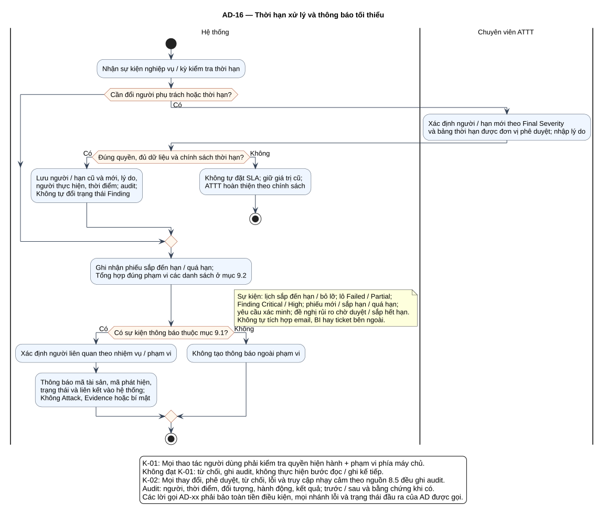

# AD-16 — Thời hạn xử lý và thông báo tối thiểu

## 1. Mục đích và phạm vi

**Mục đích:** Giải thích luồng “Thời hạn xử lý và thông báo tối thiểu” đúng theo sơ đồ và giữ ranh giới bốn chức năng nguồn.

| Thuộc tính | Nội dung |
|---|---|
| ID | `AD-16` |
| Nguồn | Mục 5.4.2; 6.5; 9 của `doi_tuong_sd_quy_trinh_hd.md` |
| Điều kiện vào | Sự kiện phân công, đổi severity/hạn hoặc kỳ kiểm tra dữ liệu nghiệp vụ. |
| Kết quả/hậu điều kiện | Hạn theo chính sách đơn vị, có lịch sử; thông báo chỉ gồm dữ liệu tối thiểu. |
| Use Case liên quan | [UC-R12](../tai_lieu_use_case/UC-R12_theo_doi_han_xu_ly.md), [UC-R13](../tai_lieu_use_case/UC-R13_dieu_chinh_phan_cong_hoac_thoi_han.md), [UC-RA05](../tai_lieu_use_case/UC-RA05_theo_doi_ngay_het_han.md), [UC-C08](../tai_lieu_use_case/UC-C08_nhan_thong_bao_nghiep_vu.md) |
| Mã sơ đồ | [Markdown](../visual_paradigm_uml_md/17_activity_thoi_han_thong_bao.md) · [PlantUML](../visual_paradigm_uml_md/plantuml/17_activity_thoi_han_thong_bao.puml) |

## 2. Swimlane và trách nhiệm

- **Hệ thống:** thực hiện các hành động nằm trong swimlane; không kế thừa quyền quyết định của lane khác.
- **Chuyên viên ATTT:** thực hiện các hành động nằm trong swimlane; không kế thừa quyền quyết định của lane khác.

Lane **Hệ thống** biểu diễn xử lý nội bộ, không phải actor. Khi một lane ghép nhiều vai trò bằng dấu `/`, chỉ vai trò thỏa guard/trạng thái của nhánh mới thực hiện. ZAP luôn do nhóm vận hành dùng bên ngoài; hành động “khắc phục” cũng xảy ra ngoài hệ thống quản lý, hệ thống chỉ ghi nhận tiến độ/evidence.

## 3. Luồng chi tiết theo sơ đồ

| Bước | Swimlane | Hành động/ý nghĩa |
|---:|---|---|
| 1 | Hệ thống | Nhận sự kiện nghiệp vụ / kỳ kiểm tra thời hạn |
| 2 | Chuyên viên ATTT | Xác định người / hạn mới theo Final Severity và bảng thời hạn được đơn vị phê duyệt; nhập lý do |
| 3 | Hệ thống | Lưu người / hạn cũ và mới, lý do, người thực hiện, thời điểm; audit; Không tự đổi trạng thái Finding |
| 4 | Hệ thống | Không tự đặt SLA; giữ giá trị cũ; ATTT hoàn thiện theo chính sách |
| 5 | Hệ thống | Ghi nhận phiếu sắp đến hạn / quá hạn; Tổng hợp đúng phạm vi các danh sách ở mục 9.2 |
| 6 | Hệ thống | Xác định người liên quan theo nhiệm vụ / phạm vi |
| 7 | Hệ thống | Thông báo mã tài sản, mã phát hiện, trạng thái và liên kết vào hệ thống; Không Attack, Evidence hoặc bí mật |
| 8 | Hệ thống | Không tạo thông báo ngoài phạm vi |

Thứ tự trên phản ánh các action trong PlantUML. Khi gặp decision/loop ở mục 4, chỉ đi theo nhánh có guard đúng; action sau điểm hợp nhất chỉ được thực hiện nếu nhánh trước cho phép tiếp tục. Lời gọi `AD-xx` giữ toàn bộ tiền điều kiện, nhánh lỗi và hậu điều kiện của Activity được gọi.

## 4. Điểm quyết định, nhánh và vòng lặp

| STT | Loại | Điều kiện/giá trị kiểm tra | Nhánh thể hiện |
|---:|---|---|---|
| 1 | Decision | Cần đổi người phụ trách hoặc thời hạn? | Có |
| 2 | Decision | Đúng quyền, đủ dữ liệu và chính sách thời hạn? | Có |
| 3 | Else | Nhánh còn lại | Không |
| 4 | Decision | Có sự kiện thông báo thuộc mục 9.1? | Có |
| 5 | Else | Nhánh còn lại | Không |

- Nhánh “Không” không được hiểu là thành công khi dữ liệu thiếu hoặc thao tác bị từ chối.
- Vòng lặp bổ sung chỉ thoát sau khi kiểm tra lại đạt; yêu cầu bổ sung rủi ro phải quay lại người duyệt.
- Với Activity chạy theo sự kiện/kỳ kiểm tra, một nút kết thúc chỉ kết thúc lần đánh giá hiện tại, không hủy việc theo dõi các kỳ sau.

## 5. Dữ liệu và trạng thái bị tác động

| Bước | Swimlane | Ghi nhận/thay đổi |
|---:|---|---|
| 3 | Hệ thống | Lưu người / hạn cũ và mới, lý do, người thực hiện, thời điểm; audit; Không tự đổi trạng thái Finding |
| 5 | Hệ thống | Ghi nhận phiếu sắp đến hạn / quá hạn; Tổng hợp đúng phạm vi các danh sách ở mục 9.2 |
| 7 | Hệ thống | Thông báo mã tài sản, mã phát hiện, trạng thái và liên kết vào hệ thống; Không Attack, Evidence hoặc bí mật |
| 8 | Hệ thống | Không tạo thông báo ngoài phạm vi |

Mọi cạnh chuyển Finding phải thuộc bảng nguồn mục 7.2. Danh sách trạng thái Asset/Schedule/Occurrence/ImportBatch không được đọc thành chuỗi chuyển bắt buộc. Không hard delete dữ liệu truy vết.

## 6. Ngoại lệ và kiểm soát

- Sai quyền/phạm vi: từ chối theo K-01 và audit; không tiếp tục action đọc/ghi.
- Sai trạng thái/đầu vào: giữ dữ liệu đang có, trả lỗi hoặc yêu cầu bổ sung theo nhánh của hình.
- Lỗi/từ chối/chuyển trạng thái/truy cập nhạy cảm: audit theo K-02, kể cả khi nhánh kết thúc sớm.
- Dữ liệu bí mật được masking ở giao diện/bản xuất; RawReport bất biến và kiểm tra toàn vẹn.
- Activity không tạo tích hợp ZAP API, email, SSO, BI, CI/CD, kho mã hoặc ticket ngoài.

## 7. Cách đọc và kiểm tra hình

1. Bắt đầu tại nút đen, xác định lane đang chịu trách nhiệm.
2. Đọc action từ trên xuống cho tới decision; chọn guard đúng và không bỏ qua nhánh lỗi.
3. Tại vòng lặp, quay lại đúng điểm kiểm tra; không đi tới hậu điều kiện khi còn thiếu dữ liệu.
4. Đối chiếu action đổi trạng thái với mục 5 và tài liệu UC liên kết.
5. Kết thúc tại nút đích; kiểm tra hậu điều kiện ở mục 1 đã đạt.

**Điểm kiểm tra chính:** Hạn theo chính sách đơn vị, có lịch sử; thông báo chỉ gồm dữ liệu tối thiểu.
