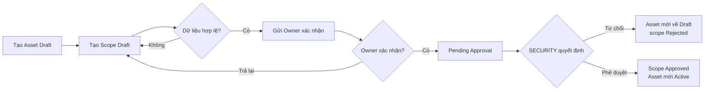
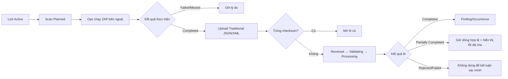
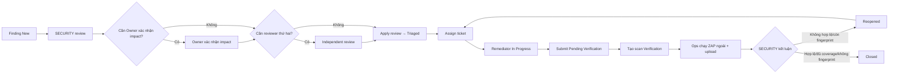
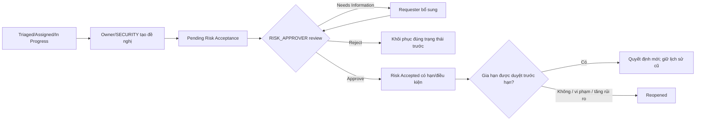

# Sitemap và user flow

## 1. Sitemap theo quyền

```mermaid
flowchart TD
  ROOT[Ứng dụng HTQLHDK] --> WORK[Công việc của tôi]
  ROOT --> AST[Tài sản]
  ROOT --> SCH[Lịch & lần quét]
  ROOT --> IMP[Lô nhập ZAP]
  ROOT --> FND[Phát hiện]
  ROOT --> TKT[Phiếu khắc phục]
  ROOT --> VER[Xác minh]
  ROOT --> RSK[Chấp nhận rủi ro]
  ROOT --> RPT[Báo cáo xuất]
  ROOT --> NTF[Thông báo]
  ROOT --> AUD[Nhật ký]
  ROOT --> ACC[Quyền truy cập]

  AST --> ASTL[Danh sách]
  AST --> ASTD[Chi tiết · Scope · Khung giờ · Lịch sử]
  SCH --> SCHL[Lịch]
  SCH --> SCAN[Các lần quét]
  IMP --> IMPL[Lô nhập]
  IMP --> IMPD[Tiến trình · Thống kê · Lỗi đã che · Bản gốc]
  FND --> FNDL[Worklist]
  FND --> FNDD[Tổng quan · Nguồn · Occurrence · Review · Lịch sử]
  TKT --> TKTL[Danh sách theo hạn]
  TKT --> TKTD[Hiện hành · Tiến độ · Evidence · Lịch sử]
  VER --> VERL[Yêu cầu]
  VER --> VERD[Scan/import · Coverage · Kết luận]
  RSK --> RSKL[Chờ duyệt · Sắp hết hạn]
  RSK --> RSKD[Đề nghị · Quyết định · Gia hạn]
  RPT --> RPTL[Danh sách phát hành]
  RPT --> RPTD[Metadata · Tải · Thu hồi]
  AUD --> AUDP[Quyền — ADMIN/AUDITOR]
  AUD --> AUDB[Nghiệp vụ — SECURITY/AUDITOR]
```

Điều hướng không hiển thị nhánh mà người dùng không có ít nhất một permission liên quan. Khi mất quyền trong phiên, route đang mở chuyển sang màn hình “Không thể truy cập” an toàn và xóa dữ liệu nhạy cảm khỏi state phía client.

## 2. User flow F-01 — Asset và scope

Với Asset đang Active, scope mới chưa duyệt không thay scope hiện hành. UI luôn hiển thị hai nhãn “Đang áp dụng” và “Đề nghị” để tránh nhầm.

## 3. User flow F-02/F-03 — Quét ngoài và nhập kết quả

Màn upload không có nút “Chạy ZAP”. Trong trạng thái xử lý, người dùng có thể rời trang; thông báo tối thiểu dẫn về lô khi có kết quả.

## 4. User flow F-04 — Triaged đến Closed/Reopened

Dialog Closed không cho nhập boolean tùy ý. UI hiển thị dữ liệu đã tính từ scan/import và yêu cầu SECURITY xác nhận căn cứ; backend vẫn kiểm lại toàn bộ.

## 5. User flow Risk Acceptance

## 6. Luồng ngoại lệ dùng chung

- `401`: chuyển tới đăng nhập; sau đăng nhập quay về internal path đã kiểm an toàn.
- `403/404` ngoài phạm vi: cùng một màn hình “Không thể truy cập tài nguyên”, không tiết lộ ID có tồn tại.
- `412 CON-002`: giữ nội dung người dùng trong form, hiển thị phiên bản mới cạnh bản đang sửa và yêu cầu tải lại/nhập lại có chủ ý; không có nút “ghi đè”.
- `409 STATE-001`: refresh trạng thái, giải thích action vừa không còn hợp lệ và đưa về chi tiết.
- `IMP-004`: banner “Báo cáo đã được nhập trước đó”, liên kết lô cũ; không báo như lỗi.
- `Partially Completed`: tách rõ số dòng thành công/lỗi; cảnh báo không dùng để kết luận vắng fingerprint khi coverage chưa đủ.
- `AUDIT-001/503`: action chưa hoàn tất; không hiển thị thành công giả. Cho retry với cùng Idempotency-Key khi API cho phép.
