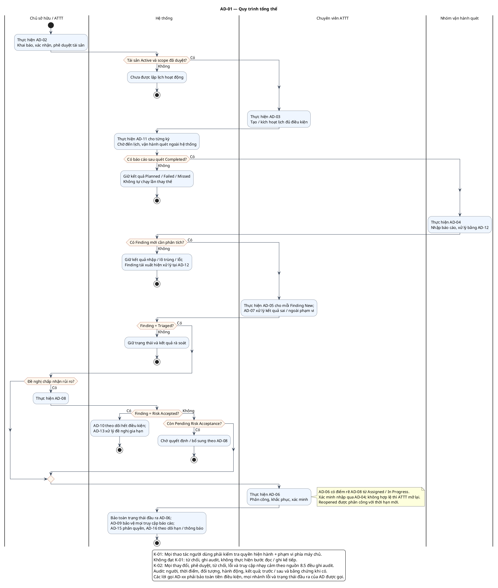

# AD-01 — Quy trình tổng thể

**Nguồn:** mục 4; 7; 8 của tài liệu nguồn.

**Điều kiện vào:** Bắt đầu quản lý tài sản hoặc tiếp tục từ quy trình con tương ứng.

**Kết quả:** Kết quả từng quy trình con được bảo toàn; không bỏ qua guard khi nối luồng.

**Truy vết UC:** UC-C07.

