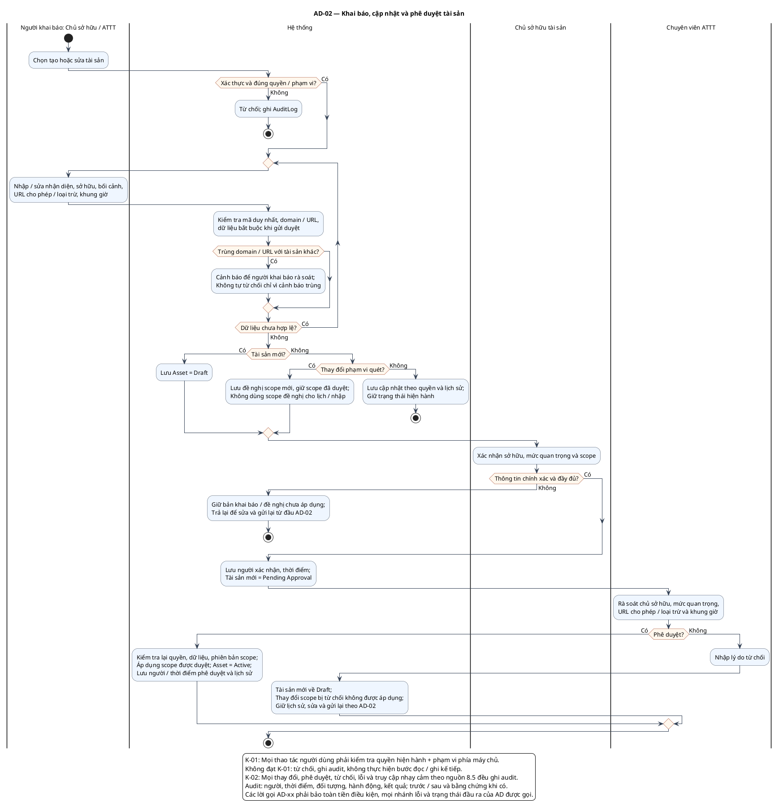

# AD-02 — Khai báo, cập nhật và phê duyệt tài sản

**Nguồn:** mục 4; 5.1; 8.5 của tài liệu nguồn.

**Điều kiện vào:** Chủ sở hữu hoặc ATTT có quyền khai báo/cập nhật; tài sản ngừng hoạt động xử lý AD-14.

**Kết quả:** Draft/Pending Approval/Active; scope mới chỉ được áp dụng khi ATTT duyệt.

**Truy vết UC:** UC-A01, UC-A02, UC-A03, UC-A04.

