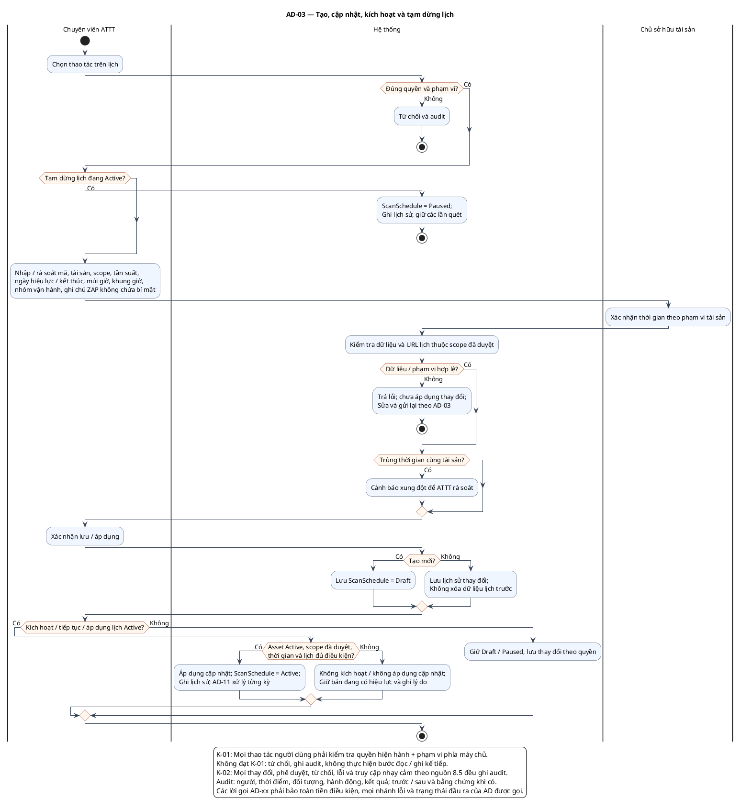

# AD-03 — Tạo, cập nhật, kích hoạt và tạm dừng lịch

**Nguồn:** mục 3.3; 5.2; 8.5 của tài liệu nguồn.

**Điều kiện vào:** ATTT có quyền quản lý lịch theo tài sản.

**Kết quả:** Draft/Active/Paused; lần quét được xử lý ở AD-11.

**Truy vết UC:** UC-S01, UC-S02, UC-S03, UC-S04, UC-S08.

