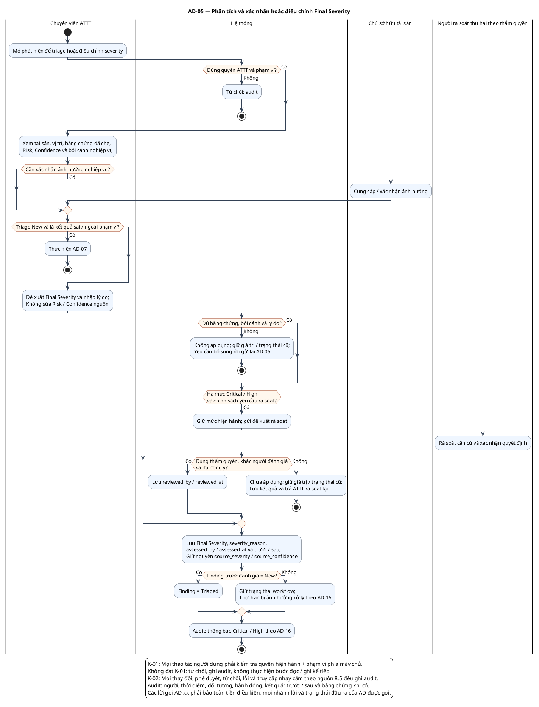

# AD-05 — Phân tích và xác nhận hoặc điều chỉnh Final Severity

**Nguồn:** mục 6; 7.2–7.3 của tài liệu nguồn.

**Điều kiện vào:** ATTT có quyền; New khi triage, hoặc Finding đã đánh giá khi điều chỉnh mức độ.

**Kết quả:** New → Triaged chỉ sau xác nhận hợp lệ; điều chỉnh severity không tự đổi trạng thái workflow.

**Truy vết UC:** UC-T01, UC-T02, UC-T05.

