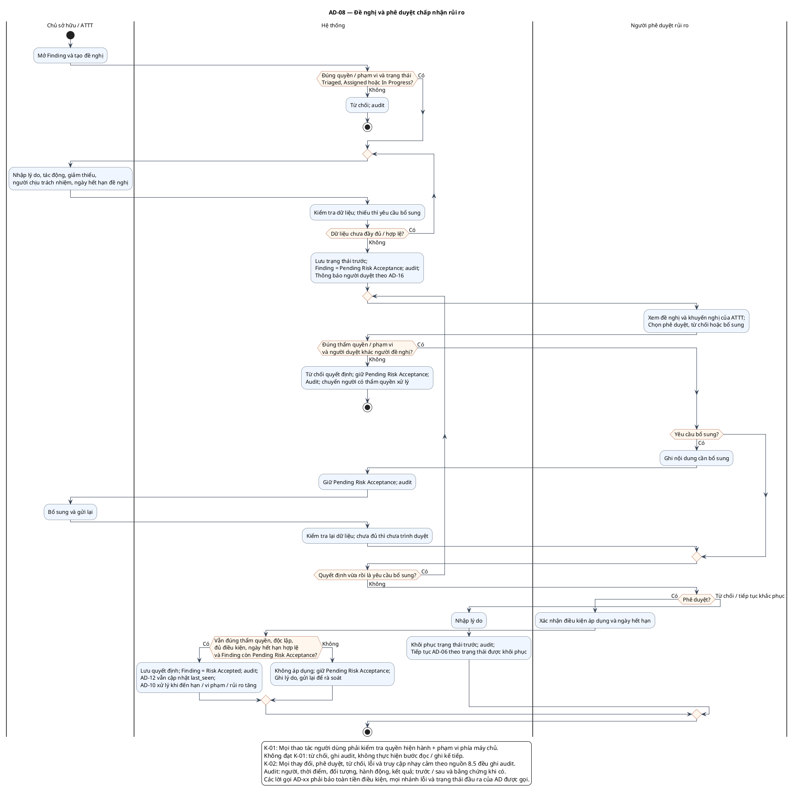

# AD-08 — Đề nghị và phê duyệt chấp nhận rủi ro

**Nguồn:** mục 3.4; 7.2; 7.4 của tài liệu nguồn.

**Điều kiện vào:** Chủ tài sản/ATTT đề nghị từ Triaged, Assigned hoặc In Progress.

**Kết quả:** Risk Accepted hoặc khôi phục trạng thái trước; bổ sung chưa quyết định thì vẫn Pending Risk Acceptance.

**Truy vết UC:** UC-RA01, UC-RA02, UC-RA03, UC-RA04.

