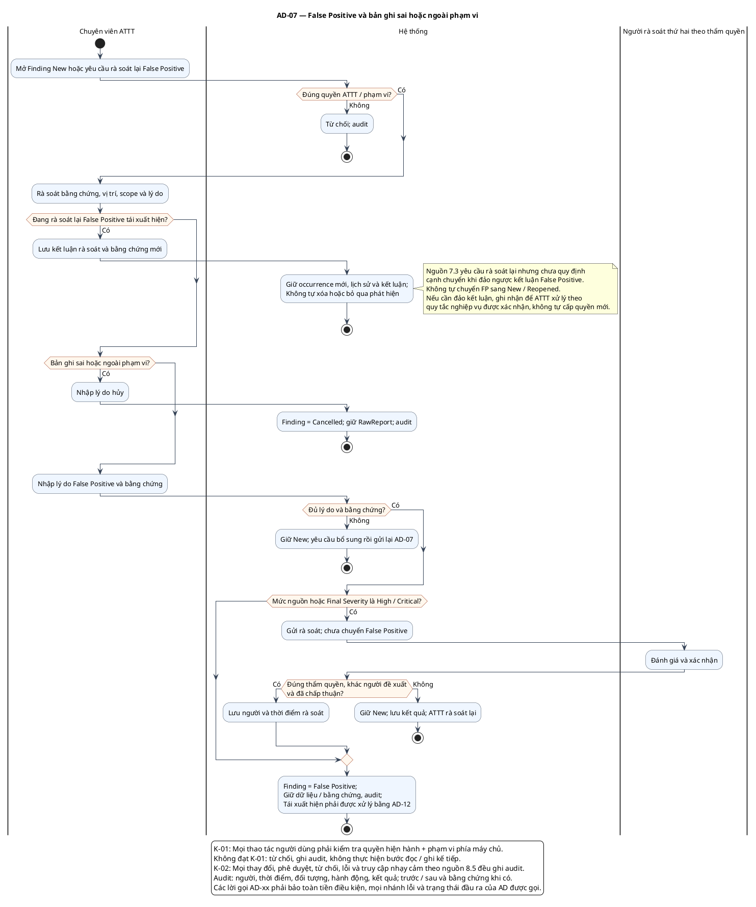

# AD-07 — False Positive và bản ghi sai hoặc ngoài phạm vi

**Nguồn:** mục 7.2–7.3; 8.5 của tài liệu nguồn.

**Điều kiện vào:** ATTT xử lý Finding New; hoặc rà soát lại False Positive tái xuất hiện.

**Kết quả:** New → False Positive/Cancelled theo nguồn; tái rà soát không tự bỏ qua hoặc thêm cạnh trạng thái mới.

**Truy vết UC:** UC-T03, UC-T04.

