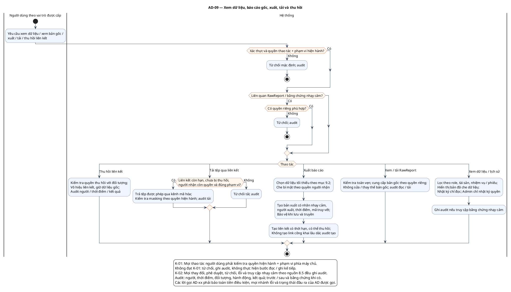

# AD-09 — Xem dữ liệu, báo cáo gốc, xuất, tải và thu hồi

**Nguồn:** mục 3.3; 8; 9.2 của tài liệu nguồn.

**Điều kiện vào:** Người dùng đã được gán quyền cụ thể; quyền RawReport tách riêng.

**Kết quả:** Chỉ trả dữ liệu đúng phạm vi; bản gốc bất biến; mọi truy cập nhạy cảm và tạo/tải/thu hồi có audit.

**Truy vết UC:** UC-A07, UC-I07, UC-I12, UC-T06, UC-C03, UC-C04, UC-C05, UC-C06, UC-C07, UC-C09, UC-C10.

